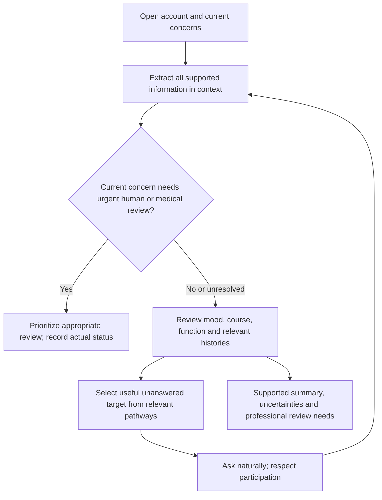

# 09 — Adult depression: alternatives and coexisting-condition assessment knowledge

Version: 1.0.0-source-reviewed. Date: 2 November 2026. Adults 18+, including older adults.

## Purpose

This package records what to recognize, clarify, extract and hand off when another condition may explain or coexist with a depressive presentation. It covers the focused alternative pathways agreed in our adult coverage map. It does not claim to diagnose/manage every psychiatric or medical condition, replace professional examination, or finish the shared question graph. Each pathway has its own purpose, practical benefit, information needs, follow-ups, limits and sources.

Alternative does not necessarily mean mutually exclusive. Depression can coexist with anxiety, PTSD, grief, substance use or medical illness. A person's current low mood also does not determine whether their lifetime illness is unipolar or bipolar. Missing information, decline and a reported prior label must remain distinct from clinical confirmation.

## Coverage and purpose map

| Pathway | Why collect it? | Benefit for our assessment |
|---|---|---|
| [Bipolar I, bipolar II and cyclothymic/other bipolar-spectrum presentations](Alternatives/01_bipolar_spectrum.md) | Check whether a depressive presentation belongs to an illness with lifetime mania, hypomania or sustained subthreshold activation. | Avoid summarizing depression as unipolar MDD while relevant activation history is missing; provide an interpretable specialist handoff. |
| [Anxiety presentations: generalized worry, panic and social anxiety](Alternatives/02_anxiety.md) | Determine whether worry, fear, panic or avoidance explains part of the presentation or coexists with depression. | Distinguish overlapping sleep/fatigue/concentration complaints and reasons for withdrawal; avoid treating every worry or panic attack as a depressive symptom. |
| [PTSD and other trauma-related presentations](Alternatives/03_trauma.md) | Check whether trauma-linked symptoms contribute to low mood, withdrawal, guilt, numbing or sleep difficulties. | Preserve the event relationship and avoid either missing trauma effects or assuming every stressful event causes PTSD. |
| [Adjustment disorder and ordinary stress responses](Alternatives/04_adjustment.md) | Examine symptoms linked to a stressor without treating every stress reaction as MDD or adjustment disorder. | Record stressor timing and continuing consequences, burden and competing full syndromes; avoid an automatic residual-depression label. |
| [Ordinary grief and prolonged grief disorder](Alternatives/05_grief.md) | Understand a bereavement response, identify loss-specific persistent difficulties and assess possible coexisting depression. | Avoid pathologizing normal grief, missing PGD or treating all bereavement-related sadness as one depressive diagnosis. |
| [Psychotic experiences, mood disorders with psychosis and schizoaffective alternatives](Alternatives/06_psychosis.md) | Clarify unusual experiences and their relationship to mood episodes, exposures and medical context. | Avoid confusing psychotic depression with a primary psychotic disorder, trauma phenomena, cultural experiences or delirium. |
| [Delirium and acute medical/cognitive change](Alternatives/07_delirium.md) | Recognize acute/fluctuating attention or awareness changes that should interrupt routine psychiatric questioning. | Avoid treating a potentially urgent medical syndrome as ordinary depressive poor concentration or lack of engagement. |
| [Cognitive decline and possible neurocognitive disorder](Alternatives/08_neurocognitive.md) | Understand longer-term decline, daily functioning and contributors while separating acute change from chronic symptoms. | Avoid both labelling depressive concentration problems as dementia and dismissing genuine cognitive decline as depression. |
| [Insomnia, sleep-disordered breathing and schedule-related problems](Alternatives/09_sleep.md) | Determine whether sleep opportunity, insomnia, breathing disruption or schedule mismatch contributes to mood, fatigue and cognition. | Avoid attributing every sleep complaint to depression and distinguish fatigue/sleepiness from reduced sleep need. |
| [Medical conditions and depressive symptoms](Alternatives/10_medical.md) | Identify reported illness, relevant investigations and physiological-cause versus comorbidity/stress/treatment possibilities. | Avoid a premature unipolar explanation and provide a traceable medical-review handoff without diagnosing physical illness from chat. |
| [Substance, medication, intoxication and withdrawal-related presentations](Alternatives/11_substance_medication.md) | Clarify actual exposures and changes that may contribute to mood, anxiety, sleep, psychosis or cognition. | Prevent causal assumptions, identify relevant medical withdrawal concerns and separate independent depressive history from exposure timing. |

## What was built

Each numbered pathway has a readable Markdown file. Its machine-readable pathway record is stored once in shared `knowledge.json` under `pathways`; redundant standalone JSON exports were removed during the audit. Shared knowledge also supplies concept definitions, optional fields, value meanings and mappings. `sources.json` records links, locators, contributions and access limits. One shared evidence schema avoids identical output forms for every concept. Authored fictional examples and validators make the intended behaviour reviewable.

The two causal-depression modules already built are reused through links, not replaced by a duplicate medication/medical knowledge base. The detailed adult depressive-disorder packages remain the source for their own criteria and evidence requirements. This new layer connects relevant alternative information to depression assessment.

## How the agents should benefit

- **Conversational agent:** express a selected target naturally, use existing context, explain the purpose briefly when useful and respect uncertainty/declines.
- **Evidence extractor:** capture all relevant supported facts, not just answers to the last target; distinguish symptoms, causes, patient beliefs and reported diagnoses; resolve short answers with history.
- **Assessment planner:** consult existing evidence, identify an important remaining gap, explore relevant branches conditionally and avoid repeating answered targets. A new acute concern can change priority.
- **Professional handoff:** provide actual findings, time/period, burden, alternative explanations, missing information and actual review status without a forced diagnosis.

These are proposed integration responsibilities. Existing agents/prompts have not been connected or modified in this step.

## Shared structure: project policy, not a validated clinical sequence

This overview illustrates responsibilities, not an implemented/validated routing algorithm. Unresolved safety information needs appropriate clarification/review; the diagram does not authorize ignoring it or declare a patient safe. Exact urgent actions depend on setting, current presentation and the implemented human-care pathway. No emergency response is delivered by a schema flag.

## Interpretation safeguards

1. Low mood can occur in many conditions. Keep timeline, context, baseline and burden rather than attach a diagnosis to a word.
2. Record same-period overlap. Do not assemble an episode from symptoms occurring in different years or different exposures.
3. Use conditional follow-ups, not every question in every file for every person. Shared facts can inform multiple branches without being asked again.
4. Unknown is not absent; a decline is not a denial. Never convert an unfinished assessment into a residual diagnosis.
5. Distinguish reduced sleep need from insomnia, panic fear of dying from suicidal intent, social fear from anhedonia, acute confusion from ordinary poor concentration and medical/exposure timing from causation.
6. Some numerical references assist professional interpretation but are not “wait until” rules for support or urgent review.
7. Do not infer culture, trauma, mania, psychosis, cognitive incapacity or a substance use disorder from stereotypes or isolated clues.

## Measures and research: what we use and what we do not claim

PHQ-2/9 are existing depression measurement references, not alternatives classifiers. NICE CG185 advises against questionnaires to identify adult bipolar disorder in primary care; this package does not implement an MDQ-based diagnostic gate. [PHQ2_2003; PHQ9_2001; NICE_185]

The VA PCL-5 resource distinguishes self-report screening/monitoring/provisional use from clinician interview assessment such as CAPS-5. We use that distinction; no PCL score, item wording or universal cutoff is implemented. Administration/version, population, language and professional interpretation would require separate decisions. [VA_PCL5]

Prigerson and colleagues' primary PG-13-R/DSM-5-TR validation paper supports grief-specific measurement as distinct from depression measurement. It does not make our questions or model clinically validated, prove individual prognosis or provide a new prompt benchmark. Only the access level recorded in the source register is claimed; no raw dataset, scale item set or scorer is bundled. [PG13R_2021]

The older AASM insomnia guideline contributes assessment-history and investigation principles. DSM-5-TR supplies the separately labelled current reference duration in this package; we do not silently merge the older ICSD-era duration rule. [AASM_2008; DSM_SLEEP]

## Readable fields, example outputs and verification

Open [the output contract](Alternatives/OUTPUT_CONTRACT.md) to understand every shared field and controlled state. Each pathway file includes its concept-specific fields, definitions, examples and follow-up limits. [Examples](Alternatives/examples.json) include sleep/activation, grief, panic, trauma decline, acute cognitive change, avoidance, ongoing stressor consequences, psychosis timing, physical versus cognitive dependence and exposure chronology. They are fictional authored fixtures, not live LLM results.

Mechanical checks assess schema, references, field/value allowlists, exact quotations, earlier context, duplicate keys and deliberately invalid examples. They do not validate clinical interpretation, care delivery or actual model performance. A valid JSON record can still contain an unsupported meaning, so qualified review and actual extraction/planning evaluation remain necessary.

## Remaining boundaries

This package completes the focused reference collection for the alternatives listed above, with detailed source-linked information for the intended depression-assessment role. It is not an exhaustive implementation of every anxiety, sleep, bipolar, psychotic, medical or substance-use disorder. ADHD, personality, OCD-related, eating and other presentations may require review; their full modules are not implemented here. Those are explicit boundaries, not diagnoses to be ruled out by default.

Before clinical use: qualified clinical review, consistency review against the depressive packages, final question graph and instrument decisions, runtime integration, verified safety/referral operations and evaluation across diverse fictional cases are still required. The current project remains a research prototype. Do not claim efficacy or clinical validation from these files or their mechanical test results.

## Source register: exact location, contribution and access

Clinical criteria/context, practice guidance, measurement research and project design have distinct roles. Printed and PDF-viewer page numbers are labelled separately. Where direct official pages were blocked, inspected indexed recommendations or locally inspected original manual text are identified. No copyrighted manuals or licensed interview content are redistributed.

### VA_2022

[VA/DoD MDD Clinical Practice Guideline, 2022](https://www.healthquality.va.gov/HEALTHQUALITY/guidelines/MH/mdd/VADODMDDCPGFinal508.pdf)

**Location:** p.19 Sidebars 1–2; pp.140–141 Appendix K; Appendix I pp.127–131

**Contribution:** Episode foundation, work-up and measurement context; sidebar is abbreviated DSM-5-era material

**Access:** Public primary-source material inspected

### NICE_222

[NICE NG222, Depression in adults](https://www.nice.org.uk/guidance/ng222/chapter/Recommendations)

**Location:** 1.2.1–1.2.9; Definitions of depression/severity; 1.12.1

**Contribution:** Comprehensive assessment, communication, safety and specialist review

**Access:** Official search-indexed recommendation extracts inspected; direct retrieval intermittently 403

### NIMH_DEP

[NIMH, Depression](https://www.nimh.nih.gov/health/publications/depression)

**Location:** Signs/symptoms; diagnosis; age-presentation paragraphs

**Contribution:** Plain-language symptom domains and adult context

**Access:** Public primary-source material inspected

### NIMH_BIPOLAR

[NIMH, Bipolar Disorder](https://www.nimh.nih.gov/health/publications/bipolar-disorder)

**Location:** Types; symptom comparison; diagnosis

**Contribution:** Activation history, reduced sleep need and bipolar uncertainty

**Access:** Public primary-source material inspected

### NICE_185

[NICE CG185, Bipolar disorder](https://www.nice.org.uk/guidance/cg185/chapter/recommendations)

**Location:** 1.2.1–1.2.3; 1.3.1–1.3.3: recognition/referral, assessment and differential

**Contribution:** Depression presentations require lifetime overactivity/disinhibition history; specialist review; questionnaires not used for primary-care bipolar identification

**Access:** Public primary-source material inspected

### ASQ_BSSA

[NIMH Adult Outpatient Brief Suicide Safety Assessment Guide](https://www.nimh.nih.gov/research/research-conducted-at-nimh/asq-toolkit-materials/adult-outpatient/adult-outpatient-brief-suicide-safety-assessment-guide)

**Location:** Intended users; thoughts, plan, past behaviour, supports and disposition sections

**Contribution:** Safety information domains; clinician guide following positive ASQ, not autonomous LLM validation

**Access:** Public primary-source material inspected

### NICE_225

[NICE NG225, Self-harm](https://www.nice.org.uk/guidance/ng225/chapter/recommendations)

**Location:** 1.6.1–1.6.6

**Contribution:** No predictive low/medium/high stratification; needs-focused assessment

**Access:** Public primary-source material inspected

### PHQ9_2001

[Kroenke et al., 2001, PHQ-9 validity](https://pmc.ncbi.nlm.nih.gov/articles/PMC1495268/)

**Location:** Abstract; Methods; diagnostic-status comparison

**Contribution:** Original validation of symptom/severity measure versus independent interview

**Access:** Public primary-source material inspected

### PHQ2_2003

[Kroenke et al., 2003, PHQ-2 validity](https://pubmed.ncbi.nlm.nih.gov/14583691/)

**Location:** Abstract, Methods and Results

**Contribution:** Two-week screen, scoring range and screening threshold; abstract only

**Access:** Primary-study abstract inspected; full paper not accessed

### APA_GRIEF

[APA, What Is Depression?](https://www.psychiatry.org/patients-families/depression/what-is-depression)

**Location:** Grief versus depression discussion

**Contribution:** Loss context and possible coexistence

**Access:** Public primary-source material inspected

### NICE_145

[NICE NG145, Thyroid disease: assessment and management](https://www.nice.org.uk/guidance/ng145/chapter/Recommendations)

**Location:** 1.2.1–1.2.6; particularly 1.2.3 and 1.2.6

**Contribution:** Clinician consideration of thyroid tests with depression and caution about acute illness affecting results

**Access:** Public primary-source recommendations/indexed extracts inspected

### NICE_239

[NICE NG239, Vitamin B12 deficiency in over 16s (2024)](https://www.nice.org.uk/guidance/ng239/chapter/recommendations)

**Location:** 1.2.1–1.2.6; symptom/risk-factor boxes

**Contribution:** Possible mental-health associations, nonspecific symptoms and context-based testing

**Access:** Public primary-source recommendations/indexed extracts inspected

### DSM_MEDICAL

[APA DSM-5-TR (2022), Depressive Disorder Due to Another Medical Condition](https://doi.org/10.1176/appi.books.9780890425787.x04_Depressive_Disorders)

**Location:** Printed pp.206–209; inspected PDF viewer pp.336–340. Major depressive episode reference: MDD criteria in same chapter.

**Contribution:** Criteria A–E, three descriptive specifiers, attribution, medical examples, course and differential

**Access:** Original APA text inspected locally through previously obtained public psychiatry.ru mirror. Publisher full text blocked; licensing/redistribution rights not inferred. No manual bundled.

### DSM_INDUCED

[APA DSM-5-TR (2022), Substance/Medication-Induced Depressive Disorder](https://doi.org/10.1176/appi.books.9780890425787.x04_Depressive_Disorders)

**Location:** Printed pp.201–206; substance-class Table 1 pp.545–546; PDF viewer pp.330–336 and 755–756

**Contribution:** Criteria-information map, onset descriptions, differential and substance-class reference

**Access:** Original APA text inspected through public psychiatry.ru mirror; publisher full text blocked; no redistribution rights inferred and no book bundled.

### TIP42

[SAMHSA TIP 42 (2020), Chapter 4](https://www.ncbi.nlm.nih.gov/books/NBK571021/)

**Location:** Substance-Induced Mental Disorders; Substance-Induced Depressive Disorders; Exhibits 4.16–4.18

**Contribution:** Longitudinal assessment, independent/induced distinction and co-occurring conditions

**Access:** Public primary-source material; relevant sections inspected

### NICE_215

[NICE NG215, medicines associated with dependence or withdrawal symptoms](https://www.nice.org.uk/guidance/ng215/chapter/Recommendations)

**Location:** 1.5.6; 1.5.15–1.5.17

**Contribution:** Withdrawal assessment and prescriber review; no abrupt-stop experiments

**Access:** Public primary-source material; relevant sections inspected

### NICE_100

[NICE CG100, alcohol-use disorders: physical complications](https://www.nice.org.uk/guidance/cg100/chapter/recommendations)

**Location:** 1.1.1 acute withdrawal assessment/admission and warning against sudden reduction

**Contribution:** Alcohol withdrawal safety boundary; no home detoxification protocol

**Access:** Public primary-source material; relevant sections inspected

### DSM_BIPOLAR

[APA DSM-5-TR (2022), Bipolar and Related Disorders](https://doi.org/10.1176/appi.books.9780890425787)

**Location:** Printed pp.140–143,150–154,160 / PDF viewer pp.256–259,268–272,279

**Contribution:** Mania/hypomania, bipolar I/II and adult cyclothymic boundaries

**Access:** Original APA text inspected locally through previously obtained psychiatry.ru mirror; no permission to redistribute inferred; manual not bundled.

### DSM_ANXIETY

[APA DSM-5-TR (2022), Anxiety Disorders](https://doi.org/10.1176/appi.books.9780890425787)

**Location:** Printed pp.235–236 and 250–251 / PDF viewer pp.374–375 and 393

**Contribution:** Panic attack versus panic disorder; generalized worry criteria context

**Access:** Original APA text inspected locally through previously obtained psychiatry.ru mirror; no permission to redistribute inferred; manual not bundled.

### DSM_ADJUST

[APA DSM-5-TR (2022), Adjustment Disorders](https://doi.org/10.1176/appi.books.9780890425787)

**Location:** Printed pp.319–320 / PDF viewer pp.477–478; differential/comorbidity p.322 / PDF p.481

**Contribution:** Stressor timing, burden, continuing consequences and alternatives

**Access:** Original APA text inspected locally through previously obtained psychiatry.ru mirror; no permission to redistribute inferred; manual not bundled.

### DSM_PGD

[APA DSM-5-TR (2022), Prolonged Grief Disorder](https://doi.org/10.1176/appi.books.9780890425787)

**Location:** Printed pp.322–323 / PDF viewer pp.481–482

**Contribution:** Adult bereavement interval, core/additional symptoms, culture and differential

**Access:** Original APA text inspected locally through previously obtained psychiatry.ru mirror; no permission to redistribute inferred; manual not bundled.

### DSM_PSYCH

[APA DSM-5-TR (2022), Schizoaffective Disorder](https://doi.org/10.1176/appi.books.9780890425787)

**Location:** Printed pp.121–122 / PDF viewer pp.232–233

**Contribution:** Mood/psychosis lifetime relationship; isolated duration is insufficient

**Access:** Original APA text inspected locally through previously obtained psychiatry.ru mirror; no permission to redistribute inferred; manual not bundled.

### DSM_SLEEP

[APA DSM-5-TR (2022), Insomnia Disorder](https://doi.org/10.1176/appi.books.9780890425787)

**Location:** Printed p.410 / PDF viewer p.590

**Contribution:** Frequency/duration/opportunity and alternate sleep/exposure explanations

**Access:** Original APA text inspected locally through previously obtained psychiatry.ru mirror; no permission to redistribute inferred; manual not bundled.

### NICE_113

[NICE CG113, Generalised anxiety disorder and panic disorder in adults](https://www.nice.org.uk/guidance/cg113/chapter/Recommendations)

**Location:** 1.2.6–1.2.8; 1.3.1–1.3.3

**Contribution:** Distress/function, comorbidity and assessment of panic presentations

**Access:** Official primary guidance/indexed recommendation text inspected

### NICE_159

[NICE CG159, Social anxiety disorder](https://www.nice.org.uk/guidance/cg159/chapter/recommendations)

**Location:** Adult identification/assessment section 1.2, especially fear/avoidance and depression relationship

**Contribution:** Distinguish social withdrawal related to negative evaluation from depressive withdrawal

**Access:** Official primary guidance/indexed recommendation text inspected

### NICE_116

[NICE NG116, PTSD](https://www.nice.org.uk/guidance/ng116/chapter/recommendations)

**Location:** 1.1 recognition, symptom domains; 1.2 assessment/coordination

**Contribution:** Trauma-associated symptoms, impairment and appropriate assessment

**Access:** Official primary guidance/indexed recommendation text inspected

### NIMH_PTSD

[NIMH, Post-Traumatic Stress Disorder](https://www.nimh.nih.gov/health/publications/post-traumatic-stress-disorder-ptsd)

**Location:** What is PTSD?; Signs and symptoms

**Contribution:** Exposure/cluster/duration context and coexistence with depression

**Access:** Official primary guidance/indexed recommendation text inspected

### VA_PCL5

[US VA National Center for PTSD, PTSD Checklist for DSM-5](https://www.ptsd.va.gov/professional/assessment/adult-sr/ptsd-checklist.asp)

**Location:** Description; Administration and Scoring; availability

**Contribution:** Self-report screening/monitoring/provisional role versus clinician interview; no instrument implemented

**Access:** Official primary guidance/indexed recommendation text inspected

### NICE_178

[NICE CG178, Psychosis and schizophrenia in adults](https://www.nice.org.uk/guidance/cg178/chapter/recommendations)

**Location:** 1.2 recognition/referral; 1.3.3.1–1.3.3.4 multidisciplinary assessment and affective presentations

**Contribution:** Prompt specialist assessment and medical/exposure/cultural/contextual review

**Access:** Official primary guidance/indexed recommendation text inspected

### NICE_103

[NICE CG103, delirium](https://www.nice.org.uk/guidance/cg103/chapter/Recommendations)

**Location:** 1.3.1, 1.5 and 1.6.1–1.6.3; 2023 assessment update: competent practitioner/4AT and final clinical diagnosis

**Contribution:** Acute/fluctuating changes in attention/cognition need assessment; hospital/long-term-care guideline context

**Access:** Public primary-source material; relevant sections inspected

### NICE_97

[NICE NG97, Dementia assessment and management](https://www.nice.org.uk/guidance/ng97/chapter/Recommendations)

**Location:** 1.2.1–1.2.11; delirium/dementia differentiation

**Contribution:** Baseline decline, informant history, reversible contributors and test limitations

**Access:** Official primary guidance/indexed recommendation text inspected

### NICE_202

[NICE NG202, Obstructive sleep apnoea/hypopnoea syndrome](https://www.nice.org.uk/guidance/ng202/chapter/1-obstructive-sleep-apnoeahypopnoea-syndrome)

**Location:** 1.1 initial assessment; symptom features and scales; rationale for initial assessment

**Contribution:** Sleep history, breathing clues, daytime effects and limits of sleepiness scales

**Access:** Official primary guidance/indexed recommendation text inspected

### AASM_2008

[Schutte-Rodin et al. (2008), Clinical guideline for chronic insomnia evaluation in adults](https://pmc.ncbi.nlm.nih.gov/articles/PMC2576317/)

**Location:** J Clin Sleep Med 4(5):487–504; Summary Recommendations: Evaluation

**Contribution:** Sleep/medical/psychiatric/substance history; not routine polysomnography for all insomnia

**Access:** Primary AASM guideline/indexed full text inspected; older ICSD-era diagnostic duration is not substituted for DSM-5-TR thresholds.

### APA_PGD

[APA, Prolonged Grief Disorder fact sheet](https://www.psychiatry.org/getContentAsset/2a667a19-80ac-4aaf-8751-9ed240619757/dfc3d011-8f63-43f6-9ed8-4b444333a1d0/APA-DSM5TR-ProlongedGriefDisorder.pdf?language=en)

**Location:** p.1: description and adult/child timing

**Contribution:** Official overview; not a complete diagnostic interview

**Access:** Official primary guidance/indexed recommendation text inspected

### PG13R_2021

[Prigerson et al. (2021), Validation of DSM-5-TR PGD criteria and PG-13-Revised](https://pmc.ncbi.nlm.nih.gov/articles/PMC7801836/)

**Location:** World Psychiatry 20:96–106; objectives, Table 1 and validation results

**Contribution:** Primary validation study supports grief-specific measurement; does not validate our wording or predict an individual

**Access:** Primary indexed article excerpts inspected; direct PMC text encountered a browser check. No raw data or scale items bundled.
