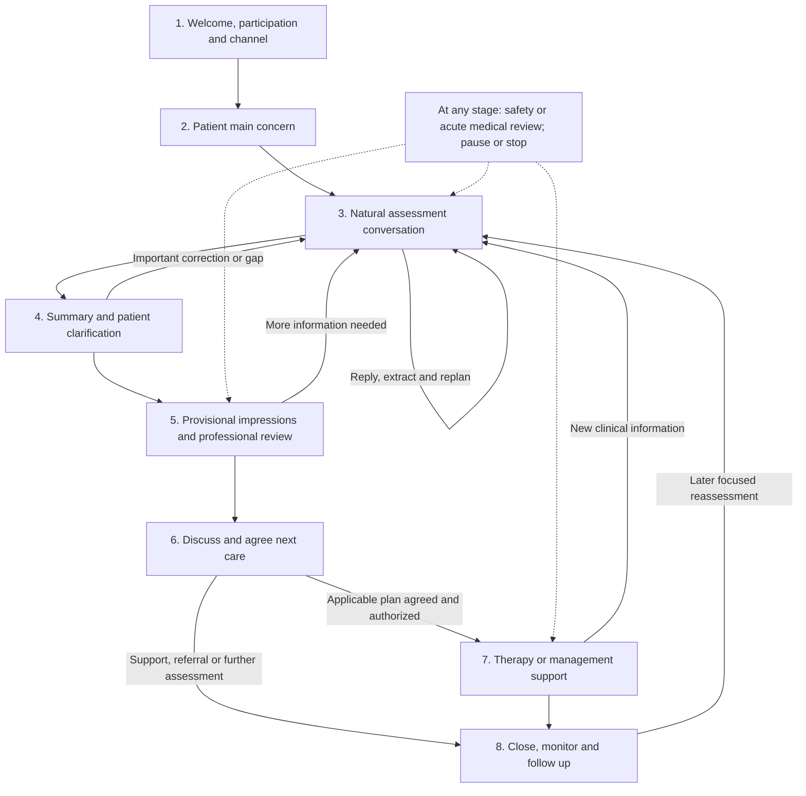
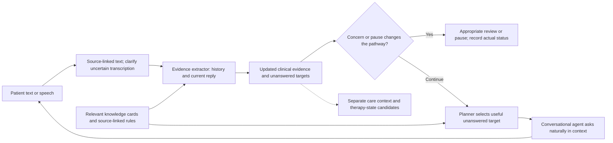

# 10 — Overall session and care-journey map

Version: 0.1.0-design. Date: 2 November 2026. Adults 18+, including older adults.

This is a proposed high-level map for the full platform. The initial conversation can use text, voice or video where the interface supports it. Assessment happens **during that conversation**, not only after it ends. Later stages organize diagnostic impressions for professional review, shared care planning, agreed therapy/management support and monitoring. A journey can span multiple contacts; one session need not complete all stages.

The map is project design informed by clinical guidance. No paper or guideline validates this exact agent architecture or sequence. The detailed question/follow-up graph, instrument placement, therapy implementation and operational safety/referral pathway are separate work. Current knowledge files are not thereby connected to the existing agents.

## Overall map

The final box is a **cross-cutting rule**, not an extra mandatory assessment step. Safety/acute medical concerns, participation and channel failures must be considered at every stage, including later therapy. Its dotted links are illustrative, not a claim that only those three stages are covered. Review need and actual review delivery must be distinguished. Detailed urgent actions need the reviewed setting-specific pathway.

## Stage purposes, inputs, outputs and boundaries

### Welcome, participation and channel setup

**Purpose:** Make the purpose and participation clear before asking for personal information.

**Enter when:** New session or resumption needing context/permission clarification.

**What happens:**

- Introduce the AI assessment-support role honestly.
- Confirm adult-scope eligibility using supplied case/intake information rather than guessing.
- Confirm text/voice/video availability, accessibility and permissions for any transcription/recording.
- Explain pause/skip/stop and relevant use of conversation content.

**Output:** participation_and_modality_context, unresolved_access_or_scope_needs. These are proposed artifact names, not implemented patient-state fields.

**Move on when:** Person chooses to proceed and the channel is usable; otherwise pause, clarify access or provide an appropriate handoff.

**Responsible roles:** Conversational role and application setup.

Source-informed domains: [NICE_197; NICE_222]. Stage names, order and agent assignments are project design.

### Patient main concern and priorities

**Purpose:** Understand what brought the person and what they want help with.

**Enter when:** Person is willing and able to begin.

**What happens:**

- Start with an open invitation.
- Listen and acknowledge in context without presuming symptoms.
- Capture relevant symptoms, time course and impact already volunteered.
- Retain goals, communication preferences and practical priorities for care planning.

**Output:** opening_account, initial_source_linked_evidence, care_context. These are proposed artifact names, not implemented patient-state fields.

**Move on when:** There is enough context to choose a focused next target, or a safety/access concern changes priority.

**Responsible roles:** Conversational role; extractor; planner.

Source-informed domains: [NICE_222; NICE_197]. Stage names, order and agent assignments are project design.

### Natural conversation with ongoing assessment

**Purpose:** Collect and clarify relevant evidence during the conversation.

**Enter when:** A meaningful unanswered target remains and the person wants to continue.

**What happens:**

- Normalize text or speech to source-linked messages with speaker/time context.
- Extractor reviews the whole available conversation and existing evidence.
- Update concept-specific details, corrections, periods and uncertainties.
- Planner chooses one useful missing target from applicable knowledge.
- Conversational role asks that target naturally using prior context.
- Use standardized tools only through a separately specified instrument protocol; placement is not decided here.

**Output:** updated_assessment_evidence, question_coverage_and_unresolved_targets, review_needs. These are proposed artifact names, not implemented patient-state fields.

**Move on when:** Enough information for a useful summary/review, the person pauses/stops, or a concern requires another pathway; this is not an automatic diagnosis-completion test.

**Responsible roles:** Extractor, planner and conversational role; application guards.

Source-informed domains: [NICE_222]. Stage names, order and agent assignments are project design.

### Summary and patient clarification

**Purpose:** Check that the account is represented accurately before handoff/formulation.

**Enter when:** A useful summary can be offered, including an incomplete assessment.

**What happens:**

- Summarize reported symptoms, course, impact and relevant context.
- State uncertainties without filling gaps.
- Invite corrections and additions.
- Return clinically meaningful corrections to extraction and planning.

**Output:** patient_checked_or_unconfirmed_summary, corrections_and_remaining_gaps. These are proposed artifact names, not implemented patient-state fields.

**Move on when:** Summary is ready for review with its confirmation status, or more clarification is appropriate; no reply is not confirmation.

**Responsible roles:** Conversational role; evidence update; later summarization component.

Source-informed domains: [NICE_197]. Stage names, order and agent assignments are project design.

### Provisional impressions and professional review

**Purpose:** Organize possible explanations and their uncertainty for a qualified diagnostic judgment.

**Enter when:** Available evidence and its limitations can be reviewed; full certainty is not required for an appropriate handoff.

**What happens:**

- Later synthesis component compares evidence with relevant category and alternative requirements.
- Separate supporting/conflicting evidence, unknowns and unresolved source questions.
- Qualified professional reviews and may confirm, revise or defer a diagnosis.
- Record who made a formulation, when and its status; the AI does not label itself the diagnosing clinician.

**Output:** reviewed_or_pending_formulation, diagnostic_status_and_uncertainty, further_assessment_or_referral_needs. These are proposed artifact names, not implemented patient-state fields.

**Move on when:** The responsible professional/workflow identifies appropriate next care or further assessment; no reviewer available does not count as approval.

**Responsible roles:** Planned clinical synthesis and qualified professional review.

Source-informed domains: [NICE_222]. Stage names, order and agent assignments are project design.

### Discuss and agree next care

**Purpose:** Choose appropriate next steps with the person, based on needs, reviewed findings and preferences.

**Enter when:** An appropriate review-informed proposal can be discussed; provisional/uncertain diagnoses may still allow support, referral or continued assessment.

**What happens:**

- Discuss suitable options in understandable terms.
- Consider goals, preferences, barriers, history and availability.
- Agree what happens next and when it will be reviewed.
- Record actual agreement and clinical authorization where required.
- Medication decisions remain with qualified prescribers.

**Output:** agreed_or_pending_care_plan, review_timing, care_agreement_and_authorization_status. These are proposed artifact names, not implemented patient-state fields.

**Move on when:** Agreed applicable actions can proceed; otherwise continue discussion, arrange review or close with pending needs.

**Responsible roles:** Planned care-planning component, responsible professional and patient.

Source-informed domains: [NICE_197; NICE_222]. Stage names, order and agent assignments are project design.

### Agreed therapy or management support

**Purpose:** Support the selected, appropriate therapeutic activities and management plan.

**Enter when:** Relevant plan is agreed and required clinical review/authorization and capability checks are actually satisfied.

**What happens:**

- Use only applicable selected approaches such as CBT, BA or IPT within the approved scope.
- Update therapy formulation, activities and agreed homework with provenance.
- Keep patient reports separate from suggested reframes or clinician hypotheses.
- Route new clinical or safety information back to assessment/review.

**Output:** therapy_specific_parameters_updates, session_events_and_agreed_actions, new_assessment_or_safety_information. These are proposed artifact names, not implemented patient-state fields.

**Move on when:** Activity/session ends, plan needs review, person pauses, or current concerns change the pathway.

**Responsible roles:** Later therapy/management components and responsible care team.

Source-informed domains: [NICE_222; NICE_197]. Stage names, order and agent assignments are project design.

### Close, monitor and plan follow-up

**Purpose:** End clearly and track meaningful change across contacts.

**Enter when:** Assessment or therapy contact is ending, including an incomplete or paused assessment.

**What happens:**

- Summarize what was discussed and actually agreed.
- Record remaining questions and review/contact status.
- Set homework only if selected and agreed; no homework is a valid outcome.
- Compare future symptoms, function and goals with the actual baseline; no invented improvement or scores.
- At a later contact, use the agreed agenda and re-enter the relevant assessment/review/care stage.

**Output:** session_summary, followup_plan_or_unresolved_followup, longitudinal_baseline_and_updates. These are proposed artifact names, not implemented patient-state fields.

**Move on when:** Session closes with accurate status; future review reopens the appropriate stage rather than requiring the whole intake again.

**Responsible roles:** Conversation, later summary/monitoring components and care team.

Source-informed domains: [NICE_222; NICE_197]. Stage names, order and agent assignments are project design.

## How the three assessment agents work inside stage 3

The patient experiences one coherent conversation. The roles work behind it: the extractor updates supported clinical evidence from the reply in context; the planner checks evidence/history and selects a meaningful remaining target; the conversational role expresses it naturally. The controller checks participation/review needs before ordinary progression. This is a logical architecture; it does not decide whether extractor/planner calls will later be combined or separate.

The first turn can be a welcome and open invitation rather than a symptom checklist. Example wording, authored for this project:

> I’m an AI assistant supporting a mental-health assessment. We can talk about what has been happening and how it is affecting your life. You can pause or skip a question. What would you like help with today?

Before collecting content, the interface must make relevant channel/content-use permissions clear. The exact opening wording and setup interaction can be refined later; it is not a validated clinical instrument or a claim that the AI is a psychotherapist.

## Text, voice and video

All three planned channels enter the same clinical reasoning process through attributable messages. Typed text can enter directly. Speech requires transcription with speaker/turn context; uncertain or clinically important unclear wording should be confirmed. Where available, timestamps can link the message to its source segment. Recording/storage choices are separate from merely choosing a call channel; do not assume video selection permits every form of recording or analysis.

For this design, audio/video are communication channels, not automatic emotion or diagnosis detectors. The system should not infer depression, mania, honesty or suicidal intent from facial appearance, voice tone or eye contact. Any future clinical observation feature needs its own defined evidence basis, permissions and validation; it is not implemented by adding a video node. Channel availability, transcription quality, accessibility and interruption handling must be tested separately.

## Where the proposed therapy state fits

Keep `therapy_specific_parameters` as a distinct therapy/formulation area of the patient state. It can hold homework and selected CBT, BA or IPT information. It must not become a replacement symptom checklist or a diagnostic score input. It is reasonable to retain relevant therapy-context candidates volunteered early, without turning the assessment conversation into therapy or making a therapeutic interpretation prematurely.

| State area | Purpose | Who uses it |
|---|---|---|
| Clinical assessment evidence | Reported symptoms/history/functioning, timing, source quotes and uncertainties | Extractor, planner, later synthesis and professional reviewer |
| Care context | Patient goals, preferences, practical barriers and communication needs | Conversation and care-planning/therapy components |
| Therapy-specific parameters | Formulation, selected activities and homework progress, clearly attributed | Relevant later therapy/management components |
| Workflow state | Stage, participation, plan agreement and actual review/contact status | Application/controller and authorized roles |

These are conceptual responsibilities; the therapy-state schema remains separate from the assessment evidence contract.

**Diagnostic boundary:** the diagnosis/synthesis component should not count a CBT belief entry, homework status, BA activity score or IPT grief entry as a diagnostic criterion. It should use the appropriate source-linked clinical evidence and requirements. Therapy labels and scores are not diagnoses.

**Clinical-information bridge:** clinically relevant statements must still be assessed wherever they arise. For example, a negative self-belief may need clarification as possible worthlessness, without automatically meeting that criterion. New sleep/activation information may change the differential. A suicidal statement during CBT needs the same safety attention as one during intake. The source statement can therefore inform both clinical evidence and therapy formulation through explicit provenance; no diagnostic conclusion should be inferred merely from where the item is stored.

### What the proposed therapy groups contribute

- **Homework:** tasks actually agreed or proposed, with their own progress state. Not doing a task does not itself prove severe depression, refusal of care or treatment failure.
- **CBT:** patient thoughts, possible underlying beliefs and later agreed/suggested reframes. A therapist/model hypothesis, a patient-endorsed belief and an AI suggestion must remain distinguishable.
- **BA:** actual avoidance contexts, selected activities and relevant experience/progress. Avoidance can have several reasons; an activity score is not a diagnostic severity rating by default.
- **IPT:** interpersonal context such as bereavement, disputes, transitions and relationship difficulties. A grief entry does not establish prolonged grief disorder, and relationship difficulty does not establish a personality disorder.

These mappings describe the intended role of your proposed fields. They do not validate a new CBT/BA/IPT instrument, make every approach appropriate for every person, or require all three approaches to be active. Specific therapy protocols and operational definitions remain later work. NICE describes CBT, BA and IPT as different interventions to consider with appropriate competence and individual choice. [NICE_222]

### Before those therapy fields are implemented

Define what `status` means for each item type; homework completion and belief/formulation status are different concepts. A belief can be an unconfirmed hypothesis, while a homework task can be proposed, agreed or completed; these are proposed project states, not validated clinical categories.

For every `score`, specify its construct, range, time period, rater/source and interpretation. Do not assume a belief-conviction score, activity pleasure score and diagnostic severity score have the same scale. Use `null` when unmeasured rather than `0.0`, because zero could otherwise imply an actual measurement. If there is no defined purpose for a score, leave scoring out until it is justified.

Preserve provenance: who reported the thought, who suggested a reframe, whether it was agreed, and which conversation/therapy session supports it. Do not invent a core belief or completed homework to populate an empty array. These are design requirements for the later therapy-state contract, not changes made to a working schema now.

## Assessment-to-care handoff

The planned handoff should preserve supported clinical findings, period/course, functional impact, relevant history and alternatives; the summary and correction status; provisional/reviewed diagnostic formulation and uncertainty; patient goals/preferences/barriers; current safety/review needs and actual status; and useful therapy-context candidates with attribution. A receiving component should not reconstruct the assessment from a loose narrative or treat a broad residual label as proof of treatment suitability.

Diagnosis, care planning and therapy are related but not one automatic chain of irreversible decisions. Appropriate support, referral or continued assessment may be agreed while the diagnosis remains uncertain. Selected therapeutic work needs an applicable agreed plan and the required clinical governance; a missing reviewer is not a positive authorization. A person may pause or end without therapy, and an initial assessment may continue at another contact.

## Source basis and what is project design

Clinical guidance supports comprehensive assessment, consideration of history/functioning/alternatives, discussion of needs/preferences and review of response. Shared decision guidance supports an agreed agenda and next steps. These domains inform the map. They do not prescribe the eight numbered stages, the division into LLM agents, the JSON namespaces, a score, a multimodal AI diagnostic method or a validated optimal question order.

NICE NG222 supports assessment beyond symptom counts and review of history/course/context (1.2.6–1.2.7), choice aligned with needs/preferences (1.4.2) and treatment monitoring (1.4.3). These underpin the broad assessment-to-review journey. [NICE_222]

NICE NG197 supports participation, agenda setting, discussion of options and agreeing/reviewing next steps (1.2.7–1.2.17). These inform the participation, summary and care-agreement stages. [NICE_197]

NICE NG225 concerns self-harm assessment/management; NIMH adult BSSA is for trained clinicians after a positive ASQ screen. We use their scope-aware assessment/review principles without claiming that our general chat is a validated safety instrument or that a drawn branch delivers a response. [NICE_225; ASQ_BSSA]

## Current versus planned work

Available: audited reference/contract packages and this proposed high-level map. Existing assessment-agent prototypes are separate and have not been wired to this map or the Desktop knowledge by this step. Text, speech/video, clinical synthesis/review, care planning, therapy state/protocols and operational safety routing need their own implementation and verification.

Next detail to design: stage 3's information modules and decision rules—what is routinely established, when alternative branches open, when to follow up, how answers/declines/corrections update coverage, and when a useful summary or professional review is appropriate. PHQ-2/9 placement and exact instrument administration remain an explicit decision, not a hidden assumption in this diagram. The source-marked exactly-four-day other-specified issue stays a review gate.

## Files

- This Markdown explains the overall design and boundaries.
- [Overall Mermaid source](Workflow/overall_session_map.mmd) is editable diagram text.
- [Assessment loop Mermaid source](Workflow/assessment_loop.mmd) shows the three logical roles.
- [Structured stage map](Workflow/overall_session_map.json) records stages, entry/exit conditions, outputs and global rules for later implementation.
- [Workflow sources](Workflow/sources.json) contains links, locations and uses.

These workflow reference files do not modify application runtime, diagnostic output or therapy-state schemas. The earlier source/consistency audit covers the knowledge packages; this newly added workflow is a source-informed design draft requiring its own clinical and implementation review.

## Sources

### NICE_222

[NICE NG222, Depression in adults](https://www.nice.org.uk/guidance/ng222/chapter/Recommendations)

Location: 1.2.6–1.2.9; section 1.3; 1.4.2–1.4.3; psychological-intervention tables

Use: Assessment domains, treatment choice, therapy context and monitoring; not validation of this exact session sequence

Access: Official search-indexed recommendation extracts inspected; direct retrieval intermittently 403

### NICE_225

[NICE NG225, Self-harm](https://www.nice.org.uk/guidance/ng225/chapter/recommendations)

Location: 1.6.1–1.6.6

Use: No predictive low/medium/high stratification; needs-focused assessment

Access: Public primary-source material inspected

### ASQ_BSSA

[NIMH Adult Outpatient Brief Suicide Safety Assessment Guide](https://www.nimh.nih.gov/research/research-conducted-at-nimh/asq-toolkit-materials/adult-outpatient/adult-outpatient-brief-suicide-safety-assessment-guide)

Location: Intended users; thoughts, plan, past behaviour, supports and disposition sections

Use: Safety information domains; clinician guide following positive ASQ, not autonomous LLM validation

Access: Public primary-source material inspected

### NICE_197

[NICE NG197, Shared decision making](https://www.nice.org.uk/guidance/ng197/chapter/recommendations)

Location: 1.2.7–1.2.17: agenda, participation, options, joint plan and review

Use: Participation, goals/preferences, agreement and review; does not prescribe this agent architecture

Access: Official recommendation/indexed text inspected
