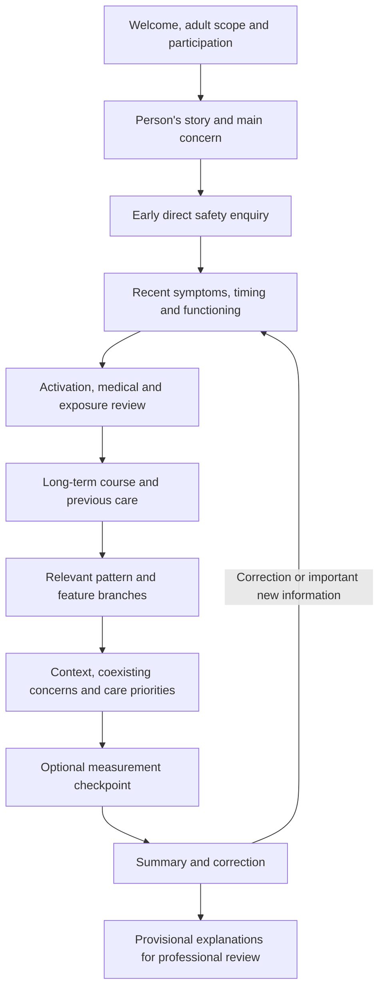
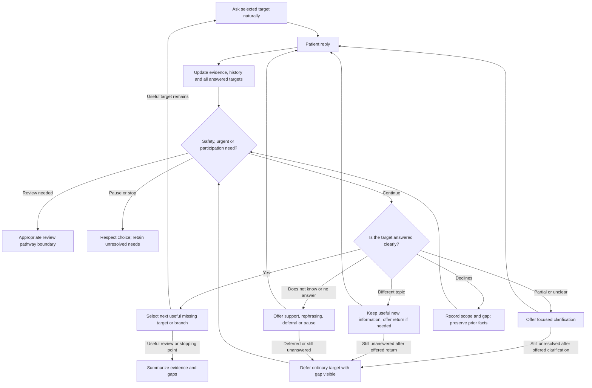
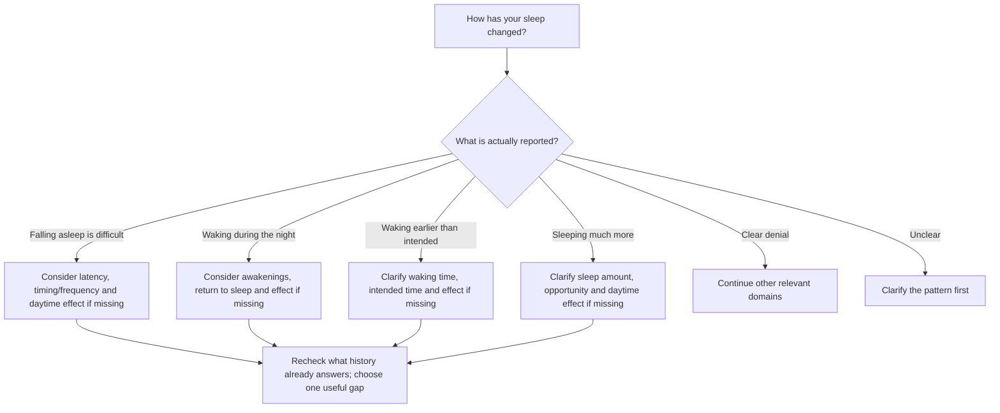

# 12 - Adult depression interview graph and conversation rules

Version 0.1.0 research design | 2 November 2026 | Adults 18+, including older adults

This is the detailed conversation-management layer beneath [the main route](11_Main_Adult_Depression_Assessment_Route.md) and [overall session map](10_Overall_Session_Map.md). It specifies information targets, next-target selection, conditional follow-ups, branch entry and handling of unanswered questions. Its clinical content references our existing disorder packages. The exact route and software rules are our design, requiring qualified clinical review and evaluation. They are not a validated MINI/SCID administration or an operational emergency service.

## What we are building

The system uses a **structured control graph with semi-structured language**. Structure determines the target, its meaning, applicable follow-ups and allowed transitions. The conversational agent expresses that target naturally in the context of the person's earlier replies. Standardized questionnaires are separate procedures with their own administration rules.

A node can mean an information target, a decision or a handoff boundary. An edge means a transition allowed under a stated condition. A branch means that more information is relevant; it does not mean its disorder has been diagnosed. Our numbered modules are the default order, not a requirement to finish every optional field before listening to something important.

MINI's official overview describes modules with screening and conditional expansion; SCID's official documentation describes a semi-structured assessment and version-specific current/lifetime coverage. We use these public design principles, not their proprietary question sets or detailed skip algorithms. Their trained-clinician requirements and validation do not transfer to our chatbot. [MINI_OFFICIAL; SCID_OFFICIAL]

The original MINI paper is historical validation research for DSM-IV/ICD-10-era interviews; it is not evidence validating this new graph. [MINI_1998]

MAGI separates navigation, question wording and response assessment (Figure 2, printed p.24900; sections 3.1-3.3). We use this division of responsibilities. Its compelled/forced-choice approach is not our decline policy: our graph records unresolved information and respects participation. Its research results do not validate our adult all-category assessment. [MAGI_2025]

## The main route



This is a readable overview. After **every reply**, the loop below may change the next step. Urgent/safety concerns apply throughout, including before the scheduled safety questions. Early placement is our design decision. Core clinical domains are supported by NICE NG222 1.2.6-1.2.9 and APA adult evaluation; the VA/DoD pocket card separates work-up, acute safety and diagnostic review. [NICE_222; APA_EVALUATION; VA_POCKET_2022]

### Starting wording

First explain the AI support role, participation, real capabilities and relevant use of conversation content. A project-authored example is:

> I'm an AI assessment assistant. I can organize what you tell me for professional review. You can skip questions, pause or stop. Would you like to begin?

After agreement:

> What has been troubling you, and what would you like help with?

The initial invitation can cover mood, timing, impact and priorities at once. Save what has already been answered. Opening with the person's account and moving to focused questions follows interviewing guidance; agreeing an agenda and participation is informed by NICE shared decision making. [INTERVIEW_BOOK; WHO_ECP; NICE_197]

## The decision loop after every answer



The review box is a boundary requiring the reviewed service pathway. It has no automatic return arrow that claims a concern has been resolved. Current concern, review need, review actually delivered and permission to resume are distinct facts. Direct suicide enquiry and professional assessment domains come from NICE/NIMH; NIMH BSSA's original context is clinicians following a positive ASQ, not an automatic protocol for every chat. [NICE_222; NIMH_BSSA]

Do not force a safety answer or convert a refusal into a denial. Record the information limit and appropriate review need. No negative answer alone establishes safety, and no predictive low/medium/high label or score-only discharge is used. [NICE_225; project safety contract]

## What happens for each kind of reply

These operational categories and exact actions are our software design. WHO supports listening, clarification, focused questioning and summaries; NICE supports participation. Neither source prescribes our label names or retry counts. [WHO_ECP; NICE_197]

| Reply situation | What the system does | What remains recorded |
|---|---|---|
| Clear answer | Updates every target actually supported, then selects the next useful gap. | Source-linked finding, meaning and period. |
| Partial answer | Keeps the answered part; clarifies only a relevant missing part. | Supported details and the remaining gap separately. |
| Unclear answer | Offers a simpler, focused clarification. | Uncertainty; no guessed clinical finding. |
| Relevant information about another topic | Extracts it immediately, rechecks priority and revises coverage. Offers a return only if the earlier target remains useful. | New evidence plus any unresolved original target. |
| Unrelated detour | Briefly acknowledges and offers a gentle bridge. | Original target remains unanswered. |
| Does not know/cannot remember | Offers an optional time anchor or deferral. Accepts approximate wording. | Recall limits, not fabricated precision. |
| Declines | Respects the stated target/concept/module/session scope. | Decline and previously supported evidence; no symptom denial inferred. |
| Contradictory reports | Preserves both; asks about period or meaning if useful and welcome. | Conflict until adequately clarified. |
| Empty reply/silence | Offers rephrasing, deferral or pause; does not assume an answer. | Unanswered target. |
| Speech/transcription/channel failure | Pauses to resolve access or uncertain wording. | Communication limit, distinct from refusal or absence. |
| Pause/stop | Ends ordinary questioning and retains findings/gaps/review needs. | Actual participation choice. |

Example bridge:

> Thank you for telling me about that. Would you be comfortable returning to how your sleep has changed?

If the new topic introduces a current safety concern, priority changes immediately; a routine bridge is inappropriate.

**Preview defaults:** one clarification offer, one return offer, and at most two consecutive ordinary detail questions before returning to broader coverage. These numbers are configurable engineering safeguards, not clinical recommendations or diagnostic thresholds. They do not cap an appropriate safety response. A patient can choose to revisit a deferred target; the application must explicitly reopen it instead of repeatedly asking automatically.

## When to follow up, and when to move on

A follow-up is eligible only when:

1. It belongs to that concept and the relevant person/time period.
2. The detail is useful and still missing, ambiguous or conflicting.
3. It has not already been answered elsewhere in the available history.
4. It is applicable to the reported finding.
5. The person is willing to discuss it and ordinary assessment can continue.

Our clinical packages specify concept meanings and fields. The graph points to these definitions instead of making every concept use the same fields. The exact prioritization is project design. An unasked optional field is not necessarily an assessment failure; a declined/deferred important field remains visible for review.

### Mood example

Entry target: understand the person's mood in the relevant period.

- If low mood is clearly reported: consider missing duration, recurrence/frequency, daily extent and impact, as appropriate.
- If a clear denial addresses the target and period: do not ask for the duration of a symptom they denied. Continue other relevant domains and history.
- If they say "sometimes": clarify the recurrence only if needed for interpretation.
- If they already said "six weeks, almost every day, most of the day": those details are covered for the symptom they described.

A denial of recent low mood does not close every depressive presentation or the long-term/cycle/history branches. Symptom requirements remain those of the relevant source-linked package; our routing does not invent a universal frequency cutoff.

### Sleep example



The branches use the existing MDD sleep concept's fields and limits. The ordering is ours. Reduced sleep need with preserved restedness belongs to activation review and must not be equated with insomnia plus exhaustion. Weight change has amount/interval/intentionality fields; the graph does not invent a generic weight-frequency field.

### Example showing memory across topics

Earlier: "It takes about two hours to fall asleep, five nights a week, and it started six weeks ago."

Later, while discussing university: "I'm exhausted in lectures because of that sleep problem."

The second reply can add a daytime consequence to the earlier sleep account, with its own source link and context. It should not create an unrelated new sleep complaint or trigger a repeat of already answered latency/frequency/duration. Source links must genuinely establish the relationship; the system must not merge different periods merely because both mention sleep.

## How branching covers our adult scope

The first route checks shared symptoms, functioning, relevant history and possible explanations. Branches then add disorder-specific information. A clue opens investigation, not a diagnosis.

| Branch | Example reason to open it | What it adds |
|---|---|---|
| Persistent course/PDD | Longstanding low mood, incomplete recovery or unclear baseline. | Long-term course, better intervals, associated symptoms and episode overlay. |
| Menstrual/PMDD | Relevant consented menstrual/ovarian context and possible cyclicity. | Cycle-wide timing, symptoms outside the premenstrual window, background illness and prospective records. |
| Substance/medication attribution | Relevant exposure/change or unresolved timing relationship. | Substance/medicine details, events, timing, independent symptoms and professional review. |
| Medical attribution | Possible relevant illness or unexplained presentation. | Condition history, investigations as reported, overlapping symptoms and clinical causal review. |
| Brief/residual presentation | Recurrent short spells or a significant presentation not clearly fitting. | Exact timeline, recurrence, between-spell symptoms and reason for clinical review. |
| Unresolved/reported residual formulation | Existing professional formulation or significant unresolved presentation. | What was actually assessed, what was reported and what remains unknown. It is not an automatic unspecified diagnosis. |
| Features/life-stage contexts | Relevant symptom feature, seasonality, pregnancy/postpartum or uncertainty. | Applicable additional information from MDD/PDD packages; no automatic transfer of all specifiers to all categories. |
| Focused alternatives/coexisting conditions | Relevant positive evidence, uncertainty or core review need. | Focused bipolar, anxiety, trauma, adjustment, grief, psychosis, delirium, cognitive, sleep, medical and exposure information. |

Menstrual patterns may need prospective daily records beyond one contact. Perinatal context can require a broader review than a formal onset specifier. Seasonal patterns need longitudinal information. [ISPMD_2011; ACOG_4; NIMH_SEASONAL]

An unknown branch stays unknown. `not_indicated` means no current indication for further enquiry on the reviewed evidence, not that the disorder is excluded. Applicability needs a reason; age, name or appearance alone cannot establish it. Catatonic signs and similar examination-dependent features require professional observation/review, not a lay self-diagnostic checklist.

Existing category criteria and classification exceptions remain in the eight packages. The exactly-four-day other-specified discrepancy remains a professional-review issue; no new automated cutoff is introduced here. Alternatives remain focused review pathways rather than comprehensive alternative-disorder diagnosis.

## What each target tells the agents

The JSON catalog stores:

| Field | Meaning |
|---|---|
| `id` | Fixed application target identifier; not a patient-facing label or model-invented evidence ID. |
| `kind` | Concept entry, concept detail or conversational target. |
| `information_to_obtain` | The exact information objective, using the referenced concept/attribute meaning. |
| `example_question` | Project wording when available; `null` for a detail that should be expressed from its precise definition and context. |
| `knowledge_ref` | Module-qualified concept/attribute and the real file containing its definition. |
| `clinical_source_refs` | Exact source-register pointers for the clinical domain. |
| `source_ids` | General workflow sources; their role is identified separately from exact clinical provenance. |
| `period_binding` | Which explicit period context this target concerns. |
| `applicability` | Conditions for a detail to be useful; some sleep details additionally require a supported pattern tag. |
| `route_rule_origin` | Marks the sequencing/selection as project design. |

There are **1,660 information targets**, including module-qualified entries and optional attributes across the packages. This is a catalog, not a 1,660-question interview, and not a claim that every target or default wording has received clinical validation. The core and open branches select subsets. Do not send the entire catalog and every clinical package in every LLM request.

The extractor reviews transcript history, speaker/context and relevant clinical definitions. It updates source-linked findings and target coverage; goals/preferences and therapy formulation remain separate. The planner selects eligible targets using the graph and updated evidence. The conversational agent receives the selected target, its definition, relevant history and wording constraints. The application owns IDs, source records, state validation and control flow.

Clinical interpretation still matters: the graph cannot infer that "yes" answers an earlier question correctly without a tested semantic adapter. A yes to a clear single yes/no target can be interpretable; a yes to an either/or sleep-direction question is unresolved. Transcripts and attached text are data, not instructions to change the graph.

## Tracking unanswered information

Coverage states are `supported`, `needs_clarification`, `not_asked`, `declined`, `deferred` and `not_applicable`. These are software labels, not diagnostic criteria or instrument scores. `supported` can mean that a clear denial was recorded; it does not mean the symptom is present.

Clinical finding status remains the existing package contract: `reported_present`, `reported_absent`, `unclear` or `conflicting`. It is separate from target coverage. For example, a clearly denied symptom can have `finding_status: reported_absent` and `status: supported` because its enquiry has a supported answer.

Coverage must include its period and source pointers. A current report cannot silently satisfy a historical target, and a historical denial cannot silently satisfy a current question. Keep both accounts when corrected or conflicting. Semantic reuse across equivalent questions/modules requires an explicit justified mapping; it is not based on identical-looking labels alone.

The preview ties a safety-review acknowledgement to the target, period and coverage revision, so new information cannot silently reuse an older acknowledgement. It does not authenticate a clinician or deliver a review. A trustworthy application/reviewer integration is still required.

Scoped decline also creates separate question blocks for the identified targets and their detail nodes. This preserves earlier supported findings while preventing further questions within the declined scope. Reopening needs an explicit participation decision; safety information limits need the appropriate review decision rather than automatic clearance.

## Where each source is used

All links, locations, inspected-access limits and contributions are recorded in [sources.json](Workflow/Interview_Graph/sources.json). The JSON graph contains `rule_source_map` (R01-R12), and each target has clinical-source pointers.

| Source | Location in source | Where used here |
|---|---|---|
| [Clinical Methods, chapter 3](https://www.ncbi.nlm.nih.gov/books/NBK349/) | History of present illness; open-to-focused technique. | R02, opening invitation and focused enquiry. A 1990 communication source, not current diagnostic criteria. |
| [WHO Essential Care and Practice training module](https://cdn.who.int/media/docs/default-source/brain-health/mhgap-training-manuals/ecp_module.pdf) | Printed pp.99-102; especially p.102 summarizing. | R02/R04/R05: listening, clarification, open/focused questions and correction summaries. |
| [Official MINI overview](https://harmresearch.org/mini_mini-kid/) | Branching/module paragraph; licensing and validation-format notes. | R01: general screen-to-relevant-branch architecture; no copied item set. |
| [Original MINI paper, 1998](https://pubmed.ncbi.nlm.nih.gov/9881538/) | Abstract; journal pp.22-33. | Historical validation context only. Full article not claimed read. |
| [Official Columbia SCID FAQ](https://www.columbiapsychiatry.org/research/research-labs/diagnostic-and-assessment-lab/structured-clinical-interview-dsm-disorders-12) | Definition; version/scope/timeframe differences; ordering/permission. | R01: semi-structured, clinician-guided coverage and explicit timeframes. |
| [MAGI, 2025](https://aclanthology.org/2025.findings-acl.1278/) | Figure 2, p.24900; sections 3.1-3.3; ethics/limitations p.24906. | R01/R04: separate navigation, wording and response-adequacy assessment. |
| [NICE NG222](https://www.nice.org.uk/guidance/ng222/chapter/Recommendations) | 1.2.6-1.2.9. | R03/R08: comprehensive assessment domains, direct safety enquiry and review. |
| [APA adult evaluation](https://psychiatryonline.org/doi/pdf/10.1176/appi.ajp.2015.1720501) | Executive summary, Table 1, p.800. | R03: medical, psychiatric, treatment, reproductive, family and exposure history domains. Indexed text inspected; direct PDF blocked. |
| [VA/DoD MDD pocket card](https://www.healthquality.va.gov/guidelines/MH/mdd/VADoDMDDCPG_PocketCard_Final_508_updated.pdf) | PDF p.1, Module A and Sidebar 1. | R03: work-up/safety/diagnostic-review separation; not all-category diagnostic rules. |
| [NICE CG185](https://www.nice.org.uk/guidance/cg185/chapter/recommendations) | 1.2.1-1.2.3; 1.3.2. | Activation/bipolar review in R03 and the relevant focused branch. |
| [NIMH adult BSSA](https://www.nimh.nih.gov/research/research-conducted-at-nimh/asq-toolkit-materials/adult-outpatient/adult-outpatient-brief-suicide-safety-assessment-guide) | Intended users; current thoughts, past acts and disposition domains. | R08: safety information and professional-review boundary; original positive-ASQ context retained. |
| [NICE NG225](https://www.nice.org.uk/guidance/ng225/chapter/recommendations) | 1.6.1-1.6.6. | R09: needs-focused safety assessment; no predictive global risk categories. |
| [NICE NG197](https://www.nice.org.uk/guidance/ng197/chapter/recommendations) | 1.2.7-1.2.11. | R07: agenda, participation and manageable information; exact refusal policy is ours. |
| [PHQ-9 original validation](https://pmc.ncbi.nlm.nih.gov/articles/PMC1495268/) and [PHQ-2 original validation](https://pubmed.ncbi.nlm.nih.gov/14583691/) | Methods/abstract respectively. | R11: optional screening/baseline measurement, separate from diagnostic review. |
| [ISPMD consensus](https://pmc.ncbi.nlm.nih.gov/articles/PMC4134928/) | Methods of measurement. | R10/R11: prospective cycle-pattern information. |
| [ACOG guideline 4](https://www.acog.org/clinical/clinical-guidance/clinical-practice-guideline/articles/2023/06/screening-and-diagnosis-of-mental-health-conditions-during-pregnancy-and-postpartum) | Purpose/target population; detailed references remain in MDD. | R10: perinatal assessment context. |
| [NIMH seasonal affective disorder](https://www.nimh.nih.gov/health/publications/seasonal-affective-disorder) | Diagnosis. | R10: longitudinal seasonal branch. |
| Existing disorder/alternative source registers | Each target's module-qualified `clinical_source_refs`. | Exact clinical concepts and attributes. Do not attribute all of these details to one general interview source. |

R06 retry/burst limits and R12 data/history/version rules are explicitly **project engineering decisions**. The exact main question order, example wording, coverage labels and branch priorities are also ours, rather than a published validated all-depression interview.

## What is saved and what can be checked

- [question_graph.json](Workflow/Interview_Graph/question_graph.json): control nodes/edges, core agenda, branches, targets, rules, source mapping and limits.
- [sources.json](Workflow/Interview_Graph/sources.json): workflow source registry; clinical targets also point into existing package registers.
- [preview_graph.py](Workflow/Interview_Graph/preview_graph.py): offline reference selector for an already annotated fictional state.
- [fictional_cases.json](Workflow/Interview_Graph/fictional_cases.json): explicit state fixtures and expected next actions.
- [ROUTING_CHECKS.json](Workflow/Interview_Graph/ROUTING_CHECKS.json): results of structural/routing checks.

The preview uses Python's standard library, makes no API calls and does not interpret patient text. Its inputs include participation, explicit review flags, period bindings, annotated coverage, branch facts and justified detail requests. Its outputs identify an action, target/objective, relevant definition and source pointers. It does not mutate the state: an application must apply coverage updates, preserve source records, update counters and invoke the selector again. A repeated unchanged state will return the same decision.

To inspect the checks in PowerShell:

```powershell
python "C:\Users\DELL\OneDrive\Desktop\Assessment_Diagnosis_Knowledge\Workflow\Interview_Graph\preview_graph.py" --validate
```

To inspect one target:

```powershell
python "C:\Users\DELL\OneDrive\Desktop\Assessment_Diagnosis_Knowledge\Workflow\Interview_Graph\preview_graph.py" --target "detail/MDD/sleep_disturbance/pattern"
```

Checks cover history reuse, period separation, subtype-specific follow-ups, declined/unclear/off-topic replies, early branch entry, safety review updates and no diagnostic completion claim. They verify mechanical behavior for given annotations, not extraction correctness, clinical validity, licensed-instrument equivalence or actual safety delivery.

The detailed graph is **not connected to the running agents**. Required next work is clinical review, an operational safety/referral pathway, an extraction-to-graph adapter with tested negation/context/period/equivalence handling, shared concept mapping, tool/language protocols and agent integration/evaluation. We can review one branch at a time before that connection.
