# 13 - Full numbered adult depression assessment graph

Version 0.1.0 visual atlas | 2 November 2026 | Adults 18+, including older adults

This file draws **the whole current research design**: the main route, every reply-handling outcome, conditional follow-ups, all 24 branches, and every concept/detail target in the current catalog. It visualizes [question_graph.json](Workflow/Interview_Graph/question_graph.json); it does not change the agents or clinical rules.

**Status:** source-informed project design requiring clinical review. The exact question order, example wording, retry limits and routing implementation are ours. This is not a validated MINI/SCID administration, a clinically complete emergency pathway or a deployed diagnostic service. New or unmodeled circumstances remain unresolved for appropriate review rather than being forced into a graph outcome.

## How to read this file

- Start with G001. Read G002-G010 for rules that apply at every question.
- Main-module charts show the default **next candidate**, not a requirement to ask something already answered.
- Every question/detail passes through the shared history, participation, safety and follow-up checks.
- Graph numbers identify diagrams; numbers inside boxes identify nodes. Clinical node IDs remain application identifiers.
- A branch opens because information is relevant, not because its diagnosis is confirmed.
- Every clinical concept has a numbered follow-up menu in the appendix. These are alternatives, not an instruction to ask every optional item.
- Some catalog concepts are supplemental rather than scheduled in the current core/branches. They are explicitly marked. Full catalog coverage is not a claim of full clinical completeness.
- Text, transcribed speech and video-call speech use the same evidence loop. Uncertain transcription is clarified. No diagnosis is inferred from facial appearance or voice tone here.

### Navigation

1. [Master route](#master)
2. [Universal response and follow-up rules](#universal)
3. [Main assessment modules](#core)
4. [All clinical branches](#branches)
5. [Every concept and optional detail](#catalog)
6. [Where sources were used](#sources)
7. [Coverage and design limits](#coverage)

## 1. Master route


**Measurement extension:** [the screening/scoring guide](14_Screening_Measurement_and_Scoring.md) adds an optional early offer after the initial account/safety review. M8 checks what was already done. This is a proposed knowledge overlay; the current offline selector does not execute the instrument protocol.


<a id="master"></a>

### G001 - Start-to-finish assessment map


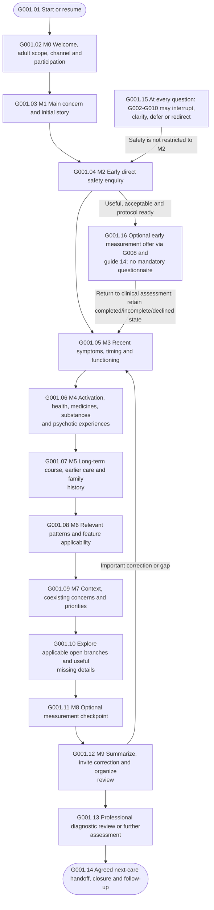


Early safety placement and this default ordering are project choices. The shared controller can select a justified open branch earlier; no single negative depression screen closes every current, historical, persistent or cyclic presentation. The downstream care handoff is planned, not automatic treatment activation.


<a id="universal"></a>

## 2. Rules that apply to every question


<a id="g002"></a>

### G002 - Universal ask, extract, review and select loop


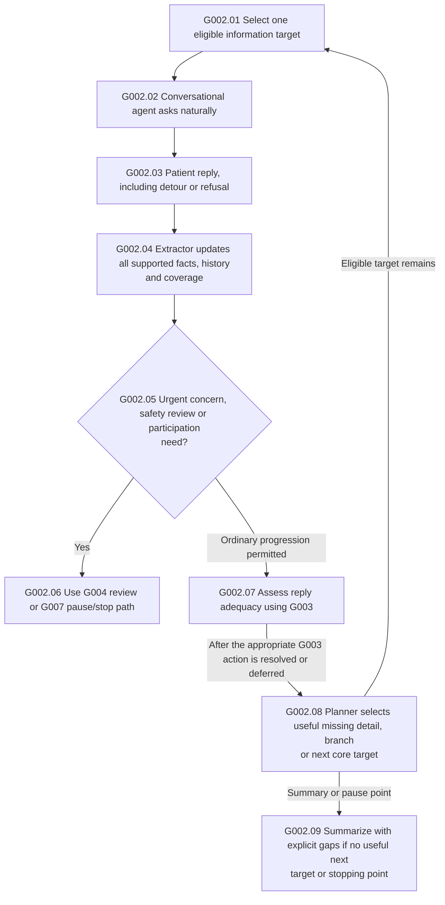


Responsibilities: extractor = history/evidence/answer coverage; planner = target and branch choice; conversational agent = wording. The application validates state and owns identifiers. A relevant answer can cover several targets in one turn; preserve its scope and period.


<a id="g003"></a>

### G003 - All reply outcomes and their return routes


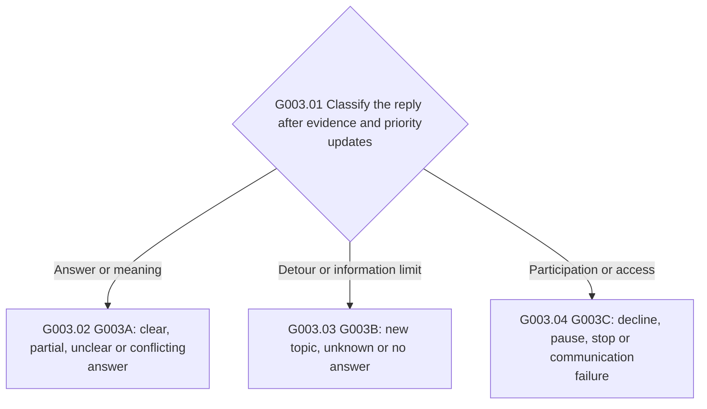


Read the three numbered subgraphs below. Every new reply returns through G002. A refusal, silence or unknown is never converted into symptom absence. Important unanswered safety information uses G004.


<a id="g003a"></a>

### G003A - G003 answer handling - clear, partial, unclear and conflicting


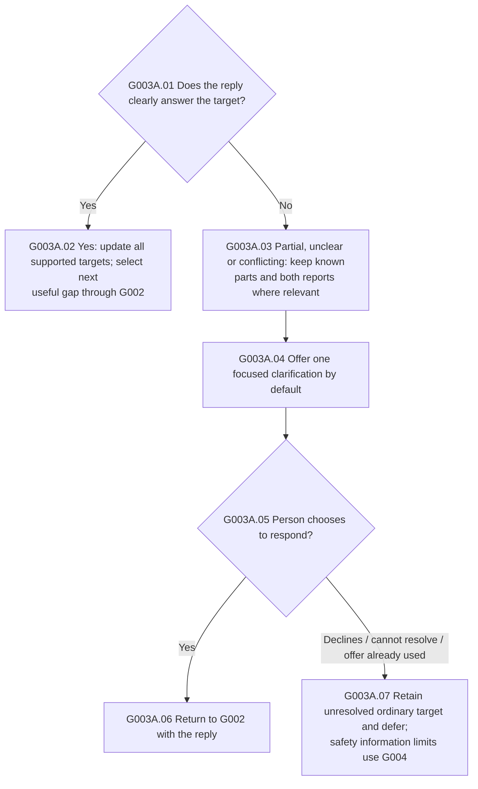


Clarify the missing meaning or part, not information already supplied. The one-offer default is project configuration; a requested revisit can be explicitly reopened.


<a id="g003b"></a>

### G003B - G003 detour handling - relevant or unrelated topic, unknown and silence


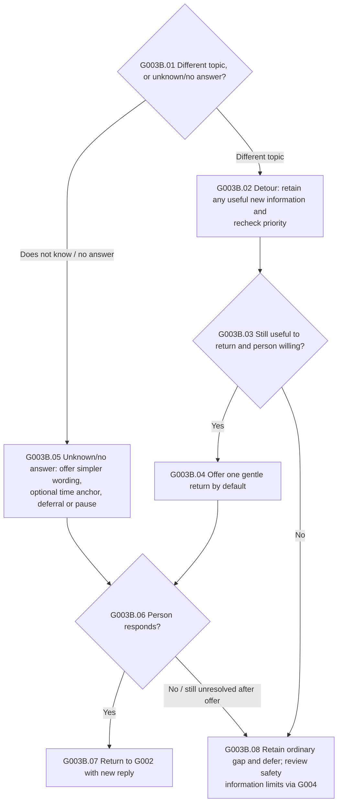


Relevant and unrelated detours share the respectful return option, but only clinically relevant information updates clinical evidence. A new safety concern interrupts ordinary return logic through G004.


<a id="g003c"></a>

### G003C - G003 participation and access handling


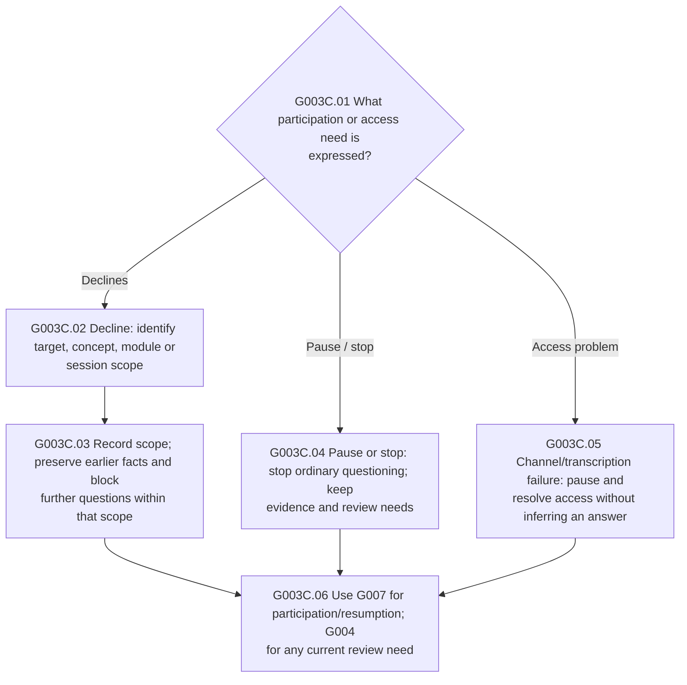


A session-level decline ends ordinary questioning. A topic-level decline does not erase evidence. Ambiguous scope must be clarified before more questions on that subject.


<a id="g004"></a>

### G004 - Safety and urgent medical or mental-state interruptions


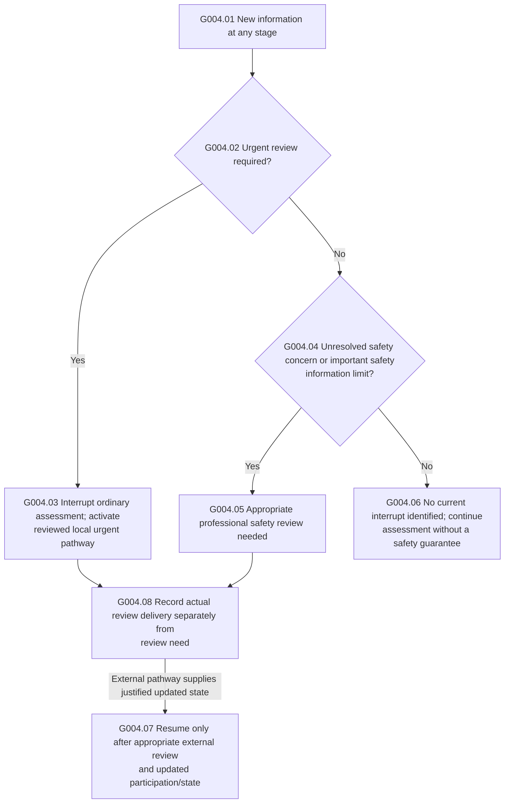


This is a boundary diagram, not a complete emergency protocol. Direct ideation/intent enquiry and current/past distinctions are source-informed. A negative answer alone is not clearance; new information invalidates a stale review acknowledgement. No predictive low/medium/high suicide label or automatic discharge is generated. See R08-R09 in the source map.


<a id="g005"></a>

### G005 - Follow-up eligibility and skip logic


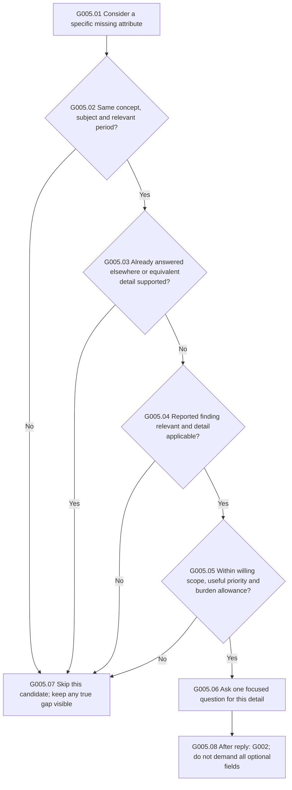


A clear denial in the specified period usually skips details of the denied finding, while other periods and symptom domains remain open. A denial of loss of interest alone does not establish preserved pleasure. Current preview defaults allow two ordinary detail questions in a row before returning to breadth; that number is project configuration, not a clinical threshold.


<a id="g006"></a>

### G006 - Branch opening, uncertainty and return to the main route


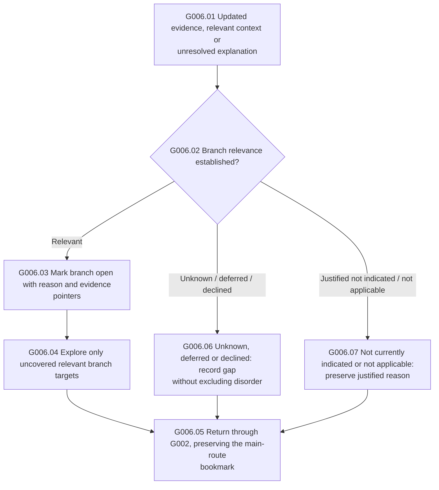


Several branches may be open together. A justified priority branch may run earlier after the initial account/safety checkpoints; otherwise the preview explores open branches after core coverage. Shared facts are reused only with an explicit meaning/period mapping, not merely because labels look alike.


<a id="g007"></a>

### G007 - Decline, pause, stop and later resumption


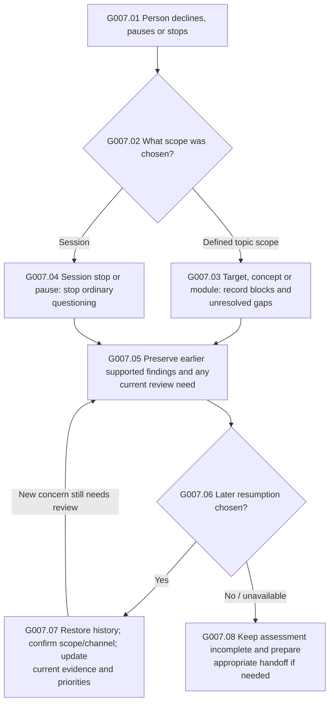


Do not reopen a declined/deferred target automatically. If the scope is ambiguous, clarify scope before asking more on that subject. A current concern still needs the appropriate review pathway even if the person wants to stop; the graph does not force continued answering.


<a id="g008"></a>

### G008 - Optional measurement and missing questionnaire responses


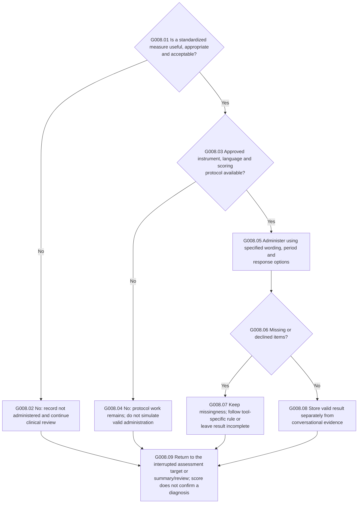


PHQ-2 is not a mandatory entry gate before PHQ-9 or all other assessment. Do not convert paraphrased conversation into a purported completed PHQ. Prospective menstrual records may require later contacts. These are protocol boundaries; full item-level instrument graphs are not implemented.


See [guide 14](14_Screening_Measurement_and_Scoring.md) and [Measurement/route_extension.json](Measurement/route_extension.json): offer early only if useful and acceptable; review an appropriate existing measure instead of automatically repeating it. The current arithmetic reference uses complete items only and never fills missing answers with zero.


<a id="g009"></a>

### G009 - Summary, corrections and professional diagnostic review


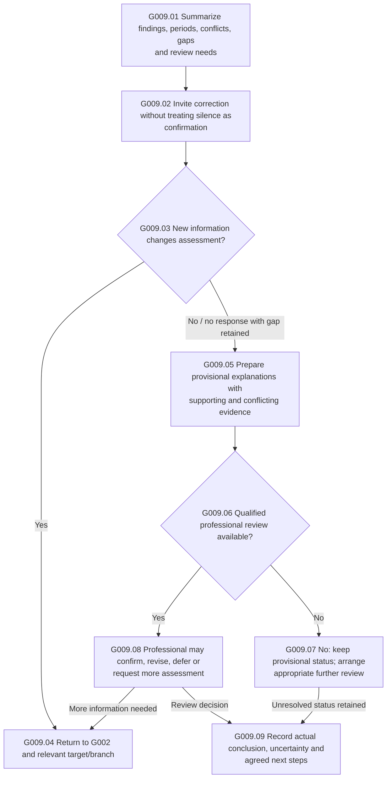


The graph never assigns a confirmed diagnosis by itself. Unfinished assessment does not automatically mean unspecified depressive disorder. Diagnostic classification remains subject to the detailed source-linked package rules and professional review.


<a id="g010"></a>

### G010 - Care handoff, end of contact and future monitoring


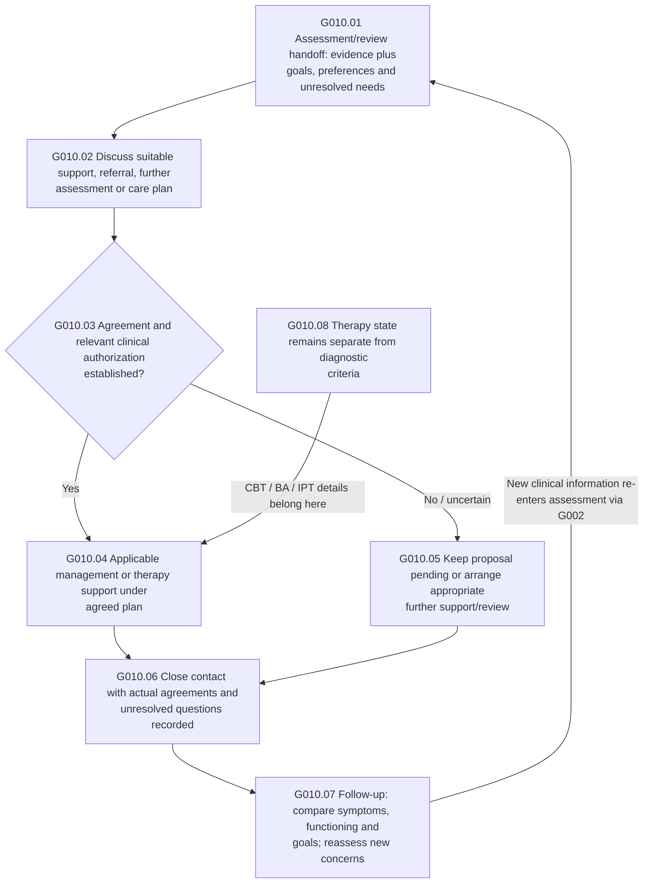


This last graph is the planned platform handoff. It does not implement detailed treatment selection, prescribing or therapy-session protocols. Clinically relevant statements arising during therapy still reach assessment/safety review; homework and therapy scores do not become diagnostic criteria.


<a id="core"></a>

## 3. Main modules - default question candidates


Before each candidate below, apply G002-G007. The question is skipped if its meaning and period are already adequately covered. A requested follow-up must pass G005. Tables show project wording, not licensed instrument items.


<a id="g011"></a>

### G011 - M1 - Opening account


```mermaid
flowchart TD

    G011n01["G011.01 Enter this module or relevant open branch"]

    G011n02["G011.02 01. Candidate: Person&#x27;s main concern and<br/>priorities"]

    G011n03["G011.03 Return to shared selector with facts,<br/>declined/deferred targets and remaining gaps"]

    G011n01 --> G011n02

    G011n02 --> G011n03

```


Every arrow means the next candidate after shared checks, not a forced answer. Use the concept appendix for optional details.


| Candidate | Information target / project question | Catalog target |
|---|---|---|

| G011.Q01 | What has been troubling you, and what would you like help with? | `q.opening` |


<a id="g012"></a>

### G012 - M2 - Early safety information


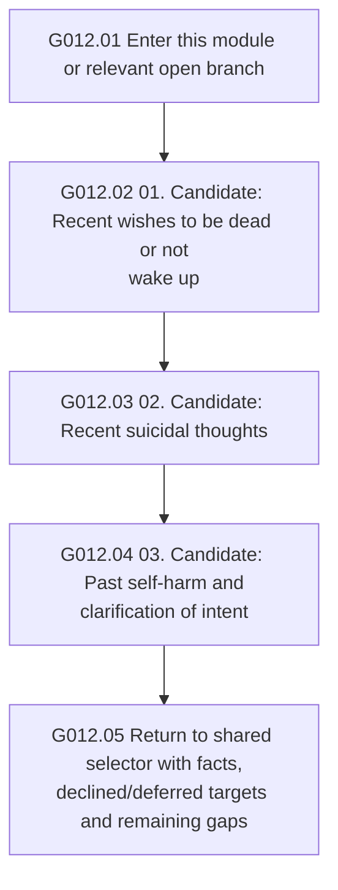


Every arrow means the next candidate after shared checks, not a forced answer. Use the concept appendix for optional details. Any positive/unclear concern or important information limit uses G004; this short chart is not a complete suicide assessment.


| Candidate | Information target / project question | Catalog target |
|---|---|---|

| G012.Q01 | Recently, have there been times when you wished you were dead or would not wake up? | `q.safety.death_wish` |

| G012.Q02 | Have you recently had thoughts of ending your life? | `q.safety.suicidal_thoughts` |

| G012.Q03 | Have there been times in the past when you harmed yourself? | `q.safety.past_behaviour` |


<a id="g013"></a>

### G013 - M3 - Depressive symptoms, timing and daily impact


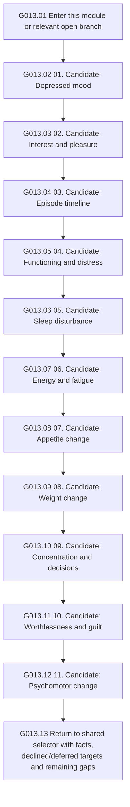


Every arrow means the next candidate after shared checks, not a forced answer. Use the concept appendix for optional details.


| Candidate | Information target / project question | Catalog target |
|---|---|---|

| G013.Q01 | How has your mood been during this period? | `root/MDD/depressed_mood` |

| G013.Q02 | Have your interest or enjoyment in your usual activities changed? | `root/MDD/interest_pleasure` |

| G013.Q03 | When did these changes begin? | `root/MDD/episode_timeline` |

| G013.Q04 | How have these changes affected your daily life? | `root/MDD/functioning_distress` |

| G013.Q05 | How has your sleep changed from what is usual for you? | `root/MDD/sleep_disturbance` |

| G013.Q06 | How has your energy been compared with usual? | `root/MDD/energy_fatigue` |

| G013.Q07 | Has your appetite changed compared with usual? | `root/MDD/appetite_change` |

| G013.Q08 | Have you noticed a change in your weight during this period? | `root/MDD/weight_change` |

| G013.Q09 | Have concentrating or making decisions become harder than usual? | `root/MDD/cognition_decisions` |

| G013.Q10 | How have you been thinking about yourself during this period? | `root/MDD/worthlessness_guilt` |

| G013.Q11 | Have you or other people noticed changes in how quickly you move or speak? | `root/MDD/psychomotor_change` |


<a id="g014"></a>

### G014 - M4 - Important alternative explanations


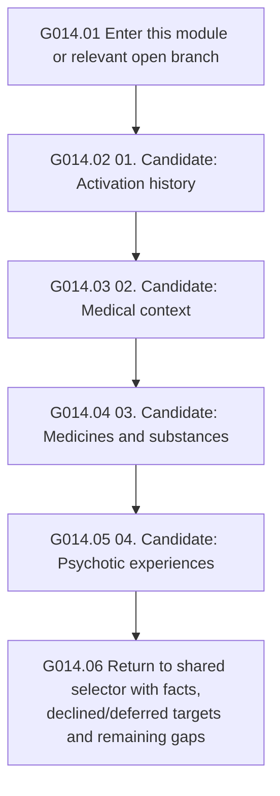


Every arrow means the next candidate after shared checks, not a forced answer. Use the concept appendix for optional details. Urgent confusion/activation/psychotic or physical concerns interrupt the ordinary order; possible explanations can coexist.


| Candidate | Information target / project question | Catalog target |
|---|---|---|

| G014.Q01 | Have you had a distinct period of unusually increased energy or activity? | `root/MDD/activation_history` |

| G014.Q02 | Are there health conditions that might be relevant to these changes? | `root/MDD/medical_context` |

| G014.Q03 | Have any medicines or substance-use patterns changed around this time? | `root/MDD/exposure_context` |

| G014.Q04 | Have you had experiences that other people do not seem to share? | `root/MDD/psychotic_experience` |


<a id="g015"></a>

### G015 - M5 - Long-term course, earlier care and family context


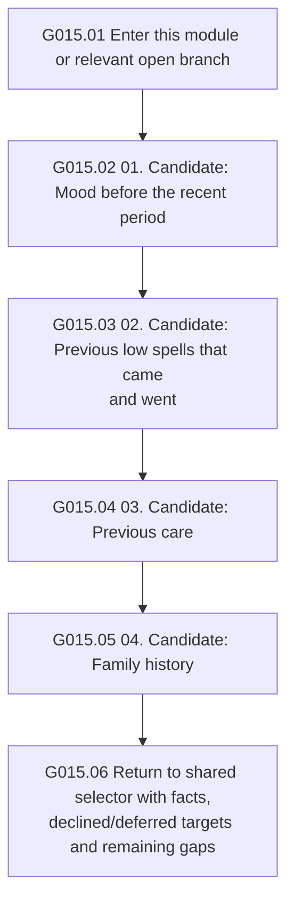


Every arrow means the next candidate after shared checks, not a forced answer. Use the concept appendix for optional details.


| Candidate | Information target / project question | Catalog target |
|---|---|---|

| G015.Q01 | Before this recent period, what was your mood usually like over the longer term? | `q.pattern.longstanding` |

| G015.Q02 | Have there been other low spells that came and went? | `q.pattern.brief_recurrent` |

| G015.Q03 | Have you received help for something similar before? | `root/MDD/treatment_history` |

| G015.Q04 | Is there relevant mental-health history in your family? | `root/MDD/family_history` |


<a id="g016"></a>

### G016 - M6 - Pattern and life-stage applicability


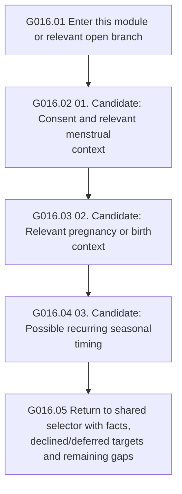


Every arrow means the next candidate after shared checks, not a forced answer. Use the concept appendix for optional details. Establish relevant context without guessing from name or appearance. An unknown applicability state is not an exclusion.


| Candidate | Information target / project question | Catalog target |
|---|---|---|

| G016.Q01 | Would you be comfortable discussing whether menstrual cycles are relevant to these changes? | `q.context.menstrual` |

| G016.Q02 | Is pregnancy or a recent birth relevant to what you have been experiencing? | `q.context.perinatal` |

| G016.Q03 | Have you noticed these low periods returning at particular times of year? | `q.context.seasonal` |


<a id="g017"></a>

### G017 - M7 - Context and care priorities


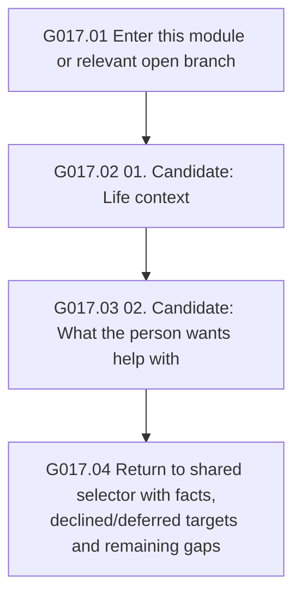


Every arrow means the next candidate after shared checks, not a forced answer. Use the concept appendix for optional details.


| Candidate | Information target / project question | Catalog target |
|---|---|---|

| G017.Q01 | Has anything important been happening around the time these changes began? | `root/MDD/life_context` |

| G017.Q02 | What would you most like help with? | `q.care.priorities` |


M0, M8 and M9 are expanded in G001, G008 and G009 respectively. Their targets are `q.welcome`, `q.measurement.offer` and `q.summary.check`.


| Target | Project wording |
|---|---|

| `q.welcome` | I’m an AI assessment assistant. I can organize what you tell me for professional review. You can skip, pause or stop. Would you like to begin? |

| `q.measurement.offer` | Would you be comfortable completing a brief questionnaire to help record a baseline? |

| `q.summary.check` | Have I understood your experience correctly, or is there anything you would change or add? |


<a id="branches"></a>

## 4. All 24 clinical branches


Each branch below follows the open/relevance decision in G006. The sequence is the current project default, with already supported information reused and useful missing details selected through G005. A positive clue does not establish a diagnosis. These branches retain the detailed source package rules; they do not flatten categories, features and alternatives into one diagnosis list.

| Branch | Diagram |
|---|---|
| B01: Persistent symptoms and PDD course | [G018](#branch-persistent) |
| B02: Menstrual timing and PMDD review | [G019](#branch-menstrual) |
| B03: Substance or medication attribution review | [G020](#branch-exposure) |
| B04: Medical-condition attribution review | [G021](#branch-medical) |
| B05: Brief, recurrent and other-specified presentation review | [G022](#branch-brief-residual) |
| B06: Reported or unresolved residual formulation review | [G023](#branch-unresolved-formulation) |
| B07: Anxious-distress features | [G024](#branch-anxious-distress) |
| B08: Mixed features and activation review | [G025](#branch-mixed-features) |
| B09: Melancholic-feature information | [G026](#branch-melancholic-features) |
| B10: Atypical-feature information | [G027](#branch-atypical-features) |
| B11: Seasonal-course information | [G028](#branch-seasonal-pattern) |
| B12: Pregnancy and postpartum context | [G029](#branch-peripartum-context) |
| B13: Catatonic signs: professional assessment boundary | [G030](#branch-catatonic-signs) |
| B14: Bipolar I, bipolar II and cyclothymic/other bipolar-spectrum presentations | [G031](#branch-alternative-01-bipolar-spectrum) |
| B15: Anxiety presentations: generalized worry, panic and social anxiety | [G032](#branch-alternative-02-anxiety) |
| B16: PTSD and other trauma-related presentations | [G033](#branch-alternative-03-trauma) |
| B17: Adjustment disorder and ordinary stress responses | [G034](#branch-alternative-04-adjustment) |
| B18: Ordinary grief and prolonged grief disorder | [G035](#branch-alternative-05-grief) |
| B19: Psychotic experiences, mood disorders with psychosis and schizoaffective alternatives | [G036](#branch-alternative-06-psychosis) |
| B20: Delirium and acute medical/cognitive change | [G037](#branch-alternative-07-delirium) |
| B21: Cognitive decline and possible neurocognitive disorder | [G038](#branch-alternative-08-neurocognitive) |
| B22: Insomnia, sleep-disordered breathing and schedule-related problems | [G039](#branch-alternative-09-sleep) |
| B23: Medical conditions and depressive symptoms | [G040](#branch-alternative-10-medical) |
| B24: Substance, medication, intoxication and withdrawal-related presentations | [G041](#branch-alternative-11-substance-medication) |


<a id="branch-persistent"></a>

### G018 - B01 - Persistent symptoms and PDD course


```mermaid
flowchart TD

    G018n01["G018.01 Enter this module or relevant open branch"]

    G018n02["G018.02 01. Candidate: Longitudinal course"]

    G018n03["G018.03 02. Candidate: Persistent depressed-mood<br/>report"]

    G018n04["G018.04 03. Candidate: Appetite or overeating"]

    G018n05["G018.05 04. Candidate: Sleep disturbance"]

    G018n06["G018.06 05. Candidate: Energy and fatigue"]

    G018n07["G018.07 06. Candidate: Low self-esteem"]

    G018n08["G018.08 07. Candidate: Concentration and decisions"]

    G018n09["G018.09 08. Candidate: Hopelessness"]

    G018n10["G018.10 09. Candidate: Major depressive episode<br/>history"]

    G018n11["G018.11 10. Candidate: Age-at-onset history"]

    G018n12["G018.12 Return to shared selector with facts,<br/>declined/deferred targets and remaining gaps"]

    G018n01 --> G018n02

    G018n02 --> G018n03

    G018n03 --> G018n04

    G018n04 --> G018n05

    G018n05 --> G018n06

    G018n06 --> G018n07

    G018n07 --> G018n08

    G018n08 --> G018n09

    G018n09 --> G018n10

    G018n10 --> G018n11

    G018n11 --> G018n12

```


**Open when:** Longstanding low mood, incomplete recovery, or unclear long-term baseline. **Branch ID:** `persistent`. After the branch, return to the shared selector; unresolved targets remain visible.


| Candidate | Information target / project question | Catalog target |
|---|---|---|

| G018.Q01 | Were there stretches when these difficulties went away? | `root/PDD/longitudinal_timeline` |

| G018.Q02 | When do you remember this longer-lasting low mood beginning? | `root/PDD/depressed_mood` |

| G018.Q03 | During those low-mood periods, what was your appetite or eating like? | `root/PDD/appetite_eating` |

| G018.Q04 | How was your sleep during those periods? | `root/PDD/sleep_disturbance` |

| G018.Q05 | What was your energy like during those low-mood periods? | `root/PDD/energy_fatigue` |

| G018.Q06 | How were you thinking about yourself during that time? | `root/PDD/low_self_esteem` |

| G018.Q07 | Were concentrating or making decisions difficult during that time? | `root/PDD/cognition_decisions` |

| G018.Q08 | How did the future seem to you during that period? | `root/PDD/hopelessness` |

| G018.Q09 | Were there periods when things became noticeably worse than that usual pattern? | `root/PDD/mde_history` |

| G018.Q10 | About how old were you when that longer-lasting pattern began? | `root/PDD/onset_history` |


<a id="branch-menstrual"></a>

### G019 - B02 - Menstrual timing and PMDD review


```mermaid
flowchart TD

    G019n01["G019.01 Enter this module or relevant open branch"]

    G019n02["G019.02 01. Candidate: Cycle/reproductive context"]

    G019n03["G019.03 02. Candidate: Symptom timing across cycles"]

    G019n04["G019.04 03. Candidate: Symptoms outside the<br/>premenstrual interval"]

    G019n05["G019.05 04. Candidate: Mood lability"]

    G019n06["G019.06 05. Candidate: Irritability, anger or conflict"]

    G019n07["G019.07 06. Candidate: Depressed mood, hopelessness or<br/>self-critical thoughts"]

    G019n08["G019.08 07. Candidate: Anxiety or tension"]

    G019n09["G019.09 08. Candidate: Reduced interest"]

    G019n10["G019.10 09. Candidate: Concentration difficulty"]

    G019n11["G019.11 10. Candidate: Low energy/fatigue"]

    G019n12["G019.12 11. Candidate: Appetite, overeating or<br/>cravings"]

    G019n13["G019.13 12. Candidate: Sleep disturbance"]

    G019n14["G019.14 13. Candidate: Overwhelmed or out of control"]

    G019n15["G019.15 14. Candidate: Physical symptom group"]

    G019n16["G019.16 15. Candidate: Functioning and distress"]

    G019n17["G019.17 16. Candidate: Hormonal exposure context"]

    G019n18["G019.18 17. Candidate: Premenstrual exacerbation<br/>review"]

    G019n19["G019.19 18. Candidate: Prospective-record history"]

    G019n20["G019.20 Return to shared selector with facts,<br/>declined/deferred targets and remaining gaps"]

    G019n01 --> G019n02

    G019n02 --> G019n03

    G019n03 --> G019n04

    G019n04 --> G019n05

    G019n05 --> G019n06

    G019n06 --> G019n07

    G019n07 --> G019n08

    G019n08 --> G019n09

    G019n09 --> G019n10

    G019n10 --> G019n11

    G019n11 --> G019n12

    G019n12 --> G019n13

    G019n13 --> G019n14

    G019n14 --> G019n15

    G019n15 --> G019n16

    G019n16 --> G019n17

    G019n17 --> G019n18

    G019n18 --> G019n19

    G019n19 --> G019n20

```


**Open when:** Relevant menstrual/ovarian context plus possible cyclicity or unresolved timing. **Branch ID:** `menstrual`. After the branch, return to the shared selector; unresolved targets remain visible.


| Candidate | Information target / project question | Catalog target |
|---|---|---|

| G019.Q01 | What is your usual pattern of periods, and has it changed recently? | `root/PMDD/cycle_context` |

| G019.Q02 | What happens to those symptoms after your period starts? | `root/PMDD/cyclical_timeline` |

| G019.Q03 | How do you feel at other times in the month? | `root/PMDD/background_symptoms` |

| G019.Q04 | What kinds of mood changes have you noticed around that time? | `root/PMDD/mood_lability` |

| G019.Q05 | Have you noticed changes in irritability or how you get along with others? | `root/PMDD/irritability_anger` |

| G019.Q06 | How do you feel about yourself and the future during those days? | `root/PMDD/depressed_affect` |

| G019.Q07 | What is anxiety or tension like for you during that time? | `root/PMDD/anxiety_tension` |

| G019.Q08 | Does your interest in your usual activities change during those days? | `root/PMDD/reduced_interest` |

| G019.Q09 | Do you notice changes in concentration during those days? | `root/PMDD/concentration_difficulty` |

| G019.Q10 | How does your energy compare at different points in the month? | `root/PMDD/low_energy` |

| G019.Q11 | Have you noticed changes in appetite, eating or cravings at that time? | `root/PMDD/appetite_cravings` |

| G019.Q12 | Does your sleep change around that time? | `root/PMDD/sleep_disturbance` |

| G019.Q13 | Do you feel overwhelmed or out of control during those days? | `root/PMDD/overwhelmed_control` |

| G019.Q14 | What physical changes, if any, do you notice around that time? | `root/PMDD/physical_symptoms` |

| G019.Q15 | How have these changes affected your daily life? | `root/PMDD/functioning_distress` |

| G019.Q16 | Have hormonal treatments or contraception changed around the time these symptoms changed? | `root/PMDD/hormone_exposure` |

| G019.Q17 | Are these the same difficulties you have at other times, or do different symptoms appear? | `root/PMDD/pme_review` |

| G019.Q18 | Have you kept daily symptom ratings across complete cycles? | `root/PMDD/prospective_records` |


<a id="branch-exposure"></a>

### G020 - B03 - Substance or medication attribution review


```mermaid
flowchart TD

    G020n01["G020.01 Enter this module or relevant open branch"]

    G020n02["G020.02 01. Candidate: Medicine/substance<br/>identification and use"]

    G020n03["G020.03 02. Candidate: Exposure changes and last use"]

    G020n04["G020.04 03. Candidate: Mood relative to exposure"]

    G020n05["G020.05 04. Candidate: Depression outside the exposure<br/>period"]

    G020n06["G020.06 05. Candidate: Course after an exposure change"]

    G020n07["G020.07 06. Candidate: Possible<br/>intoxication/withdrawal context"]

    G020n08["G020.08 07. Candidate: Illness, treatment and<br/>competing explanations"]

    G020n09["G020.09 08. Candidate: Reported tests and professional<br/>findings"]

    G020n10["G020.10 Return to shared selector with facts,<br/>declined/deferred targets and remaining gaps"]

    G020n01 --> G020n02

    G020n02 --> G020n03

    G020n03 --> G020n04

    G020n04 --> G020n05

    G020n05 --> G020n06

    G020n06 --> G020n07

    G020n07 --> G020n08

    G020n08 --> G020n09

    G020n09 --> G020n10

```


**Open when:** Relevant medication/substance exposure or temporal attribution question. **Branch ID:** `exposure`. After the branch, return to the shared selector; unresolved targets remain visible.


| Candidate | Information target / project question | Catalog target |
|---|---|---|

| G020.Q01 | What medicines, supplements, alcohol or other substances have you been using recently? | `root/Substance_Medication_Induced_Depression/exposure_details` |

| G020.Q02 | Was there any change in how you were taking or using it around that time? | `root/Substance_Medication_Induced_Depression/exposure_events` |

| G020.Q03 | How did the timing of the mood change compare with starting or changing it? | `root/Substance_Medication_Induced_Depression/exposure_mood_timing` |

| G020.Q04 | Have you had a similar period before, including times before you used this medicine or substance? | `root/Substance_Medication_Induced_Depression/independent_depression_history` |

| G020.Q05 | Since that change happened, what has happened to your mood? | `root/Substance_Medication_Induced_Depression/post_exposure_course` |

| G020.Q06 | What other changes did you notice around the time you reduced or stopped it? | `root/Substance_Medication_Induced_Depression/intoxication_withdrawal_context` |

| G020.Q07 | What was happening with the condition being treated when your mood changed? | `root/Substance_Medication_Induced_Depression/medical_indication_confounding` |

| G020.Q08 | Has a clinician assessed these changes or discussed any relevant test results with you? | `root/Substance_Medication_Induced_Depression/reported_tests_review` |


<a id="branch-medical"></a>

### G021 - B04 - Medical-condition attribution review


```mermaid
flowchart TD

    G021n01["G021.01 Enter this module or relevant open branch"]

    G021n02["G021.02 01. Candidate: Reported medical condition and<br/>diagnostic basis"]

    G021n03["G021.03 02. Candidate: Medical illness chronology and<br/>course"]

    G021n04["G021.04 03. Candidate: Relationship of mood and<br/>medical course"]

    G021n05["G021.05 04. Candidate: Reported examination and<br/>investigation findings"]

    G021n06["G021.06 05. Candidate: Reported professional view of<br/>the relationship"]

    G021n07["G021.07 06. Candidate: Earlier depressive periods and<br/>baseline"]

    G021n08["G021.08 07. Candidate: Treatment, medication and<br/>substance alternatives"]

    G021n09["G021.09 08. Candidate: Symptoms with several possible<br/>explanations"]

    G021n10["G021.10 09. Candidate: Response to illness, loss and<br/>demoralization"]

    G021n11["G021.11 Return to shared selector with facts,<br/>declined/deferred targets and remaining gaps"]

    G021n01 --> G021n02

    G021n02 --> G021n03

    G021n03 --> G021n04

    G021n04 --> G021n05

    G021n05 --> G021n06

    G021n06 --> G021n07

    G021n07 --> G021n08

    G021n08 --> G021n09

    G021n09 --> G021n10

    G021n10 --> G021n11

```


**Open when:** Potential relevant illness or unresolved physiological explanation. **Branch ID:** `medical`. After the branch, return to the shared selector; unresolved targets remain visible.


| Candidate | Information target / project question | Catalog target |
|---|---|---|

| G021.Q01 | Have you been diagnosed with a medical condition, or are any symptoms being investigated? | `root/Depression_Due_To_Medical_Condition/condition_identification` |

| G021.Q02 | When did the physical symptoms begin, and what has changed since then? | `root/Depression_Due_To_Medical_Condition/medical_condition_course` |

| G021.Q03 | How did the timing of your mood change compare with the illness or its treatment? | `root/Depression_Due_To_Medical_Condition/mood_medical_timing` |

| G021.Q04 | Have any tests or examinations been done, and what did your clinician tell you about the results? | `root/Depression_Due_To_Medical_Condition/reported_investigation` |

| G021.Q05 | Has a clinician discussed whether the condition, its treatment or something else may be affecting your mood? | `root/Depression_Due_To_Medical_Condition/reported_professional_opinion` |

| G021.Q06 | Have there been similar periods earlier in your life, and what was happening with your health then? | `root/Depression_Due_To_Medical_Condition/prior_depressive_course` |

| G021.Q07 | What treatments or medicines were started or changed around the time your mood changed? | `root/Depression_Due_To_Medical_Condition/treatment_exposure_review` |

| G021.Q08 | Is this different from your usual experience with the physical condition? | `root/Depression_Due_To_Medical_Condition/overlapping_symptoms` |

| G021.Q09 | How has living with the condition affected how you feel about your life? | `root/Depression_Due_To_Medical_Condition/illness_related_distress` |


<a id="branch-brief-residual"></a>

### G022 - B05 - Brief, recurrent and other-specified presentation review


```mermaid
flowchart TD

    G022n01["G022.01 Enter this module or relevant open branch"]

    G022n02["G022.02 01. Candidate: Individual brief depressive<br/>period"]

    G022n03["G022.03 02. Candidate: Recurrence across months"]

    G022n04["G022.04 03. Candidate: Symptoms between low periods"]

    G022n05["G022.05 04. Candidate: Lifetime threshold and previous<br/>diagnostic history"]

    G022n06["G022.06 05. Candidate: Menstrual-cycle relationship<br/>when relevant"]

    G022n07["G022.07 06. Candidate: Stressors and adjustment-<br/>related alternatives"]

    G022n08["G022.08 07. Candidate: Reported professional<br/>explanation of an unmet requirement"]

    G022n09["G022.09 08. Candidate: Unanswered or uncertain<br/>information"]

    G022n10["G022.10 Return to shared selector with facts,<br/>declined/deferred targets and remaining gaps"]

    G022n01 --> G022n02

    G022n02 --> G022n03

    G022n03 --> G022n04

    G022n04 --> G022n05

    G022n05 --> G022n06

    G022n06 --> G022n07

    G022n07 --> G022n08

    G022n08 --> G022n09

    G022n09 --> G022n10

```


**Open when:** Brief/repeated or otherwise non-fitting depressive presentation requiring review. **Branch ID:** `brief_residual`. After the branch, return to the shared selector; unresolved targets remain visible.


| Candidate | Information target / project question | Catalog target |
|---|---|---|

| G022.Q01 | Could you describe one recent low period, from when it began until it ended? | `root/Other_Specified_Depressive_Disorder/brief_period_details` |

| G022.Q02 | Over what period has this been happening, and have there been months without a low spell? | `root/Other_Specified_Depressive_Disorder/recurrence_pattern` |

| G022.Q03 | How do you feel between those low spells? | `root/Other_Specified_Depressive_Disorder/between_period_course` |

| G022.Q04 | Have you ever had a longer period like this, or received a mood or psychotic-disorder diagnosis? | `root/Other_Specified_Depressive_Disorder/lifetime_threshold_history` |

| G022.Q05 | If relevant to you, have you noticed whether these spells are linked to your menstrual cycle? | `root/Other_Specified_Depressive_Disorder/menstrual_relationship` |

| G022.Q06 | What was happening in your life around the time this started? | `root/Other_Specified_Depressive_Disorder/stressor_adjustment_review` |

| G022.Q07 | Has a clinician explained how they understand these symptoms or what remains uncertain? | `root/Other_Specified_Depressive_Disorder/reported_diagnostic_reason` |

| G022.Q08 | What parts of the timing are you able to remember? | `root/Other_Specified_Depressive_Disorder/assessment_information_gaps` |


<a id="branch-unresolved-formulation"></a>

### G023 - B06 - Reported or unresolved residual formulation review


```mermaid
flowchart TD

    G023n01["G023.01 Enter this module or relevant open branch"]

    G023n02["G023.02 01. Candidate: Current depressive presentation<br/>and burden"]

    G023n03["G023.03 02. Candidate: Reported clinician diagnosis or<br/>formulation"]

    G023n04["G023.04 03. Candidate: Reported limits affecting<br/>assessment"]

    G023n05["G023.05 04. Candidate: Changes reported at<br/>reassessment"]

    G023n06["G023.06 Return to shared selector with facts,<br/>declined/deferred targets and remaining gaps"]

    G023n01 --> G023n02

    G023n02 --> G023n03

    G023n03 --> G023n04

    G023n04 --> G023n05

    G023n05 --> G023n06

```


**Open when:** Existing residual formulation or significant unresolved presentation; not mere interview incompleteness. **Branch ID:** `unresolved_formulation`. After the branch, return to the shared selector; unresolved targets remain visible.


| Candidate | Information target / project question | Catalog target |
|---|---|---|

| G023.Q01 | What have you noticed, and how has it affected everyday life? | `root/Unspecified_Depressive_Disorder/presentation_description` |

| G023.Q02 | Has a professional assessed this before, and what did they explain to you? | `root/Unspecified_Depressive_Disorder/reported_clinical_formulation` |

| G023.Q03 | Would you like me to ask that another way, or leave it for now? | `root/Unspecified_Depressive_Disorder/assessment_limit` |

| G023.Q04 | Since we last discussed this, what has changed or become clearer? | `root/Unspecified_Depressive_Disorder/followup_change_report` |


<a id="branch-anxious-distress"></a>

### G024 - B07 - Anxious-distress features


```mermaid
flowchart TD

    G024n01["G024.01 Enter this module or relevant open branch"]

    G024n02["G024.02 01. Candidate: Anxious distress"]

    G024n03["G024.03 Return to shared selector with facts,<br/>declined/deferred targets and remaining gaps"]

    G024n01 --> G024n02

    G024n02 --> G024n03

```


**Open when:** Applicable clue or explicit unresolved feature requiring review; check disorder-specific applicability in the source package.. **Branch ID:** `anxious_distress`. After the branch, return to the shared selector; unresolved targets remain visible.


| Candidate | Information target / project question | Catalog target |
|---|---|---|

| G024.Q01 | During this low period, have you also been feeling unusually tense or on edge? | `root/MDD/anxious_distress` |


<a id="branch-mixed-features"></a>

### G025 - B08 - Mixed features and activation review


```mermaid
flowchart TD

    G025n01["G025.01 Enter this module or relevant open branch"]

    G025n02["G025.02 01. Candidate: Mixed features"]

    G025n03["G025.03 Return to shared selector with facts,<br/>declined/deferred targets and remaining gaps"]

    G025n01 --> G025n02

    G025n02 --> G025n03

```


**Open when:** Applicable clue or explicit unresolved feature requiring review; check disorder-specific applicability in the source package.. **Branch ID:** `mixed_features`. After the branch, return to the shared selector; unresolved targets remain visible.


| Candidate | Information target / project question | Catalog target |
|---|---|---|

| G025.Q01 | During the low period, have there also been distinct changes in your energy or activity? | `root/MDD/mixed_features` |


<a id="branch-melancholic-features"></a>

### G026 - B09 - Melancholic-feature information


```mermaid
flowchart TD

    G026n01["G026.01 Enter this module or relevant open branch"]

    G026n02["G026.02 01. Candidate: Melancholic features"]

    G026n03["G026.03 Return to shared selector with facts,<br/>declined/deferred targets and remaining gaps"]

    G026n01 --> G026n02

    G026n02 --> G026n03

```


**Open when:** Applicable clue or explicit unresolved feature requiring review; check disorder-specific applicability in the source package.. **Branch ID:** `melancholic_features`. After the branch, return to the shared selector; unresolved targets remain visible.


| Candidate | Information target / project question | Catalog target |
|---|---|---|

| G026.Q01 | When something good happens during this period, how does your mood respond? | `root/MDD/melancholic_features` |


<a id="branch-atypical-features"></a>

### G027 - B10 - Atypical-feature information


```mermaid
flowchart TD

    G027n01["G027.01 Enter this module or relevant open branch"]

    G027n02["G027.02 01. Candidate: Atypical features"]

    G027n03["G027.03 Return to shared selector with facts,<br/>declined/deferred targets and remaining gaps"]

    G027n01 --> G027n02

    G027n02 --> G027n03

```


**Open when:** Applicable clue or explicit unresolved feature requiring review; check disorder-specific applicability in the source package.. **Branch ID:** `atypical_features`. After the branch, return to the shared selector; unresolved targets remain visible.


| Candidate | Information target / project question | Catalog target |
|---|---|---|

| G027.Q01 | Have you noticed changes such as sleeping much more, eating more, or feeling unusually heavy in your limbs? | `root/MDD/atypical_features` |


<a id="branch-seasonal-pattern"></a>

### G028 - B11 - Seasonal-course information


```mermaid
flowchart TD

    G028n01["G028.01 Enter this module or relevant open branch"]

    G028n02["G028.02 01. Candidate: Seasonal pattern"]

    G028n03["G028.03 Return to shared selector with facts,<br/>declined/deferred targets and remaining gaps"]

    G028n01 --> G028n02

    G028n02 --> G028n03

```


**Open when:** Applicable clue or explicit unresolved feature requiring review; check disorder-specific applicability in the source package.. **Branch ID:** `seasonal_pattern`. After the branch, return to the shared selector; unresolved targets remain visible.


| Candidate | Information target / project question | Catalog target |
|---|---|---|

| G028.Q01 | Do these low periods tend to begin and improve at particular times of year? | `root/MDD/seasonal_pattern` |


<a id="branch-peripartum-context"></a>

### G029 - B12 - Pregnancy and postpartum context


```mermaid
flowchart TD

    G029n01["G029.01 Enter this module or relevant open branch"]

    G029n02["G029.02 01. Candidate: Peripartum/perinatal context"]

    G029n03["G029.03 Return to shared selector with facts,<br/>declined/deferred targets and remaining gaps"]

    G029n01 --> G029n02

    G029n02 --> G029n03

```


**Open when:** Applicable clue or explicit unresolved feature requiring review; check disorder-specific applicability in the source package.. **Branch ID:** `peripartum_context`. After the branch, return to the shared selector; unresolved targets remain visible.


| Candidate | Information target / project question | Catalog target |
|---|---|---|

| G029.Q01 | If pregnancy or a recent birth is relevant, how did the timing relate to these changes? | `root/MDD/peripartum_context` |


<a id="branch-catatonic-signs"></a>

### G030 - B13 - Catatonic signs: professional assessment boundary


```mermaid
flowchart TD

    G030n01["G030.01 Enter this module or relevant open branch"]

    G030n02["G030.02 01. Candidate: Catatonic signs"]

    G030n03["G030.03 Return to shared selector with facts,<br/>declined/deferred targets and remaining gaps"]

    G030n01 --> G030n02

    G030n02 --> G030n03

```


**Open when:** Applicable clue or explicit unresolved feature requiring review; check disorder-specific applicability in the source package.. **Branch ID:** `catatonic_signs`. Professional/urgent review can take precedence. The chart lists information domains for appropriate review, not a lay self-diagnostic examination or permission to delay urgent care. After the branch, return to the shared selector; unresolved targets remain visible.


| Candidate | Information target / project question | Catalog target |
|---|---|---|

| G030.Q01 | Has a health professional assessed any marked changes in movement, speech or responsiveness? | `root/MDD/catatonic_signs` |


<a id="branch-alternative-01-bipolar-spectrum"></a>

### G031 - B14 - Bipolar I, bipolar II and cyclothymic/other bipolar-spectrum presentations


```mermaid
flowchart TD

    G031n01["G031.01 Enter this module or relevant open branch"]

    G031n02["G031.02 01. Candidate: Distinct activation period"]

    G031n03["G031.03 02. Candidate: Reduced need for sleep"]

    G031n04["G031.04 03. Candidate: Associated activation features"]

    G031n05["G031.05 04. Candidate: Activation severity and causal<br/>context"]

    G031n06["G031.06 05. Candidate: Long-term mood fluctuation"]

    G031n07["G031.07 06. Candidate: Episode timeline"]

    G031n08["G031.08 07. Candidate: Previous care"]

    G031n09["G031.09 08. Candidate: Family history"]

    G031n10["G031.10 09. Candidate: Death/suicide-related reports"]

    G031n11["G031.11 Return to shared selector with facts,<br/>declined/deferred targets and remaining gaps"]

    G031n01 --> G031n02

    G031n02 --> G031n03

    G031n03 --> G031n04

    G031n04 --> G031n05

    G031n05 --> G031n06

    G031n06 --> G031n07

    G031n07 --> G031n08

    G031n08 --> G031n09

    G031n09 --> G031n10

    G031n10 --> G031n11

```


**Open when:** Lifetime activation is relevant in any depression assessment. Ask focused follow-ups if the account suggests a distinct high/irritable, energetic or disinhibited period, reduced sleep need, or prior bipolar formulation.. **Branch ID:** `alternative_01_bipolar_spectrum`. After the branch, return to the shared selector; unresolved targets remain visible.


| Candidate | Information target / project question | Catalog target |
|---|---|---|

| G031.Q01 | Have there been distinct times when your mood and energy were unusually different from your usual self? | `root/Alternatives/activation_mood_energy` |

| G031.Q02 | When you slept less during that period, did you feel rested or tired afterwards? | `root/Alternatives/reduced_sleep_need` |

| G031.Q03 | What else changed during that same period? | `root/Alternatives/activation_associated_changes` |

| G031.Q04 | Did that period cause serious problems or lead you to need urgent care? | `root/Alternatives/activation_severity_context` |

| G031.Q05 | Over the longer term, how have the higher and lower periods alternated? | `root/Alternatives/longterm_mood_fluctuation` |

| G031.Q06 | When did these changes begin? | `root/Alternatives/episode_timeline` |

| G031.Q07 | Have you received help for something similar before? | `root/Alternatives/treatment_history` |

| G031.Q08 | Is there relevant mental-health history in your family? | `root/Alternatives/family_history` |

| G031.Q09 | Have you had thoughts about ending your life? | `root/Alternatives/death_suicide` |


<a id="branch-alternative-02-anxiety"></a>

### G032 - B15 - Anxiety presentations: generalized worry, panic and social anxiety


```mermaid
flowchart TD

    G032n01["G032.01 Enter this module or relevant open branch"]

    G032n02["G032.02 01. Candidate: Generalized worry pattern"]

    G032n03["G032.03 02. Candidate: Panic-like episode"]

    G032n04["G032.04 03. Candidate: Social fear and avoidance"]

    G032n05["G032.05 04. Candidate: Sleep disturbance"]

    G032n06["G032.06 05. Candidate: Concentration and decisions"]

    G032n07["G032.07 06. Candidate: Functioning and distress"]

    G032n08["G032.08 07. Candidate: Medicines and substances"]

    G032n09["G032.09 Return to shared selector with facts,<br/>declined/deferred targets and remaining gaps"]

    G032n01 --> G032n02

    G032n02 --> G032n03

    G032n03 --> G032n04

    G032n04 --> G032n05

    G032n05 --> G032n06

    G032n06 --> G032n07

    G032n07 --> G032n08

    G032n08 --> G032n09

```


**Open when:** Explore if worry/fear, sudden episodes or avoidance are reported, or when overlapping symptoms remain unexplained.. **Branch ID:** `alternative_02_anxiety`. After the branch, return to the shared selector; unresolved targets remain visible.


| Candidate | Information target / project question | Catalog target |
|---|---|---|

| G032.Q01 | What worries have been taking up your mind, and how hard are they to set aside? | `root/Alternatives/worry_pattern` |

| G032.Q02 | Could you describe what happens during one of those sudden episodes? | `root/Alternatives/panic_experience` |

| G032.Q03 | What makes seeing people difficult: worry about what might happen, low interest, or something else? | `root/Alternatives/social_fear_avoidance` |

| G032.Q04 | How has your sleep changed from what is usual for you? | `root/Alternatives/sleep_disturbance` |

| G032.Q05 | Have concentrating or making decisions become harder than usual? | `root/Alternatives/cognition_decisions` |

| G032.Q06 | How have these changes affected your daily life? | `root/Alternatives/functioning_distress` |

| G032.Q07 | Have any medicines or substance-use patterns changed around this time? | `root/Alternatives/exposure_context` |


<a id="branch-alternative-03-trauma"></a>

### G033 - B16 - PTSD and other trauma-related presentations


```mermaid
flowchart TD

    G033n01["G033.01 Enter this module or relevant open branch"]

    G033n02["G033.02 01. Candidate: Trauma context and assessment<br/>permission"]

    G033n03["G033.03 02. Candidate: Trauma-linked symptom pattern"]

    G033n04["G033.04 03. Candidate: Episode timeline"]

    G033n05["G033.05 04. Candidate: Functioning and distress"]

    G033n06["G033.06 05. Candidate: Death/suicide-related reports"]

    G033n07["G033.07 06. Candidate: Assessment participation and<br/>limits"]

    G033n08["G033.08 Return to shared selector with facts,<br/>declined/deferred targets and remaining gaps"]

    G033n01 --> G033n02

    G033n02 --> G033n03

    G033n03 --> G033n04

    G033n04 --> G033n05

    G033n05 --> G033n06

    G033n06 --> G033n07

    G033n07 --> G033n08

```


**Open when:** Explore when the person reports a potentially relevant event or trauma-linked effects. Ask permission and use broad context before symptom follow-ups.. **Branch ID:** `alternative_03_trauma`. After the branch, return to the shared selector; unresolved targets remain visible.


| Candidate | Information target / project question | Catalog target |
|---|---|---|

| G033.Q01 | Has anything frightening or traumatic happened that you feel may be connected, without going into details you do not want to share? | `root/Alternatives/trauma_context` |

| G033.Q02 | How has it affected you—for example, in unwanted memories, feeling on guard or avoiding reminders? | `root/Alternatives/trauma_linked_symptoms` |

| G033.Q03 | When did these changes begin? | `root/Alternatives/episode_timeline` |

| G033.Q04 | How have these changes affected your daily life? | `root/Alternatives/functioning_distress` |

| G033.Q05 | Have you had thoughts about ending your life? | `root/Alternatives/death_suicide` |

| G033.Q06 | Would you prefer that I ask this another way or leave it for now? | `root/Alternatives/assessment_limits` |


<a id="branch-alternative-04-adjustment"></a>

### G034 - B17 - Adjustment disorder and ordinary stress responses


```mermaid
flowchart TD

    G034n01["G034.01 Enter this module or relevant open branch"]

    G034n02["G034.02 01. Candidate: Stressor-linked response"]

    G034n03["G034.03 02. Candidate: Depressed mood"]

    G034n04["G034.04 03. Candidate: Functioning and distress"]

    G034n05["G034.05 04. Candidate: Episode timeline"]

    G034n06["G034.06 05. Candidate: Life context"]

    G034n07["G034.07 06. Candidate: Death/suicide-related reports"]

    G034n08["G034.08 Return to shared selector with facts,<br/>declined/deferred targets and remaining gaps"]

    G034n01 --> G034n02

    G034n02 --> G034n03

    G034n03 --> G034n04

    G034n04 --> G034n05

    G034n05 --> G034n06

    G034n06 --> G034n07

    G034n07 --> G034n08

```


**Open when:** Explore when a clear stressor is reported or symptoms are tightly linked to a change in circumstances.. **Branch ID:** `alternative_04_adjustment`. After the branch, return to the shared selector; unresolved targets remain visible.


| Candidate | Information target / project question | Catalog target |
|---|---|---|

| G034.Q01 | What changed around the time this began, and is that situation or its impact still ongoing? | `root/Alternatives/stressor_response` |

| G034.Q02 | How has your mood been during this period? | `root/Alternatives/depressed_mood` |

| G034.Q03 | How have these changes affected your daily life? | `root/Alternatives/functioning_distress` |

| G034.Q04 | When did these changes begin? | `root/Alternatives/episode_timeline` |

| G034.Q05 | Has anything important been happening around the time these changes began? | `root/Alternatives/life_context` |

| G034.Q06 | Have you had thoughts about ending your life? | `root/Alternatives/death_suicide` |


<a id="branch-alternative-05-grief"></a>

### G035 - B18 - Ordinary grief and prolonged grief disorder


```mermaid
flowchart TD

    G035n01["G035.01 Enter this module or relevant open branch"]

    G035n02["G035.02 01. Candidate: Bereavement and cultural<br/>context"]

    G035n03["G035.03 02. Candidate: Grief-specific experiences"]

    G035n04["G035.04 03. Candidate: Depressed mood"]

    G035n05["G035.05 04. Candidate: Interest and pleasure"]

    G035n06["G035.06 05. Candidate: Functioning and distress"]

    G035n07["G035.07 06. Candidate: Death/suicide-related reports"]

    G035n08["G035.08 Return to shared selector with facts,<br/>declined/deferred targets and remaining gaps"]

    G035n01 --> G035n02

    G035n02 --> G035n03

    G035n03 --> G035n04

    G035n04 --> G035n05

    G035n05 --> G035n06

    G035n06 --> G035n07

    G035n07 --> G035n08

```


**Open when:** Explore when a death is reported or the account is strongly loss-focused; do not assume every loss is bereavement after a death.. **Branch ID:** `alternative_05_grief`. After the branch, return to the shared selector; unresolved targets remain visible.


| Candidate | Information target / project question | Catalog target |
|---|---|---|

| G035.Q01 | Would you like to tell me about the loss and how it has affected you? | `root/Alternatives/bereavement_context` |

| G035.Q02 | What has been hardest about the grief recently? | `root/Alternatives/grief_specific_experiences` |

| G035.Q03 | How has your mood been during this period? | `root/Alternatives/depressed_mood` |

| G035.Q04 | Have your interest or enjoyment in your usual activities changed? | `root/Alternatives/interest_pleasure` |

| G035.Q05 | How have these changes affected your daily life? | `root/Alternatives/functioning_distress` |

| G035.Q06 | Have you had thoughts about ending your life? | `root/Alternatives/death_suicide` |


<a id="branch-alternative-06-psychosis"></a>

### G036 - B19 - Psychotic experiences, mood disorders with psychosis and schizoaffective alternatives


```mermaid
flowchart TD

    G036n01["G036.01 Enter this module or relevant open branch"]

    G036n02["G036.02 01. Candidate: Unusual perceptual or belief<br/>experiences"]

    G036n03["G036.03 02. Candidate: Psychosis and mood across time"]

    G036n04["G036.04 03. Candidate: Distinct activation period"]

    G036n05["G036.05 04. Candidate: Episode timeline"]

    G036n06["G036.06 05. Candidate: Medical context"]

    G036n07["G036.07 06. Candidate: Medicines and substances"]

    G036n08["G036.08 07. Candidate: Death/suicide-related reports"]

    G036n09["G036.09 Return to shared selector with facts,<br/>declined/deferred targets and remaining gaps"]

    G036n01 --> G036n02

    G036n02 --> G036n03

    G036n03 --> G036n04

    G036n04 --> G036n05

    G036n05 --> G036n06

    G036n06 --> G036n07

    G036n07 --> G036n08

    G036n08 --> G036n09

```


**Open when:** Explore when perceptual, belief, disorganization or prior psychotic-diagnosis information is reported; do not infer it from unfamiliar cultural expression.. **Branch ID:** `alternative_06_psychosis`. After the branch, return to the shared selector; unresolved targets remain visible.


| Candidate | Information target / project question | Catalog target |
|---|---|---|

| G036.Q01 | Have you noticed experiences such as hearing or seeing things that others do not seem to notice? | `root/Alternatives/psychotic_experiences` |

| G036.Q02 | Have those experiences also happened at times when you were not having a low or unusually high mood period? | `root/Alternatives/psychosis_mood_course` |

| G036.Q03 | Have there been distinct times when your mood and energy were unusually different from your usual self? | `root/Alternatives/activation_mood_energy` |

| G036.Q04 | When did these changes begin? | `root/Alternatives/episode_timeline` |

| G036.Q05 | Are there health conditions that might be relevant to these changes? | `root/Alternatives/medical_context` |

| G036.Q06 | Have any medicines or substance-use patterns changed around this time? | `root/Alternatives/exposure_context` |

| G036.Q07 | Have you had thoughts about ending your life? | `root/Alternatives/death_suicide` |


<a id="branch-alternative-07-delirium"></a>

### G037 - B20 - Delirium and acute medical/cognitive change


```mermaid
flowchart TD

    G037n01["G037.01 Enter this module or relevant open branch"]

    G037n02["G037.02 01. Candidate: Acute/fluctuating cognitive<br/>change"]

    G037n03["G037.03 02. Candidate: Medical context"]

    G037n04["G037.04 03. Candidate: Medicines and substances"]

    G037n05["G037.05 04. Candidate: Assessment participation and<br/>limits"]

    G037n06["G037.06 Return to shared selector with facts,<br/>declined/deferred targets and remaining gaps"]

    G037n01 --> G037n02

    G037n02 --> G037n03

    G037n03 --> G037n04

    G037n04 --> G037n05

    G037n05 --> G037n06

```


**Open when:** Pause routine questioning if current sudden confusion, altered attention/awareness or marked fluctuation is reported.. **Branch ID:** `alternative_07_delirium`. Professional/urgent review can take precedence. The chart lists information domains for appropriate review, not a lay self-diagnostic examination or permission to delay urgent care. After the branch, return to the shared selector; unresolved targets remain visible.


| Candidate | Information target / project question | Catalog target |
|---|---|---|

| G037.Q01 | Has there been a sudden change in confusion or ability to pay attention compared with usual? | `root/Alternatives/acute_attention_change` |

| G037.Q02 | Are there health conditions that might be relevant to these changes? | `root/Alternatives/medical_context` |

| G037.Q03 | Have any medicines or substance-use patterns changed around this time? | `root/Alternatives/exposure_context` |

| G037.Q04 | Would you prefer that I ask this another way or leave it for now? | `root/Alternatives/assessment_limits` |


<a id="branch-alternative-08-neurocognitive"></a>

### G038 - B21 - Cognitive decline and possible neurocognitive disorder


```mermaid
flowchart TD

    G038n01["G038.01 Enter this module or relevant open branch"]

    G038n02["G038.02 01. Candidate: Longer-term cognitive and<br/>functional course"]

    G038n03["G038.03 02. Candidate: Concentration and decisions"]

    G038n04["G038.04 03. Candidate: Episode timeline"]

    G038n05["G038.05 04. Candidate: Medical context"]

    G038n06["G038.06 05. Candidate: Medicines and substances"]

    G038n07["G038.07 06. Candidate: Sleep opportunity and schedule"]

    G038n08["G038.08 07. Candidate: Assessment participation and<br/>limits"]

    G038n09["G038.09 Return to shared selector with facts,<br/>declined/deferred targets and remaining gaps"]

    G038n01 --> G038n02

    G038n02 --> G038n03

    G038n03 --> G038n04

    G038n04 --> G038n05

    G038n05 --> G038n06

    G038n06 --> G038n07

    G038n07 --> G038n08

    G038n08 --> G038n09

```


**Open when:** Explore when decline in memory, language, reasoning or daily tasks is reported; sudden change instead prioritizes the delirium pathway.. **Branch ID:** `alternative_08_neurocognitive`. After the branch, return to the shared selector; unresolved targets remain visible.


| Candidate | Information target / project question | Catalog target |
|---|---|---|

| G038.Q01 | What changes have you noticed in memory or everyday tasks compared with your usual abilities? | `root/Alternatives/cognitive_function_course` |

| G038.Q02 | Have concentrating or making decisions become harder than usual? | `root/Alternatives/cognition_decisions` |

| G038.Q03 | When did these changes begin? | `root/Alternatives/episode_timeline` |

| G038.Q04 | Are there health conditions that might be relevant to these changes? | `root/Alternatives/medical_context` |

| G038.Q05 | Have any medicines or substance-use patterns changed around this time? | `root/Alternatives/exposure_context` |

| G038.Q06 | What does a typical night look like, including when you can sleep and when you need to get up? | `root/Alternatives/sleep_opportunity_timing` |

| G038.Q07 | Would you prefer that I ask this another way or leave it for now? | `root/Alternatives/assessment_limits` |


<a id="branch-alternative-09-sleep"></a>

### G039 - B22 - Insomnia, sleep-disordered breathing and schedule-related problems


```mermaid
flowchart TD

    G039n01["G039.01 Enter this module or relevant open branch"]

    G039n02["G039.02 01. Candidate: Sleep opportunity and schedule"]

    G039n03["G039.03 02. Candidate: Sleep-related breathing clues"]

    G039n04["G039.04 03. Candidate: Sleep disturbance"]

    G039n05["G039.05 04. Candidate: Energy and fatigue"]

    G039n06["G039.06 05. Candidate: Reduced need for sleep"]

    G039n07["G039.07 06. Candidate: Medical context"]

    G039n08["G039.08 07. Candidate: Medicines and substances"]

    G039n09["G039.09 Return to shared selector with facts,<br/>declined/deferred targets and remaining gaps"]

    G039n01 --> G039n02

    G039n02 --> G039n03

    G039n03 --> G039n04

    G039n04 --> G039n05

    G039n05 --> G039n06

    G039n06 --> G039n07

    G039n07 --> G039n08

    G039n08 --> G039n09

```


**Open when:** Explore any reported sleep change, unexplained fatigue/sleepiness, cognitive difficulty or breathing/schedule clue.. **Branch ID:** `alternative_09_sleep`. After the branch, return to the shared selector; unresolved targets remain visible.


| Candidate | Information target / project question | Catalog target |
|---|---|---|

| G039.Q01 | What does a typical night look like, including when you can sleep and when you need to get up? | `root/Alternatives/sleep_opportunity_timing` |

| G039.Q02 | Has anyone noticed loud snoring or pauses in your breathing while you sleep? | `root/Alternatives/sleep_breathing_clues` |

| G039.Q03 | How has your sleep changed from what is usual for you? | `root/Alternatives/sleep_disturbance` |

| G039.Q04 | How has your energy been compared with usual? | `root/Alternatives/energy_fatigue` |

| G039.Q05 | When you slept less during that period, did you feel rested or tired afterwards? | `root/Alternatives/reduced_sleep_need` |

| G039.Q06 | Are there health conditions that might be relevant to these changes? | `root/Alternatives/medical_context` |

| G039.Q07 | Have any medicines or substance-use patterns changed around this time? | `root/Alternatives/exposure_context` |


<a id="branch-alternative-10-medical"></a>

### G040 - B23 - Medical conditions and depressive symptoms


```mermaid
flowchart TD

    G040n01["G040.01 Enter this module or relevant open branch"]

    G040n02["G040.02 01. Candidate: Medical context"]

    G040n03["G040.03 02. Candidate: Episode timeline"]

    G040n04["G040.04 03. Candidate: Previous care"]

    G040n05["G040.05 04. Candidate: Functioning and distress"]

    G040n06["G040.06 05. Candidate: Acute/fluctuating cognitive<br/>change"]

    G040n07["G040.07 06. Candidate: Assessment participation and<br/>limits"]

    G040n08["G040.08 Return to shared selector with facts,<br/>declined/deferred targets and remaining gaps"]

    G040n01 --> G040n02

    G040n02 --> G040n03

    G040n03 --> G040n04

    G040n04 --> G040n05

    G040n05 --> G040n06

    G040n06 --> G040n07

    G040n07 --> G040n08

```


**Open when:** Take relevant medical history in depression assessment and explore targeted findings or atypical/acute changes when reported.. **Branch ID:** `alternative_10_medical`. After the branch, return to the shared selector; unresolved targets remain visible.


| Candidate | Information target / project question | Catalog target |
|---|---|---|

| G040.Q01 | Are there health conditions that might be relevant to these changes? | `root/Alternatives/medical_context` |

| G040.Q02 | When did these changes begin? | `root/Alternatives/episode_timeline` |

| G040.Q03 | Have you received help for something similar before? | `root/Alternatives/treatment_history` |

| G040.Q04 | How have these changes affected your daily life? | `root/Alternatives/functioning_distress` |

| G040.Q05 | Has there been a sudden change in confusion or ability to pay attention compared with usual? | `root/Alternatives/acute_attention_change` |

| G040.Q06 | Would you prefer that I ask this another way or leave it for now? | `root/Alternatives/assessment_limits` |


<a id="branch-alternative-11-substance-medication"></a>

### G041 - B24 - Substance, medication, intoxication and withdrawal-related presentations


```mermaid
flowchart TD

    G041n01["G041.01 Enter this module or relevant open branch"]

    G041n02["G041.02 01. Candidate: Medicines and substances"]

    G041n03["G041.03 02. Candidate: Episode timeline"]

    G041n04["G041.04 03. Candidate: Previous care"]

    G041n05["G041.05 04. Candidate: Medical context"]

    G041n06["G041.06 05. Candidate: Acute/fluctuating cognitive<br/>change"]

    G041n07["G041.07 06. Candidate: Death/suicide-related reports"]

    G041n08["G041.08 07. Candidate: Assessment participation and<br/>limits"]

    G041n09["G041.09 Return to shared selector with facts,<br/>declined/deferred targets and remaining gaps"]

    G041n01 --> G041n02

    G041n02 --> G041n03

    G041n03 --> G041n04

    G041n04 --> G041n05

    G041n05 --> G041n06

    G041n06 --> G041n07

    G041n07 --> G041n08

    G041n08 --> G041n09

```


**Open when:** Exposure history is relevant across assessment; expand when an exposure/change or related symptoms are reported.. **Branch ID:** `alternative_11_substance_medication`. After the branch, return to the shared selector; unresolved targets remain visible.


| Candidate | Information target / project question | Catalog target |
|---|---|---|

| G041.Q01 | Have any medicines or substance-use patterns changed around this time? | `root/Alternatives/exposure_context` |

| G041.Q02 | When did these changes begin? | `root/Alternatives/episode_timeline` |

| G041.Q03 | Have you received help for something similar before? | `root/Alternatives/treatment_history` |

| G041.Q04 | Are there health conditions that might be relevant to these changes? | `root/Alternatives/medical_context` |

| G041.Q05 | Has there been a sudden change in confusion or ability to pay attention compared with usual? | `root/Alternatives/acute_attention_change` |

| G041.Q06 | Have you had thoughts about ending your life? | `root/Alternatives/death_suicide` |

| G041.Q07 | Would you prefer that I ask this another way or leave it for now? | `root/Alternatives/assessment_limits` |


<a id="catalog"></a>

## 5. Every concept and all optional follow-up targets


This appendix covers every concept-entry and detail target in the current JSON catalog. It is a **menu of information needs**. It does not mean every symptom is present or every detail should be asked.

Each menu is conditional: use G005 to select only a useful, unanswered, applicable detail. Field meanings below come from the current project clinical knowledge. Default ordering is not a new clinical rule. For details without a fixed wording example, the conversational agent must formulate one neutral question for the stated information objective using the relevant history.

Safety information goes through G004. Examination-dependent signs require professional assessment. Applicable fields retain their original package scope and value meanings. Do not use one episode's answer to fill a different episode or a different person's finding.

| Package | Jump to concept menus |
|---|---|
| MDD | [Open appendix section](#package-mdd) |
| PDD | [Open appendix section](#package-pdd) |
| PMDD | [Open appendix section](#package-pmdd) |
| Substance Medication Induced Depression | [Open appendix section](#package-substance-medication-induced-depression) |
| Depression Due To Medical Condition | [Open appendix section](#package-depression-due-to-medical-condition) |
| Other Specified Depressive Disorder | [Open appendix section](#package-other-specified-depressive-disorder) |
| Unspecified Depressive Disorder | [Open appendix section](#package-unspecified-depressive-disorder) |
| Alternatives | [Open appendix section](#package-alternatives) |


<a id="package-mdd"></a>

### Package: MDD


<a id="g042"></a>

### G042 - MDD / Depressed mood


```mermaid
flowchart TD

    G042n01["G042.01 Entry: Depressed mood"]

    G042n02{"G042.02 Relevant report and useful missing detail<br/>within willing scope?"}

    G042n03["G042.03 No eligible detail: next candidate through<br/>G002; retain genuine gaps"]

    G042n04["G042.04 Optional detail menu - choose only a relevant gap:<br/>F01. description<br/>F02. onset<br/>F03. duration<br/>F04. frequency<br/>F05. days per week<br/>F06. proportion of day<br/>F07. baseline comparison<br/>F08. impact"]

    G042n05["G042.05 Ask one selected detail naturally; update<br/>evidence and all answered targets via G002"]

    G042n01 --> G042n02

    G042n02 -->|"Already covered / denied for this period / declined / deferred / not useful"| G042n03

    G042n02 -->|"Relevant and eligible"| G042n04

    G042n04 -->|"One selected item"| G042n05

    G042n05 -->|"Recheck after every answer"| G042n02

```


Scheduled entry in: G013.


**Entry target:** `root/MDD/depressed_mood`. **Period binding:** `current`.


**Meaning:** Reported low, sad or empty mood.


**Project entry wording:** How has your mood been during this period?


**Interpretation limit:** A sad day alone does not establish the domain threshold or MDD.


**Default candidate priorities, only when missing/applicable:** `duration`, `frequency`, `proportion_of_day`. Other optional details are not automatically required.


**Clinical provenance:** [concept definition and field specifications](MDD/knowledge.json); [module source register](MDD/sources.json): `NIMH_DEP`, `VA_2022`, `SAMHSA_2020`. The picture and selection rules are project design.


| Detail | Attribute and information to obtain | Wording example or special condition |
|---|---|---|

| G042.F01 | **description**: The person's account of this experience, without adding a diagnosis. | Ask one neutral question for the objective in the middle column, using history. |

| G042.F02 | **onset**: When this particular experience began; preserve approximate wording. | Ask one neutral question for the objective in the middle column, using history. |

| G042.F03 | **duration**: How long this particular experience has continued, not time needed to perform an activity. | How long has this low mood been going on? |

| G042.F04 | **frequency**: Reported recurrence within an explicit reference period; no invented numeric conversion. | During that period, how often have you felt down? |

| G042.F05 | **days_per_week**: Stated days affected; keep units and wording instead of imposing a diagnostic cutoff. | Ask one neutral question for the objective in the middle column, using history. |

| G042.F06 | **proportion_of_day**: Reported share of an affected day; most of the day is already useful. | On an affected day, how much of the day do you feel that way? |

| G042.F07 | **baseline_comparison**: How this differs from the person's usual state. | Ask one neutral question for the objective in the middle column, using history. |

| G042.F08 | **impact**: Concrete reported consequences of this experience. | Ask one neutral question for the objective in the middle column, using history. |


<!-- graph-target: detail/MDD/depressed_mood/description -->

<!-- graph-target: detail/MDD/depressed_mood/onset -->

<!-- graph-target: detail/MDD/depressed_mood/duration -->

<!-- graph-target: detail/MDD/depressed_mood/frequency -->

<!-- graph-target: detail/MDD/depressed_mood/days_per_week -->

<!-- graph-target: detail/MDD/depressed_mood/proportion_of_day -->

<!-- graph-target: detail/MDD/depressed_mood/baseline_comparison -->

<!-- graph-target: detail/MDD/depressed_mood/impact -->


Every F-item uses G005 and returns through G002. If not answered, apply G003/G007; do not create a value just to fill the field.


<a id="g043"></a>

### G043 - MDD / Interest and pleasure


```mermaid
flowchart TD

    G043n01["G043.01 Entry: Interest and pleasure"]

    G043n02{"G043.02 Relevant report and useful missing detail<br/>within willing scope?"}

    G043n03["G043.03 No eligible detail: next candidate through<br/>G002; retain genuine gaps"]

    G043n04["G043.04 Optional detail menu - choose only a relevant gap:<br/>F01. onset<br/>F02. duration<br/>F03. frequency<br/>F04. days per week<br/>F05. proportion of day<br/>F06. interest<br/>F07. pleasure<br/>F08. activities<br/>F09. breadth<br/>F10. baseline comparison"]

    G043n05["G043.05 Ask one selected detail naturally; update<br/>evidence and all answered targets via G002"]

    G043n01 --> G043n02

    G043n02 -->|"Already covered / denied for this period / declined / deferred / not useful"| G043n03

    G043n02 -->|"Relevant and eligible"| G043n04

    G043n04 -->|"One selected item"| G043n05

    G043n05 -->|"Recheck after every answer"| G043n02

```


Scheduled entry in: G013.


**Entry target:** `root/MDD/interest_pleasure`. **Period binding:** `current`.


**Meaning:** Reduced desire for activities and/or reduced enjoyment.


**Project entry wording:** Have your interest or enjoyment in your usual activities changed?


**Interpretation limit:** One retained hobby does not negate all symptoms; not doing an activity may reflect lack of opportunity.


**Default candidate priorities, only when missing/applicable:** `interest`, `pleasure`, `breadth`, `duration`, `frequency`, `proportion_of_day`. Other optional details are not automatically required.


**Clinical provenance:** [concept definition and field specifications](MDD/knowledge.json); [module source register](MDD/sources.json): `NIMH_DEP`, `VA_2022`. The picture and selection rules are project design.


| Detail | Attribute and information to obtain | Wording example or special condition |
|---|---|---|

| G043.F01 | **onset**: When this particular experience began; preserve approximate wording. | Ask one neutral question for the objective in the middle column, using history. |

| G043.F02 | **duration**: How long this particular experience has continued, not time needed to perform an activity. | Ask one neutral question for the objective in the middle column, using history. |

| G043.F03 | **frequency**: Reported recurrence within an explicit reference period; no invented numeric conversion. | Ask one neutral question for the objective in the middle column, using history. |

| G043.F04 | **days_per_week**: Stated days affected; keep units and wording instead of imposing a diagnostic cutoff. | Ask one neutral question for the objective in the middle column, using history. |

| G043.F05 | **proportion_of_day**: Reported share of an affected day; most of the day is already useful. | Ask one neutral question for the objective in the middle column, using history. |

| G043.F06 | **interest**: Reported wanting or motivation to engage. | How has your wish to take part in your usual activities changed? |

| G043.F07 | **pleasure**: Enjoyment when engaged. | When you do those activities, how much enjoyment do you get from them? |

| G043.F08 | **activities**: Affected activities and retained interests. | Ask one neutral question for the objective in the middle column, using history. |

| G043.F09 | **breadth**: How broadly activities are affected. | Which activities have changed, and which can you still enjoy? |

| G043.F10 | **baseline_comparison**: How this differs from the person's usual state. | Ask one neutral question for the objective in the middle column, using history. |


<!-- graph-target: detail/MDD/interest_pleasure/onset -->

<!-- graph-target: detail/MDD/interest_pleasure/duration -->

<!-- graph-target: detail/MDD/interest_pleasure/frequency -->

<!-- graph-target: detail/MDD/interest_pleasure/days_per_week -->

<!-- graph-target: detail/MDD/interest_pleasure/proportion_of_day -->

<!-- graph-target: detail/MDD/interest_pleasure/interest -->

<!-- graph-target: detail/MDD/interest_pleasure/pleasure -->

<!-- graph-target: detail/MDD/interest_pleasure/activities -->

<!-- graph-target: detail/MDD/interest_pleasure/breadth -->

<!-- graph-target: detail/MDD/interest_pleasure/baseline_comparison -->


Every F-item uses G005 and returns through G002. If not answered, apply G003/G007; do not create a value just to fill the field.


<a id="g044"></a>

### G044 - MDD / Appetite change


```mermaid
flowchart TD

    G044n01["G044.01 Entry: Appetite change"]

    G044n02{"G044.02 Relevant report and useful missing detail<br/>within willing scope?"}

    G044n03["G044.03 No eligible detail: next candidate through<br/>G002; retain genuine gaps"]

    G044n04["G044.04 Optional detail menu - choose only a relevant gap:<br/>F01. onset<br/>F02. duration<br/>F03. frequency<br/>F04. baseline comparison<br/>F05. direction<br/>F06. appetite vs intake<br/>F07. impact"]

    G044n05["G044.05 Ask one selected detail naturally; update<br/>evidence and all answered targets via G002"]

    G044n01 --> G044n02

    G044n02 -->|"Already covered / denied for this period / declined / deferred / not useful"| G044n03

    G044n02 -->|"Relevant and eligible"| G044n04

    G044n04 -->|"One selected item"| G044n05

    G044n05 -->|"Recheck after every answer"| G044n02

```


Scheduled entry in: G013.


**Entry target:** `root/MDD/appetite_change`. **Period binding:** `current`.


**Meaning:** Change in desire for food.


**Project entry wording:** Has your appetite changed compared with usual?


**Interpretation limit:** Do not invent weight change from appetite; shares one count group with weight.


**Default candidate priorities, only when missing/applicable:** `direction`, `appetite_vs_intake`, `duration`, `frequency`. Other optional details are not automatically required.


**Clinical provenance:** [concept definition and field specifications](MDD/knowledge.json); [module source register](MDD/sources.json): `NIMH_DEP`, `SAMHSA_2020`. The picture and selection rules are project design.


| Detail | Attribute and information to obtain | Wording example or special condition |
|---|---|---|

| G044.F01 | **onset**: When this particular experience began; preserve approximate wording. | Ask one neutral question for the objective in the middle column, using history. |

| G044.F02 | **duration**: How long this particular experience has continued, not time needed to perform an activity. | Ask one neutral question for the objective in the middle column, using history. |

| G044.F03 | **frequency**: Reported recurrence within an explicit reference period; no invented numeric conversion. | Ask one neutral question for the objective in the middle column, using history. |

| G044.F04 | **baseline_comparison**: How this differs from the person's usual state. | Ask one neutral question for the objective in the middle column, using history. |

| G044.F05 | **direction**: Reported appetite direction. | Has your appetite been lower, higher, or different in another way? |

| G044.F06 | **appetite_vs_intake**: Distinguish hunger/desire from actual eating. | Ask one neutral question for the objective in the middle column, using history. |

| G044.F07 | **impact**: Concrete reported consequences of this experience. | Ask one neutral question for the objective in the middle column, using history. |


<!-- graph-target: detail/MDD/appetite_change/onset -->

<!-- graph-target: detail/MDD/appetite_change/duration -->

<!-- graph-target: detail/MDD/appetite_change/frequency -->

<!-- graph-target: detail/MDD/appetite_change/baseline_comparison -->

<!-- graph-target: detail/MDD/appetite_change/direction -->

<!-- graph-target: detail/MDD/appetite_change/appetite_vs_intake -->

<!-- graph-target: detail/MDD/appetite_change/impact -->


Every F-item uses G005 and returns through G002. If not answered, apply G003/G007; do not create a value just to fill the field.


<a id="g045"></a>

### G045 - MDD / Weight change


```mermaid
flowchart TD

    G045n01["G045.01 Entry: Weight change"]

    G045n02{"G045.02 Relevant report and useful missing detail<br/>within willing scope?"}

    G045n03["G045.03 No eligible detail: next candidate through<br/>G002; retain genuine gaps"]

    G045n04["G045.04 Optional detail menu - choose only a relevant gap:<br/>F01. direction<br/>F02. amount<br/>F03. interval<br/>F04. baseline weight<br/>F05. measurement<br/>F06. intentionality"]

    G045n05["G045.05 Ask one selected detail naturally; update<br/>evidence and all answered targets via G002"]

    G045n01 --> G045n02

    G045n02 -->|"Already covered / denied for this period / declined / deferred / not useful"| G045n03

    G045n02 -->|"Relevant and eligible"| G045n04

    G045n04 -->|"One selected item"| G045n05

    G045n05 -->|"Recheck after every answer"| G045n02

```


Scheduled entry in: G013.


**Entry target:** `root/MDD/weight_change`. **Period binding:** `current`.


**Meaning:** Reported change in body weight.


**Project entry wording:** Have you noticed a change in your weight during this period?


**Interpretation limit:** No automatic percent calculation without compatible stated weights and dates; never double-count appetite.


**Default candidate priorities, only when missing/applicable:** `direction`, `amount`, `interval`, `intentionality`. Other optional details are not automatically required.


**Clinical provenance:** [concept definition and field specifications](MDD/knowledge.json); [module source register](MDD/sources.json): `SAMHSA_2020`. The picture and selection rules are project design.


| Detail | Attribute and information to obtain | Wording example or special condition |
|---|---|---|

| G045.F01 | **direction**: Weight direction. | Ask one neutral question for the objective in the middle column, using history. |

| G045.F02 | **amount**: Amount with original units; no guessing. | About how much has your weight changed? |

| G045.F03 | **interval**: Period over which weight changed. | Over what length of time did that weight change happen? |

| G045.F04 | **baseline_weight**: Earlier weight if supplied. | Ask one neutral question for the objective in the middle column, using history. |

| G045.F05 | **measurement**: Measured versus estimated account. | Ask one neutral question for the objective in the middle column, using history. |

| G045.F06 | **intentionality**: Whether intentional. | Were you trying to change your weight during that time? |


<!-- graph-target: detail/MDD/weight_change/direction -->

<!-- graph-target: detail/MDD/weight_change/amount -->

<!-- graph-target: detail/MDD/weight_change/interval -->

<!-- graph-target: detail/MDD/weight_change/baseline_weight -->

<!-- graph-target: detail/MDD/weight_change/measurement -->

<!-- graph-target: detail/MDD/weight_change/intentionality -->


Every F-item uses G005 and returns through G002. If not answered, apply G003/G007; do not create a value just to fill the field.


<a id="g046"></a>

### G046 - MDD / Sleep disturbance


```mermaid
flowchart TD

    G046n01["G046.01 Entry: Sleep disturbance"]

    G046n02{"G046.02 Relevant report and useful missing detail<br/>within willing scope?"}

    G046n03["G046.03 No eligible detail: next candidate through<br/>G002; retain genuine gaps"]

    G046n04["G046.04 Optional detail menu - choose only a relevant gap:<br/>F01. onset<br/>F02. duration<br/>F03. frequency<br/>F04. baseline comparison<br/>F05. pattern<br/>F06. latency<br/>F07. awakenings<br/>F08. wake timing<br/>F09. total sleep<br/>F10. sleep opportunity<br/>F11. daytime effect"]

    G046n05["G046.05 Ask one selected detail naturally; update<br/>evidence and all answered targets via G002"]

    G046n01 --> G046n02

    G046n02 -->|"Already covered / denied for this period / declined / deferred / not useful"| G046n03

    G046n02 -->|"Relevant and eligible"| G046n04

    G046n04 -->|"One selected item"| G046n05

    G046n05 -->|"Recheck after every answer"| G046n02

```


Scheduled entry in: G013.


**Entry target:** `root/MDD/sleep_disturbance`. **Period binding:** `current`.


**Meaning:** Difficulty sleeping or excessive sleep.


**Project entry wording:** How has your sleep changed from what is usual for you?


**Interpretation limit:** Insomnia while tired is not reduced sleep need; insufficient opportunity is not automatically insomnia.


**Default candidate priorities, only when missing/applicable:** `pattern`, `frequency`, `duration`, `daytime_effect`. Other optional details are not automatically required.


**Clinical provenance:** [concept definition and field specifications](MDD/knowledge.json); [module source register](MDD/sources.json): `NIMH_DEP`, `SAMHSA_2020`, `NIMH_BIPOLAR`. The picture and selection rules are project design.


| Detail | Attribute and information to obtain | Wording example or special condition |
|---|---|---|

| G046.F01 | **onset**: When this particular experience began; preserve approximate wording. | Ask one neutral question for the objective in the middle column, using history. |

| G046.F02 | **duration**: How long this particular experience has continued, not time needed to perform an activity. | Ask one neutral question for the objective in the middle column, using history. |

| G046.F03 | **frequency**: Reported recurrence within an explicit reference period; no invented numeric conversion. | Ask one neutral question for the objective in the middle column, using history. |

| G046.F04 | **baseline_comparison**: How this differs from the person's usual state. | Ask one neutral question for the objective in the middle column, using history. |

| G046.F05 | **pattern**: Reported sleep complaint. | What is different about your sleep? |

| G046.F06 | **latency**: Time taken to fall asleep. | About how long does it take you to fall asleep? Only when supported pattern includes `sleep_onset_difficulty`. |

| G046.F07 | **awakenings**: Waking during sleep and return-to-sleep account. | What happens when you wake during the night? Only when supported pattern includes `sleep_maintenance_difficulty`. |

| G046.F08 | **wake_timing**: Actual versus intended/usual waking. | How does your waking time compare with when you intend to get up? Only when supported pattern includes `early_waking`. |

| G046.F09 | **total_sleep**: Reported sleep hours with period. | Ask one neutral question for the objective in the middle column, using history. |

| G046.F10 | **sleep_opportunity**: Opportunity and external interruptions. | Ask one neutral question for the objective in the middle column, using history. |

| G046.F11 | **daytime_effect**: Sleepiness, exhaustion or other reported effects. | How does that sleep pattern affect you during the day? |


<!-- graph-target: detail/MDD/sleep_disturbance/onset -->

<!-- graph-target: detail/MDD/sleep_disturbance/duration -->

<!-- graph-target: detail/MDD/sleep_disturbance/frequency -->

<!-- graph-target: detail/MDD/sleep_disturbance/baseline_comparison -->

<!-- graph-target: detail/MDD/sleep_disturbance/pattern -->

<!-- graph-target: detail/MDD/sleep_disturbance/latency -->

<!-- graph-target: detail/MDD/sleep_disturbance/awakenings -->

<!-- graph-target: detail/MDD/sleep_disturbance/wake_timing -->

<!-- graph-target: detail/MDD/sleep_disturbance/total_sleep -->

<!-- graph-target: detail/MDD/sleep_disturbance/sleep_opportunity -->

<!-- graph-target: detail/MDD/sleep_disturbance/daytime_effect -->


Every F-item uses G005 and returns through G002. If not answered, apply G003/G007; do not create a value just to fill the field.


<a id="g047"></a>

### G047 - MDD / Psychomotor change


```mermaid
flowchart TD

    G047n01["G047.01 Entry: Psychomotor change"]

    G047n02{"G047.02 Relevant report and useful missing detail<br/>within willing scope?"}

    G047n03["G047.03 No eligible detail: next candidate through<br/>G002; retain genuine gaps"]

    G047n04["G047.04 Optional detail menu - choose only a relevant gap:<br/>F01. onset<br/>F02. frequency<br/>F03. direction<br/>F04. examples<br/>F05. observer<br/>F06. baseline comparison<br/>F07. impact"]

    G047n05["G047.05 Ask one selected detail naturally; update<br/>evidence and all answered targets via G002"]

    G047n01 --> G047n02

    G047n02 -->|"Already covered / denied for this period / declined / deferred / not useful"| G047n03

    G047n02 -->|"Relevant and eligible"| G047n04

    G047n04 -->|"One selected item"| G047n05

    G047n05 -->|"Recheck after every answer"| G047n02

```


Scheduled entry in: G013.


**Entry target:** `root/MDD/psychomotor_change`. **Period binding:** `current`.


**Meaning:** Noticeable motor/speech slowing or agitation.


**Project entry wording:** Have you or other people noticed changes in how quickly you move or speak?


**Interpretation limit:** Text response speed and feeling restless alone do not establish observable psychomotor change.


**Default candidate priorities, only when missing/applicable:** `direction`, `examples`, `observer`, `frequency`. Other optional details are not automatically required.


**Clinical provenance:** [concept definition and field specifications](MDD/knowledge.json); [module source register](MDD/sources.json): `SAMHSA_2020`, `VA_2022`. The picture and selection rules are project design.


| Detail | Attribute and information to obtain | Wording example or special condition |
|---|---|---|

| G047.F01 | **onset**: When this particular experience began; preserve approximate wording. | Ask one neutral question for the objective in the middle column, using history. |

| G047.F02 | **frequency**: Reported recurrence within an explicit reference period; no invented numeric conversion. | Ask one neutral question for the objective in the middle column, using history. |

| G047.F03 | **direction**: Reported observable change. | Ask one neutral question for the objective in the middle column, using history. |

| G047.F04 | **examples**: Concrete speech/movement behaviour. | What changes in movement or speech have been noticed? |

| G047.F05 | **observer**: Who noticed it; self-report about another observer remains patient report. | Who noticed that change? |

| G047.F06 | **baseline_comparison**: How this differs from the person's usual state. | Ask one neutral question for the objective in the middle column, using history. |

| G047.F07 | **impact**: Concrete reported consequences of this experience. | Ask one neutral question for the objective in the middle column, using history. |


<!-- graph-target: detail/MDD/psychomotor_change/onset -->

<!-- graph-target: detail/MDD/psychomotor_change/frequency -->

<!-- graph-target: detail/MDD/psychomotor_change/direction -->

<!-- graph-target: detail/MDD/psychomotor_change/examples -->

<!-- graph-target: detail/MDD/psychomotor_change/observer -->

<!-- graph-target: detail/MDD/psychomotor_change/baseline_comparison -->

<!-- graph-target: detail/MDD/psychomotor_change/impact -->


Every F-item uses G005 and returns through G002. If not answered, apply G003/G007; do not create a value just to fill the field.


<a id="g048"></a>

### G048 - MDD / Energy and fatigue


```mermaid
flowchart TD

    G048n01["G048.01 Entry: Energy and fatigue"]

    G048n02{"G048.02 Relevant report and useful missing detail<br/>within willing scope?"}

    G048n03["G048.03 No eligible detail: next candidate through<br/>G002; retain genuine gaps"]

    G048n04["G048.04 Optional detail menu - choose only a relevant gap:<br/>F01. onset<br/>F02. duration<br/>F03. frequency<br/>F04. baseline comparison<br/>F05. experience<br/>F06. sleepiness<br/>F07. impact"]

    G048n05["G048.05 Ask one selected detail naturally; update<br/>evidence and all answered targets via G002"]

    G048n01 --> G048n02

    G048n02 -->|"Already covered / denied for this period / declined / deferred / not useful"| G048n03

    G048n02 -->|"Relevant and eligible"| G048n04

    G048n04 -->|"One selected item"| G048n05

    G048n05 -->|"Recheck after every answer"| G048n02

```


Scheduled entry in: G013.


**Entry target:** `root/MDD/energy_fatigue`. **Period binding:** `current`.


**Meaning:** Unusual tiredness or reduced energy.


**Project entry wording:** How has your energy been compared with usual?


**Interpretation limit:** Do not automatically attribute fatigue to depression or infer it from short sleep.


**Default candidate priorities, only when missing/applicable:** `experience`, `duration`, `frequency`, `sleepiness`. Other optional details are not automatically required.


**Clinical provenance:** [concept definition and field specifications](MDD/knowledge.json); [module source register](MDD/sources.json): `NIMH_DEP`, `VA_2022`. The picture and selection rules are project design.


| Detail | Attribute and information to obtain | Wording example or special condition |
|---|---|---|

| G048.F01 | **onset**: When this particular experience began; preserve approximate wording. | Ask one neutral question for the objective in the middle column, using history. |

| G048.F02 | **duration**: How long this particular experience has continued, not time needed to perform an activity. | Ask one neutral question for the objective in the middle column, using history. |

| G048.F03 | **frequency**: Reported recurrence within an explicit reference period; no invented numeric conversion. | Ask one neutral question for the objective in the middle column, using history. |

| G048.F04 | **baseline_comparison**: How this differs from the person's usual state. | Ask one neutral question for the objective in the middle column, using history. |

| G048.F05 | **experience**: Fatigue, low energy or both. | Ask one neutral question for the objective in the middle column, using history. |

| G048.F06 | **sleepiness**: Reported sleepiness if distinguished. | Ask one neutral question for the objective in the middle column, using history. |

| G048.F07 | **impact**: Concrete reported consequences of this experience. | Ask one neutral question for the objective in the middle column, using history. |


<!-- graph-target: detail/MDD/energy_fatigue/onset -->

<!-- graph-target: detail/MDD/energy_fatigue/duration -->

<!-- graph-target: detail/MDD/energy_fatigue/frequency -->

<!-- graph-target: detail/MDD/energy_fatigue/baseline_comparison -->

<!-- graph-target: detail/MDD/energy_fatigue/experience -->

<!-- graph-target: detail/MDD/energy_fatigue/sleepiness -->

<!-- graph-target: detail/MDD/energy_fatigue/impact -->


Every F-item uses G005 and returns through G002. If not answered, apply G003/G007; do not create a value just to fill the field.


<a id="g049"></a>

### G049 - MDD / Worthlessness and guilt


```mermaid
flowchart TD

    G049n01["G049.01 Entry: Worthlessness and guilt"]

    G049n02{"G049.02 Relevant report and useful missing detail<br/>within willing scope?"}

    G049n03["G049.03 No eligible detail: next candidate through<br/>G002; retain genuine gaps"]

    G049n04["G049.04 Optional detail menu - choose only a relevant gap:<br/>F01. onset<br/>F02. duration<br/>F03. frequency<br/>F04. content<br/>F05. kind<br/>F06. context<br/>F07. impact"]

    G049n05["G049.05 Ask one selected detail naturally; update<br/>evidence and all answered targets via G002"]

    G049n01 --> G049n02

    G049n02 -->|"Already covered / denied for this period / declined / deferred / not useful"| G049n03

    G049n02 -->|"Relevant and eligible"| G049n04

    G049n04 -->|"One selected item"| G049n05

    G049n05 -->|"Recheck after every answer"| G049n02

```


Scheduled entry in: G013.


**Entry target:** `root/MDD/worthlessness_guilt`. **Period binding:** `current`.


**Meaning:** Low self-worth or excessive/inappropriate guilt.


**Project entry wording:** How have you been thinking about yourself during this period?


**Interpretation limit:** Ordinary regret, low confidence and guilt about illness are not automatically qualifying guilt.


**Default candidate priorities, only when missing/applicable:** `content`, `kind`, `context`, `frequency`. Other optional details are not automatically required.


**Clinical provenance:** [concept definition and field specifications](MDD/knowledge.json); [module source register](MDD/sources.json): `NIMH_DEP`, `SAMHSA_2020`. The picture and selection rules are project design.


| Detail | Attribute and information to obtain | Wording example or special condition |
|---|---|---|

| G049.F01 | **onset**: When this particular experience began; preserve approximate wording. | Ask one neutral question for the objective in the middle column, using history. |

| G049.F02 | **duration**: How long this particular experience has continued, not time needed to perform an activity. | Ask one neutral question for the objective in the middle column, using history. |

| G049.F03 | **frequency**: Reported recurrence within an explicit reference period; no invented numeric conversion. | Ask one neutral question for the objective in the middle column, using history. |

| G049.F04 | **content**: Actual self-evaluation or guilt account. | What sorts of thoughts about yourself have you been having? |

| G049.F05 | **kind**: Which experience is actually reported: feeling worthless, guilt, both, or unclear. This label does not by itself establish excessive/inappropriate guilt or its diagnostic threshold. | Ask one neutral question for the objective in the middle column, using history. |

| G049.F06 | **context**: What the thought concerns; retain uncertainty about proportionality. | Ask one neutral question for the objective in the middle column, using history. |

| G049.F07 | **impact**: Concrete reported consequences of this experience. | Ask one neutral question for the objective in the middle column, using history. |


<!-- graph-target: detail/MDD/worthlessness_guilt/onset -->

<!-- graph-target: detail/MDD/worthlessness_guilt/duration -->

<!-- graph-target: detail/MDD/worthlessness_guilt/frequency -->

<!-- graph-target: detail/MDD/worthlessness_guilt/content -->

<!-- graph-target: detail/MDD/worthlessness_guilt/kind -->

<!-- graph-target: detail/MDD/worthlessness_guilt/context -->

<!-- graph-target: detail/MDD/worthlessness_guilt/impact -->


Every F-item uses G005 and returns through G002. If not answered, apply G003/G007; do not create a value just to fill the field.


<a id="g050"></a>

### G050 - MDD / Concentration and decisions


```mermaid
flowchart TD

    G050n01["G050.01 Entry: Concentration and decisions"]

    G050n02{"G050.02 Relevant report and useful missing detail<br/>within willing scope?"}

    G050n03["G050.03 No eligible detail: next candidate through<br/>G002; retain genuine gaps"]

    G050n04["G050.04 Optional detail menu - choose only a relevant gap:<br/>F01. onset<br/>F02. duration<br/>F03. frequency<br/>F04. baseline comparison<br/>F05. kind<br/>F06. tasks<br/>F07. impact"]

    G050n05["G050.05 Ask one selected detail naturally; update<br/>evidence and all answered targets via G002"]

    G050n01 --> G050n02

    G050n02 -->|"Already covered / denied for this period / declined / deferred / not useful"| G050n03

    G050n02 -->|"Relevant and eligible"| G050n04

    G050n04 -->|"One selected item"| G050n05

    G050n05 -->|"Recheck after every answer"| G050n02

```


Scheduled entry in: G013.


**Entry target:** `root/MDD/cognition_decisions`. **Period binding:** `current`.


**Meaning:** Reported thinking, attention or decision difficulty.


**Project entry wording:** Have concentrating or making decisions become harder than usual?


**Interpretation limit:** Do not label dementia, ADHD or depression from this alone.


**Default candidate priorities, only when missing/applicable:** `kind`, `tasks`, `baseline_comparison`, `frequency`. Other optional details are not automatically required.


**Clinical provenance:** [concept definition and field specifications](MDD/knowledge.json); [module source register](MDD/sources.json): `NIMH_DEP`, `VA_2022`. The picture and selection rules are project design.


| Detail | Attribute and information to obtain | Wording example or special condition |
|---|---|---|

| G050.F01 | **onset**: When this particular experience began; preserve approximate wording. | Ask one neutral question for the objective in the middle column, using history. |

| G050.F02 | **duration**: How long this particular experience has continued, not time needed to perform an activity. | Ask one neutral question for the objective in the middle column, using history. |

| G050.F03 | **frequency**: Reported recurrence within an explicit reference period; no invented numeric conversion. | Ask one neutral question for the objective in the middle column, using history. |

| G050.F04 | **baseline_comparison**: How this differs from the person's usual state. | Ask one neutral question for the objective in the middle column, using history. |

| G050.F05 | **kind**: Reported difficulty. | Ask one neutral question for the objective in the middle column, using history. |

| G050.F06 | **tasks**: Concrete affected tasks. | What activities have become harder to concentrate on? |

| G050.F07 | **impact**: Concrete reported consequences of this experience. | Ask one neutral question for the objective in the middle column, using history. |


<!-- graph-target: detail/MDD/cognition_decisions/onset -->

<!-- graph-target: detail/MDD/cognition_decisions/duration -->

<!-- graph-target: detail/MDD/cognition_decisions/frequency -->

<!-- graph-target: detail/MDD/cognition_decisions/baseline_comparison -->

<!-- graph-target: detail/MDD/cognition_decisions/kind -->

<!-- graph-target: detail/MDD/cognition_decisions/tasks -->

<!-- graph-target: detail/MDD/cognition_decisions/impact -->


Every F-item uses G005 and returns through G002. If not answered, apply G003/G007; do not create a value just to fill the field.


<a id="g051"></a>

### G051 - MDD / Death/suicide-related reports


```mermaid
flowchart TD

    G051n01["G051.01 Entry: Death/suicide-related reports"]

    G051n02{"G051.02 Relevant report and useful missing detail<br/>within willing scope?"}

    G051n03["G051.03 No eligible detail: next candidate through<br/>G002; retain genuine gaps"]

    G051n04["G051.04 Optional detail menu - choose only a relevant gap:<br/>F01. experience<br/>F02. recency<br/>F03. frequency<br/>F04. intent<br/>F05. plan present<br/>F06. access<br/>F07. past behaviour<br/>F08. support"]

    G051n05["G051.05 Ask one selected detail naturally; update<br/>evidence and all answered targets via G002"]

    G051n06["G051.06 Appropriate safety/professional assessment<br/>first; no ordinary self-diagnostic checklist"]

    G051n01 --> G051n06

    G051n06 -->|"Only with appropriate reviewed participation/state"| G051n02

    G051n02 -->|"Already covered / denied for this period / declined / deferred / not useful"| G051n03

    G051n02 -->|"Relevant and eligible"| G051n04

    G051n04 -->|"One selected item"| G051n05

    G051n05 -->|"Recheck after every answer"| G051n02

```


Supplemental catalog entry: not scheduled as a default entry by the current core/branch lists. Any use needs a justified relevant target selection, not automatic extra questioning.


**Entry target:** `root/MDD/death_suicide`. **Period binding:** `current`.


**Meaning:** Death-related thoughts, suicidal thoughts, plans or attempts.


**Project entry wording:** Have you had thoughts about ending your life?


**Interpretation limit:** Fear of death is not automatically recurrent thoughts of death; self-harm and suicidal intent must be distinguished.


**Clinical provenance:** [concept definition and field specifications](MDD/knowledge.json); [module source register](MDD/sources.json): `APA_UPDATES`, `ASQ_BSSA`, `NICE_222`. The picture and selection rules are project design.


| Detail | Attribute and information to obtain | Wording example or special condition |
|---|---|---|

| G051.F01 | **experience**: Preserve distinctions. | Ask one neutral question for the objective in the middle column, using history. |

| G051.F02 | **recency**: When last/current; do not infer resolution. | Ask one neutral question for the objective in the middle column, using history. |

| G051.F03 | **frequency**: Reported recurrence within an explicit reference period; no invented numeric conversion. | Ask one neutral question for the objective in the middle column, using history. |

| G051.F04 | **intent**: Intent as reported. | Ask one neutral question for the objective in the middle column, using history. |

| G051.F05 | **plan_present**: Whether a plan was explicitly reported or denied. | Ask one neutral question for the objective in the middle column, using history. |

| G051.F06 | **access**: Access to means as reported, without generating procedural details. | Ask one neutral question for the objective in the middle column, using history. |

| G051.F07 | **past_behaviour**: Historical self-injury/attempt account, intent and timing. | Ask one neutral question for the objective in the middle column, using history. |

| G051.F08 | **support**: Available support as reported. | Ask one neutral question for the objective in the middle column, using history. |


<!-- graph-target: detail/MDD/death_suicide/experience -->

<!-- graph-target: detail/MDD/death_suicide/recency -->

<!-- graph-target: detail/MDD/death_suicide/frequency -->

<!-- graph-target: detail/MDD/death_suicide/intent -->

<!-- graph-target: detail/MDD/death_suicide/plan_present -->

<!-- graph-target: detail/MDD/death_suicide/access -->

<!-- graph-target: detail/MDD/death_suicide/past_behaviour -->

<!-- graph-target: detail/MDD/death_suicide/support -->


Every F-item uses G005 and returns through G002. If not answered, apply G003/G007; do not create a value just to fill the field.


<a id="g052"></a>

### G052 - MDD / Episode timeline


```mermaid
flowchart TD

    G052n01["G052.01 Entry: Episode timeline"]

    G052n02{"G052.02 Relevant report and useful missing detail<br/>within willing scope?"}

    G052n03["G052.03 No eligible detail: next candidate through<br/>G002; retain genuine gaps"]

    G052n04["G052.04 Optional detail menu - choose only a relevant gap:<br/>F01. onset<br/>F02. duration<br/>F03. course<br/>F04. overlap<br/>F05. intervals"]

    G052n05["G052.05 Ask one selected detail naturally; update<br/>evidence and all answered targets via G002"]

    G052n01 --> G052n02

    G052n02 -->|"Already covered / denied for this period / declined / deferred / not useful"| G052n03

    G052n02 -->|"Relevant and eligible"| G052n04

    G052n04 -->|"One selected item"| G052n05

    G052n05 -->|"Recheck after every answer"| G052n02

```


Scheduled entry in: G013.


**Entry target:** `root/MDD/episode_timeline`. **Period binding:** `current`.


**Meaning:** Period linking symptoms and changes.


**Project entry wording:** When did these changes begin?


**Interpretation limit:** A contextual association is not a confirmed causal explanation.


**Default candidate priorities, only when missing/applicable:** `onset`, `course`, `overlap`, `intervals`. Other optional details are not automatically required.


**Clinical provenance:** [concept definition and field specifications](MDD/knowledge.json); [module source register](MDD/sources.json): `VA_2022`. The picture and selection rules are project design.


| Detail | Attribute and information to obtain | Wording example or special condition |
|---|---|---|

| G052.F01 | **onset**: When this particular experience began; preserve approximate wording. | Ask one neutral question for the objective in the middle column, using history. |

| G052.F02 | **duration**: How long this particular experience has continued, not time needed to perform an activity. | Ask one neutral question for the objective in the middle column, using history. |

| G052.F03 | **course**: Continuity, fluctuation or change over the relevant period. | Ask one neutral question for the objective in the middle column, using history. |

| G052.F04 | **overlap**: Whether symptoms occurred together. | Ask one neutral question for the objective in the middle column, using history. |

| G052.F05 | **intervals**: Earlier periods, recovery and residual symptoms. | Ask one neutral question for the objective in the middle column, using history. |


<!-- graph-target: detail/MDD/episode_timeline/onset -->

<!-- graph-target: detail/MDD/episode_timeline/duration -->

<!-- graph-target: detail/MDD/episode_timeline/course -->

<!-- graph-target: detail/MDD/episode_timeline/overlap -->

<!-- graph-target: detail/MDD/episode_timeline/intervals -->


Every F-item uses G005 and returns through G002. If not answered, apply G003/G007; do not create a value just to fill the field.


<a id="g053"></a>

### G053 - MDD / Functioning and distress


```mermaid
flowchart TD

    G053n01["G053.01 Entry: Functioning and distress"]

    G053n02{"G053.02 Relevant report and useful missing detail<br/>within willing scope?"}

    G053n03["G053.03 No eligible detail: next candidate through<br/>G002; retain genuine gaps"]

    G053n04["G053.04 Optional detail menu - choose only a relevant gap:<br/>F01. domain<br/>F02. examples<br/>F03. baseline<br/>F04. supports"]

    G053n05["G053.05 Ask one selected detail naturally; update<br/>evidence and all answered targets via G002"]

    G053n01 --> G053n02

    G053n02 -->|"Already covered / denied for this period / declined / deferred / not useful"| G053n03

    G053n02 -->|"Relevant and eligible"| G053n04

    G053n04 -->|"One selected item"| G053n05

    G053n05 -->|"Recheck after every answer"| G053n02

```


Scheduled entry in: G013.


**Entry target:** `root/MDD/functioning_distress`. **Period binding:** `current`.


**Meaning:** Reported burden in important life areas.


**Project entry wording:** How have these changes affected your daily life?


**Interpretation limit:** A contextual association is not a confirmed causal explanation.


**Default candidate priorities, only when missing/applicable:** `domain`, `examples`, `baseline`, `supports`. Other optional details are not automatically required.


**Clinical provenance:** [concept definition and field specifications](MDD/knowledge.json); [module source register](MDD/sources.json): `NICE_222`. The picture and selection rules are project design.


| Detail | Attribute and information to obtain | Wording example or special condition |
|---|---|---|

| G053.F01 | **domain**: Affected area such as work, relationships or self-care. | Ask one neutral question for the objective in the middle column, using history. |

| G053.F02 | **examples**: Concrete difficulty or distress. | Ask one neutral question for the objective in the middle column, using history. |

| G053.F03 | **baseline**: Usual functioning. | Ask one neutral question for the objective in the middle column, using history. |

| G053.F04 | **supports**: Assistance helping preserve functioning. | Ask one neutral question for the objective in the middle column, using history. |


<!-- graph-target: detail/MDD/functioning_distress/domain -->

<!-- graph-target: detail/MDD/functioning_distress/examples -->

<!-- graph-target: detail/MDD/functioning_distress/baseline -->

<!-- graph-target: detail/MDD/functioning_distress/supports -->


Every F-item uses G005 and returns through G002. If not answered, apply G003/G007; do not create a value just to fill the field.


<a id="g054"></a>

### G054 - MDD / Activation history


```mermaid
flowchart TD

    G054n01["G054.01 Entry: Activation history"]

    G054n02{"G054.02 Relevant report and useful missing detail<br/>within willing scope?"}

    G054n03["G054.03 No eligible detail: next candidate through<br/>G002; retain genuine gaps"]

    G054n04["G054.04 Optional detail menu - choose only a relevant gap:<br/>F01. period<br/>F02. mood<br/>F03. energy activity<br/>F04. sleep need<br/>F05. other changes<br/>F06. duration<br/>F07. impact<br/>F08. exposure context"]

    G054n05["G054.05 Ask one selected detail naturally; update<br/>evidence and all answered targets via G002"]

    G054n01 --> G054n02

    G054n02 -->|"Already covered / denied for this period / declined / deferred / not useful"| G054n03

    G054n02 -->|"Relevant and eligible"| G054n04

    G054n04 -->|"One selected item"| G054n05

    G054n05 -->|"Recheck after every answer"| G054n02

```


Scheduled entry in: G014.


**Entry target:** `root/MDD/activation_history`. **Period binding:** `lifetime`.


**Meaning:** Possible distinct elevated/overactive periods requiring review.


**Project entry wording:** Have you had a distinct period of unusually increased energy or activity?


**Interpretation limit:** A contextual association is not a confirmed causal explanation.


**Default candidate priorities, only when missing/applicable:** `period`, `energy_activity`, `sleep_need`, `duration`, `impact`, `exposure_context`. Other optional details are not automatically required.


**Clinical provenance:** [concept definition and field specifications](MDD/knowledge.json); [module source register](MDD/sources.json): `NICE_185`, `NIMH_BIPOLAR`. The picture and selection rules are project design.


| Detail | Attribute and information to obtain | Wording example or special condition |
|---|---|---|

| G054.F01 | **period**: Current/historical time. | Ask one neutral question for the objective in the middle column, using history. |

| G054.F02 | **mood**: Elevated, expansive or irritable mood as reported. | Ask one neutral question for the objective in the middle column, using history. |

| G054.F03 | **energy_activity**: Change in energy/activity. | Ask one neutral question for the objective in the middle column, using history. |

| G054.F04 | **sleep_need**: Sleep need and tiredness, not just sleep hours. | During that period, how much sleep did you need to feel rested? |

| G054.F05 | **other_changes**: Associated speech, thoughts, confidence or risky behaviour. | Ask one neutral question for the objective in the middle column, using history. |

| G054.F06 | **duration**: Duration of that period. | Ask one neutral question for the objective in the middle column, using history. |

| G054.F07 | **impact**: Consequences or other observers. | Ask one neutral question for the objective in the middle column, using history. |

| G054.F08 | **exposure_context**: Medicines/substances/medical context. | Ask one neutral question for the objective in the middle column, using history. |


<!-- graph-target: detail/MDD/activation_history/period -->

<!-- graph-target: detail/MDD/activation_history/mood -->

<!-- graph-target: detail/MDD/activation_history/energy_activity -->

<!-- graph-target: detail/MDD/activation_history/sleep_need -->

<!-- graph-target: detail/MDD/activation_history/other_changes -->

<!-- graph-target: detail/MDD/activation_history/duration -->

<!-- graph-target: detail/MDD/activation_history/impact -->

<!-- graph-target: detail/MDD/activation_history/exposure_context -->


Every F-item uses G005 and returns through G002. If not answered, apply G003/G007; do not create a value just to fill the field.


<a id="g055"></a>

### G055 - MDD / Medical context


```mermaid
flowchart TD

    G055n01["G055.01 Entry: Medical context"]

    G055n02{"G055.02 Relevant report and useful missing detail<br/>within willing scope?"}

    G055n03["G055.03 No eligible detail: next candidate through<br/>G002; retain genuine gaps"]

    G055n04["G055.04 Optional detail menu - choose only a relevant gap:<br/>F01. conditions<br/>F02. timeline<br/>F03. investigations<br/>F04. clinician review"]

    G055n05["G055.05 Ask one selected detail naturally; update<br/>evidence and all answered targets via G002"]

    G055n01 --> G055n02

    G055n02 -->|"Already covered / denied for this period / declined / deferred / not useful"| G055n03

    G055n02 -->|"Relevant and eligible"| G055n04

    G055n04 -->|"One selected item"| G055n05

    G055n05 -->|"Recheck after every answer"| G055n02

```


Scheduled entry in: G014.


**Entry target:** `root/MDD/medical_context`. **Period binding:** `current`.


**Meaning:** Relevant reported medical history and symptoms.


**Project entry wording:** Are there health conditions that might be relevant to these changes?


**Interpretation limit:** A contextual association is not a confirmed causal explanation.


**Clinical provenance:** [concept definition and field specifications](MDD/knowledge.json); [module source register](MDD/sources.json): `VA_2022`, `NICE_222`. The picture and selection rules are project design.


| Detail | Attribute and information to obtain | Wording example or special condition |
|---|---|---|

| G055.F01 | **conditions**: Reported conditions; distinguish reported diagnosis from confirmation. | Ask one neutral question for the objective in the middle column, using history. |

| G055.F02 | **timeline**: Relationship to symptoms. | Ask one neutral question for the objective in the middle column, using history. |

| G055.F03 | **investigations**: Results only if actually supplied. | Ask one neutral question for the objective in the middle column, using history. |

| G055.F04 | **clinician_review**: Known professional assessment or unresolved need. | Ask one neutral question for the objective in the middle column, using history. |


<!-- graph-target: detail/MDD/medical_context/conditions -->

<!-- graph-target: detail/MDD/medical_context/timeline -->

<!-- graph-target: detail/MDD/medical_context/investigations -->

<!-- graph-target: detail/MDD/medical_context/clinician_review -->


Every F-item uses G005 and returns through G002. If not answered, apply G003/G007; do not create a value just to fill the field.


<a id="g056"></a>

### G056 - MDD / Medicines and substances


```mermaid
flowchart TD

    G056n01["G056.01 Entry: Medicines and substances"]

    G056n02{"G056.02 Relevant report and useful missing detail<br/>within willing scope?"}

    G056n03["G056.03 No eligible detail: next candidate through<br/>G002; retain genuine gaps"]

    G056n04["G056.04 Optional detail menu - choose only a relevant gap:<br/>F01. name<br/>F02. dose use<br/>F03. start change stop<br/>F04. symptom timing<br/>F05. source kind"]

    G056n05["G056.05 Ask one selected detail naturally; update<br/>evidence and all answered targets via G002"]

    G056n01 --> G056n02

    G056n02 -->|"Already covered / denied for this period / declined / deferred / not useful"| G056n03

    G056n02 -->|"Relevant and eligible"| G056n04

    G056n04 -->|"One selected item"| G056n05

    G056n05 -->|"Recheck after every answer"| G056n02

```


Scheduled entry in: G014.


**Entry target:** `root/MDD/exposure_context`. **Period binding:** `current`.


**Meaning:** Relevant treatment/substance exposure account.


**Project entry wording:** Have any medicines or substance-use patterns changed around this time?


**Interpretation limit:** A contextual association is not a confirmed causal explanation.


**Clinical provenance:** [concept definition and field specifications](MDD/knowledge.json); [module source register](MDD/sources.json): `NICE_222`, `VA_2022`. The picture and selection rules are project design.


| Detail | Attribute and information to obtain | Wording example or special condition |
|---|---|---|

| G056.F01 | **name**: Named exposure. | Ask one neutral question for the objective in the middle column, using history. |

| G056.F02 | **dose_use**: Reported amount/use; never recommend a dose. | Ask one neutral question for the objective in the middle column, using history. |

| G056.F03 | **start_change_stop**: Timing of changes. | Ask one neutral question for the objective in the middle column, using history. |

| G056.F04 | **symptom_timing**: Reported temporal relationship. | Ask one neutral question for the objective in the middle column, using history. |

| G056.F05 | **source_kind**: Medicine, alcohol, other substance or unclear. | Ask one neutral question for the objective in the middle column, using history. |


<!-- graph-target: detail/MDD/exposure_context/name -->

<!-- graph-target: detail/MDD/exposure_context/dose_use -->

<!-- graph-target: detail/MDD/exposure_context/start_change_stop -->

<!-- graph-target: detail/MDD/exposure_context/symptom_timing -->

<!-- graph-target: detail/MDD/exposure_context/source_kind -->


Every F-item uses G005 and returns through G002. If not answered, apply G003/G007; do not create a value just to fill the field.


<a id="g057"></a>

### G057 - MDD / Psychotic experiences


```mermaid
flowchart TD

    G057n01["G057.01 Entry: Psychotic experiences"]

    G057n02{"G057.02 Relevant report and useful missing detail<br/>within willing scope?"}

    G057n03["G057.03 No eligible detail: next candidate through<br/>G002; retain genuine gaps"]

    G057n04["G057.04 Optional detail menu - choose only a relevant gap:<br/>F01. kind<br/>F02. content<br/>F03. mood relationship<br/>F04. conviction context<br/>F05. safety concerns<br/>F06. reported mood congruence"]

    G057n05["G057.05 Ask one selected detail naturally; update<br/>evidence and all answered targets via G002"]

    G057n01 --> G057n02

    G057n02 -->|"Already covered / denied for this period / declined / deferred / not useful"| G057n03

    G057n02 -->|"Relevant and eligible"| G057n04

    G057n04 -->|"One selected item"| G057n05

    G057n05 -->|"Recheck after every answer"| G057n02

```


Scheduled entry in: G014.


**Entry target:** `root/MDD/psychotic_experience`. **Period binding:** `current`.


**Meaning:** Reported experiences requiring specialist interpretation.


**Project entry wording:** Have you had experiences that other people do not seem to share?


**Interpretation limit:** A contextual association is not a confirmed causal explanation.


**Clinical provenance:** [concept definition and field specifications](MDD/knowledge.json); [module source register](MDD/sources.json): `APA_MDD`, `NICE_222`. The picture and selection rules are project design.


| Detail | Attribute and information to obtain | Wording example or special condition |
|---|---|---|

| G057.F01 | **kind**: Experience as described, not an automatic diagnosis. | Ask one neutral question for the objective in the middle column, using history. |

| G057.F02 | **content**: Brief relevant content without affirming beliefs. | Ask one neutral question for the objective in the middle column, using history. |

| G057.F03 | **mood_relationship**: During versus outside mood episodes. | Ask one neutral question for the objective in the middle column, using history. |

| G057.F04 | **conviction_context**: Reported belief/context and uncertainty. | Ask one neutral question for the objective in the middle column, using history. |

| G057.F05 | **safety_concerns**: Any reported urgent implications. | Ask one neutral question for the objective in the middle column, using history. |

| G057.F06 | **reported_mood_congruence**: Professional mood-congruence description if actually supplied; do not invent it. | Ask one neutral question for the objective in the middle column, using history. |


<!-- graph-target: detail/MDD/psychotic_experience/kind -->

<!-- graph-target: detail/MDD/psychotic_experience/content -->

<!-- graph-target: detail/MDD/psychotic_experience/mood_relationship -->

<!-- graph-target: detail/MDD/psychotic_experience/conviction_context -->

<!-- graph-target: detail/MDD/psychotic_experience/safety_concerns -->

<!-- graph-target: detail/MDD/psychotic_experience/reported_mood_congruence -->


Every F-item uses G005 and returns through G002. If not answered, apply G003/G007; do not create a value just to fill the field.


<a id="g058"></a>

### G058 - MDD / Previous care


```mermaid
flowchart TD

    G058n01["G058.01 Entry: Previous care"]

    G058n02{"G058.02 Relevant report and useful missing detail<br/>within willing scope?"}

    G058n03["G058.03 No eligible detail: next candidate through<br/>G002; retain genuine gaps"]

    G058n04["G058.04 Optional detail menu - choose only a relevant gap:<br/>F01. reported diagnosis<br/>F02. treatment<br/>F03. period<br/>F04. response<br/>F05. use"]

    G058n05["G058.05 Ask one selected detail naturally; update<br/>evidence and all answered targets via G002"]

    G058n01 --> G058n02

    G058n02 -->|"Already covered / denied for this period / declined / deferred / not useful"| G058n03

    G058n02 -->|"Relevant and eligible"| G058n04

    G058n04 -->|"One selected item"| G058n05

    G058n05 -->|"Recheck after every answer"| G058n02

```


Scheduled entry in: G015.


**Entry target:** `root/MDD/treatment_history`. **Period binding:** `lifetime`.


**Meaning:** Prior mental-health assessment and care.


**Project entry wording:** Have you received help for something similar before?


**Interpretation limit:** A contextual association is not a confirmed causal explanation.


**Clinical provenance:** [concept definition and field specifications](MDD/knowledge.json); [module source register](MDD/sources.json): `NICE_222`. The picture and selection rules are project design.


| Detail | Attribute and information to obtain | Wording example or special condition |
|---|---|---|

| G058.F01 | **reported_diagnosis**: Person-reported professional diagnosis. | Ask one neutral question for the objective in the middle column, using history. |

| G058.F02 | **treatment**: Therapy/medicines/admissions as reported. | Ask one neutral question for the objective in the middle column, using history. |

| G058.F03 | **period**: When and for which symptoms. | Ask one neutral question for the objective in the middle column, using history. |

| G058.F04 | **response**: Reported benefits, persistence or unwanted effects. | Ask one neutral question for the objective in the middle column, using history. |

| G058.F05 | **use**: Actual use and barriers as reported. | Ask one neutral question for the objective in the middle column, using history. |


<!-- graph-target: detail/MDD/treatment_history/reported_diagnosis -->

<!-- graph-target: detail/MDD/treatment_history/treatment -->

<!-- graph-target: detail/MDD/treatment_history/period -->

<!-- graph-target: detail/MDD/treatment_history/response -->

<!-- graph-target: detail/MDD/treatment_history/use -->


Every F-item uses G005 and returns through G002. If not answered, apply G003/G007; do not create a value just to fill the field.


<a id="g059"></a>

### G059 - MDD / Family history


```mermaid
flowchart TD

    G059n01["G059.01 Entry: Family history"]

    G059n02{"G059.02 Relevant report and useful missing detail<br/>within willing scope?"}

    G059n03["G059.03 No eligible detail: next candidate through<br/>G002; retain genuine gaps"]

    G059n04["G059.04 Optional detail menu - choose only a relevant gap:<br/>F01. relative<br/>F02. reported condition<br/>F03. certainty"]

    G059n05["G059.05 Ask one selected detail naturally; update<br/>evidence and all answered targets via G002"]

    G059n01 --> G059n02

    G059n02 -->|"Already covered / denied for this period / declined / deferred / not useful"| G059n03

    G059n02 -->|"Relevant and eligible"| G059n04

    G059n04 -->|"One selected item"| G059n05

    G059n05 -->|"Recheck after every answer"| G059n02

```


Scheduled entry in: G015.


**Entry target:** `root/MDD/family_history`. **Period binding:** `lifetime`.


**Meaning:** Relevant family mood/psychiatric history.


**Project entry wording:** Is there relevant mental-health history in your family?


**Interpretation limit:** A contextual association is not a confirmed causal explanation.


**Clinical provenance:** [concept definition and field specifications](MDD/knowledge.json); [module source register](MDD/sources.json): `VA_2022`. The picture and selection rules are project design.


| Detail | Attribute and information to obtain | Wording example or special condition |
|---|---|---|

| G059.F01 | **relative**: Relationship, without unnecessary identifying details. | Ask one neutral question for the objective in the middle column, using history. |

| G059.F02 | **reported_condition**: Condition as reported. | Ask one neutral question for the objective in the middle column, using history. |

| G059.F03 | **certainty**: How the person knows; unknown remains unknown. | Ask one neutral question for the objective in the middle column, using history. |


<!-- graph-target: detail/MDD/family_history/relative -->

<!-- graph-target: detail/MDD/family_history/reported_condition -->

<!-- graph-target: detail/MDD/family_history/certainty -->


Every F-item uses G005 and returns through G002. If not answered, apply G003/G007; do not create a value just to fill the field.


<a id="g060"></a>

### G060 - MDD / Life context


```mermaid
flowchart TD

    G060n01["G060.01 Entry: Life context"]

    G060n02{"G060.02 Relevant report and useful missing detail<br/>within willing scope?"}

    G060n03["G060.03 No eligible detail: next candidate through<br/>G002; retain genuine gaps"]

    G060n04["G060.04 Optional detail menu - choose only a relevant gap:<br/>F01. events<br/>F02. timing<br/>F03. support<br/>F04. barriers<br/>F05. meaning"]

    G060n05["G060.05 Ask one selected detail naturally; update<br/>evidence and all answered targets via G002"]

    G060n01 --> G060n02

    G060n02 -->|"Already covered / denied for this period / declined / deferred / not useful"| G060n03

    G060n02 -->|"Relevant and eligible"| G060n04

    G060n04 -->|"One selected item"| G060n05

    G060n05 -->|"Recheck after every answer"| G060n02

```


Scheduled entry in: G017.


**Entry target:** `root/MDD/life_context`. **Period binding:** `contact`.


**Meaning:** Relevant stress, loss, trauma and support.


**Project entry wording:** Has anything important been happening around the time these changes began?


**Interpretation limit:** A contextual association is not a confirmed causal explanation.


**Clinical provenance:** [concept definition and field specifications](MDD/knowledge.json); [module source register](MDD/sources.json): `NICE_222`, `APA_GRIEF`. The picture and selection rules are project design.


| Detail | Attribute and information to obtain | Wording example or special condition |
|---|---|---|

| G060.F01 | **events**: Events relevant to symptom timeline. | Ask one neutral question for the objective in the middle column, using history. |

| G060.F02 | **timing**: Temporal relationship. | Ask one neutral question for the objective in the middle column, using history. |

| G060.F03 | **support**: Current supports. | Ask one neutral question for the objective in the middle column, using history. |

| G060.F04 | **barriers**: Practical barriers. | Ask one neutral question for the objective in the middle column, using history. |

| G060.F05 | **meaning**: Person's interpretation of the context. | Ask one neutral question for the objective in the middle column, using history. |


<!-- graph-target: detail/MDD/life_context/events -->

<!-- graph-target: detail/MDD/life_context/timing -->

<!-- graph-target: detail/MDD/life_context/support -->

<!-- graph-target: detail/MDD/life_context/barriers -->

<!-- graph-target: detail/MDD/life_context/meaning -->


Every F-item uses G005 and returns through G002. If not answered, apply G003/G007; do not create a value just to fill the field.


<a id="g061"></a>

### G061 - MDD / Anxious distress


```mermaid
flowchart TD

    G061n01["G061.01 Entry: Anxious distress"]

    G061n02{"G061.02 Relevant report and useful missing detail<br/>within willing scope?"}

    G061n03["G061.03 No eligible detail: next candidate through<br/>G002; retain genuine gaps"]

    G061n04["G061.04 Optional detail menu - choose only a relevant gap:<br/>F01. tension<br/>F02. unusual restlessness<br/>F03. worry affecting concentration<br/>F04. fear of awful event<br/>F05. fear of losing control<br/>F06. episode overlap<br/>F07. timing frequency<br/>F08. observer"]

    G061n05["G061.05 Ask one selected detail naturally; update<br/>evidence and all answered targets via G002"]

    G061n01 --> G061n02

    G061n02 -->|"Already covered / denied for this period / declined / deferred / not useful"| G061n03

    G061n02 -->|"Relevant and eligible"| G061n04

    G061n04 -->|"One selected item"| G061n05

    G061n05 -->|"Recheck after every answer"| G061n02

```


Scheduled entry in: G024.


**Entry target:** `root/MDD/anxious_distress`. **Period binding:** `current`.


**Meaning:** At least two anxiety features on most episode days; anxious-distress severity is distinct from overall MDD severity.


**Project entry wording:** During this low period, have you also been feeling unusually tense or on edge?


**Interpretation limit:** Clarify episode overlap and actual experience; do not substitute a generic anxiety score.


**Clinical provenance:** [concept definition and field specifications](MDD/knowledge.json); [module source register](MDD/sources.json): `ANXIOUS_STUDY`, `DSM_TR`. The picture and selection rules are project design.


| Detail | Attribute and information to obtain | Wording example or special condition |
|---|---|---|

| G061.F01 | **tension**: Feeling keyed up or tense during the relevant episode. | Ask one neutral question for the objective in the middle column, using history. |

| G061.F02 | **unusual_restlessness**: Restlessness beyond the person's usual state; separate from observed motor agitation. | Ask one neutral question for the objective in the middle column, using history. |

| G061.F03 | **worry_affecting_concentration**: Difficulty focusing specifically because of worry. | Ask one neutral question for the objective in the middle column, using history. |

| G061.F04 | **fear_of_awful_event**: Fear that something awful may happen. | Ask one neutral question for the objective in the middle column, using history. |

| G061.F05 | **fear_of_losing_control**: Fear of losing control of oneself, as described by the person. | Ask one neutral question for the objective in the middle column, using history. |

| G061.F06 | **episode_overlap**: Relation to the current or most recent episode. | Ask one neutral question for the objective in the middle column, using history. |

| G061.F07 | **timing_frequency**: Relevant timing/frequency of the pattern. | Ask one neutral question for the objective in the middle column, using history. |

| G061.F08 | **observer**: Reporter/observer; not a substitute for examination. | Ask one neutral question for the objective in the middle column, using history. |


<!-- graph-target: detail/MDD/anxious_distress/tension -->

<!-- graph-target: detail/MDD/anxious_distress/unusual_restlessness -->

<!-- graph-target: detail/MDD/anxious_distress/worry_affecting_concentration -->

<!-- graph-target: detail/MDD/anxious_distress/fear_of_awful_event -->

<!-- graph-target: detail/MDD/anxious_distress/fear_of_losing_control -->

<!-- graph-target: detail/MDD/anxious_distress/episode_overlap -->

<!-- graph-target: detail/MDD/anxious_distress/timing_frequency -->

<!-- graph-target: detail/MDD/anxious_distress/observer -->


Every F-item uses G005 and returns through G002. If not answered, apply G003/G007; do not create a value just to fill the field.


<a id="g062"></a>

### G062 - MDD / Mixed features


```mermaid
flowchart TD

    G062n01["G062.01 Entry: Mixed features"]

    G062n02{"G062.02 Relevant report and useful missing detail<br/>within willing scope?"}

    G062n03["G062.03 No eligible detail: next candidate through<br/>G002; retain genuine gaps"]

    G062n04["G062.04 Optional detail menu - choose only a relevant gap:<br/>F01. elevated expansive mood<br/>F02. grandiosity<br/>F03. increased talkativeness<br/>F04. racing thoughts<br/>F05. increased energy activity<br/>F06. risky activity<br/>F07. reduced sleep need<br/>F08. episode overlap<br/>F09. timing frequency<br/>F10. observer"]

    G062n05["G062.05 Ask one selected detail naturally; update<br/>evidence and all answered targets via G002"]

    G062n01 --> G062n02

    G062n02 -->|"Already covered / denied for this period / declined / deferred / not useful"| G062n03

    G062n02 -->|"Relevant and eligible"| G062n04

    G062n04 -->|"One selected item"| G062n05

    G062n05 -->|"Recheck after every answer"| G062n02

```


Scheduled entry in: G025.


**Entry target:** `root/MDD/mixed_features`. **Period binding:** `current`.


**Meaning:** At least three activation features on most episode days, changed from usual and observable; full mania/hypomania changes the bipolar formulation.


**Project entry wording:** During the low period, have there also been distinct changes in your energy or activity?


**Interpretation limit:** Check exposure effects and professional interpretation. Irritability/agitation alone are not the seven-feature definition.


**Clinical provenance:** [concept definition and field specifications](MDD/knowledge.json); [module source register](MDD/sources.json): `MIXED_STUDY`, `DSM_TR`, `NIMH_BIPOLAR`. The picture and selection rules are project design.


| Detail | Attribute and information to obtain | Wording example or special condition |
|---|---|---|

| G062.F01 | **elevated_expansive_mood**: Unusually elevated or expansive mood; ordinary happiness is insufficient. | Ask one neutral question for the objective in the middle column, using history. |

| G062.F02 | **grandiosity**: Unusual inflated self-esteem or grandiose beliefs compared with baseline. | Ask one neutral question for the objective in the middle column, using history. |

| G062.F03 | **increased_talkativeness**: More talkative than usual or feeling pressure to keep talking. | Ask one neutral question for the objective in the middle column, using history. |

| G062.F04 | **racing_thoughts**: Reported fast/racing thoughts or rapid shifts between ideas. | Ask one neutral question for the objective in the middle column, using history. |

| G062.F05 | **increased_energy_activity**: Unusual increase in energy or purposeful activity. | Ask one neutral question for the objective in the middle column, using history. |

| G062.F06 | **risky_activity**: Unusual involvement in activities with significant potential adverse consequences. | Ask one neutral question for the objective in the middle column, using history. |

| G062.F07 | **reduced_sleep_need**: Feeling rested despite less sleep, rather than being unable to sleep while tired. | Ask one neutral question for the objective in the middle column, using history. |

| G062.F08 | **episode_overlap**: Relation to the current or most recent episode. | Ask one neutral question for the objective in the middle column, using history. |

| G062.F09 | **timing_frequency**: Relevant timing/frequency of the pattern. | Ask one neutral question for the objective in the middle column, using history. |

| G062.F10 | **observer**: Reporter/observer; not a substitute for examination. | Ask one neutral question for the objective in the middle column, using history. |


<!-- graph-target: detail/MDD/mixed_features/elevated_expansive_mood -->

<!-- graph-target: detail/MDD/mixed_features/grandiosity -->

<!-- graph-target: detail/MDD/mixed_features/increased_talkativeness -->

<!-- graph-target: detail/MDD/mixed_features/racing_thoughts -->

<!-- graph-target: detail/MDD/mixed_features/increased_energy_activity -->

<!-- graph-target: detail/MDD/mixed_features/risky_activity -->

<!-- graph-target: detail/MDD/mixed_features/reduced_sleep_need -->

<!-- graph-target: detail/MDD/mixed_features/episode_overlap -->

<!-- graph-target: detail/MDD/mixed_features/timing_frequency -->

<!-- graph-target: detail/MDD/mixed_features/observer -->


Every F-item uses G005 and returns through G002. If not answered, apply G003/G007; do not create a value just to fill the field.


<a id="g063"></a>

### G063 - MDD / Melancholic features


```mermaid
flowchart TD

    G063n01["G063.01 Entry: Melancholic features"]

    G063n02{"G063.02 Relevant report and useful missing detail<br/>within willing scope?"}

    G063n03["G063.03 No eligible detail: next candidate through<br/>G002; retain genuine gaps"]

    G063n04["G063.04 Optional detail menu - choose only a relevant gap:<br/>F01. near total pleasure loss<br/>F02. low mood reactivity<br/>F03. distinct mood quality<br/>F04. morning worsening<br/>F05. early waking<br/>F06. marked motor change<br/>F07. appetite weight loss<br/>F08. excessive guilt<br/>F09. episode overlap<br/>F10. timing frequency<br/>F11. observer"]

    G063n05["G063.05 Ask one selected detail naturally; update<br/>evidence and all answered targets via G002"]

    G063n01 --> G063n02

    G063n02 -->|"Already covered / denied for this period / declined / deferred / not useful"| G063n03

    G063n02 -->|"Relevant and eligible"| G063n04

    G063n04 -->|"One selected item"| G063n05

    G063n05 -->|"Recheck after every answer"| G063n02

```


Scheduled entry in: G026.


**Entry target:** `root/MDD/melancholic_features`. **Period binding:** `current`.


**Meaning:** At the episode's worst phase: near-total pleasure loss or little mood response to positive events, plus at least three associated features.


**Project entry wording:** When something good happens during this period, how does your mood respond?


**Interpretation limit:** Mere severity is not distinct mood quality. Preserve observed versus reported motor changes.


**Clinical provenance:** [concept definition and field specifications](MDD/knowledge.json); [module source register](MDD/sources.json): `CANMAT_2016`, `DSM_TR`. The picture and selection rules are project design.


| Detail | Attribute and information to obtain | Wording example or special condition |
|---|---|---|

| G063.F01 | **near_total_pleasure_loss**: Almost no enjoyment across almost all activities at the worst episode phase. | Ask one neutral question for the objective in the middle column, using history. |

| G063.F02 | **low_mood_reactivity**: Little or no temporary mood improvement with usually enjoyable events. | Ask one neutral question for the objective in the middle column, using history. |

| G063.F03 | **distinct_mood_quality**: Qualitatively distinct despair/despondency/empty mood; severity alone is insufficient. | Ask one neutral question for the objective in the middle column, using history. |

| G063.F04 | **morning_worsening**: A regular pattern of worse depression in the morning. | Ask one neutral question for the objective in the middle column, using history. |

| G063.F05 | **early_waking**: Waking earlier than usual; record the actual difference before evaluating the two-hour feature. | Ask one neutral question for the objective in the middle column, using history. |

| G063.F06 | **marked_motor_change**: Pronounced observable slowing or agitation; retain reporter and uncertainty. | Ask one neutral question for the objective in the middle column, using history. |

| G063.F07 | **appetite_weight_loss**: Significant appetite/weight loss, with appetite and weight kept distinct. | Ask one neutral question for the objective in the middle column, using history. |

| G063.F08 | **excessive_guilt**: Reported excessive/inappropriate guilt; proportionality requires clinical interpretation. | Ask one neutral question for the objective in the middle column, using history. |

| G063.F09 | **episode_overlap**: Relation to the current or most recent episode. | Ask one neutral question for the objective in the middle column, using history. |

| G063.F10 | **timing_frequency**: Relevant timing/frequency of the pattern. | Ask one neutral question for the objective in the middle column, using history. |

| G063.F11 | **observer**: Reporter/observer; not a substitute for examination. | Ask one neutral question for the objective in the middle column, using history. |


<!-- graph-target: detail/MDD/melancholic_features/near_total_pleasure_loss -->

<!-- graph-target: detail/MDD/melancholic_features/low_mood_reactivity -->

<!-- graph-target: detail/MDD/melancholic_features/distinct_mood_quality -->

<!-- graph-target: detail/MDD/melancholic_features/morning_worsening -->

<!-- graph-target: detail/MDD/melancholic_features/early_waking -->

<!-- graph-target: detail/MDD/melancholic_features/marked_motor_change -->

<!-- graph-target: detail/MDD/melancholic_features/appetite_weight_loss -->

<!-- graph-target: detail/MDD/melancholic_features/excessive_guilt -->

<!-- graph-target: detail/MDD/melancholic_features/episode_overlap -->

<!-- graph-target: detail/MDD/melancholic_features/timing_frequency -->

<!-- graph-target: detail/MDD/melancholic_features/observer -->


Every F-item uses G005 and returns through G002. If not answered, apply G003/G007; do not create a value just to fill the field.


<a id="g064"></a>

### G064 - MDD / Atypical features


```mermaid
flowchart TD

    G064n01["G064.01 Entry: Atypical features"]

    G064n02{"G064.02 Relevant report and useful missing detail<br/>within willing scope?"}

    G064n03["G064.03 No eligible detail: next candidate through<br/>G002; retain genuine gaps"]

    G064n04["G064.04 Optional detail menu - choose only a relevant gap:<br/>F01. mood reactivity<br/>F02. appetite weight gain<br/>F03. excessive sleep<br/>F04. leaden limbs<br/>F05. longstanding rejection sensitivity<br/>F06. episode overlap<br/>F07. timing frequency<br/>F08. observer"]

    G064n05["G064.05 Ask one selected detail naturally; update<br/>evidence and all answered targets via G002"]

    G064n01 --> G064n02

    G064n02 -->|"Already covered / denied for this period / declined / deferred / not useful"| G064n03

    G064n02 -->|"Relevant and eligible"| G064n04

    G064n04 -->|"One selected item"| G064n05

    G064n05 -->|"Recheck after every answer"| G064n02

```


Scheduled entry in: G027.


**Entry target:** `root/MDD/atypical_features`. **Period binding:** `current`.


**Meaning:** Predominant episode pattern: mood brightening with positive events plus at least two associated features; incompatible melancholic/catatonic criteria must be reviewed.


**Project entry wording:** Have you noticed changes such as sleeping much more, eating more, or feeling unusually heavy in your limbs?


**Interpretation limit:** Feeling better briefly does not rule out depression. Atypical is a technical pattern, not any unusual symptom.


**Clinical provenance:** [concept definition and field specifications](MDD/knowledge.json); [module source register](MDD/sources.json): `CANMAT_2016`, `DSM_TR`. The picture and selection rules are project design.


| Detail | Attribute and information to obtain | Wording example or special condition |
|---|---|---|

| G064.F01 | **mood_reactivity**: Mood improvement in response to actual or anticipated positive events. | Ask one neutral question for the objective in the middle column, using history. |

| G064.F02 | **appetite_weight_gain**: Significant increased appetite or weight, preserving which is reported. | Ask one neutral question for the objective in the middle column, using history. |

| G064.F03 | **excessive_sleep**: Reported extended sleep compared with usual; retain actual hours/naps and baseline. | Ask one neutral question for the objective in the middle column, using history. |

| G064.F04 | **leaden_limbs**: A heavy, weighted-down feeling in arms or legs; not objective paralysis. | Ask one neutral question for the objective in the middle column, using history. |

| G064.F05 | **longstanding_rejection_sensitivity**: Impairing sensitivity to interpersonal rejection that also exists outside mood episodes. | Ask one neutral question for the objective in the middle column, using history. |

| G064.F06 | **episode_overlap**: Relation to the current or most recent episode. | Ask one neutral question for the objective in the middle column, using history. |

| G064.F07 | **timing_frequency**: Relevant timing/frequency of the pattern. | Ask one neutral question for the objective in the middle column, using history. |

| G064.F08 | **observer**: Reporter/observer; not a substitute for examination. | Ask one neutral question for the objective in the middle column, using history. |


<!-- graph-target: detail/MDD/atypical_features/mood_reactivity -->

<!-- graph-target: detail/MDD/atypical_features/appetite_weight_gain -->

<!-- graph-target: detail/MDD/atypical_features/excessive_sleep -->

<!-- graph-target: detail/MDD/atypical_features/leaden_limbs -->

<!-- graph-target: detail/MDD/atypical_features/longstanding_rejection_sensitivity -->

<!-- graph-target: detail/MDD/atypical_features/episode_overlap -->

<!-- graph-target: detail/MDD/atypical_features/timing_frequency -->

<!-- graph-target: detail/MDD/atypical_features/observer -->


Every F-item uses G005 and returns through G002. If not answered, apply G003/G007; do not create a value just to fill the field.


<a id="g065"></a>

### G065 - MDD / Seasonal pattern


```mermaid
flowchart TD

    G065n01["G065.01 Entry: Seasonal pattern"]

    G065n02{"G065.02 Relevant report and useful missing detail<br/>within willing scope?"}

    G065n03["G065.03 No eligible detail: next candidate through<br/>G002; retain genuine gaps"]

    G065n04["G065.04 Optional detail menu - choose only a relevant gap:<br/>F01. onset season<br/>F02. remission season<br/>F03. two year history<br/>F04. nonseasonal episodes<br/>F05. lifetime pattern<br/>F06. seasonal stressors<br/>F07. episode overlap<br/>F08. timing frequency<br/>F09. observer"]

    G065n05["G065.05 Ask one selected detail naturally; update<br/>evidence and all answered targets via G002"]

    G065n01 --> G065n02

    G065n02 -->|"Already covered / denied for this period / declined / deferred / not useful"| G065n03

    G065n02 -->|"Relevant and eligible"| G065n04

    G065n04 -->|"One selected item"| G065n05

    G065n05 -->|"Recheck after every answer"| G065n02

```


Scheduled entry in: G028.


**Entry target:** `root/MDD/seasonal_pattern`. **Period binding:** `current`.


**Meaning:** For recurrent MDD: characteristic seasonal onset/remission, a qualifying two-year pattern without nonseasonal episodes, and seasonal predominance across life.


**Project entry wording:** Do these low periods tend to begin and improve at particular times of year?


**Interpretation limit:** A single difficult winter does not establish seasonal pattern.


**Clinical provenance:** [concept definition and field specifications](MDD/knowledge.json); [module source register](MDD/sources.json): `SEASONAL`, `DSM_TR`. The picture and selection rules are project design.


| Detail | Attribute and information to obtain | Wording example or special condition |
|---|---|---|

| G065.F01 | **onset_season**: Time of year when actual depressive episodes begin. | Ask one neutral question for the objective in the middle column, using history. |

| G065.F02 | **remission_season**: Time of year when episodes remit, not merely improve briefly. | Ask one neutral question for the objective in the middle column, using history. |

| G065.F03 | **two_year_history**: Episode and recovery pattern over the last two years. | Ask one neutral question for the objective in the middle column, using history. |

| G065.F04 | **nonseasonal_episodes**: Depressive episodes outside the proposed season; include dates. | Ask one neutral question for the objective in the middle column, using history. |

| G065.F05 | **lifetime_pattern**: Relative lifetime occurrence of seasonal and nonseasonal episodes. | Ask one neutral question for the objective in the middle column, using history. |

| G065.F06 | **seasonal_stressors**: Season-linked life events that might explain the reported pattern. | Ask one neutral question for the objective in the middle column, using history. |

| G065.F07 | **episode_overlap**: Relation to the current or most recent episode. | Ask one neutral question for the objective in the middle column, using history. |

| G065.F08 | **timing_frequency**: Relevant timing/frequency of the pattern. | Ask one neutral question for the objective in the middle column, using history. |

| G065.F09 | **observer**: Reporter/observer; not a substitute for examination. | Ask one neutral question for the objective in the middle column, using history. |


<!-- graph-target: detail/MDD/seasonal_pattern/onset_season -->

<!-- graph-target: detail/MDD/seasonal_pattern/remission_season -->

<!-- graph-target: detail/MDD/seasonal_pattern/two_year_history -->

<!-- graph-target: detail/MDD/seasonal_pattern/nonseasonal_episodes -->

<!-- graph-target: detail/MDD/seasonal_pattern/lifetime_pattern -->

<!-- graph-target: detail/MDD/seasonal_pattern/seasonal_stressors -->

<!-- graph-target: detail/MDD/seasonal_pattern/episode_overlap -->

<!-- graph-target: detail/MDD/seasonal_pattern/timing_frequency -->

<!-- graph-target: detail/MDD/seasonal_pattern/observer -->


Every F-item uses G005 and returns through G002. If not answered, apply G003/G007; do not create a value just to fill the field.


<a id="g066"></a>

### G066 - MDD / Peripartum/perinatal context


```mermaid
flowchart TD

    G066n01["G066.01 Entry: Peripartum/perinatal context"]

    G066n02{"G066.02 Relevant report and useful missing detail<br/>within willing scope?"}

    G066n03["G066.03 No eligible detail: next candidate through<br/>G002; retain genuine gaps"]

    G066n04["G066.04 Optional detail menu - choose only a relevant gap:<br/>F01. pregnancy delivery timing<br/>F02. symptom onset timing<br/>F03. episode relationship<br/>F04. parent infant functioning<br/>F05. postpartum psychosis concerns<br/>F06. episode overlap<br/>F07. timing frequency<br/>F08. observer"]

    G066n05["G066.05 Ask one selected detail naturally; update<br/>evidence and all answered targets via G002"]

    G066n01 --> G066n02

    G066n02 -->|"Already covered / denied for this period / declined / deferred / not useful"| G066n03

    G066n02 -->|"Relevant and eligible"| G066n04

    G066n04 -->|"One selected item"| G066n05

    G066n05 -->|"Recheck after every answer"| G066n02

```


Scheduled entry in: G029.


**Entry target:** `root/MDD/peripartum_context`. **Period binding:** `current`.


**Meaning:** Formal peripartum onset concerns pregnancy or the first four weeks after delivery; broader perinatal assessment includes the first postpartum year.


**Project entry wording:** If pregnancy or a recent birth is relevant, how did the timing relate to these changes?


**Interpretation limit:** Later postpartum onset still warrants assessment. Postpartum psychosis requires urgent professional care.


**Clinical provenance:** [concept definition and field specifications](MDD/knowledge.json); [module source register](MDD/sources.json): `ACOG_4`, `DSM_TR`. The picture and selection rules are project design.


| Detail | Attribute and information to obtain | Wording example or special condition |
|---|---|---|

| G066.F01 | **pregnancy_delivery_timing**: Pregnancy stage, delivery date or postpartum interval as actually reported. | Ask one neutral question for the objective in the middle column, using history. |

| G066.F02 | **symptom_onset_timing**: Onset relative to pregnancy and delivery, separately from interview date. | Ask one neutral question for the objective in the middle column, using history. |

| G066.F03 | **episode_relationship**: Which episode this reproductive context concerns. | Ask one neutral question for the objective in the middle column, using history. |

| G066.F04 | **parent_infant_functioning**: Reported self-care, caregiving and related functional concerns. | Ask one neutral question for the objective in the middle column, using history. |

| G066.F05 | **postpartum_psychosis_concerns**: Reported psychotic/confusional/marked activation concerns after delivery requiring urgent professional review. | Ask one neutral question for the objective in the middle column, using history. |

| G066.F06 | **episode_overlap**: Relation to the current or most recent episode. | Ask one neutral question for the objective in the middle column, using history. |

| G066.F07 | **timing_frequency**: Relevant timing/frequency of the pattern. | Ask one neutral question for the objective in the middle column, using history. |

| G066.F08 | **observer**: Reporter/observer; not a substitute for examination. | Ask one neutral question for the objective in the middle column, using history. |


<!-- graph-target: detail/MDD/peripartum_context/pregnancy_delivery_timing -->

<!-- graph-target: detail/MDD/peripartum_context/symptom_onset_timing -->

<!-- graph-target: detail/MDD/peripartum_context/episode_relationship -->

<!-- graph-target: detail/MDD/peripartum_context/parent_infant_functioning -->

<!-- graph-target: detail/MDD/peripartum_context/postpartum_psychosis_concerns -->

<!-- graph-target: detail/MDD/peripartum_context/episode_overlap -->

<!-- graph-target: detail/MDD/peripartum_context/timing_frequency -->

<!-- graph-target: detail/MDD/peripartum_context/observer -->


Every F-item uses G005 and returns through G002. If not answered, apply G003/G007; do not create a value just to fill the field.


<a id="g067"></a>

### G067 - MDD / Catatonic signs


```mermaid
flowchart TD

    G067n01["G067.01 Entry: Catatonic signs"]

    G067n02{"G067.02 Relevant report and useful missing detail<br/>within willing scope?"}

    G067n03["G067.03 No eligible detail: next candidate through<br/>G002; retain genuine gaps"]

    G067n04["G067.04 Optional detail menu - choose only a relevant gap:<br/>F01. stupor<br/>F02. catalepsy<br/>F03. waxy flexibility<br/>F04. mutism<br/>F05. negativism<br/>F06. posturing<br/>F07. mannerism<br/>F08. stereotypy<br/>F09. unprovoked agitation<br/>F10. grimacing<br/>F11. echolalia<br/>F12. echopraxia<br/>F13. episode overlap<br/>F14. timing frequency<br/>F15. observer"]

    G067n05["G067.05 Ask one selected detail naturally; update<br/>evidence and all answered targets via G002"]

    G067n06["G067.06 Appropriate safety/professional assessment<br/>first; no ordinary self-diagnostic checklist"]

    G067n01 --> G067n06

    G067n06 -->|"Only with appropriate reviewed participation/state"| G067n02

    G067n02 -->|"Already covered / denied for this period / declined / deferred / not useful"| G067n03

    G067n02 -->|"Relevant and eligible"| G067n04

    G067n04 -->|"One selected item"| G067n05

    G067n05 -->|"Recheck after every answer"| G067n02

```


Scheduled entry in: G030.


**Entry target:** `root/MDD/catatonic_signs`. **Period binding:** `current`.


**Meaning:** A syndrome requiring at least three recognized signs and professional examination; not equivalent to fatigue or ordinary motor slowing.


**Project entry wording:** Has a health professional assessed any marked changes in movement, speech or responsiveness?


**Interpretation limit:** Text silence cannot diagnose mutism or stupor; do not instruct a layperson to perform a physical examination.


**Clinical provenance:** [concept definition and field specifications](MDD/knowledge.json); [module source register](MDD/sources.json): `UCL_CATATONIA`, `BAP_2023`, `DSM_TR`. The picture and selection rules are project design.


| Detail | Attribute and information to obtain | Wording example or special condition |
|---|---|---|

| G067.F01 | **stupor**: Markedly reduced movement and responsiveness, requiring clinical observation. | Ask one neutral question for the objective in the middle column, using history. |

| G067.F02 | **catalepsy**: An examiner-positioned posture maintained against gravity; requires examination. | Ask one neutral question for the objective in the middle column, using history. |

| G067.F03 | **waxy_flexibility**: Slight even resistance during examiner repositioning; requires examination. | Ask one neutral question for the objective in the middle column, using history. |

| G067.F04 | **mutism**: Minimal or absent verbal response, requiring appropriate clinical interpretation. | Ask one neutral question for the objective in the middle column, using history. |

| G067.F05 | **negativism**: Opposition or absent response to instructions/external stimuli in clinical assessment. | Ask one neutral question for the objective in the middle column, using history. |

| G067.F06 | **posturing**: Spontaneously holding a posture against gravity. | Ask one neutral question for the objective in the middle column, using history. |

| G067.F07 | **mannerism**: An unusual exaggerated version of an ordinary action. | Ask one neutral question for the objective in the middle column, using history. |

| G067.F08 | **stereotypy**: Repeated non-goal-directed movements. | Ask one neutral question for the objective in the middle column, using history. |

| G067.F09 | **unprovoked_agitation**: Agitation not influenced by external stimuli in the clinical formulation. | Ask one neutral question for the objective in the middle column, using history. |

| G067.F10 | **grimacing**: Unusual sustained/repeated facial expressions. | Ask one neutral question for the objective in the middle column, using history. |

| G067.F11 | **echolalia**: Imitation of another person's speech. | Ask one neutral question for the objective in the middle column, using history. |

| G067.F12 | **echopraxia**: Imitation of another person's movements. | Ask one neutral question for the objective in the middle column, using history. |

| G067.F13 | **episode_overlap**: Relation to the current or most recent episode. | Ask one neutral question for the objective in the middle column, using history. |

| G067.F14 | **timing_frequency**: Relevant timing/frequency of the pattern. | Ask one neutral question for the objective in the middle column, using history. |

| G067.F15 | **observer**: Reporter/observer; not a substitute for examination. | Ask one neutral question for the objective in the middle column, using history. |


<!-- graph-target: detail/MDD/catatonic_signs/stupor -->

<!-- graph-target: detail/MDD/catatonic_signs/catalepsy -->

<!-- graph-target: detail/MDD/catatonic_signs/waxy_flexibility -->

<!-- graph-target: detail/MDD/catatonic_signs/mutism -->

<!-- graph-target: detail/MDD/catatonic_signs/negativism -->

<!-- graph-target: detail/MDD/catatonic_signs/posturing -->

<!-- graph-target: detail/MDD/catatonic_signs/mannerism -->

<!-- graph-target: detail/MDD/catatonic_signs/stereotypy -->

<!-- graph-target: detail/MDD/catatonic_signs/unprovoked_agitation -->

<!-- graph-target: detail/MDD/catatonic_signs/grimacing -->

<!-- graph-target: detail/MDD/catatonic_signs/echolalia -->

<!-- graph-target: detail/MDD/catatonic_signs/echopraxia -->

<!-- graph-target: detail/MDD/catatonic_signs/episode_overlap -->

<!-- graph-target: detail/MDD/catatonic_signs/timing_frequency -->

<!-- graph-target: detail/MDD/catatonic_signs/observer -->


Every F-item uses G005 and returns through G002. If not answered, apply G003/G007; do not create a value just to fill the field.


<a id="package-pdd"></a>

### Package: PDD


<a id="g068"></a>

### G068 - PDD / Persistent depressed-mood report


```mermaid
flowchart TD

    G068n01["G068.01 Entry: Persistent depressed-mood report"]

    G068n02{"G068.02 Relevant report and useful missing detail<br/>within willing scope?"}

    G068n03["G068.03 No eligible detail: next candidate through<br/>G002; retain genuine gaps"]

    G068n04["G068.04 Optional detail menu - choose only a relevant gap:<br/>F01. description<br/>F02. onset<br/>F03. duration<br/>F04. frequency<br/>F05. proportion of day<br/>F06. course<br/>F07. baseline comparison<br/>F08. recall limits"]

    G068n05["G068.05 Ask one selected detail naturally; update<br/>evidence and all answered targets via G002"]

    G068n01 --> G068n02

    G068n02 -->|"Already covered / denied for this period / declined / deferred / not useful"| G068n03

    G068n02 -->|"Relevant and eligible"| G068n04

    G068n04 -->|"One selected item"| G068n05

    G068n05 -->|"Recheck after every answer"| G068n02

```


Scheduled entry in: G018.


**Entry target:** `root/PDD/depressed_mood`. **Period binding:** `longterm`.


**Meaning:** Low, sad or empty mood described over a relevant period.


**Project entry wording:** When do you remember this longer-lasting low mood beginning?


**Interpretation limit:** Always been this way is not a verified duration. Do not impose MDD's nearly-daily rule on PDD.


**Default candidate priorities, only when missing/applicable:** `duration`, `frequency`, `proportion_of_day`. Other optional details are not automatically required.


**Clinical provenance:** [concept definition and field specifications](PDD/knowledge.json); [module source register](PDD/sources.json): `APA_PDD`, `SAMHSA_PDD`. The picture and selection rules are project design.


| Detail | Attribute and information to obtain | Wording example or special condition |
|---|---|---|

| G068.F01 | **description**: The person's description of this experience, without adding a diagnosis. | Ask one neutral question for the objective in the middle column, using history. |

| G068.F02 | **onset**: When this specific experience began; retain approximate dates or life anchors. | Ask one neutral question for the objective in the middle column, using history. |

| G068.F03 | **duration**: Reported length of this particular experience; do not borrow another symptom's duration. | How long has this low mood been going on? |

| G068.F04 | **frequency**: Actual recurrence pattern and reference period; no invented days-per-week threshold. | During that period, how often have you felt down? |

| G068.F05 | **proportion_of_day**: How much of an affected day the experience lasts. | On an affected day, how much of the day do you feel that way? |

| G068.F06 | **course**: Continuity, fluctuations and changes within the relevant period. | Ask one neutral question for the objective in the middle column, using history. |

| G068.F07 | **baseline_comparison**: Usual state if recall permits; a clear pre-illness baseline is not always available. | Ask one neutral question for the objective in the middle column, using history. |

| G068.F08 | **recall_limits**: Approximation, uncertainty or difficulty reconstructing history. | Ask one neutral question for the objective in the middle column, using history. |


<!-- graph-target: detail/PDD/depressed_mood/description -->

<!-- graph-target: detail/PDD/depressed_mood/onset -->

<!-- graph-target: detail/PDD/depressed_mood/duration -->

<!-- graph-target: detail/PDD/depressed_mood/frequency -->

<!-- graph-target: detail/PDD/depressed_mood/proportion_of_day -->

<!-- graph-target: detail/PDD/depressed_mood/course -->

<!-- graph-target: detail/PDD/depressed_mood/baseline_comparison -->

<!-- graph-target: detail/PDD/depressed_mood/recall_limits -->


Every F-item uses G005 and returns through G002. If not answered, apply G003/G007; do not create a value just to fill the field.


<a id="g069"></a>

### G069 - PDD / Appetite or overeating


```mermaid
flowchart TD

    G069n01["G069.01 Entry: Appetite or overeating"]

    G069n02{"G069.02 Relevant report and useful missing detail<br/>within willing scope?"}

    G069n03["G069.03 No eligible detail: next candidate through<br/>G002; retain genuine gaps"]

    G069n04["G069.04 Optional detail menu - choose only a relevant gap:<br/>F01. description<br/>F02. onset<br/>F03. duration<br/>F04. frequency<br/>F05. overlap with low mood<br/>F06. pattern<br/>F07. appetite vs intake<br/>F08. impact"]

    G069n05["G069.05 Ask one selected detail naturally; update<br/>evidence and all answered targets via G002"]

    G069n01 --> G069n02

    G069n02 -->|"Already covered / denied for this period / declined / deferred / not useful"| G069n03

    G069n02 -->|"Relevant and eligible"| G069n04

    G069n04 -->|"One selected item"| G069n05

    G069n05 -->|"Recheck after every answer"| G069n02

```


Scheduled entry in: G018.


**Entry target:** `root/PDD/appetite_eating`. **Period binding:** `longterm`.


**Meaning:** Poor appetite or eating more than usual; preserve which was actually reported.


**Project entry wording:** During those low-mood periods, what was your appetite or eating like?


**Interpretation limit:** Do not require weight change, infer overeating from hunger alone or count appetite and overeating as two groups.


**Clinical provenance:** [concept definition and field specifications](PDD/knowledge.json); [module source register](PDD/sources.json): `SAMHSA_PDD`. The picture and selection rules are project design.


| Detail | Attribute and information to obtain | Wording example or special condition |
|---|---|---|

| G069.F01 | **description**: The person's description of this experience, without adding a diagnosis. | Ask one neutral question for the objective in the middle column, using history. |

| G069.F02 | **onset**: When this specific experience began; retain approximate dates or life anchors. | Ask one neutral question for the objective in the middle column, using history. |

| G069.F03 | **duration**: Reported length of this particular experience; do not borrow another symptom's duration. | Ask one neutral question for the objective in the middle column, using history. |

| G069.F04 | **frequency**: Actual recurrence pattern and reference period; no invented days-per-week threshold. | Ask one neutral question for the objective in the middle column, using history. |

| G069.F05 | **overlap_with_low_mood**: Whether and when this associated experience occurred during low-mood periods. | Ask one neutral question for the objective in the middle column, using history. |

| G069.F06 | **pattern**: Whether the person reports poor appetite, overeating, both/variable patterns, or an unclear pattern during the relevant depressed period. This is not a measured weight-change field. | Ask one neutral question for the objective in the middle column, using history. |

| G069.F07 | **appetite_vs_intake**: Desire for food versus actual eating; not interchangeable. | Ask one neutral question for the objective in the middle column, using history. |

| G069.F08 | **impact**: Concrete reported consequence of this experience. | Ask one neutral question for the objective in the middle column, using history. |


<!-- graph-target: detail/PDD/appetite_eating/description -->

<!-- graph-target: detail/PDD/appetite_eating/onset -->

<!-- graph-target: detail/PDD/appetite_eating/duration -->

<!-- graph-target: detail/PDD/appetite_eating/frequency -->

<!-- graph-target: detail/PDD/appetite_eating/overlap_with_low_mood -->

<!-- graph-target: detail/PDD/appetite_eating/pattern -->

<!-- graph-target: detail/PDD/appetite_eating/appetite_vs_intake -->

<!-- graph-target: detail/PDD/appetite_eating/impact -->


Every F-item uses G005 and returns through G002. If not answered, apply G003/G007; do not create a value just to fill the field.


<a id="g070"></a>

### G070 - PDD / Sleep disturbance


```mermaid
flowchart TD

    G070n01["G070.01 Entry: Sleep disturbance"]

    G070n02{"G070.02 Relevant report and useful missing detail<br/>within willing scope?"}

    G070n03["G070.03 No eligible detail: next candidate through<br/>G002; retain genuine gaps"]

    G070n04["G070.04 Optional detail menu - choose only a relevant gap:<br/>F01. onset<br/>F02. duration<br/>F03. frequency<br/>F04. overlap with low mood<br/>F05. pattern<br/>F06. latency<br/>F07. sleep hours<br/>F08. opportunity<br/>F09. daytime effects<br/>F10. baseline comparison"]

    G070n05["G070.05 Ask one selected detail naturally; update<br/>evidence and all answered targets via G002"]

    G070n01 --> G070n02

    G070n02 -->|"Already covered / denied for this period / declined / deferred / not useful"| G070n03

    G070n02 -->|"Relevant and eligible"| G070n04

    G070n04 -->|"One selected item"| G070n05

    G070n05 -->|"Recheck after every answer"| G070n02

```


Scheduled entry in: G018.


**Entry target:** `root/PDD/sleep_disturbance`. **Period binding:** `longterm`.


**Meaning:** Difficulty sleeping or excessive sleep within the assessed course.


**Project entry wording:** How was your sleep during those periods?


**Interpretation limit:** Short sleep with tiredness is not reduced need for sleep; do not assume the complaint lasted as long as low mood.


**Default candidate priorities, only when missing/applicable:** `pattern`, `frequency`, `duration`. Other optional details are not automatically required.


**Clinical provenance:** [concept definition and field specifications](PDD/knowledge.json); [module source register](PDD/sources.json): `SAMHSA_PDD`, `NIMH_BIPOLAR`. The picture and selection rules are project design.


| Detail | Attribute and information to obtain | Wording example or special condition |
|---|---|---|

| G070.F01 | **onset**: When this specific experience began; retain approximate dates or life anchors. | Ask one neutral question for the objective in the middle column, using history. |

| G070.F02 | **duration**: Reported length of this particular experience; do not borrow another symptom's duration. | Ask one neutral question for the objective in the middle column, using history. |

| G070.F03 | **frequency**: Actual recurrence pattern and reference period; no invented days-per-week threshold. | Ask one neutral question for the objective in the middle column, using history. |

| G070.F04 | **overlap_with_low_mood**: Whether and when this associated experience occurred during low-mood periods. | Ask one neutral question for the objective in the middle column, using history. |

| G070.F05 | **pattern**: Reported complaint. | What is different about your sleep? |

| G070.F06 | **latency**: Time needed to fall asleep, not weeks/months of the complaint. | About how long does it take you to fall asleep? Only when supported pattern includes `sleep_onset_difficulty`. |

| G070.F07 | **sleep_hours**: Actual reported sleeping time with units and reference period. | Ask one neutral question for the objective in the middle column, using history. |

| G070.F08 | **opportunity**: Opportunity to sleep and relevant external interruptions. | Ask one neutral question for the objective in the middle column, using history. |

| G070.F09 | **daytime_effects**: Reported sleepiness, exhaustion or other effects. | Ask one neutral question for the objective in the middle column, using history. |

| G070.F10 | **baseline_comparison**: Usual state if recall permits; a clear pre-illness baseline is not always available. | Ask one neutral question for the objective in the middle column, using history. |


<!-- graph-target: detail/PDD/sleep_disturbance/onset -->

<!-- graph-target: detail/PDD/sleep_disturbance/duration -->

<!-- graph-target: detail/PDD/sleep_disturbance/frequency -->

<!-- graph-target: detail/PDD/sleep_disturbance/overlap_with_low_mood -->

<!-- graph-target: detail/PDD/sleep_disturbance/pattern -->

<!-- graph-target: detail/PDD/sleep_disturbance/latency -->

<!-- graph-target: detail/PDD/sleep_disturbance/sleep_hours -->

<!-- graph-target: detail/PDD/sleep_disturbance/opportunity -->

<!-- graph-target: detail/PDD/sleep_disturbance/daytime_effects -->

<!-- graph-target: detail/PDD/sleep_disturbance/baseline_comparison -->


Every F-item uses G005 and returns through G002. If not answered, apply G003/G007; do not create a value just to fill the field.


<a id="g071"></a>

### G071 - PDD / Energy and fatigue


```mermaid
flowchart TD

    G071n01["G071.01 Entry: Energy and fatigue"]

    G071n02{"G071.02 Relevant report and useful missing detail<br/>within willing scope?"}

    G071n03["G071.03 No eligible detail: next candidate through<br/>G002; retain genuine gaps"]

    G071n04["G071.04 Optional detail menu - choose only a relevant gap:<br/>F01. description<br/>F02. onset<br/>F03. duration<br/>F04. frequency<br/>F05. overlap with low mood<br/>F06. baseline comparison<br/>F07. impact"]

    G071n05["G071.05 Ask one selected detail naturally; update<br/>evidence and all answered targets via G002"]

    G071n01 --> G071n02

    G071n02 -->|"Already covered / denied for this period / declined / deferred / not useful"| G071n03

    G071n02 -->|"Relevant and eligible"| G071n04

    G071n04 -->|"One selected item"| G071n05

    G071n05 -->|"Recheck after every answer"| G071n02

```


Scheduled entry in: G018.


**Entry target:** `root/PDD/energy_fatigue`. **Period binding:** `longterm`.


**Meaning:** Low energy or unusual tiredness.


**Project entry wording:** What was your energy like during those low-mood periods?


**Interpretation limit:** Fatigue alone does not establish its cause or a diagnosis.


**Default candidate priorities, only when missing/applicable:** `duration`, `frequency`. Other optional details are not automatically required.


**Clinical provenance:** [concept definition and field specifications](PDD/knowledge.json); [module source register](PDD/sources.json): `SAMHSA_PDD`. The picture and selection rules are project design.


| Detail | Attribute and information to obtain | Wording example or special condition |
|---|---|---|

| G071.F01 | **description**: The person's description of this experience, without adding a diagnosis. | Ask one neutral question for the objective in the middle column, using history. |

| G071.F02 | **onset**: When this specific experience began; retain approximate dates or life anchors. | Ask one neutral question for the objective in the middle column, using history. |

| G071.F03 | **duration**: Reported length of this particular experience; do not borrow another symptom's duration. | Ask one neutral question for the objective in the middle column, using history. |

| G071.F04 | **frequency**: Actual recurrence pattern and reference period; no invented days-per-week threshold. | Ask one neutral question for the objective in the middle column, using history. |

| G071.F05 | **overlap_with_low_mood**: Whether and when this associated experience occurred during low-mood periods. | Ask one neutral question for the objective in the middle column, using history. |

| G071.F06 | **baseline_comparison**: Usual state if recall permits; a clear pre-illness baseline is not always available. | Ask one neutral question for the objective in the middle column, using history. |

| G071.F07 | **impact**: Concrete reported consequence of this experience. | Ask one neutral question for the objective in the middle column, using history. |


<!-- graph-target: detail/PDD/energy_fatigue/description -->

<!-- graph-target: detail/PDD/energy_fatigue/onset -->

<!-- graph-target: detail/PDD/energy_fatigue/duration -->

<!-- graph-target: detail/PDD/energy_fatigue/frequency -->

<!-- graph-target: detail/PDD/energy_fatigue/overlap_with_low_mood -->

<!-- graph-target: detail/PDD/energy_fatigue/baseline_comparison -->

<!-- graph-target: detail/PDD/energy_fatigue/impact -->


Every F-item uses G005 and returns through G002. If not answered, apply G003/G007; do not create a value just to fill the field.


<a id="g072"></a>

### G072 - PDD / Low self-esteem


```mermaid
flowchart TD

    G072n01["G072.01 Entry: Low self-esteem"]

    G072n02{"G072.02 Relevant report and useful missing detail<br/>within willing scope?"}

    G072n03["G072.03 No eligible detail: next candidate through<br/>G002; retain genuine gaps"]

    G072n04["G072.04 Optional detail menu - choose only a relevant gap:<br/>F01. description<br/>F02. self evaluation<br/>F03. onset<br/>F04. duration<br/>F05. frequency<br/>F06. overlap with low mood<br/>F07. context<br/>F08. impact"]

    G072n05["G072.05 Ask one selected detail naturally; update<br/>evidence and all answered targets via G002"]

    G072n01 --> G072n02

    G072n02 -->|"Already covered / denied for this period / declined / deferred / not useful"| G072n03

    G072n02 -->|"Relevant and eligible"| G072n04

    G072n04 -->|"One selected item"| G072n05

    G072n05 -->|"Recheck after every answer"| G072n02

```


Scheduled entry in: G018.


**Entry target:** `root/PDD/low_self_esteem`. **Period binding:** `longterm`.


**Meaning:** Reported low evaluation of oneself or one's worth/capabilities.


**Project entry wording:** How were you thinking about yourself during that time?


**Interpretation limit:** Do not automatically turn low self-esteem into excessive guilt, delusional worthlessness or a personality diagnosis.


**Clinical provenance:** [concept definition and field specifications](PDD/knowledge.json); [module source register](PDD/sources.json): `SAMHSA_PDD`. The picture and selection rules are project design.


| Detail | Attribute and information to obtain | Wording example or special condition |
|---|---|---|

| G072.F01 | **description**: The person's description of this experience, without adding a diagnosis. | Ask one neutral question for the objective in the middle column, using history. |

| G072.F02 | **self_evaluation**: Actual thoughts and examples in the person's terms. | Ask one neutral question for the objective in the middle column, using history. |

| G072.F03 | **onset**: When this specific experience began; retain approximate dates or life anchors. | Ask one neutral question for the objective in the middle column, using history. |

| G072.F04 | **duration**: Reported length of this particular experience; do not borrow another symptom's duration. | Ask one neutral question for the objective in the middle column, using history. |

| G072.F05 | **frequency**: Actual recurrence pattern and reference period; no invented days-per-week threshold. | Ask one neutral question for the objective in the middle column, using history. |

| G072.F06 | **overlap_with_low_mood**: Whether and when this associated experience occurred during low-mood periods. | Ask one neutral question for the objective in the middle column, using history. |

| G072.F07 | **context**: Situations in which this evaluation occurs. | Ask one neutral question for the objective in the middle column, using history. |

| G072.F08 | **impact**: Concrete reported consequence of this experience. | Ask one neutral question for the objective in the middle column, using history. |


<!-- graph-target: detail/PDD/low_self_esteem/description -->

<!-- graph-target: detail/PDD/low_self_esteem/self_evaluation -->

<!-- graph-target: detail/PDD/low_self_esteem/onset -->

<!-- graph-target: detail/PDD/low_self_esteem/duration -->

<!-- graph-target: detail/PDD/low_self_esteem/frequency -->

<!-- graph-target: detail/PDD/low_self_esteem/overlap_with_low_mood -->

<!-- graph-target: detail/PDD/low_self_esteem/context -->

<!-- graph-target: detail/PDD/low_self_esteem/impact -->


Every F-item uses G005 and returns through G002. If not answered, apply G003/G007; do not create a value just to fill the field.


<a id="g073"></a>

### G073 - PDD / Concentration and decisions


```mermaid
flowchart TD

    G073n01["G073.01 Entry: Concentration and decisions"]

    G073n02{"G073.02 Relevant report and useful missing detail<br/>within willing scope?"}

    G073n03["G073.03 No eligible detail: next candidate through<br/>G002; retain genuine gaps"]

    G073n04["G073.04 Optional detail menu - choose only a relevant gap:<br/>F01. description<br/>F02. kind<br/>F03. tasks<br/>F04. onset<br/>F05. duration<br/>F06. frequency<br/>F07. overlap with low mood<br/>F08. baseline comparison<br/>F09. impact"]

    G073n05["G073.05 Ask one selected detail naturally; update<br/>evidence and all answered targets via G002"]

    G073n01 --> G073n02

    G073n02 -->|"Already covered / denied for this period / declined / deferred / not useful"| G073n03

    G073n02 -->|"Relevant and eligible"| G073n04

    G073n04 -->|"One selected item"| G073n05

    G073n05 -->|"Recheck after every answer"| G073n02

```


Scheduled entry in: G018.


**Entry target:** `root/PDD/cognition_decisions`. **Period binding:** `longterm`.


**Meaning:** Poor concentration or difficulty making decisions.


**Project entry wording:** Were concentrating or making decisions difficult during that time?


**Interpretation limit:** Do not diagnose dementia or ADHD from this report.


**Default candidate priorities, only when missing/applicable:** `kind`, `tasks`, `baseline_comparison`, `frequency`. Other optional details are not automatically required.


**Clinical provenance:** [concept definition and field specifications](PDD/knowledge.json); [module source register](PDD/sources.json): `SAMHSA_PDD`. The picture and selection rules are project design.


| Detail | Attribute and information to obtain | Wording example or special condition |
|---|---|---|

| G073.F01 | **description**: The person's description of this experience, without adding a diagnosis. | Ask one neutral question for the objective in the middle column, using history. |

| G073.F02 | **kind**: Reported difficulty. | Ask one neutral question for the objective in the middle column, using history. |

| G073.F03 | **tasks**: Concrete affected tasks. | What activities have become harder to concentrate on? |

| G073.F04 | **onset**: When this specific experience began; retain approximate dates or life anchors. | Ask one neutral question for the objective in the middle column, using history. |

| G073.F05 | **duration**: Reported length of this particular experience; do not borrow another symptom's duration. | Ask one neutral question for the objective in the middle column, using history. |

| G073.F06 | **frequency**: Actual recurrence pattern and reference period; no invented days-per-week threshold. | Ask one neutral question for the objective in the middle column, using history. |

| G073.F07 | **overlap_with_low_mood**: Whether and when this associated experience occurred during low-mood periods. | Ask one neutral question for the objective in the middle column, using history. |

| G073.F08 | **baseline_comparison**: Usual state if recall permits; a clear pre-illness baseline is not always available. | Ask one neutral question for the objective in the middle column, using history. |

| G073.F09 | **impact**: Concrete reported consequence of this experience. | Ask one neutral question for the objective in the middle column, using history. |


<!-- graph-target: detail/PDD/cognition_decisions/description -->

<!-- graph-target: detail/PDD/cognition_decisions/kind -->

<!-- graph-target: detail/PDD/cognition_decisions/tasks -->

<!-- graph-target: detail/PDD/cognition_decisions/onset -->

<!-- graph-target: detail/PDD/cognition_decisions/duration -->

<!-- graph-target: detail/PDD/cognition_decisions/frequency -->

<!-- graph-target: detail/PDD/cognition_decisions/overlap_with_low_mood -->

<!-- graph-target: detail/PDD/cognition_decisions/baseline_comparison -->

<!-- graph-target: detail/PDD/cognition_decisions/impact -->


Every F-item uses G005 and returns through G002. If not answered, apply G003/G007; do not create a value just to fill the field.


<a id="g074"></a>

### G074 - PDD / Hopelessness


```mermaid
flowchart TD

    G074n01["G074.01 Entry: Hopelessness"]

    G074n02{"G074.02 Relevant report and useful missing detail<br/>within willing scope?"}

    G074n03["G074.03 No eligible detail: next candidate through<br/>G002; retain genuine gaps"]

    G074n04["G074.04 Optional detail menu - choose only a relevant gap:<br/>F01. description<br/>F02. future expectations<br/>F03. onset<br/>F04. duration<br/>F05. frequency<br/>F06. overlap with low mood<br/>F07. context<br/>F08. impact"]

    G074n05["G074.05 Ask one selected detail naturally; update<br/>evidence and all answered targets via G002"]

    G074n01 --> G074n02

    G074n02 -->|"Already covered / denied for this period / declined / deferred / not useful"| G074n03

    G074n02 -->|"Relevant and eligible"| G074n04

    G074n04 -->|"One selected item"| G074n05

    G074n05 -->|"Recheck after every answer"| G074n02

```


Scheduled entry in: G018.


**Entry target:** `root/PDD/hopelessness`. **Period binding:** `longterm`.


**Meaning:** Reported negative expectations or lack of hope about the future.


**Project entry wording:** How did the future seem to you during that period?


**Interpretation limit:** Hopelessness is not automatically suicidal intent; future plans do not by themselves prove safety.


**Clinical provenance:** [concept definition and field specifications](PDD/knowledge.json); [module source register](PDD/sources.json): `SAMHSA_PDD`, `ASQ_BSSA`. The picture and selection rules are project design.


| Detail | Attribute and information to obtain | Wording example or special condition |
|---|---|---|

| G074.F01 | **description**: The person's description of this experience, without adding a diagnosis. | Ask one neutral question for the objective in the middle column, using history. |

| G074.F02 | **future_expectations**: What the person expects or sees as unlikely to improve. | Ask one neutral question for the objective in the middle column, using history. |

| G074.F03 | **onset**: When this specific experience began; retain approximate dates or life anchors. | Ask one neutral question for the objective in the middle column, using history. |

| G074.F04 | **duration**: Reported length of this particular experience; do not borrow another symptom's duration. | Ask one neutral question for the objective in the middle column, using history. |

| G074.F05 | **frequency**: Actual recurrence pattern and reference period; no invented days-per-week threshold. | Ask one neutral question for the objective in the middle column, using history. |

| G074.F06 | **overlap_with_low_mood**: Whether and when this associated experience occurred during low-mood periods. | Ask one neutral question for the objective in the middle column, using history. |

| G074.F07 | **context**: What these expectations concern. | Ask one neutral question for the objective in the middle column, using history. |

| G074.F08 | **impact**: Concrete reported consequence of this experience. | Ask one neutral question for the objective in the middle column, using history. |


<!-- graph-target: detail/PDD/hopelessness/description -->

<!-- graph-target: detail/PDD/hopelessness/future_expectations -->

<!-- graph-target: detail/PDD/hopelessness/onset -->

<!-- graph-target: detail/PDD/hopelessness/duration -->

<!-- graph-target: detail/PDD/hopelessness/frequency -->

<!-- graph-target: detail/PDD/hopelessness/overlap_with_low_mood -->

<!-- graph-target: detail/PDD/hopelessness/context -->

<!-- graph-target: detail/PDD/hopelessness/impact -->


Every F-item uses G005 and returns through G002. If not answered, apply G003/G007; do not create a value just to fill the field.


<a id="g075"></a>

### G075 - PDD / Longitudinal course


```mermaid
flowchart TD

    G075n01["G075.01 Entry: Longitudinal course"]

    G075n02{"G075.02 Relevant report and useful missing detail<br/>within willing scope?"}

    G075n03["G075.03 No eligible detail: next candidate through<br/>G002; retain genuine gaps"]

    G075n04["G075.04 Optional detail menu - choose only a relevant gap:<br/>F01. onset<br/>F02. duration<br/>F03. course<br/>F04. recall limits<br/>F05. reference window<br/>F06. longest better interval<br/>F07. symptom absence account<br/>F08. life anchors<br/>F09. associated symptom overlap<br/>F10. intervals"]

    G075n05["G075.05 Ask one selected detail naturally; update<br/>evidence and all answered targets via G002"]

    G075n01 --> G075n02

    G075n02 -->|"Already covered / denied for this period / declined / deferred / not useful"| G075n03

    G075n02 -->|"Relevant and eligible"| G075n04

    G075n04 -->|"One selected item"| G075n05

    G075n05 -->|"Recheck after every answer"| G075n02

```


Scheduled entry in: G018.


**Entry target:** `root/PDD/longitudinal_timeline`. **Period binding:** `longterm`.


**Meaning:** The background period and its changes, without a diagnosis inferred from duration alone.


**Project entry wording:** Were there stretches when these difficulties went away?


**Interpretation limit:** Do not convert always into two years, better into remission or eight weeks into two calendar months.


**Clinical provenance:** [concept definition and field specifications](PDD/knowledge.json); [module source register](PDD/sources.json): `DSM_PDD`, `SAMHSA_PDD`, `PDD_SURVEY_2020`. The picture and selection rules are project design.


| Detail | Attribute and information to obtain | Wording example or special condition |
|---|---|---|

| G075.F01 | **onset**: When this specific experience began; retain approximate dates or life anchors. | Ask one neutral question for the objective in the middle column, using history. |

| G075.F02 | **duration**: Reported length of this particular experience; do not borrow another symptom's duration. | Ask one neutral question for the objective in the middle column, using history. |

| G075.F03 | **course**: Continuity, fluctuations and changes within the relevant period. | Ask one neutral question for the objective in the middle column, using history. |

| G075.F04 | **recall_limits**: Approximation, uncertainty or difficulty reconstructing history. | Ask one neutral question for the objective in the middle column, using history. |

| G075.F05 | **reference_window**: Which long-term interval is being reconstructed. | Ask one neutral question for the objective in the middle column, using history. |

| G075.F06 | **longest_better_interval**: Longest reported better interval; clarify what better means. | Ask one neutral question for the objective in the middle column, using history. |

| G075.F07 | **symptom_absence_account**: Evidence concerning intervals without relevant symptoms; not mere improvement. | Ask one neutral question for the objective in the middle column, using history. |

| G075.F08 | **life_anchors**: Reported ages/events helping recall timing. | Ask one neutral question for the objective in the middle column, using history. |

| G075.F09 | **associated_symptom_overlap**: Whether associated reports belong to the low-mood periods. | Ask one neutral question for the objective in the middle column, using history. |

| G075.F10 | **intervals**: Reported intervals. Each entry keeps raw dates/duration, degree of change and description; uncertainty is explicit. | Ask one neutral question for the objective in the middle column, using history. |


<!-- graph-target: detail/PDD/longitudinal_timeline/onset -->

<!-- graph-target: detail/PDD/longitudinal_timeline/duration -->

<!-- graph-target: detail/PDD/longitudinal_timeline/course -->

<!-- graph-target: detail/PDD/longitudinal_timeline/recall_limits -->

<!-- graph-target: detail/PDD/longitudinal_timeline/reference_window -->

<!-- graph-target: detail/PDD/longitudinal_timeline/longest_better_interval -->

<!-- graph-target: detail/PDD/longitudinal_timeline/symptom_absence_account -->

<!-- graph-target: detail/PDD/longitudinal_timeline/life_anchors -->

<!-- graph-target: detail/PDD/longitudinal_timeline/associated_symptom_overlap -->

<!-- graph-target: detail/PDD/longitudinal_timeline/intervals -->


Every F-item uses G005 and returns through G002. If not answered, apply G003/G007; do not create a value just to fill the field.


<a id="g076"></a>

### G076 - PDD / Age-at-onset history


```mermaid
flowchart TD

    G076n01["G076.01 Entry: Age-at-onset history"]

    G076n02{"G076.02 Relevant report and useful missing detail<br/>within willing scope?"}

    G076n03["G076.03 No eligible detail: next candidate through<br/>G002; retain genuine gaps"]

    G076n04["G076.04 Optional detail menu - choose only a relevant gap:<br/>F01. age or period<br/>F02. approximation<br/>F03. continuity to adulthood"]

    G076n05["G076.05 Ask one selected detail naturally; update<br/>evidence and all answered targets via G002"]

    G076n01 --> G076n02

    G076n02 -->|"Already covered / denied for this period / declined / deferred / not useful"| G076n03

    G076n02 -->|"Relevant and eligible"| G076n04

    G076n04 -->|"One selected item"| G076n05

    G076n05 -->|"Recheck after every answer"| G076n02

```


Scheduled entry in: G018.


**Entry target:** `root/PDD/onset_history`. **Period binding:** `lifetime`.


**Meaning:** Reported age or life period when the persistent course began.


**Project entry wording:** About how old were you when that longer-lasting pattern began?


**Interpretation limit:** Before 21 versus 21+ is an onset description, not our adult eligibility rule.


**Clinical provenance:** [concept definition and field specifications](PDD/knowledge.json); [module source register](PDD/sources.json): `DSM_PDD`. The picture and selection rules are project design.


| Detail | Attribute and information to obtain | Wording example or special condition |
|---|---|---|

| G076.F01 | **age_or_period**: Reported age/life period; do not guess a number. | Ask one neutral question for the objective in the middle column, using history. |

| G076.F02 | **approximation**: Precision and uncertainty of recall. | Ask one neutral question for the objective in the middle column, using history. |

| G076.F03 | **continuity_to_adulthood**: Whether the reported course extended into adulthood. | Ask one neutral question for the objective in the middle column, using history. |


<!-- graph-target: detail/PDD/onset_history/age_or_period -->

<!-- graph-target: detail/PDD/onset_history/approximation -->

<!-- graph-target: detail/PDD/onset_history/continuity_to_adulthood -->


Every F-item uses G005 and returns through G002. If not answered, apply G003/G007; do not create a value just to fill the field.


<a id="g077"></a>

### G077 - PDD / Major depressive episode history


```mermaid
flowchart TD

    G077n01["G077.01 Entry: Major depressive episode history"]

    G077n02{"G077.02 Relevant report and useful missing detail<br/>within willing scope?"}

    G077n03["G077.03 No eligible detail: next candidate through<br/>G002; retain genuine gaps"]

    G077n04["G077.04 Optional detail menu - choose only a relevant gap:<br/>F01. period<br/>F02. symptoms<br/>F03. impact<br/>F04. current status<br/>F05. background relationship<br/>F06. lower symptom intervals<br/>F07. professional history"]

    G077n05["G077.05 Ask one selected detail naturally; update<br/>evidence and all answered targets via G002"]

    G077n01 --> G077n02

    G077n02 -->|"Already covered / denied for this period / declined / deferred / not useful"| G077n03

    G077n02 -->|"Relevant and eligible"| G077n04

    G077n04 -->|"One selected item"| G077n05

    G077n05 -->|"Recheck after every answer"| G077n02

```


Scheduled entry in: G018.


**Entry target:** `root/PDD/mde_history`. **Period binding:** `longterm`.


**Meaning:** Periods needing separate MDE review within or outside the persistent background.


**Project entry wording:** Were there periods when things became noticeably worse than that usual pattern?


**Interpretation limit:** Do not force PDD and MDD to be mutually exclusive, or label full MDE from worse alone.


**Clinical provenance:** [concept definition and field specifications](PDD/knowledge.json); [module source register](PDD/sources.json): `DSM_PDD`, `CANMAT_2023`. The picture and selection rules are project design.


| Detail | Attribute and information to obtain | Wording example or special condition |
|---|---|---|

| G077.F01 | **period**: Dates/duration of the suspected episode. | Ask one neutral question for the objective in the middle column, using history. |

| G077.F02 | **symptoms**: Reported symptoms requiring full MDD-module assessment. | Ask one neutral question for the objective in the middle column, using history. |

| G077.F03 | **impact**: Reported burden. | Ask one neutral question for the objective in the middle column, using history. |

| G077.F04 | **current_status**: Current versus past presentation, as reported. | Ask one neutral question for the objective in the middle column, using history. |

| G077.F05 | **background_relationship**: Relation to the long-term background. | Ask one neutral question for the objective in the middle column, using history. |

| G077.F06 | **lower_symptom_intervals**: Intervals below a full episode threshold, if actually professionally established; otherwise preserve raw changes. | Ask one neutral question for the objective in the middle column, using history. |

| G077.F07 | **professional_history**: What a professional reportedly diagnosed, not our confirmation. | Ask one neutral question for the objective in the middle column, using history. |


<!-- graph-target: detail/PDD/mde_history/period -->

<!-- graph-target: detail/PDD/mde_history/symptoms -->

<!-- graph-target: detail/PDD/mde_history/impact -->

<!-- graph-target: detail/PDD/mde_history/current_status -->

<!-- graph-target: detail/PDD/mde_history/background_relationship -->

<!-- graph-target: detail/PDD/mde_history/lower_symptom_intervals -->

<!-- graph-target: detail/PDD/mde_history/professional_history -->


Every F-item uses G005 and returns through G002. If not answered, apply G003/G007; do not create a value just to fill the field.


<a id="g078"></a>

### G078 - PDD / Death/suicide-related reports


```mermaid
flowchart TD

    G078n01["G078.01 Entry: Death/suicide-related reports"]

    G078n02{"G078.02 Relevant report and useful missing detail<br/>within willing scope?"}

    G078n03["G078.03 No eligible detail: next candidate through<br/>G002; retain genuine gaps"]

    G078n04["G078.04 Optional detail menu - choose only a relevant gap:<br/>F01. experience<br/>F02. recency<br/>F03. frequency<br/>F04. intent<br/>F05. plan present<br/>F06. access<br/>F07. past behaviour<br/>F08. support"]

    G078n05["G078.05 Ask one selected detail naturally; update<br/>evidence and all answered targets via G002"]

    G078n06["G078.06 Appropriate safety/professional assessment<br/>first; no ordinary self-diagnostic checklist"]

    G078n01 --> G078n06

    G078n06 -->|"Only with appropriate reviewed participation/state"| G078n02

    G078n02 -->|"Already covered / denied for this period / declined / deferred / not useful"| G078n03

    G078n02 -->|"Relevant and eligible"| G078n04

    G078n04 -->|"One selected item"| G078n05

    G078n05 -->|"Recheck after every answer"| G078n02

```


Supplemental catalog entry: not scheduled as a default entry by the current core/branch lists. Any use needs a justified relevant target selection, not automatic extra questioning.


**Entry target:** `root/PDD/death_suicide`. **Period binding:** `longterm`.


**Meaning:** Reported death/suicide-related experiences requiring separate safety assessment; not one of the six PDD associated groups.


**Project entry wording:** Have you had thoughts about ending your life?


**Interpretation limit:** Fear of death is not automatically recurrent thoughts of death; self-harm and suicidal intent must be distinguished.


**Clinical provenance:** [concept definition and field specifications](PDD/knowledge.json); [module source register](PDD/sources.json): `ASQ_BSSA`, `NICE_222`. The picture and selection rules are project design.


| Detail | Attribute and information to obtain | Wording example or special condition |
|---|---|---|

| G078.F01 | **experience**: Preserve distinctions. | Ask one neutral question for the objective in the middle column, using history. |

| G078.F02 | **recency**: When last/current; do not infer resolution. | Ask one neutral question for the objective in the middle column, using history. |

| G078.F03 | **frequency**: Reported recurrence within an explicit reference period; no invented numeric conversion. | Ask one neutral question for the objective in the middle column, using history. |

| G078.F04 | **intent**: Intent as reported. | Ask one neutral question for the objective in the middle column, using history. |

| G078.F05 | **plan_present**: Whether a plan was explicitly reported or denied. | Ask one neutral question for the objective in the middle column, using history. |

| G078.F06 | **access**: Access to means as reported, without generating procedural details. | Ask one neutral question for the objective in the middle column, using history. |

| G078.F07 | **past_behaviour**: Historical self-injury/attempt account, intent and timing. | Ask one neutral question for the objective in the middle column, using history. |

| G078.F08 | **support**: Available support as reported. | Ask one neutral question for the objective in the middle column, using history. |


<!-- graph-target: detail/PDD/death_suicide/experience -->

<!-- graph-target: detail/PDD/death_suicide/recency -->

<!-- graph-target: detail/PDD/death_suicide/frequency -->

<!-- graph-target: detail/PDD/death_suicide/intent -->

<!-- graph-target: detail/PDD/death_suicide/plan_present -->

<!-- graph-target: detail/PDD/death_suicide/access -->

<!-- graph-target: detail/PDD/death_suicide/past_behaviour -->

<!-- graph-target: detail/PDD/death_suicide/support -->


Every F-item uses G005 and returns through G002. If not answered, apply G003/G007; do not create a value just to fill the field.


<a id="g079"></a>

### G079 - PDD / Functioning and distress


```mermaid
flowchart TD

    G079n01["G079.01 Entry: Functioning and distress"]

    G079n02{"G079.02 Relevant report and useful missing detail<br/>within willing scope?"}

    G079n03["G079.03 No eligible detail: next candidate through<br/>G002; retain genuine gaps"]

    G079n04["G079.04 Optional detail menu - choose only a relevant gap:<br/>F01. domain<br/>F02. examples<br/>F03. baseline<br/>F04. supports"]

    G079n05["G079.05 Ask one selected detail naturally; update<br/>evidence and all answered targets via G002"]

    G079n01 --> G079n02

    G079n02 -->|"Already covered / denied for this period / declined / deferred / not useful"| G079n03

    G079n02 -->|"Relevant and eligible"| G079n04

    G079n04 -->|"One selected item"| G079n05

    G079n05 -->|"Recheck after every answer"| G079n02

```


Supplemental catalog entry: not scheduled as a default entry by the current core/branch lists. Any use needs a justified relevant target selection, not automatic extra questioning.


**Entry target:** `root/PDD/functioning_distress`. **Period binding:** `longterm`.


**Meaning:** Reported burden in important life areas.


**Project entry wording:** How have these changes affected your daily life?


**Interpretation limit:** A contextual association is not a confirmed causal explanation.


**Default candidate priorities, only when missing/applicable:** `domain`, `examples`, `baseline`, `supports`. Other optional details are not automatically required.


**Clinical provenance:** [concept definition and field specifications](PDD/knowledge.json); [module source register](PDD/sources.json): `NICE_222`. The picture and selection rules are project design.


| Detail | Attribute and information to obtain | Wording example or special condition |
|---|---|---|

| G079.F01 | **domain**: Affected area such as work, relationships or self-care. | Ask one neutral question for the objective in the middle column, using history. |

| G079.F02 | **examples**: Concrete difficulty or distress. | Ask one neutral question for the objective in the middle column, using history. |

| G079.F03 | **baseline**: Usual functioning. | Ask one neutral question for the objective in the middle column, using history. |

| G079.F04 | **supports**: Assistance helping preserve functioning. | Ask one neutral question for the objective in the middle column, using history. |


<!-- graph-target: detail/PDD/functioning_distress/domain -->

<!-- graph-target: detail/PDD/functioning_distress/examples -->

<!-- graph-target: detail/PDD/functioning_distress/baseline -->

<!-- graph-target: detail/PDD/functioning_distress/supports -->


Every F-item uses G005 and returns through G002. If not answered, apply G003/G007; do not create a value just to fill the field.


<a id="g080"></a>

### G080 - PDD / Activation history


```mermaid
flowchart TD

    G080n01["G080.01 Entry: Activation history"]

    G080n02{"G080.02 Relevant report and useful missing detail<br/>within willing scope?"}

    G080n03["G080.03 No eligible detail: next candidate through<br/>G002; retain genuine gaps"]

    G080n04["G080.04 Optional detail menu - choose only a relevant gap:<br/>F01. period<br/>F02. mood<br/>F03. energy activity<br/>F04. sleep need<br/>F05. other changes<br/>F06. duration<br/>F07. impact<br/>F08. exposure context"]

    G080n05["G080.05 Ask one selected detail naturally; update<br/>evidence and all answered targets via G002"]

    G080n01 --> G080n02

    G080n02 -->|"Already covered / denied for this period / declined / deferred / not useful"| G080n03

    G080n02 -->|"Relevant and eligible"| G080n04

    G080n04 -->|"One selected item"| G080n05

    G080n05 -->|"Recheck after every answer"| G080n02

```


Supplemental catalog entry: not scheduled as a default entry by the current core/branch lists. Any use needs a justified relevant target selection, not automatic extra questioning.


**Entry target:** `root/PDD/activation_history`. **Period binding:** `lifetime`.


**Meaning:** Possible distinct elevated/overactive periods requiring review.


**Project entry wording:** Have you had a distinct period of unusually increased energy or activity?


**Interpretation limit:** A contextual association is not a confirmed causal explanation.


**Default candidate priorities, only when missing/applicable:** `period`, `energy_activity`, `sleep_need`, `duration`, `impact`, `exposure_context`. Other optional details are not automatically required.


**Clinical provenance:** [concept definition and field specifications](PDD/knowledge.json); [module source register](PDD/sources.json): `NICE_185`, `NIMH_BIPOLAR`. The picture and selection rules are project design.


| Detail | Attribute and information to obtain | Wording example or special condition |
|---|---|---|

| G080.F01 | **period**: Current/historical time. | Ask one neutral question for the objective in the middle column, using history. |

| G080.F02 | **mood**: Elevated, expansive or irritable mood as reported. | Ask one neutral question for the objective in the middle column, using history. |

| G080.F03 | **energy_activity**: Change in energy/activity. | Ask one neutral question for the objective in the middle column, using history. |

| G080.F04 | **sleep_need**: Sleep need and tiredness, not just sleep hours. | During that period, how much sleep did you need to feel rested? |

| G080.F05 | **other_changes**: Associated speech, thoughts, confidence or risky behaviour. | Ask one neutral question for the objective in the middle column, using history. |

| G080.F06 | **duration**: Duration of that period. | Ask one neutral question for the objective in the middle column, using history. |

| G080.F07 | **impact**: Consequences or other observers. | Ask one neutral question for the objective in the middle column, using history. |

| G080.F08 | **exposure_context**: Medicines/substances/medical context. | Ask one neutral question for the objective in the middle column, using history. |


<!-- graph-target: detail/PDD/activation_history/period -->

<!-- graph-target: detail/PDD/activation_history/mood -->

<!-- graph-target: detail/PDD/activation_history/energy_activity -->

<!-- graph-target: detail/PDD/activation_history/sleep_need -->

<!-- graph-target: detail/PDD/activation_history/other_changes -->

<!-- graph-target: detail/PDD/activation_history/duration -->

<!-- graph-target: detail/PDD/activation_history/impact -->

<!-- graph-target: detail/PDD/activation_history/exposure_context -->


Every F-item uses G005 and returns through G002. If not answered, apply G003/G007; do not create a value just to fill the field.


<a id="g081"></a>

### G081 - PDD / Medical context


```mermaid
flowchart TD

    G081n01["G081.01 Entry: Medical context"]

    G081n02{"G081.02 Relevant report and useful missing detail<br/>within willing scope?"}

    G081n03["G081.03 No eligible detail: next candidate through<br/>G002; retain genuine gaps"]

    G081n04["G081.04 Optional detail menu - choose only a relevant gap:<br/>F01. conditions<br/>F02. timeline<br/>F03. investigations<br/>F04. clinician review"]

    G081n05["G081.05 Ask one selected detail naturally; update<br/>evidence and all answered targets via G002"]

    G081n01 --> G081n02

    G081n02 -->|"Already covered / denied for this period / declined / deferred / not useful"| G081n03

    G081n02 -->|"Relevant and eligible"| G081n04

    G081n04 -->|"One selected item"| G081n05

    G081n05 -->|"Recheck after every answer"| G081n02

```


Supplemental catalog entry: not scheduled as a default entry by the current core/branch lists. Any use needs a justified relevant target selection, not automatic extra questioning.


**Entry target:** `root/PDD/medical_context`. **Period binding:** `longterm`.


**Meaning:** Relevant reported medical history and symptoms.


**Project entry wording:** Are there health conditions that might be relevant to these changes?


**Interpretation limit:** A contextual association is not a confirmed causal explanation.


**Clinical provenance:** [concept definition and field specifications](PDD/knowledge.json); [module source register](PDD/sources.json): `NICE_222`. The picture and selection rules are project design.


| Detail | Attribute and information to obtain | Wording example or special condition |
|---|---|---|

| G081.F01 | **conditions**: Reported conditions; distinguish reported diagnosis from confirmation. | Ask one neutral question for the objective in the middle column, using history. |

| G081.F02 | **timeline**: Relationship to symptoms. | Ask one neutral question for the objective in the middle column, using history. |

| G081.F03 | **investigations**: Results only if actually supplied. | Ask one neutral question for the objective in the middle column, using history. |

| G081.F04 | **clinician_review**: Known professional assessment or unresolved need. | Ask one neutral question for the objective in the middle column, using history. |


<!-- graph-target: detail/PDD/medical_context/conditions -->

<!-- graph-target: detail/PDD/medical_context/timeline -->

<!-- graph-target: detail/PDD/medical_context/investigations -->

<!-- graph-target: detail/PDD/medical_context/clinician_review -->


Every F-item uses G005 and returns through G002. If not answered, apply G003/G007; do not create a value just to fill the field.


<a id="g082"></a>

### G082 - PDD / Medicines and substances


```mermaid
flowchart TD

    G082n01["G082.01 Entry: Medicines and substances"]

    G082n02{"G082.02 Relevant report and useful missing detail<br/>within willing scope?"}

    G082n03["G082.03 No eligible detail: next candidate through<br/>G002; retain genuine gaps"]

    G082n04["G082.04 Optional detail menu - choose only a relevant gap:<br/>F01. name<br/>F02. dose use<br/>F03. start change stop<br/>F04. symptom timing<br/>F05. source kind"]

    G082n05["G082.05 Ask one selected detail naturally; update<br/>evidence and all answered targets via G002"]

    G082n01 --> G082n02

    G082n02 -->|"Already covered / denied for this period / declined / deferred / not useful"| G082n03

    G082n02 -->|"Relevant and eligible"| G082n04

    G082n04 -->|"One selected item"| G082n05

    G082n05 -->|"Recheck after every answer"| G082n02

```


Supplemental catalog entry: not scheduled as a default entry by the current core/branch lists. Any use needs a justified relevant target selection, not automatic extra questioning.


**Entry target:** `root/PDD/exposure_context`. **Period binding:** `longterm`.


**Meaning:** Relevant treatment/substance exposure account.


**Project entry wording:** Have any medicines or substance-use patterns changed around this time?


**Interpretation limit:** A contextual association is not a confirmed causal explanation.


**Clinical provenance:** [concept definition and field specifications](PDD/knowledge.json); [module source register](PDD/sources.json): `NICE_222`. The picture and selection rules are project design.


| Detail | Attribute and information to obtain | Wording example or special condition |
|---|---|---|

| G082.F01 | **name**: Named exposure. | Ask one neutral question for the objective in the middle column, using history. |

| G082.F02 | **dose_use**: Reported amount/use; never recommend a dose. | Ask one neutral question for the objective in the middle column, using history. |

| G082.F03 | **start_change_stop**: Timing of changes. | Ask one neutral question for the objective in the middle column, using history. |

| G082.F04 | **symptom_timing**: Reported temporal relationship. | Ask one neutral question for the objective in the middle column, using history. |

| G082.F05 | **source_kind**: Medicine, alcohol, other substance or unclear. | Ask one neutral question for the objective in the middle column, using history. |


<!-- graph-target: detail/PDD/exposure_context/name -->

<!-- graph-target: detail/PDD/exposure_context/dose_use -->

<!-- graph-target: detail/PDD/exposure_context/start_change_stop -->

<!-- graph-target: detail/PDD/exposure_context/symptom_timing -->

<!-- graph-target: detail/PDD/exposure_context/source_kind -->


Every F-item uses G005 and returns through G002. If not answered, apply G003/G007; do not create a value just to fill the field.


<a id="g083"></a>

### G083 - PDD / Psychotic experiences


```mermaid
flowchart TD

    G083n01["G083.01 Entry: Psychotic experiences"]

    G083n02{"G083.02 Relevant report and useful missing detail<br/>within willing scope?"}

    G083n03["G083.03 No eligible detail: next candidate through<br/>G002; retain genuine gaps"]

    G083n04["G083.04 Optional detail menu - choose only a relevant gap:<br/>F01. kind<br/>F02. content<br/>F03. mood relationship<br/>F04. conviction context<br/>F05. safety concerns<br/>F06. reported mood congruence"]

    G083n05["G083.05 Ask one selected detail naturally; update<br/>evidence and all answered targets via G002"]

    G083n01 --> G083n02

    G083n02 -->|"Already covered / denied for this period / declined / deferred / not useful"| G083n03

    G083n02 -->|"Relevant and eligible"| G083n04

    G083n04 -->|"One selected item"| G083n05

    G083n05 -->|"Recheck after every answer"| G083n02

```


Supplemental catalog entry: not scheduled as a default entry by the current core/branch lists. Any use needs a justified relevant target selection, not automatic extra questioning.


**Entry target:** `root/PDD/psychotic_experience`. **Period binding:** `longterm`.


**Meaning:** Reported experiences requiring specialist interpretation.


**Project entry wording:** Have you had experiences that other people do not seem to share?


**Interpretation limit:** A contextual association is not a confirmed causal explanation.


**Clinical provenance:** [concept definition and field specifications](PDD/knowledge.json); [module source register](PDD/sources.json): `DSM_PDD`, `NICE_222`. The picture and selection rules are project design.


| Detail | Attribute and information to obtain | Wording example or special condition |
|---|---|---|

| G083.F01 | **kind**: Experience as described, not an automatic diagnosis. | Ask one neutral question for the objective in the middle column, using history. |

| G083.F02 | **content**: Brief relevant content without affirming beliefs. | Ask one neutral question for the objective in the middle column, using history. |

| G083.F03 | **mood_relationship**: During versus outside mood episodes. | Ask one neutral question for the objective in the middle column, using history. |

| G083.F04 | **conviction_context**: Reported belief/context and uncertainty. | Ask one neutral question for the objective in the middle column, using history. |

| G083.F05 | **safety_concerns**: Any reported urgent implications. | Ask one neutral question for the objective in the middle column, using history. |

| G083.F06 | **reported_mood_congruence**: Professional mood-congruence description if actually supplied; do not invent it. | Ask one neutral question for the objective in the middle column, using history. |


<!-- graph-target: detail/PDD/psychotic_experience/kind -->

<!-- graph-target: detail/PDD/psychotic_experience/content -->

<!-- graph-target: detail/PDD/psychotic_experience/mood_relationship -->

<!-- graph-target: detail/PDD/psychotic_experience/conviction_context -->

<!-- graph-target: detail/PDD/psychotic_experience/safety_concerns -->

<!-- graph-target: detail/PDD/psychotic_experience/reported_mood_congruence -->


Every F-item uses G005 and returns through G002. If not answered, apply G003/G007; do not create a value just to fill the field.


<a id="g084"></a>

### G084 - PDD / Previous care


```mermaid
flowchart TD

    G084n01["G084.01 Entry: Previous care"]

    G084n02{"G084.02 Relevant report and useful missing detail<br/>within willing scope?"}

    G084n03["G084.03 No eligible detail: next candidate through<br/>G002; retain genuine gaps"]

    G084n04["G084.04 Optional detail menu - choose only a relevant gap:<br/>F01. reported diagnosis<br/>F02. treatment<br/>F03. period<br/>F04. response<br/>F05. use"]

    G084n05["G084.05 Ask one selected detail naturally; update<br/>evidence and all answered targets via G002"]

    G084n01 --> G084n02

    G084n02 -->|"Already covered / denied for this period / declined / deferred / not useful"| G084n03

    G084n02 -->|"Relevant and eligible"| G084n04

    G084n04 -->|"One selected item"| G084n05

    G084n05 -->|"Recheck after every answer"| G084n02

```


Supplemental catalog entry: not scheduled as a default entry by the current core/branch lists. Any use needs a justified relevant target selection, not automatic extra questioning.


**Entry target:** `root/PDD/treatment_history`. **Period binding:** `lifetime`.


**Meaning:** Prior mental-health assessment and care.


**Project entry wording:** Have you received help for something similar before?


**Interpretation limit:** A contextual association is not a confirmed causal explanation.


**Clinical provenance:** [concept definition and field specifications](PDD/knowledge.json); [module source register](PDD/sources.json): `NICE_222`. The picture and selection rules are project design.


| Detail | Attribute and information to obtain | Wording example or special condition |
|---|---|---|

| G084.F01 | **reported_diagnosis**: Person-reported professional diagnosis. | Ask one neutral question for the objective in the middle column, using history. |

| G084.F02 | **treatment**: Therapy/medicines/admissions as reported. | Ask one neutral question for the objective in the middle column, using history. |

| G084.F03 | **period**: When and for which symptoms. | Ask one neutral question for the objective in the middle column, using history. |

| G084.F04 | **response**: Reported benefits, persistence or unwanted effects. | Ask one neutral question for the objective in the middle column, using history. |

| G084.F05 | **use**: Actual use and barriers as reported. | Ask one neutral question for the objective in the middle column, using history. |


<!-- graph-target: detail/PDD/treatment_history/reported_diagnosis -->

<!-- graph-target: detail/PDD/treatment_history/treatment -->

<!-- graph-target: detail/PDD/treatment_history/period -->

<!-- graph-target: detail/PDD/treatment_history/response -->

<!-- graph-target: detail/PDD/treatment_history/use -->


Every F-item uses G005 and returns through G002. If not answered, apply G003/G007; do not create a value just to fill the field.


<a id="g085"></a>

### G085 - PDD / Family history


```mermaid
flowchart TD

    G085n01["G085.01 Entry: Family history"]

    G085n02{"G085.02 Relevant report and useful missing detail<br/>within willing scope?"}

    G085n03["G085.03 No eligible detail: next candidate through<br/>G002; retain genuine gaps"]

    G085n04["G085.04 Optional detail menu - choose only a relevant gap:<br/>F01. relative<br/>F02. reported condition<br/>F03. certainty"]

    G085n05["G085.05 Ask one selected detail naturally; update<br/>evidence and all answered targets via G002"]

    G085n01 --> G085n02

    G085n02 -->|"Already covered / denied for this period / declined / deferred / not useful"| G085n03

    G085n02 -->|"Relevant and eligible"| G085n04

    G085n04 -->|"One selected item"| G085n05

    G085n05 -->|"Recheck after every answer"| G085n02

```


Supplemental catalog entry: not scheduled as a default entry by the current core/branch lists. Any use needs a justified relevant target selection, not automatic extra questioning.


**Entry target:** `root/PDD/family_history`. **Period binding:** `lifetime`.


**Meaning:** Relevant family mood/psychiatric history.


**Project entry wording:** Is there relevant mental-health history in your family?


**Interpretation limit:** A contextual association is not a confirmed causal explanation.


**Clinical provenance:** [concept definition and field specifications](PDD/knowledge.json); [module source register](PDD/sources.json): `NICE_222`. The picture and selection rules are project design.


| Detail | Attribute and information to obtain | Wording example or special condition |
|---|---|---|

| G085.F01 | **relative**: Relationship, without unnecessary identifying details. | Ask one neutral question for the objective in the middle column, using history. |

| G085.F02 | **reported_condition**: Condition as reported. | Ask one neutral question for the objective in the middle column, using history. |

| G085.F03 | **certainty**: How the person knows; unknown remains unknown. | Ask one neutral question for the objective in the middle column, using history. |


<!-- graph-target: detail/PDD/family_history/relative -->

<!-- graph-target: detail/PDD/family_history/reported_condition -->

<!-- graph-target: detail/PDD/family_history/certainty -->


Every F-item uses G005 and returns through G002. If not answered, apply G003/G007; do not create a value just to fill the field.


<a id="g086"></a>

### G086 - PDD / Life context


```mermaid
flowchart TD

    G086n01["G086.01 Entry: Life context"]

    G086n02{"G086.02 Relevant report and useful missing detail<br/>within willing scope?"}

    G086n03["G086.03 No eligible detail: next candidate through<br/>G002; retain genuine gaps"]

    G086n04["G086.04 Optional detail menu - choose only a relevant gap:<br/>F01. events<br/>F02. timing<br/>F03. support<br/>F04. barriers<br/>F05. meaning"]

    G086n05["G086.05 Ask one selected detail naturally; update<br/>evidence and all answered targets via G002"]

    G086n01 --> G086n02

    G086n02 -->|"Already covered / denied for this period / declined / deferred / not useful"| G086n03

    G086n02 -->|"Relevant and eligible"| G086n04

    G086n04 -->|"One selected item"| G086n05

    G086n05 -->|"Recheck after every answer"| G086n02

```


Supplemental catalog entry: not scheduled as a default entry by the current core/branch lists. Any use needs a justified relevant target selection, not automatic extra questioning.


**Entry target:** `root/PDD/life_context`. **Period binding:** `contact`.


**Meaning:** Relevant stress, loss, trauma and support.


**Project entry wording:** Has anything important been happening around the time these changes began?


**Interpretation limit:** A contextual association is not a confirmed causal explanation.


**Clinical provenance:** [concept definition and field specifications](PDD/knowledge.json); [module source register](PDD/sources.json): `NICE_222`, `APA_GRIEF`. The picture and selection rules are project design.


| Detail | Attribute and information to obtain | Wording example or special condition |
|---|---|---|

| G086.F01 | **events**: Events relevant to symptom timeline. | Ask one neutral question for the objective in the middle column, using history. |

| G086.F02 | **timing**: Temporal relationship. | Ask one neutral question for the objective in the middle column, using history. |

| G086.F03 | **support**: Current supports. | Ask one neutral question for the objective in the middle column, using history. |

| G086.F04 | **barriers**: Practical barriers. | Ask one neutral question for the objective in the middle column, using history. |

| G086.F05 | **meaning**: Person's interpretation of the context. | Ask one neutral question for the objective in the middle column, using history. |


<!-- graph-target: detail/PDD/life_context/events -->

<!-- graph-target: detail/PDD/life_context/timing -->

<!-- graph-target: detail/PDD/life_context/support -->

<!-- graph-target: detail/PDD/life_context/barriers -->

<!-- graph-target: detail/PDD/life_context/meaning -->


Every F-item uses G005 and returns through G002. If not answered, apply G003/G007; do not create a value just to fill the field.


<a id="g087"></a>

### G087 - PDD / Anxious distress


```mermaid
flowchart TD

    G087n01["G087.01 Entry: Anxious distress"]

    G087n02{"G087.02 Relevant report and useful missing detail<br/>within willing scope?"}

    G087n03["G087.03 No eligible detail: next candidate through<br/>G002; retain genuine gaps"]

    G087n04["G087.04 Optional detail menu - choose only a relevant gap:<br/>F01. tension<br/>F02. unusual restlessness<br/>F03. worry affecting concentration<br/>F04. fear of awful event<br/>F05. fear of losing control<br/>F06. timing frequency<br/>F07. observer<br/>F08. depressed period overlap"]

    G087n05["G087.05 Ask one selected detail naturally; update<br/>evidence and all answered targets via G002"]

    G087n01 --> G087n02

    G087n02 -->|"Already covered / denied for this period / declined / deferred / not useful"| G087n03

    G087n02 -->|"Relevant and eligible"| G087n04

    G087n04 -->|"One selected item"| G087n05

    G087n05 -->|"Recheck after every answer"| G087n02

```


Supplemental catalog entry: not scheduled as a default entry by the current core/branch lists. Any use needs a justified relevant target selection, not automatic extra questioning.


**Entry target:** `root/PDD/anxious_distress`. **Period binding:** `longterm`.


**Meaning:** Anxiety features on the majority of symptomatic days of current PDD; at least two specified features need professional review.


**Project entry wording:** During this low period, have you also been feeling unusually tense or on edge?


**Interpretation limit:** Clarify episode overlap and actual experience; do not substitute a generic anxiety score.


**Clinical provenance:** [concept definition and field specifications](PDD/knowledge.json); [module source register](PDD/sources.json): `APA_PDD`, `DSM_PDD`, `ANXIOUS_STUDY`. The picture and selection rules are project design.


| Detail | Attribute and information to obtain | Wording example or special condition |
|---|---|---|

| G087.F01 | **tension**: Feeling keyed up or tense during the relevant episode. | Ask one neutral question for the objective in the middle column, using history. |

| G087.F02 | **unusual_restlessness**: Restlessness beyond the person's usual state; separate from observed motor agitation. | Ask one neutral question for the objective in the middle column, using history. |

| G087.F03 | **worry_affecting_concentration**: Difficulty focusing specifically because of worry. | Ask one neutral question for the objective in the middle column, using history. |

| G087.F04 | **fear_of_awful_event**: Fear that something awful may happen. | Ask one neutral question for the objective in the middle column, using history. |

| G087.F05 | **fear_of_losing_control**: Fear of losing control of oneself, as described by the person. | Ask one neutral question for the objective in the middle column, using history. |

| G087.F06 | **timing_frequency**: Frequency of the features during the relevant persistent-depression period. | Ask one neutral question for the objective in the middle column, using history. |

| G087.F07 | **observer**: Reporter/observer; not a substitute for examination. | Ask one neutral question for the objective in the middle column, using history. |

| G087.F08 | **depressed_period_overlap**: Relation to the current PDD symptomatic period, not an assumed discrete MDE. | Ask one neutral question for the objective in the middle column, using history. |


<!-- graph-target: detail/PDD/anxious_distress/tension -->

<!-- graph-target: detail/PDD/anxious_distress/unusual_restlessness -->

<!-- graph-target: detail/PDD/anxious_distress/worry_affecting_concentration -->

<!-- graph-target: detail/PDD/anxious_distress/fear_of_awful_event -->

<!-- graph-target: detail/PDD/anxious_distress/fear_of_losing_control -->

<!-- graph-target: detail/PDD/anxious_distress/timing_frequency -->

<!-- graph-target: detail/PDD/anxious_distress/observer -->

<!-- graph-target: detail/PDD/anxious_distress/depressed_period_overlap -->


Every F-item uses G005 and returns through G002. If not answered, apply G003/G007; do not create a value just to fill the field.


<a id="g088"></a>

### G088 - PDD / Atypical features


```mermaid
flowchart TD

    G088n01["G088.01 Entry: Atypical features"]

    G088n02{"G088.02 Relevant report and useful missing detail<br/>within willing scope?"}

    G088n03["G088.03 No eligible detail: next candidate through<br/>G002; retain genuine gaps"]

    G088n04["G088.04 Optional detail menu - choose only a relevant gap:<br/>F01. mood reactivity<br/>F02. appetite weight gain<br/>F03. excessive sleep<br/>F04. leaden limbs<br/>F05. longstanding rejection sensitivity<br/>F06. timing frequency<br/>F07. observer<br/>F08. depressed period overlap"]

    G088n05["G088.05 Ask one selected detail naturally; update<br/>evidence and all answered targets via G002"]

    G088n01 --> G088n02

    G088n02 -->|"Already covered / denied for this period / declined / deferred / not useful"| G088n03

    G088n02 -->|"Relevant and eligible"| G088n04

    G088n04 -->|"One selected item"| G088n05

    G088n05 -->|"Recheck after every answer"| G088n02

```


Supplemental catalog entry: not scheduled as a default entry by the current core/branch lists. Any use needs a justified relevant target selection, not automatic extra questioning.


**Entry target:** `root/PDD/atypical_features`. **Period binding:** `longterm`.


**Meaning:** Mood reactivity plus at least two of increased appetite/weight, excessive sleep, leaden limbs or longstanding impairing rejection sensitivity, predominant on the majority of symptomatic days of current PDD.


**Project entry wording:** Have you noticed changes such as sleeping much more, eating more, or feeling unusually heavy in your limbs?


**Interpretation limit:** Feeling better briefly does not rule out depression. Atypical is a technical pattern, not any unusual symptom.


**Clinical provenance:** [concept definition and field specifications](PDD/knowledge.json); [module source register](PDD/sources.json): `APA_PDD`, `DSM_PDD`, `CANMAT_2016`. The picture and selection rules are project design.


| Detail | Attribute and information to obtain | Wording example or special condition |
|---|---|---|

| G088.F01 | **mood_reactivity**: Mood improvement in response to actual or anticipated positive events. | Ask one neutral question for the objective in the middle column, using history. |

| G088.F02 | **appetite_weight_gain**: Significant increased appetite or weight, preserving which is reported. | Ask one neutral question for the objective in the middle column, using history. |

| G088.F03 | **excessive_sleep**: Reported extended sleep compared with usual; retain actual hours/naps and baseline. | Ask one neutral question for the objective in the middle column, using history. |

| G088.F04 | **leaden_limbs**: A heavy, weighted-down feeling in arms or legs; not objective paralysis. | Ask one neutral question for the objective in the middle column, using history. |

| G088.F05 | **longstanding_rejection_sensitivity**: Impairing sensitivity to interpersonal rejection that also exists outside mood episodes. | Ask one neutral question for the objective in the middle column, using history. |

| G088.F06 | **timing_frequency**: Frequency of the features during the relevant persistent-depression period. | Ask one neutral question for the objective in the middle column, using history. |

| G088.F07 | **observer**: Reporter/observer; not a substitute for examination. | Ask one neutral question for the objective in the middle column, using history. |

| G088.F08 | **depressed_period_overlap**: Relation to the current PDD symptomatic period, not an assumed discrete MDE. | Ask one neutral question for the objective in the middle column, using history. |


<!-- graph-target: detail/PDD/atypical_features/mood_reactivity -->

<!-- graph-target: detail/PDD/atypical_features/appetite_weight_gain -->

<!-- graph-target: detail/PDD/atypical_features/excessive_sleep -->

<!-- graph-target: detail/PDD/atypical_features/leaden_limbs -->

<!-- graph-target: detail/PDD/atypical_features/longstanding_rejection_sensitivity -->

<!-- graph-target: detail/PDD/atypical_features/timing_frequency -->

<!-- graph-target: detail/PDD/atypical_features/observer -->

<!-- graph-target: detail/PDD/atypical_features/depressed_period_overlap -->


Every F-item uses G005 and returns through G002. If not answered, apply G003/G007; do not create a value just to fill the field.


<a id="package-pmdd"></a>

### Package: PMDD


<a id="g089"></a>

### G089 - PMDD / Mood lability


```mermaid
flowchart TD

    G089n01["G089.01 Entry: Mood lability"]

    G089n02{"G089.02 Relevant report and useful missing detail<br/>within willing scope?"}

    G089n03["G089.03 No eligible detail: next candidate through<br/>G002; retain genuine gaps"]

    G089n04["G089.04 Optional detail menu - choose only a relevant gap:<br/>F01. description<br/>F02. changes<br/>F03. onset relative to bleeding<br/>F04. improvement timing<br/>F05. postmenstrual level<br/>F06. duration within cycle<br/>F07. intensity as reported<br/>F08. impact"]

    G089n05["G089.05 Ask one selected detail naturally; update<br/>evidence and all answered targets via G002"]

    G089n01 --> G089n02

    G089n02 -->|"Already covered / denied for this period / declined / deferred / not useful"| G089n03

    G089n02 -->|"Relevant and eligible"| G089n04

    G089n04 -->|"One selected item"| G089n05

    G089n05 -->|"Recheck after every answer"| G089n02

```


Scheduled entry in: G019.


**Entry target:** `root/PMDD/mood_lability`. **Period binding:** `cycle`.


**Meaning:** Marked mood swings, sudden sadness/tearfulness or rejection sensitivity.


**Project entry wording:** What kinds of mood changes have you noticed around that time?


**Interpretation limit:** Tearfulness alone does not automatically establish lability and a separate depressed-mood group.


**Clinical provenance:** [concept definition and field specifications](PMDD/knowledge.json); [module source register](PMDD/sources.json): `DSM_PMDD`, `NHS_PMDD`. The picture and selection rules are project design.


| Detail | Attribute and information to obtain | Wording example or special condition |
|---|---|---|

| G089.F01 | **description**: The person's account of this experience; do not add a diagnosis. | Ask one neutral question for the objective in the middle column, using history. |

| G089.F02 | **changes**: Actual mood shifts or rejection-related experiences. | Ask one neutral question for the objective in the middle column, using history. |

| G089.F03 | **onset_relative_to_bleeding**: When this symptom starts relative to a reported period, preserving actual wording. | Ask one neutral question for the objective in the middle column, using history. |

| G089.F04 | **improvement_timing**: When this symptom starts to improve; improvement is not necessarily disappearance. | Ask one neutral question for the objective in the middle column, using history. |

| G089.F05 | **postmenstrual_level**: This symptom outside the premenstrual interval; absent, low, persistent or unclear as actually described. | Ask one neutral question for the objective in the middle column, using history. |

| G089.F06 | **duration_within_cycle**: How long this symptom lasts within a cycle; not how many months the recurring pattern has existed. | Ask one neutral question for the objective in the middle column, using history. |

| G089.F07 | **intensity_as_reported**: Reported severity/meaning; do not manufacture an instrument rating. | Ask one neutral question for the objective in the middle column, using history. |

| G089.F08 | **impact**: Concrete consequence of this symptom. | Ask one neutral question for the objective in the middle column, using history. |


<!-- graph-target: detail/PMDD/mood_lability/description -->

<!-- graph-target: detail/PMDD/mood_lability/changes -->

<!-- graph-target: detail/PMDD/mood_lability/onset_relative_to_bleeding -->

<!-- graph-target: detail/PMDD/mood_lability/improvement_timing -->

<!-- graph-target: detail/PMDD/mood_lability/postmenstrual_level -->

<!-- graph-target: detail/PMDD/mood_lability/duration_within_cycle -->

<!-- graph-target: detail/PMDD/mood_lability/intensity_as_reported -->

<!-- graph-target: detail/PMDD/mood_lability/impact -->


Every F-item uses G005 and returns through G002. If not answered, apply G003/G007; do not create a value just to fill the field.


<a id="g090"></a>

### G090 - PMDD / Irritability, anger or conflict


```mermaid
flowchart TD

    G090n01["G090.01 Entry: Irritability, anger or conflict"]

    G090n02{"G090.02 Relevant report and useful missing detail<br/>within willing scope?"}

    G090n03["G090.03 No eligible detail: next candidate through<br/>G002; retain genuine gaps"]

    G090n04["G090.04 Optional detail menu - choose only a relevant gap:<br/>F01. description<br/>F02. examples<br/>F03. onset relative to bleeding<br/>F04. improvement timing<br/>F05. postmenstrual level<br/>F06. duration within cycle<br/>F07. intensity as reported<br/>F08. impact"]

    G090n05["G090.05 Ask one selected detail naturally; update<br/>evidence and all answered targets via G002"]

    G090n01 --> G090n02

    G090n02 -->|"Already covered / denied for this period / declined / deferred / not useful"| G090n03

    G090n02 -->|"Relevant and eligible"| G090n04

    G090n04 -->|"One selected item"| G090n05

    G090n05 -->|"Recheck after every answer"| G090n02

```


Scheduled entry in: G019.


**Entry target:** `root/PMDD/irritability_anger`. **Period binding:** `cycle`.


**Meaning:** Marked irritability/anger or increased interpersonal conflict.


**Project entry wording:** Have you noticed changes in irritability or how you get along with others?


**Interpretation limit:** Anger and conflict are alternatives within one group, not two criteria.


**Clinical provenance:** [concept definition and field specifications](PMDD/knowledge.json); [module source register](PMDD/sources.json): `DSM_PMDD`, `NHS_PMDD`. The picture and selection rules are project design.


| Detail | Attribute and information to obtain | Wording example or special condition |
|---|---|---|

| G090.F01 | **description**: The person's account of this experience; do not add a diagnosis. | Ask one neutral question for the objective in the middle column, using history. |

| G090.F02 | **examples**: Reported irritability, anger or conflict; avoid blaming language. | Ask one neutral question for the objective in the middle column, using history. |

| G090.F03 | **onset_relative_to_bleeding**: When this symptom starts relative to a reported period, preserving actual wording. | Ask one neutral question for the objective in the middle column, using history. |

| G090.F04 | **improvement_timing**: When this symptom starts to improve; improvement is not necessarily disappearance. | Ask one neutral question for the objective in the middle column, using history. |

| G090.F05 | **postmenstrual_level**: This symptom outside the premenstrual interval; absent, low, persistent or unclear as actually described. | Ask one neutral question for the objective in the middle column, using history. |

| G090.F06 | **duration_within_cycle**: How long this symptom lasts within a cycle; not how many months the recurring pattern has existed. | Ask one neutral question for the objective in the middle column, using history. |

| G090.F07 | **intensity_as_reported**: Reported severity/meaning; do not manufacture an instrument rating. | Ask one neutral question for the objective in the middle column, using history. |

| G090.F08 | **impact**: Concrete consequence of this symptom. | Ask one neutral question for the objective in the middle column, using history. |


<!-- graph-target: detail/PMDD/irritability_anger/description -->

<!-- graph-target: detail/PMDD/irritability_anger/examples -->

<!-- graph-target: detail/PMDD/irritability_anger/onset_relative_to_bleeding -->

<!-- graph-target: detail/PMDD/irritability_anger/improvement_timing -->

<!-- graph-target: detail/PMDD/irritability_anger/postmenstrual_level -->

<!-- graph-target: detail/PMDD/irritability_anger/duration_within_cycle -->

<!-- graph-target: detail/PMDD/irritability_anger/intensity_as_reported -->

<!-- graph-target: detail/PMDD/irritability_anger/impact -->


Every F-item uses G005 and returns through G002. If not answered, apply G003/G007; do not create a value just to fill the field.


<a id="g091"></a>

### G091 - PMDD / Depressed mood, hopelessness or self-critical thoughts


```mermaid
flowchart TD

    G091n01["G091.01 Entry: Depressed mood, hopelessness or self-<br/>critical thoughts"]

    G091n02{"G091.02 Relevant report and useful missing detail<br/>within willing scope?"}

    G091n03["G091.03 No eligible detail: next candidate through<br/>G002; retain genuine gaps"]

    G091n04["G091.04 Optional detail menu - choose only a relevant gap:<br/>F01. description<br/>F02. content<br/>F03. onset relative to bleeding<br/>F04. improvement timing<br/>F05. postmenstrual level<br/>F06. duration within cycle<br/>F07. intensity as reported<br/>F08. impact"]

    G091n05["G091.05 Ask one selected detail naturally; update<br/>evidence and all answered targets via G002"]

    G091n01 --> G091n02

    G091n02 -->|"Already covered / denied for this period / declined / deferred / not useful"| G091n03

    G091n02 -->|"Relevant and eligible"| G091n04

    G091n04 -->|"One selected item"| G091n05

    G091n05 -->|"Recheck after every answer"| G091n02

```


Scheduled entry in: G019.


**Entry target:** `root/PMDD/depressed_affect`. **Period binding:** `cycle`.


**Meaning:** Marked depressive affect or the specified negative thoughts.


**Project entry wording:** How do you feel about yourself and the future during those days?


**Interpretation limit:** Do not count hopelessness and depressed mood as two PMDD groups; assess suicide concerns separately.


**Clinical provenance:** [concept definition and field specifications](PMDD/knowledge.json); [module source register](PMDD/sources.json): `DSM_PMDD`, `NHS_PMDD`. The picture and selection rules are project design.


| Detail | Attribute and information to obtain | Wording example or special condition |
|---|---|---|

| G091.F01 | **description**: The person's account of this experience; do not add a diagnosis. | Ask one neutral question for the objective in the middle column, using history. |

| G091.F02 | **content**: Actual mood, future expectations or self-critical thought content. | Ask one neutral question for the objective in the middle column, using history. |

| G091.F03 | **onset_relative_to_bleeding**: When this symptom starts relative to a reported period, preserving actual wording. | Ask one neutral question for the objective in the middle column, using history. |

| G091.F04 | **improvement_timing**: When this symptom starts to improve; improvement is not necessarily disappearance. | Ask one neutral question for the objective in the middle column, using history. |

| G091.F05 | **postmenstrual_level**: This symptom outside the premenstrual interval; absent, low, persistent or unclear as actually described. | Ask one neutral question for the objective in the middle column, using history. |

| G091.F06 | **duration_within_cycle**: How long this symptom lasts within a cycle; not how many months the recurring pattern has existed. | Ask one neutral question for the objective in the middle column, using history. |

| G091.F07 | **intensity_as_reported**: Reported severity/meaning; do not manufacture an instrument rating. | Ask one neutral question for the objective in the middle column, using history. |

| G091.F08 | **impact**: Concrete consequence of this symptom. | Ask one neutral question for the objective in the middle column, using history. |


<!-- graph-target: detail/PMDD/depressed_affect/description -->

<!-- graph-target: detail/PMDD/depressed_affect/content -->

<!-- graph-target: detail/PMDD/depressed_affect/onset_relative_to_bleeding -->

<!-- graph-target: detail/PMDD/depressed_affect/improvement_timing -->

<!-- graph-target: detail/PMDD/depressed_affect/postmenstrual_level -->

<!-- graph-target: detail/PMDD/depressed_affect/duration_within_cycle -->

<!-- graph-target: detail/PMDD/depressed_affect/intensity_as_reported -->

<!-- graph-target: detail/PMDD/depressed_affect/impact -->


Every F-item uses G005 and returns through G002. If not answered, apply G003/G007; do not create a value just to fill the field.


<a id="g092"></a>

### G092 - PMDD / Anxiety or tension


```mermaid
flowchart TD

    G092n01["G092.01 Entry: Anxiety or tension"]

    G092n02{"G092.02 Relevant report and useful missing detail<br/>within willing scope?"}

    G092n03["G092.03 No eligible detail: next candidate through<br/>G002; retain genuine gaps"]

    G092n04["G092.04 Optional detail menu - choose only a relevant gap:<br/>F01. description<br/>F02. experience<br/>F03. onset relative to bleeding<br/>F04. improvement timing<br/>F05. postmenstrual level<br/>F06. duration within cycle<br/>F07. intensity as reported<br/>F08. impact"]

    G092n05["G092.05 Ask one selected detail naturally; update<br/>evidence and all answered targets via G002"]

    G092n01 --> G092n02

    G092n02 -->|"Already covered / denied for this period / declined / deferred / not useful"| G092n03

    G092n02 -->|"Relevant and eligible"| G092n04

    G092n04 -->|"One selected item"| G092n05

    G092n05 -->|"Recheck after every answer"| G092n02

```


Scheduled entry in: G019.


**Entry target:** `root/PMDD/anxiety_tension`. **Period binding:** `cycle`.


**Meaning:** Marked anxiety, tension, or keyed-up/on-edge feelings.


**Project entry wording:** What is anxiety or tension like for you during that time?


**Interpretation limit:** Anxiety alone does not establish a separate anxiety disorder or PMDD.


**Clinical provenance:** [concept definition and field specifications](PMDD/knowledge.json); [module source register](PMDD/sources.json): `DSM_PMDD`, `NHS_PMDD`. The picture and selection rules are project design.


| Detail | Attribute and information to obtain | Wording example or special condition |
|---|---|---|

| G092.F01 | **description**: The person's account of this experience; do not add a diagnosis. | Ask one neutral question for the objective in the middle column, using history. |

| G092.F02 | **experience**: What the anxious/tension experience is like. | Ask one neutral question for the objective in the middle column, using history. |

| G092.F03 | **onset_relative_to_bleeding**: When this symptom starts relative to a reported period, preserving actual wording. | Ask one neutral question for the objective in the middle column, using history. |

| G092.F04 | **improvement_timing**: When this symptom starts to improve; improvement is not necessarily disappearance. | Ask one neutral question for the objective in the middle column, using history. |

| G092.F05 | **postmenstrual_level**: This symptom outside the premenstrual interval; absent, low, persistent or unclear as actually described. | Ask one neutral question for the objective in the middle column, using history. |

| G092.F06 | **duration_within_cycle**: How long this symptom lasts within a cycle; not how many months the recurring pattern has existed. | Ask one neutral question for the objective in the middle column, using history. |

| G092.F07 | **intensity_as_reported**: Reported severity/meaning; do not manufacture an instrument rating. | Ask one neutral question for the objective in the middle column, using history. |

| G092.F08 | **impact**: Concrete consequence of this symptom. | Ask one neutral question for the objective in the middle column, using history. |


<!-- graph-target: detail/PMDD/anxiety_tension/description -->

<!-- graph-target: detail/PMDD/anxiety_tension/experience -->

<!-- graph-target: detail/PMDD/anxiety_tension/onset_relative_to_bleeding -->

<!-- graph-target: detail/PMDD/anxiety_tension/improvement_timing -->

<!-- graph-target: detail/PMDD/anxiety_tension/postmenstrual_level -->

<!-- graph-target: detail/PMDD/anxiety_tension/duration_within_cycle -->

<!-- graph-target: detail/PMDD/anxiety_tension/intensity_as_reported -->

<!-- graph-target: detail/PMDD/anxiety_tension/impact -->


Every F-item uses G005 and returns through G002. If not answered, apply G003/G007; do not create a value just to fill the field.


<a id="g093"></a>

### G093 - PMDD / Reduced interest


```mermaid
flowchart TD

    G093n01["G093.01 Entry: Reduced interest"]

    G093n02{"G093.02 Relevant report and useful missing detail<br/>within willing scope?"}

    G093n03["G093.03 No eligible detail: next candidate through<br/>G002; retain genuine gaps"]

    G093n04["G093.04 Optional detail menu - choose only a relevant gap:<br/>F01. description<br/>F02. activities<br/>F03. onset relative to bleeding<br/>F04. improvement timing<br/>F05. postmenstrual level<br/>F06. duration within cycle<br/>F07. intensity as reported<br/>F08. impact"]

    G093n05["G093.05 Ask one selected detail naturally; update<br/>evidence and all answered targets via G002"]

    G093n01 --> G093n02

    G093n02 -->|"Already covered / denied for this period / declined / deferred / not useful"| G093n03

    G093n02 -->|"Relevant and eligible"| G093n04

    G093n04 -->|"One selected item"| G093n05

    G093n05 -->|"Recheck after every answer"| G093n02

```


Scheduled entry in: G019.


**Entry target:** `root/PMDD/reduced_interest`. **Period binding:** `cycle`.


**Meaning:** Less interest in usual activities.


**Project entry wording:** Does your interest in your usual activities change during those days?


**Interpretation limit:** Do not import MDD's two-week duration requirement into this PMDD group.


**Clinical provenance:** [concept definition and field specifications](PMDD/knowledge.json); [module source register](PMDD/sources.json): `DSM_PMDD`. The picture and selection rules are project design.


| Detail | Attribute and information to obtain | Wording example or special condition |
|---|---|---|

| G093.F01 | **description**: The person's account of this experience; do not add a diagnosis. | Ask one neutral question for the objective in the middle column, using history. |

| G093.F02 | **activities**: Usual activities with reduced interest or preserved engagement. | Ask one neutral question for the objective in the middle column, using history. |

| G093.F03 | **onset_relative_to_bleeding**: When this symptom starts relative to a reported period, preserving actual wording. | Ask one neutral question for the objective in the middle column, using history. |

| G093.F04 | **improvement_timing**: When this symptom starts to improve; improvement is not necessarily disappearance. | Ask one neutral question for the objective in the middle column, using history. |

| G093.F05 | **postmenstrual_level**: This symptom outside the premenstrual interval; absent, low, persistent or unclear as actually described. | Ask one neutral question for the objective in the middle column, using history. |

| G093.F06 | **duration_within_cycle**: How long this symptom lasts within a cycle; not how many months the recurring pattern has existed. | Ask one neutral question for the objective in the middle column, using history. |

| G093.F07 | **intensity_as_reported**: Reported severity/meaning; do not manufacture an instrument rating. | Ask one neutral question for the objective in the middle column, using history. |

| G093.F08 | **impact**: Concrete consequence of this symptom. | Ask one neutral question for the objective in the middle column, using history. |


<!-- graph-target: detail/PMDD/reduced_interest/description -->

<!-- graph-target: detail/PMDD/reduced_interest/activities -->

<!-- graph-target: detail/PMDD/reduced_interest/onset_relative_to_bleeding -->

<!-- graph-target: detail/PMDD/reduced_interest/improvement_timing -->

<!-- graph-target: detail/PMDD/reduced_interest/postmenstrual_level -->

<!-- graph-target: detail/PMDD/reduced_interest/duration_within_cycle -->

<!-- graph-target: detail/PMDD/reduced_interest/intensity_as_reported -->

<!-- graph-target: detail/PMDD/reduced_interest/impact -->


Every F-item uses G005 and returns through G002. If not answered, apply G003/G007; do not create a value just to fill the field.


<a id="g094"></a>

### G094 - PMDD / Concentration difficulty


```mermaid
flowchart TD

    G094n01["G094.01 Entry: Concentration difficulty"]

    G094n02{"G094.02 Relevant report and useful missing detail<br/>within willing scope?"}

    G094n03["G094.03 No eligible detail: next candidate through<br/>G002; retain genuine gaps"]

    G094n04["G094.04 Optional detail menu - choose only a relevant gap:<br/>F01. description<br/>F02. tasks<br/>F03. onset relative to bleeding<br/>F04. improvement timing<br/>F05. postmenstrual level<br/>F06. duration within cycle<br/>F07. intensity as reported<br/>F08. impact"]

    G094n05["G094.05 Ask one selected detail naturally; update<br/>evidence and all answered targets via G002"]

    G094n01 --> G094n02

    G094n02 -->|"Already covered / denied for this period / declined / deferred / not useful"| G094n03

    G094n02 -->|"Relevant and eligible"| G094n04

    G094n04 -->|"One selected item"| G094n05

    G094n05 -->|"Recheck after every answer"| G094n02

```


Scheduled entry in: G019.


**Entry target:** `root/PMDD/concentration_difficulty`. **Period binding:** `cycle`.


**Meaning:** Subjective difficulty concentrating.


**Project entry wording:** Do you notice changes in concentration during those days?


**Interpretation limit:** An isolated forgotten task is not a clinical threshold.


**Clinical provenance:** [concept definition and field specifications](PMDD/knowledge.json); [module source register](PMDD/sources.json): `DSM_PMDD`. The picture and selection rules are project design.


| Detail | Attribute and information to obtain | Wording example or special condition |
|---|---|---|

| G094.F01 | **description**: The person's account of this experience; do not add a diagnosis. | Ask one neutral question for the objective in the middle column, using history. |

| G094.F02 | **tasks**: Concrete attention-related tasks affected. | Ask one neutral question for the objective in the middle column, using history. |

| G094.F03 | **onset_relative_to_bleeding**: When this symptom starts relative to a reported period, preserving actual wording. | Ask one neutral question for the objective in the middle column, using history. |

| G094.F04 | **improvement_timing**: When this symptom starts to improve; improvement is not necessarily disappearance. | Ask one neutral question for the objective in the middle column, using history. |

| G094.F05 | **postmenstrual_level**: This symptom outside the premenstrual interval; absent, low, persistent or unclear as actually described. | Ask one neutral question for the objective in the middle column, using history. |

| G094.F06 | **duration_within_cycle**: How long this symptom lasts within a cycle; not how many months the recurring pattern has existed. | Ask one neutral question for the objective in the middle column, using history. |

| G094.F07 | **intensity_as_reported**: Reported severity/meaning; do not manufacture an instrument rating. | Ask one neutral question for the objective in the middle column, using history. |

| G094.F08 | **impact**: Concrete consequence of this symptom. | Ask one neutral question for the objective in the middle column, using history. |


<!-- graph-target: detail/PMDD/concentration_difficulty/description -->

<!-- graph-target: detail/PMDD/concentration_difficulty/tasks -->

<!-- graph-target: detail/PMDD/concentration_difficulty/onset_relative_to_bleeding -->

<!-- graph-target: detail/PMDD/concentration_difficulty/improvement_timing -->

<!-- graph-target: detail/PMDD/concentration_difficulty/postmenstrual_level -->

<!-- graph-target: detail/PMDD/concentration_difficulty/duration_within_cycle -->

<!-- graph-target: detail/PMDD/concentration_difficulty/intensity_as_reported -->

<!-- graph-target: detail/PMDD/concentration_difficulty/impact -->


Every F-item uses G005 and returns through G002. If not answered, apply G003/G007; do not create a value just to fill the field.


<a id="g095"></a>

### G095 - PMDD / Low energy/fatigue


```mermaid
flowchart TD

    G095n01["G095.01 Entry: Low energy/fatigue"]

    G095n02{"G095.02 Relevant report and useful missing detail<br/>within willing scope?"}

    G095n03["G095.03 No eligible detail: next candidate through<br/>G002; retain genuine gaps"]

    G095n04["G095.04 Optional detail menu - choose only a relevant gap:<br/>F01. description<br/>F02. experience<br/>F03. onset relative to bleeding<br/>F04. improvement timing<br/>F05. postmenstrual level<br/>F06. duration within cycle<br/>F07. intensity as reported<br/>F08. impact"]

    G095n05["G095.05 Ask one selected detail naturally; update<br/>evidence and all answered targets via G002"]

    G095n01 --> G095n02

    G095n02 -->|"Already covered / denied for this period / declined / deferred / not useful"| G095n03

    G095n02 -->|"Relevant and eligible"| G095n04

    G095n04 -->|"One selected item"| G095n05

    G095n05 -->|"Recheck after every answer"| G095n02

```


Scheduled entry in: G019.


**Entry target:** `root/PMDD/low_energy`. **Period binding:** `cycle`.


**Meaning:** Lethargy, easy fatigue or marked lack of energy.


**Project entry wording:** How does your energy compare at different points in the month?


**Interpretation limit:** Do not attribute all fatigue to the menstrual cycle or PMDD.


**Clinical provenance:** [concept definition and field specifications](PMDD/knowledge.json); [module source register](PMDD/sources.json): `DSM_PMDD`. The picture and selection rules are project design.


| Detail | Attribute and information to obtain | Wording example or special condition |
|---|---|---|

| G095.F01 | **description**: The person's account of this experience; do not add a diagnosis. | Ask one neutral question for the objective in the middle column, using history. |

| G095.F02 | **experience**: Fatigue/low energy versus sleepiness as actually reported. | Ask one neutral question for the objective in the middle column, using history. |

| G095.F03 | **onset_relative_to_bleeding**: When this symptom starts relative to a reported period, preserving actual wording. | Ask one neutral question for the objective in the middle column, using history. |

| G095.F04 | **improvement_timing**: When this symptom starts to improve; improvement is not necessarily disappearance. | Ask one neutral question for the objective in the middle column, using history. |

| G095.F05 | **postmenstrual_level**: This symptom outside the premenstrual interval; absent, low, persistent or unclear as actually described. | Ask one neutral question for the objective in the middle column, using history. |

| G095.F06 | **duration_within_cycle**: How long this symptom lasts within a cycle; not how many months the recurring pattern has existed. | Ask one neutral question for the objective in the middle column, using history. |

| G095.F07 | **intensity_as_reported**: Reported severity/meaning; do not manufacture an instrument rating. | Ask one neutral question for the objective in the middle column, using history. |

| G095.F08 | **impact**: Concrete consequence of this symptom. | Ask one neutral question for the objective in the middle column, using history. |


<!-- graph-target: detail/PMDD/low_energy/description -->

<!-- graph-target: detail/PMDD/low_energy/experience -->

<!-- graph-target: detail/PMDD/low_energy/onset_relative_to_bleeding -->

<!-- graph-target: detail/PMDD/low_energy/improvement_timing -->

<!-- graph-target: detail/PMDD/low_energy/postmenstrual_level -->

<!-- graph-target: detail/PMDD/low_energy/duration_within_cycle -->

<!-- graph-target: detail/PMDD/low_energy/intensity_as_reported -->

<!-- graph-target: detail/PMDD/low_energy/impact -->


Every F-item uses G005 and returns through G002. If not answered, apply G003/G007; do not create a value just to fill the field.


<a id="g096"></a>

### G096 - PMDD / Appetite, overeating or cravings


```mermaid
flowchart TD

    G096n01["G096.01 Entry: Appetite, overeating or cravings"]

    G096n02{"G096.02 Relevant report and useful missing detail<br/>within willing scope?"}

    G096n03["G096.03 No eligible detail: next candidate through<br/>G002; retain genuine gaps"]

    G096n04["G096.04 Optional detail menu - choose only a relevant gap:<br/>F01. description<br/>F02. pattern<br/>F03. details<br/>F04. onset relative to bleeding<br/>F05. improvement timing<br/>F06. postmenstrual level<br/>F07. duration within cycle<br/>F08. intensity as reported"]

    G096n05["G096.05 Ask one selected detail naturally; update<br/>evidence and all answered targets via G002"]

    G096n01 --> G096n02

    G096n02 -->|"Already covered / denied for this period / declined / deferred / not useful"| G096n03

    G096n02 -->|"Relevant and eligible"| G096n04

    G096n04 -->|"One selected item"| G096n05

    G096n05 -->|"Recheck after every answer"| G096n02

```


Scheduled entry in: G019.


**Entry target:** `root/PMDD/appetite_cravings`. **Period binding:** `cycle`.


**Meaning:** Marked appetite change, overeating or specific food cravings.


**Project entry wording:** Have you noticed changes in appetite, eating or cravings at that time?


**Interpretation limit:** These alternatives count as one group; appetite change does not establish weight change.


**Clinical provenance:** [concept definition and field specifications](PMDD/knowledge.json); [module source register](PMDD/sources.json): `DSM_PMDD`, `NHS_PMDD`. The picture and selection rules are project design.


| Detail | Attribute and information to obtain | Wording example or special condition |
|---|---|---|

| G096.F01 | **description**: The person's account of this experience; do not add a diagnosis. | Ask one neutral question for the objective in the middle column, using history. |

| G096.F02 | **pattern**: Whether appetite change, overeating, specific cravings, a mixture, or an unclear pattern is reported. Establish its cycle timing separately; the pattern label alone does not establish PMDD. | Ask one neutral question for the objective in the middle column, using history. |

| G096.F03 | **details**: Appetite direction, actual eating or named craving, as supplied. | Ask one neutral question for the objective in the middle column, using history. |

| G096.F04 | **onset_relative_to_bleeding**: When this symptom starts relative to a reported period, preserving actual wording. | Ask one neutral question for the objective in the middle column, using history. |

| G096.F05 | **improvement_timing**: When this symptom starts to improve; improvement is not necessarily disappearance. | Ask one neutral question for the objective in the middle column, using history. |

| G096.F06 | **postmenstrual_level**: This symptom outside the premenstrual interval; absent, low, persistent or unclear as actually described. | Ask one neutral question for the objective in the middle column, using history. |

| G096.F07 | **duration_within_cycle**: How long this symptom lasts within a cycle; not how many months the recurring pattern has existed. | Ask one neutral question for the objective in the middle column, using history. |

| G096.F08 | **intensity_as_reported**: Reported severity/meaning; do not manufacture an instrument rating. | Ask one neutral question for the objective in the middle column, using history. |


<!-- graph-target: detail/PMDD/appetite_cravings/description -->

<!-- graph-target: detail/PMDD/appetite_cravings/pattern -->

<!-- graph-target: detail/PMDD/appetite_cravings/details -->

<!-- graph-target: detail/PMDD/appetite_cravings/onset_relative_to_bleeding -->

<!-- graph-target: detail/PMDD/appetite_cravings/improvement_timing -->

<!-- graph-target: detail/PMDD/appetite_cravings/postmenstrual_level -->

<!-- graph-target: detail/PMDD/appetite_cravings/duration_within_cycle -->

<!-- graph-target: detail/PMDD/appetite_cravings/intensity_as_reported -->


Every F-item uses G005 and returns through G002. If not answered, apply G003/G007; do not create a value just to fill the field.


<a id="g097"></a>

### G097 - PMDD / Sleep disturbance


```mermaid
flowchart TD

    G097n01["G097.01 Entry: Sleep disturbance"]

    G097n02{"G097.02 Relevant report and useful missing detail<br/>within willing scope?"}

    G097n03["G097.03 No eligible detail: next candidate through<br/>G002; retain genuine gaps"]

    G097n04["G097.04 Optional detail menu - choose only a relevant gap:<br/>F01. description<br/>F02. pattern<br/>F03. sleep hours<br/>F04. sleep opportunity<br/>F05. onset relative to bleeding<br/>F06. improvement timing<br/>F07. postmenstrual level<br/>F08. duration within cycle<br/>F09. intensity as reported<br/>F10. latency<br/>F11. awakenings<br/>F12. wake timing<br/>F13. daytime effects"]

    G097n05["G097.05 Ask one selected detail naturally; update<br/>evidence and all answered targets via G002"]

    G097n01 --> G097n02

    G097n02 -->|"Already covered / denied for this period / declined / deferred / not useful"| G097n03

    G097n02 -->|"Relevant and eligible"| G097n04

    G097n04 -->|"One selected item"| G097n05

    G097n05 -->|"Recheck after every answer"| G097n02

```


Scheduled entry in: G019.


**Entry target:** `root/PMDD/sleep_disturbance`. **Period binding:** `cycle`.


**Meaning:** Excessive sleep or insomnia.


**Project entry wording:** Does your sleep change around that time?


**Interpretation limit:** Insomnia with fatigue is not reduced sleep need; do not infer cycle timing from another symptom.


**Default candidate priorities, only when missing/applicable:** `pattern`. Other optional details are not automatically required.


**Clinical provenance:** [concept definition and field specifications](PMDD/knowledge.json); [module source register](PMDD/sources.json): `DSM_PMDD`, `NIMH_BIPOLAR`. The picture and selection rules are project design.


| Detail | Attribute and information to obtain | Wording example or special condition |
|---|---|---|

| G097.F01 | **description**: The person's account of this experience; do not add a diagnosis. | Ask one neutral question for the objective in the middle column, using history. |

| G097.F02 | **pattern**: Reported sleep complaint. | What is different about your sleep? |

| G097.F03 | **sleep_hours**: Reported sleeping time with units/reference period. | Ask one neutral question for the objective in the middle column, using history. |

| G097.F04 | **sleep_opportunity**: Opportunity to sleep and external interruptions. | Ask one neutral question for the objective in the middle column, using history. |

| G097.F05 | **onset_relative_to_bleeding**: When this symptom starts relative to a reported period, preserving actual wording. | Ask one neutral question for the objective in the middle column, using history. |

| G097.F06 | **improvement_timing**: When this symptom starts to improve; improvement is not necessarily disappearance. | Ask one neutral question for the objective in the middle column, using history. |

| G097.F07 | **postmenstrual_level**: This symptom outside the premenstrual interval; absent, low, persistent or unclear as actually described. | Ask one neutral question for the objective in the middle column, using history. |

| G097.F08 | **duration_within_cycle**: How long this symptom lasts within a cycle; not how many months the recurring pattern has existed. | Ask one neutral question for the objective in the middle column, using history. |

| G097.F09 | **intensity_as_reported**: Reported severity/meaning; do not manufacture an instrument rating. | Ask one neutral question for the objective in the middle column, using history. |

| G097.F10 | **latency**: Reported time needed to fall asleep, not months of symptom recurrence. | About how long does it take you to fall asleep? Only when supported pattern includes `sleep_onset_difficulty`. |

| G097.F11 | **awakenings**: Night waking and return-to-sleep account. | What happens when you wake during the night? Only when supported pattern includes `sleep_maintenance_difficulty`. |

| G097.F12 | **wake_timing**: Actual versus usual/intended waking time. | How does your waking time compare with when you intend to get up? Only when supported pattern includes `early_waking`. |

| G097.F13 | **daytime_effects**: Reported sleepiness, exhaustion or other daytime effects. | Ask one neutral question for the objective in the middle column, using history. |


<!-- graph-target: detail/PMDD/sleep_disturbance/description -->

<!-- graph-target: detail/PMDD/sleep_disturbance/pattern -->

<!-- graph-target: detail/PMDD/sleep_disturbance/sleep_hours -->

<!-- graph-target: detail/PMDD/sleep_disturbance/sleep_opportunity -->

<!-- graph-target: detail/PMDD/sleep_disturbance/onset_relative_to_bleeding -->

<!-- graph-target: detail/PMDD/sleep_disturbance/improvement_timing -->

<!-- graph-target: detail/PMDD/sleep_disturbance/postmenstrual_level -->

<!-- graph-target: detail/PMDD/sleep_disturbance/duration_within_cycle -->

<!-- graph-target: detail/PMDD/sleep_disturbance/intensity_as_reported -->

<!-- graph-target: detail/PMDD/sleep_disturbance/latency -->

<!-- graph-target: detail/PMDD/sleep_disturbance/awakenings -->

<!-- graph-target: detail/PMDD/sleep_disturbance/wake_timing -->

<!-- graph-target: detail/PMDD/sleep_disturbance/daytime_effects -->


Every F-item uses G005 and returns through G002. If not answered, apply G003/G007; do not create a value just to fill the field.


<a id="g098"></a>

### G098 - PMDD / Overwhelmed or out of control


```mermaid
flowchart TD

    G098n01["G098.01 Entry: Overwhelmed or out of control"]

    G098n02{"G098.02 Relevant report and useful missing detail<br/>within willing scope?"}

    G098n03["G098.03 No eligible detail: next candidate through<br/>G002; retain genuine gaps"]

    G098n04["G098.04 Optional detail menu - choose only a relevant gap:<br/>F01. description<br/>F02. meaning<br/>F03. onset relative to bleeding<br/>F04. improvement timing<br/>F05. postmenstrual level<br/>F06. duration within cycle<br/>F07. intensity as reported<br/>F08. impact"]

    G098n05["G098.05 Ask one selected detail naturally; update<br/>evidence and all answered targets via G002"]

    G098n01 --> G098n02

    G098n02 -->|"Already covered / denied for this period / declined / deferred / not useful"| G098n03

    G098n02 -->|"Relevant and eligible"| G098n04

    G098n04 -->|"One selected item"| G098n05

    G098n05 -->|"Recheck after every answer"| G098n02

```


Scheduled entry in: G019.


**Entry target:** `root/PMDD/overwhelmed_control`. **Period binding:** `cycle`.


**Meaning:** Feeling overwhelmed or out of control.


**Project entry wording:** Do you feel overwhelmed or out of control during those days?


**Interpretation limit:** Do not automatically translate this into dangerous behaviour or a psychotic symptom.


**Clinical provenance:** [concept definition and field specifications](PMDD/knowledge.json); [module source register](PMDD/sources.json): `DSM_PMDD`. The picture and selection rules are project design.


| Detail | Attribute and information to obtain | Wording example or special condition |
|---|---|---|

| G098.F01 | **description**: The person's account of this experience; do not add a diagnosis. | Ask one neutral question for the objective in the middle column, using history. |

| G098.F02 | **meaning**: What overwhelmed or out of control means to the person. | Ask one neutral question for the objective in the middle column, using history. |

| G098.F03 | **onset_relative_to_bleeding**: When this symptom starts relative to a reported period, preserving actual wording. | Ask one neutral question for the objective in the middle column, using history. |

| G098.F04 | **improvement_timing**: When this symptom starts to improve; improvement is not necessarily disappearance. | Ask one neutral question for the objective in the middle column, using history. |

| G098.F05 | **postmenstrual_level**: This symptom outside the premenstrual interval; absent, low, persistent or unclear as actually described. | Ask one neutral question for the objective in the middle column, using history. |

| G098.F06 | **duration_within_cycle**: How long this symptom lasts within a cycle; not how many months the recurring pattern has existed. | Ask one neutral question for the objective in the middle column, using history. |

| G098.F07 | **intensity_as_reported**: Reported severity/meaning; do not manufacture an instrument rating. | Ask one neutral question for the objective in the middle column, using history. |

| G098.F08 | **impact**: Concrete consequence of this symptom. | Ask one neutral question for the objective in the middle column, using history. |


<!-- graph-target: detail/PMDD/overwhelmed_control/description -->

<!-- graph-target: detail/PMDD/overwhelmed_control/meaning -->

<!-- graph-target: detail/PMDD/overwhelmed_control/onset_relative_to_bleeding -->

<!-- graph-target: detail/PMDD/overwhelmed_control/improvement_timing -->

<!-- graph-target: detail/PMDD/overwhelmed_control/postmenstrual_level -->

<!-- graph-target: detail/PMDD/overwhelmed_control/duration_within_cycle -->

<!-- graph-target: detail/PMDD/overwhelmed_control/intensity_as_reported -->

<!-- graph-target: detail/PMDD/overwhelmed_control/impact -->


Every F-item uses G005 and returns through G002. If not answered, apply G003/G007; do not create a value just to fill the field.


<a id="g099"></a>

### G099 - PMDD / Physical symptom group


```mermaid
flowchart TD

    G099n01["G099.01 Entry: Physical symptom group"]

    G099n02{"G099.02 Relevant report and useful missing detail<br/>within willing scope?"}

    G099n03["G099.03 No eligible detail: next candidate through<br/>G002; retain genuine gaps"]

    G099n04["G099.04 Optional detail menu - choose only a relevant gap:<br/>F01. description<br/>F02. symptoms<br/>F03. weight if reported<br/>F04. onset relative to bleeding<br/>F05. improvement timing<br/>F06. postmenstrual level<br/>F07. duration within cycle<br/>F08. intensity as reported<br/>F09. impact"]

    G099n05["G099.05 Ask one selected detail naturally; update<br/>evidence and all answered targets via G002"]

    G099n01 --> G099n02

    G099n02 -->|"Already covered / denied for this period / declined / deferred / not useful"| G099n03

    G099n02 -->|"Relevant and eligible"| G099n04

    G099n04 -->|"One selected item"| G099n05

    G099n05 -->|"Recheck after every answer"| G099n02

```


Scheduled entry in: G019.


**Entry target:** `root/PMDD/physical_symptoms`. **Period binding:** `cycle`.


**Meaning:** Breast tenderness/swelling, joint/muscle pain, bloating or reported weight gain.


**Project entry wording:** What physical changes, if any, do you notice around that time?


**Interpretation limit:** Breast tenderness plus bloating is not two PMDD criteria; bloating is not a measured weight gain.


**Clinical provenance:** [concept definition and field specifications](PMDD/knowledge.json); [module source register](PMDD/sources.json): `DSM_PMDD`, `NHS_PMDD`. The picture and selection rules are project design.


| Detail | Attribute and information to obtain | Wording example or special condition |
|---|---|---|

| G099.F01 | **description**: The person's account of this experience; do not add a diagnosis. | Ask one neutral question for the objective in the middle column, using history. |

| G099.F02 | **symptoms**: Actual physical symptoms; multiple symptoms remain one PMDD group. | Ask one neutral question for the objective in the middle column, using history. |

| G099.F03 | **weight_if_reported**: Amount/units/time interval only if actually supplied; distinguish sensation of bloating. | Ask one neutral question for the objective in the middle column, using history. |

| G099.F04 | **onset_relative_to_bleeding**: When this symptom starts relative to a reported period, preserving actual wording. | Ask one neutral question for the objective in the middle column, using history. |

| G099.F05 | **improvement_timing**: When this symptom starts to improve; improvement is not necessarily disappearance. | Ask one neutral question for the objective in the middle column, using history. |

| G099.F06 | **postmenstrual_level**: This symptom outside the premenstrual interval; absent, low, persistent or unclear as actually described. | Ask one neutral question for the objective in the middle column, using history. |

| G099.F07 | **duration_within_cycle**: How long this symptom lasts within a cycle; not how many months the recurring pattern has existed. | Ask one neutral question for the objective in the middle column, using history. |

| G099.F08 | **intensity_as_reported**: Reported severity/meaning; do not manufacture an instrument rating. | Ask one neutral question for the objective in the middle column, using history. |

| G099.F09 | **impact**: Concrete consequence of this symptom. | Ask one neutral question for the objective in the middle column, using history. |


<!-- graph-target: detail/PMDD/physical_symptoms/description -->

<!-- graph-target: detail/PMDD/physical_symptoms/symptoms -->

<!-- graph-target: detail/PMDD/physical_symptoms/weight_if_reported -->

<!-- graph-target: detail/PMDD/physical_symptoms/onset_relative_to_bleeding -->

<!-- graph-target: detail/PMDD/physical_symptoms/improvement_timing -->

<!-- graph-target: detail/PMDD/physical_symptoms/postmenstrual_level -->

<!-- graph-target: detail/PMDD/physical_symptoms/duration_within_cycle -->

<!-- graph-target: detail/PMDD/physical_symptoms/intensity_as_reported -->

<!-- graph-target: detail/PMDD/physical_symptoms/impact -->


Every F-item uses G005 and returns through G002. If not answered, apply G003/G007; do not create a value just to fill the field.


<a id="g100"></a>

### G100 - PMDD / Cycle/reproductive context


```mermaid
flowchart TD

    G100n01["G100.01 Entry: Cycle/reproductive context"]

    G100n02{"G100.02 Relevant report and useful missing detail<br/>within willing scope?"}

    G100n03["G100.03 No eligible detail: next candidate through<br/>G002; retain genuine gaps"]

    G100n04["G100.04 Optional detail menu - choose only a relevant gap:<br/>F01. bleeding pattern<br/>F02. recent periods<br/>F03. usual cycle length<br/>F04. reproductive context<br/>F05. hormonal context<br/>F06. ovulation information"]

    G100n05["G100.05 Ask one selected detail naturally; update<br/>evidence and all answered targets via G002"]

    G100n01 --> G100n02

    G100n02 -->|"Already covered / denied for this period / declined / deferred / not useful"| G100n03

    G100n02 -->|"Relevant and eligible"| G100n04

    G100n04 -->|"One selected item"| G100n05

    G100n05 -->|"Recheck after every answer"| G100n02

```


Scheduled entry in: G019.


**Entry target:** `root/PMDD/cycle_context`. **Period binding:** `cycle`.


**Meaning:** Reported cycles, bleeding and reproductive circumstances relevant to interpretation.


**Project entry wording:** What is your usual pattern of periods, and has it changed recently?


**Interpretation limit:** Do not infer ovulation on day 14 or equate no bleeding with no ovarian activity.


**Clinical provenance:** [concept definition and field specifications](PMDD/knowledge.json); [module source register](PMDD/sources.json): `ACOG_7`, `ISPMD_2011`. The picture and selection rules are project design.


| Detail | Attribute and information to obtain | Wording example or special condition |
|---|---|---|

| G100.F01 | **bleeding_pattern**: Reported pattern. | Ask one neutral question for the objective in the middle column, using history. |

| G100.F02 | **recent_periods**: Actual reported onset/offset dates and uncertainty. | Ask one neutral question for the objective in the middle column, using history. |

| G100.F03 | **usual_cycle_length**: Reported length/variability, not assumed 28 days. | Ask one neutral question for the objective in the middle column, using history. |

| G100.F04 | **reproductive_context**: Relevant pregnancy/postpartum/perimenopausal, surgery or other context if supplied. | Ask one neutral question for the objective in the middle column, using history. |

| G100.F05 | **hormonal_context**: Whether a treatment may affect bleeding/ovarian activity. | Ask one neutral question for the objective in the middle column, using history. |

| G100.F06 | **ovulation_information**: Only actual available evidence; no inference from cycle day. | Ask one neutral question for the objective in the middle column, using history. |


<!-- graph-target: detail/PMDD/cycle_context/bleeding_pattern -->

<!-- graph-target: detail/PMDD/cycle_context/recent_periods -->

<!-- graph-target: detail/PMDD/cycle_context/usual_cycle_length -->

<!-- graph-target: detail/PMDD/cycle_context/reproductive_context -->

<!-- graph-target: detail/PMDD/cycle_context/hormonal_context -->

<!-- graph-target: detail/PMDD/cycle_context/ovulation_information -->


Every F-item uses G005 and returns through G002. If not answered, apply G003/G007; do not create a value just to fill the field.


<a id="g101"></a>

### G101 - PMDD / Symptom timing across cycles


```mermaid
flowchart TD

    G101n01["G101.01 Entry: Symptom timing across cycles"]

    G101n02{"G101.02 Relevant report and useful missing detail<br/>within willing scope?"}

    G101n03["G101.03 No eligible detail: next candidate through<br/>G002; retain genuine gaps"]

    G101n04["G101.04 Optional detail menu - choose only a relevant gap:<br/>F01. onset timing<br/>F02. improvement timing<br/>F03. postmenstrual course<br/>F04. history duration<br/>F05. preceding year pattern<br/>F06. cycles described<br/>F07. symptom scope<br/>F08. recall limits"]

    G101n05["G101.05 Ask one selected detail naturally; update<br/>evidence and all answered targets via G002"]

    G101n01 --> G101n02

    G101n02 -->|"Already covered / denied for this period / declined / deferred / not useful"| G101n03

    G101n02 -->|"Relevant and eligible"| G101n04

    G101n04 -->|"One selected item"| G101n05

    G101n05 -->|"Recheck after every answer"| G101n02

```


Scheduled entry in: G019.


**Entry target:** `root/PMDD/cyclical_timeline`. **Period binding:** `cycle`.


**Meaning:** Reported onset, improvement, low-symptom interval and recurrence across cycles.


**Project entry wording:** What happens to those symptoms after your period starts?


**Interpretation limit:** Two retrospective examples do not establish prospective confirmation or the year-long pattern.


**Clinical provenance:** [concept definition and field specifications](PMDD/knowledge.json); [module source register](PMDD/sources.json): `ACOG_7`, `DSM_PMDD`. The picture and selection rules are project design.


| Detail | Attribute and information to obtain | Wording example or special condition |
|---|---|---|

| G101.F01 | **onset_timing**: When the reported group of symptoms starts relative to bleeding. | Ask one neutral question for the objective in the middle column, using history. |

| G101.F02 | **improvement_timing**: When improvement starts after bleeding begins. | Ask one neutral question for the objective in the middle column, using history. |

| G101.F03 | **postmenstrual_course**: Actual symptoms after menses, not assumed absence. | Ask one neutral question for the objective in the middle column, using history. |

| G101.F04 | **history_duration**: How long the recurring pattern has been noticed; this alone does not establish the proportion of affected cycles. | Ask one neutral question for the objective in the middle column, using history. |

| G101.F05 | **preceding_year_pattern**: Reported recurrence over the preceding year; do not invent percentages. | Ask one neutral question for the objective in the middle column, using history. |

| G101.F06 | **cycles_described**: Which/how many cycles were recalled. | Ask one neutral question for the objective in the middle column, using history. |

| G101.F07 | **symptom_scope**: Which symptoms a shared timing statement explicitly refers to. | Ask one neutral question for the objective in the middle column, using history. |

| G101.F08 | **recall_limits**: Uncertainty, variability or incomplete recall. | Ask one neutral question for the objective in the middle column, using history. |


<!-- graph-target: detail/PMDD/cyclical_timeline/onset_timing -->

<!-- graph-target: detail/PMDD/cyclical_timeline/improvement_timing -->

<!-- graph-target: detail/PMDD/cyclical_timeline/postmenstrual_course -->

<!-- graph-target: detail/PMDD/cyclical_timeline/history_duration -->

<!-- graph-target: detail/PMDD/cyclical_timeline/preceding_year_pattern -->

<!-- graph-target: detail/PMDD/cyclical_timeline/cycles_described -->

<!-- graph-target: detail/PMDD/cyclical_timeline/symptom_scope -->

<!-- graph-target: detail/PMDD/cyclical_timeline/recall_limits -->


Every F-item uses G005 and returns through G002. If not answered, apply G003/G007; do not create a value just to fill the field.


<a id="g102"></a>

### G102 - PMDD / Symptoms outside the premenstrual interval


```mermaid
flowchart TD

    G102n01["G102.01 Entry: Symptoms outside the premenstrual<br/>interval"]

    G102n02{"G102.02 Relevant report and useful missing detail<br/>within willing scope?"}

    G102n03["G102.03 No eligible detail: next candidate through<br/>G002; retain genuine gaps"]

    G102n04["G102.04 Optional detail menu - choose only a relevant gap:<br/>F01. symptoms<br/>F02. timing<br/>F03. baseline intensity<br/>F04. premenstrual difference"]

    G102n05["G102.05 Ask one selected detail naturally; update<br/>evidence and all answered targets via G002"]

    G102n01 --> G102n02

    G102n02 -->|"Already covered / denied for this period / declined / deferred / not useful"| G102n03

    G102n02 -->|"Relevant and eligible"| G102n04

    G102n04 -->|"One selected item"| G102n05

    G102n05 -->|"Recheck after every answer"| G102n02

```


Scheduled entry in: G019.


**Entry target:** `root/PMDD/background_symptoms`. **Period binding:** `cycle`.


**Meaning:** The rest-of-cycle symptom pattern, including ongoing illness or distinct cyclical symptoms.


**Project entry wording:** How do you feel at other times in the month?


**Interpretation limit:** Any background condition does not automatically exclude coexisting PMDD; mere worsening of it is not sufficient for PMDD.


**Clinical provenance:** [concept definition and field specifications](PMDD/knowledge.json); [module source register](PMDD/sources.json): `DSM_PMDD`, `ISPMD_2011`, `ACOG_7`. The picture and selection rules are project design.


| Detail | Attribute and information to obtain | Wording example or special condition |
|---|---|---|

| G102.F01 | **symptoms**: What remains present outside the reported premenstrual days. | Ask one neutral question for the objective in the middle column, using history. |

| G102.F02 | **timing**: When and how persistently those symptoms occur. | Ask one neutral question for the objective in the middle column, using history. |

| G102.F03 | **baseline_intensity**: Reported background burden. | Ask one neutral question for the objective in the middle column, using history. |

| G102.F04 | **premenstrual_difference**: What changes premenstrually, including whether symptoms are the same or distinct. | Ask one neutral question for the objective in the middle column, using history. |


<!-- graph-target: detail/PMDD/background_symptoms/symptoms -->

<!-- graph-target: detail/PMDD/background_symptoms/timing -->

<!-- graph-target: detail/PMDD/background_symptoms/baseline_intensity -->

<!-- graph-target: detail/PMDD/background_symptoms/premenstrual_difference -->


Every F-item uses G005 and returns through G002. If not answered, apply G003/G007; do not create a value just to fill the field.


<a id="g103"></a>

### G103 - PMDD / Prospective-record history


```mermaid
flowchart TD

    G103n01["G103.01 Entry: Prospective-record history"]

    G103n02{"G103.02 Relevant report and useful missing detail<br/>within willing scope?"}

    G103n03["G103.03 No eligible detail: next candidate through<br/>G002; retain genuine gaps"]

    G103n04["G103.04 Optional detail menu - choose only a relevant gap:<br/>F01. availability<br/>F02. instrument<br/>F03. coverage<br/>F04. recording method<br/>F05. missingness<br/>F06. review history"]

    G103n05["G103.05 Ask one selected detail naturally; update<br/>evidence and all answered targets via G002"]

    G103n01 --> G103n02

    G103n02 -->|"Already covered / denied for this period / declined / deferred / not useful"| G103n03

    G103n02 -->|"Relevant and eligible"| G103n04

    G103n04 -->|"One selected item"| G103n05

    G103n05 -->|"Recheck after every answer"| G103n02

```


Scheduled entry in: G019.


**Entry target:** `root/PMDD/prospective_records`. **Period binding:** `cycle`.


**Meaning:** What diary/rating records exist and what remains unverified.


**Project entry wording:** Have you kept daily symptom ratings across complete cycles?


**Interpretation limit:** A statement that a diary exists is not diary verification; retrospective chat never becomes prospective data.


**Clinical provenance:** [concept definition and field specifications](PMDD/knowledge.json); [module source register](PMDD/sources.json): `ACOG_7`, `DRSP_2006`, `CPASS_2017`. The picture and selection rules are project design.


| Detail | Attribute and information to obtain | Wording example or special condition |
|---|---|---|

| G103.F01 | **availability**: What is reported. | Ask one neutral question for the objective in the middle column, using history. |

| G103.F02 | **instrument**: Tool/version/language actually used, if known. | Ask one neutral question for the objective in the middle column, using history. |

| G103.F03 | **coverage**: Actual dates/cycles supplied, not assumed complete. | Ask one neutral question for the objective in the middle column, using history. |

| G103.F04 | **recording_method**: Same-day versus recalled/backfilled entries as reported. | Ask one neutral question for the objective in the middle column, using history. |

| G103.F05 | **missingness**: Reported gaps or incomplete entries. | Ask one neutral question for the objective in the middle column, using history. |

| G103.F06 | **review_history**: Professional review actually reported; not our confirmation. | Ask one neutral question for the objective in the middle column, using history. |


<!-- graph-target: detail/PMDD/prospective_records/availability -->

<!-- graph-target: detail/PMDD/prospective_records/instrument -->

<!-- graph-target: detail/PMDD/prospective_records/coverage -->

<!-- graph-target: detail/PMDD/prospective_records/recording_method -->

<!-- graph-target: detail/PMDD/prospective_records/missingness -->

<!-- graph-target: detail/PMDD/prospective_records/review_history -->


Every F-item uses G005 and returns through G002. If not answered, apply G003/G007; do not create a value just to fill the field.


<a id="g104"></a>

### G104 - PMDD / Hormonal exposure context


```mermaid
flowchart TD

    G104n01["G104.01 Entry: Hormonal exposure context"]

    G104n02{"G104.02 Relevant report and useful missing detail<br/>within willing scope?"}

    G104n03["G104.03 No eligible detail: next candidate through<br/>G002; retain genuine gaps"]

    G104n04["G104.04 Optional detail menu - choose only a relevant gap:<br/>F01. treatment<br/>F02. start change stop<br/>F03. regimen<br/>F04. bleeding relationship<br/>F05. symptom relationship"]

    G104n05["G104.05 Ask one selected detail naturally; update<br/>evidence and all answered targets via G002"]

    G104n01 --> G104n02

    G104n02 -->|"Already covered / denied for this period / declined / deferred / not useful"| G104n03

    G104n02 -->|"Relevant and eligible"| G104n04

    G104n04 -->|"One selected item"| G104n05

    G104n05 -->|"Recheck after every answer"| G104n02

```


Scheduled entry in: G019.


**Entry target:** `root/PMDD/hormone_exposure`. **Period binding:** `cycle`.


**Meaning:** Reported contraception/hormone treatment and relevant changes.


**Project entry wording:** Have hormonal treatments or contraception changed around the time these symptoms changed?


**Interpretation limit:** Do not advise stopping/changing hormones or assume bleeding confirms ovulation.


**Clinical provenance:** [concept definition and field specifications](PMDD/knowledge.json); [module source register](PMDD/sources.json): `DSM_PMDD`, `ISPMD_2011`. The picture and selection rules are project design.


| Detail | Attribute and information to obtain | Wording example or special condition |
|---|---|---|

| G104.F01 | **treatment**: Name/formulation as supplied; do not infer composition. | Ask one neutral question for the objective in the middle column, using history. |

| G104.F02 | **start_change_stop**: Dates of starting/changing/stopping. | Ask one neutral question for the objective in the middle column, using history. |

| G104.F03 | **regimen**: Continuous/cyclic/unknown as actually reported. | Ask one neutral question for the objective in the middle column, using history. |

| G104.F04 | **bleeding_relationship**: Bleeding changes including possible withdrawal bleeding. | Ask one neutral question for the objective in the middle column, using history. |

| G104.F05 | **symptom_relationship**: Reported temporal association; no causal conclusion. | Ask one neutral question for the objective in the middle column, using history. |


<!-- graph-target: detail/PMDD/hormone_exposure/treatment -->

<!-- graph-target: detail/PMDD/hormone_exposure/start_change_stop -->

<!-- graph-target: detail/PMDD/hormone_exposure/regimen -->

<!-- graph-target: detail/PMDD/hormone_exposure/bleeding_relationship -->

<!-- graph-target: detail/PMDD/hormone_exposure/symptom_relationship -->


Every F-item uses G005 and returns through G002. If not answered, apply G003/G007; do not create a value just to fill the field.


<a id="g105"></a>

### G105 - PMDD / Premenstrual exacerbation review


```mermaid
flowchart TD

    G105n01["G105.01 Entry: Premenstrual exacerbation review"]

    G105n02{"G105.02 Relevant report and useful missing detail<br/>within willing scope?"}

    G105n03["G105.03 No eligible detail: next candidate through<br/>G002; retain genuine gaps"]

    G105n04["G105.04 Optional detail menu - choose only a relevant gap:<br/>F01. underlying history<br/>F02. baseline pattern<br/>F03. worsening pattern<br/>F04. distinct symptoms<br/>F05. records needed"]

    G105n05["G105.05 Ask one selected detail naturally; update<br/>evidence and all answered targets via G002"]

    G105n01 --> G105n02

    G105n02 -->|"Already covered / denied for this period / declined / deferred / not useful"| G105n03

    G105n02 -->|"Relevant and eligible"| G105n04

    G105n04 -->|"One selected item"| G105n05

    G105n05 -->|"Recheck after every answer"| G105n02

```


Scheduled entry in: G019.


**Entry target:** `root/PMDD/pme_review`. **Period binding:** `cycle`.


**Meaning:** Possible premenstrual worsening of an underlying condition; not a new diagnosis assigned by the extractor.


**Project entry wording:** Are these the same difficulties you have at other times, or do different symptoms appear?


**Interpretation limit:** Do not classify PMDD or PME from one sentence, or force them into a simplistic binary for every case.


**Clinical provenance:** [concept definition and field specifications](PMDD/knowledge.json); [module source register](PMDD/sources.json): `ISPMD_2011`, `DSM_PMDD`. The picture and selection rules are project design.


| Detail | Attribute and information to obtain | Wording example or special condition |
|---|---|---|

| G105.F01 | **underlying_history**: Reported condition and who diagnosed it. | Ask one neutral question for the objective in the middle column, using history. |

| G105.F02 | **baseline_pattern**: Symptoms outside the premenstrual interval. | Ask one neutral question for the objective in the middle column, using history. |

| G105.F03 | **worsening_pattern**: What becomes worse, when and how much, as reported. | Ask one neutral question for the objective in the middle column, using history. |

| G105.F04 | **distinct_symptoms**: Possible new cyclical symptoms distinct from the underlying pattern. | Ask one neutral question for the objective in the middle column, using history. |

| G105.F05 | **records_needed**: Unresolved cycle-wide symptom information. | Ask one neutral question for the objective in the middle column, using history. |


<!-- graph-target: detail/PMDD/pme_review/underlying_history -->

<!-- graph-target: detail/PMDD/pme_review/baseline_pattern -->

<!-- graph-target: detail/PMDD/pme_review/worsening_pattern -->

<!-- graph-target: detail/PMDD/pme_review/distinct_symptoms -->

<!-- graph-target: detail/PMDD/pme_review/records_needed -->


Every F-item uses G005 and returns through G002. If not answered, apply G003/G007; do not create a value just to fill the field.


<a id="g106"></a>

### G106 - PMDD / Death/suicide-related reports


```mermaid
flowchart TD

    G106n01["G106.01 Entry: Death/suicide-related reports"]

    G106n02{"G106.02 Relevant report and useful missing detail<br/>within willing scope?"}

    G106n03["G106.03 No eligible detail: next candidate through<br/>G002; retain genuine gaps"]

    G106n04["G106.04 Optional detail menu - choose only a relevant gap:<br/>F01. experience<br/>F02. recency<br/>F03. frequency<br/>F04. intent<br/>F05. plan present<br/>F06. access<br/>F07. past behaviour<br/>F08. support"]

    G106n05["G106.05 Ask one selected detail naturally; update<br/>evidence and all answered targets via G002"]

    G106n06["G106.06 Appropriate safety/professional assessment<br/>first; no ordinary self-diagnostic checklist"]

    G106n01 --> G106n06

    G106n06 -->|"Only with appropriate reviewed participation/state"| G106n02

    G106n02 -->|"Already covered / denied for this period / declined / deferred / not useful"| G106n03

    G106n02 -->|"Relevant and eligible"| G106n04

    G106n04 -->|"One selected item"| G106n05

    G106n05 -->|"Recheck after every answer"| G106n02

```


Supplemental catalog entry: not scheduled as a default entry by the current core/branch lists. Any use needs a justified relevant target selection, not automatic extra questioning.


**Entry target:** `root/PMDD/death_suicide`. **Period binding:** `cycle`.


**Meaning:** Death/suicide-related reports requiring separate safety assessment; not an additional PMDD symptom-count group.


**Project entry wording:** Have you had thoughts about ending your life?


**Interpretation limit:** Fear of death is not automatically recurrent thoughts of death; self-harm and suicidal intent must be distinguished.


**Clinical provenance:** [concept definition and field specifications](PMDD/knowledge.json); [module source register](PMDD/sources.json): `ASQ_BSSA`, `NICE_222`. The picture and selection rules are project design.


| Detail | Attribute and information to obtain | Wording example or special condition |
|---|---|---|

| G106.F01 | **experience**: Preserve distinctions. | Ask one neutral question for the objective in the middle column, using history. |

| G106.F02 | **recency**: When last/current; do not infer resolution. | Ask one neutral question for the objective in the middle column, using history. |

| G106.F03 | **frequency**: Reported recurrence within an explicit reference period; no invented numeric conversion. | Ask one neutral question for the objective in the middle column, using history. |

| G106.F04 | **intent**: Intent as reported. | Ask one neutral question for the objective in the middle column, using history. |

| G106.F05 | **plan_present**: Whether a plan was explicitly reported or denied. | Ask one neutral question for the objective in the middle column, using history. |

| G106.F06 | **access**: Access to means as reported, without generating procedural details. | Ask one neutral question for the objective in the middle column, using history. |

| G106.F07 | **past_behaviour**: Historical self-injury/attempt account, intent and timing. | Ask one neutral question for the objective in the middle column, using history. |

| G106.F08 | **support**: Available support as reported. | Ask one neutral question for the objective in the middle column, using history. |


<!-- graph-target: detail/PMDD/death_suicide/experience -->

<!-- graph-target: detail/PMDD/death_suicide/recency -->

<!-- graph-target: detail/PMDD/death_suicide/frequency -->

<!-- graph-target: detail/PMDD/death_suicide/intent -->

<!-- graph-target: detail/PMDD/death_suicide/plan_present -->

<!-- graph-target: detail/PMDD/death_suicide/access -->

<!-- graph-target: detail/PMDD/death_suicide/past_behaviour -->

<!-- graph-target: detail/PMDD/death_suicide/support -->


Every F-item uses G005 and returns through G002. If not answered, apply G003/G007; do not create a value just to fill the field.


<a id="g107"></a>

### G107 - PMDD / Functioning and distress


```mermaid
flowchart TD

    G107n01["G107.01 Entry: Functioning and distress"]

    G107n02{"G107.02 Relevant report and useful missing detail<br/>within willing scope?"}

    G107n03["G107.03 No eligible detail: next candidate through<br/>G002; retain genuine gaps"]

    G107n04["G107.04 Optional detail menu - choose only a relevant gap:<br/>F01. domain<br/>F02. examples<br/>F03. baseline<br/>F04. supports"]

    G107n05["G107.05 Ask one selected detail naturally; update<br/>evidence and all answered targets via G002"]

    G107n01 --> G107n02

    G107n02 -->|"Already covered / denied for this period / declined / deferred / not useful"| G107n03

    G107n02 -->|"Relevant and eligible"| G107n04

    G107n04 -->|"One selected item"| G107n05

    G107n05 -->|"Recheck after every answer"| G107n02

```


Scheduled entry in: G019.


**Entry target:** `root/PMDD/functioning_distress`. **Period binding:** `cycle`.


**Meaning:** Reported burden in important life areas.


**Project entry wording:** How have these changes affected your daily life?


**Interpretation limit:** A contextual association is not a confirmed causal explanation.


**Default candidate priorities, only when missing/applicable:** `domain`, `examples`, `baseline`, `supports`. Other optional details are not automatically required.


**Clinical provenance:** [concept definition and field specifications](PMDD/knowledge.json); [module source register](PMDD/sources.json): `NICE_222`. The picture and selection rules are project design.


| Detail | Attribute and information to obtain | Wording example or special condition |
|---|---|---|

| G107.F01 | **domain**: Affected area such as work, relationships or self-care. | Ask one neutral question for the objective in the middle column, using history. |

| G107.F02 | **examples**: Concrete difficulty or distress. | Ask one neutral question for the objective in the middle column, using history. |

| G107.F03 | **baseline**: Usual functioning. | Ask one neutral question for the objective in the middle column, using history. |

| G107.F04 | **supports**: Assistance helping preserve functioning. | Ask one neutral question for the objective in the middle column, using history. |


<!-- graph-target: detail/PMDD/functioning_distress/domain -->

<!-- graph-target: detail/PMDD/functioning_distress/examples -->

<!-- graph-target: detail/PMDD/functioning_distress/baseline -->

<!-- graph-target: detail/PMDD/functioning_distress/supports -->


Every F-item uses G005 and returns through G002. If not answered, apply G003/G007; do not create a value just to fill the field.


<a id="g108"></a>

### G108 - PMDD / Activation history


```mermaid
flowchart TD

    G108n01["G108.01 Entry: Activation history"]

    G108n02{"G108.02 Relevant report and useful missing detail<br/>within willing scope?"}

    G108n03["G108.03 No eligible detail: next candidate through<br/>G002; retain genuine gaps"]

    G108n04["G108.04 Optional detail menu - choose only a relevant gap:<br/>F01. period<br/>F02. mood<br/>F03. energy activity<br/>F04. sleep need<br/>F05. other changes<br/>F06. duration<br/>F07. impact<br/>F08. exposure context"]

    G108n05["G108.05 Ask one selected detail naturally; update<br/>evidence and all answered targets via G002"]

    G108n01 --> G108n02

    G108n02 -->|"Already covered / denied for this period / declined / deferred / not useful"| G108n03

    G108n02 -->|"Relevant and eligible"| G108n04

    G108n04 -->|"One selected item"| G108n05

    G108n05 -->|"Recheck after every answer"| G108n02

```


Supplemental catalog entry: not scheduled as a default entry by the current core/branch lists. Any use needs a justified relevant target selection, not automatic extra questioning.


**Entry target:** `root/PMDD/activation_history`. **Period binding:** `lifetime`.


**Meaning:** Possible distinct elevated/overactive periods requiring review.


**Project entry wording:** Have you had a distinct period of unusually increased energy or activity?


**Interpretation limit:** A contextual association is not a confirmed causal explanation.


**Default candidate priorities, only when missing/applicable:** `period`, `energy_activity`, `sleep_need`, `duration`, `impact`, `exposure_context`. Other optional details are not automatically required.


**Clinical provenance:** [concept definition and field specifications](PMDD/knowledge.json); [module source register](PMDD/sources.json): `NIMH_BIPOLAR`. The picture and selection rules are project design.


| Detail | Attribute and information to obtain | Wording example or special condition |
|---|---|---|

| G108.F01 | **period**: Current/historical time. | Ask one neutral question for the objective in the middle column, using history. |

| G108.F02 | **mood**: Elevated, expansive or irritable mood as reported. | Ask one neutral question for the objective in the middle column, using history. |

| G108.F03 | **energy_activity**: Change in energy/activity. | Ask one neutral question for the objective in the middle column, using history. |

| G108.F04 | **sleep_need**: Sleep need and tiredness, not just sleep hours. | During that period, how much sleep did you need to feel rested? |

| G108.F05 | **other_changes**: Associated speech, thoughts, confidence or risky behaviour. | Ask one neutral question for the objective in the middle column, using history. |

| G108.F06 | **duration**: Duration of that period. | Ask one neutral question for the objective in the middle column, using history. |

| G108.F07 | **impact**: Consequences or other observers. | Ask one neutral question for the objective in the middle column, using history. |

| G108.F08 | **exposure_context**: Medicines/substances/medical context. | Ask one neutral question for the objective in the middle column, using history. |


<!-- graph-target: detail/PMDD/activation_history/period -->

<!-- graph-target: detail/PMDD/activation_history/mood -->

<!-- graph-target: detail/PMDD/activation_history/energy_activity -->

<!-- graph-target: detail/PMDD/activation_history/sleep_need -->

<!-- graph-target: detail/PMDD/activation_history/other_changes -->

<!-- graph-target: detail/PMDD/activation_history/duration -->

<!-- graph-target: detail/PMDD/activation_history/impact -->

<!-- graph-target: detail/PMDD/activation_history/exposure_context -->


Every F-item uses G005 and returns through G002. If not answered, apply G003/G007; do not create a value just to fill the field.


<a id="g109"></a>

### G109 - PMDD / Medical context


```mermaid
flowchart TD

    G109n01["G109.01 Entry: Medical context"]

    G109n02{"G109.02 Relevant report and useful missing detail<br/>within willing scope?"}

    G109n03["G109.03 No eligible detail: next candidate through<br/>G002; retain genuine gaps"]

    G109n04["G109.04 Optional detail menu - choose only a relevant gap:<br/>F01. conditions<br/>F02. timeline<br/>F03. investigations<br/>F04. clinician review"]

    G109n05["G109.05 Ask one selected detail naturally; update<br/>evidence and all answered targets via G002"]

    G109n01 --> G109n02

    G109n02 -->|"Already covered / denied for this period / declined / deferred / not useful"| G109n03

    G109n02 -->|"Relevant and eligible"| G109n04

    G109n04 -->|"One selected item"| G109n05

    G109n05 -->|"Recheck after every answer"| G109n02

```


Supplemental catalog entry: not scheduled as a default entry by the current core/branch lists. Any use needs a justified relevant target selection, not automatic extra questioning.


**Entry target:** `root/PMDD/medical_context`. **Period binding:** `cycle`.


**Meaning:** Relevant reported medical history and symptoms.


**Project entry wording:** Are there health conditions that might be relevant to these changes?


**Interpretation limit:** A contextual association is not a confirmed causal explanation.


**Clinical provenance:** [concept definition and field specifications](PMDD/knowledge.json); [module source register](PMDD/sources.json): `VA_2022`, `NICE_222`. The picture and selection rules are project design.


| Detail | Attribute and information to obtain | Wording example or special condition |
|---|---|---|

| G109.F01 | **conditions**: Reported conditions; distinguish reported diagnosis from confirmation. | Ask one neutral question for the objective in the middle column, using history. |

| G109.F02 | **timeline**: Relationship to symptoms. | Ask one neutral question for the objective in the middle column, using history. |

| G109.F03 | **investigations**: Results only if actually supplied. | Ask one neutral question for the objective in the middle column, using history. |

| G109.F04 | **clinician_review**: Known professional assessment or unresolved need. | Ask one neutral question for the objective in the middle column, using history. |


<!-- graph-target: detail/PMDD/medical_context/conditions -->

<!-- graph-target: detail/PMDD/medical_context/timeline -->

<!-- graph-target: detail/PMDD/medical_context/investigations -->

<!-- graph-target: detail/PMDD/medical_context/clinician_review -->


Every F-item uses G005 and returns through G002. If not answered, apply G003/G007; do not create a value just to fill the field.


<a id="g110"></a>

### G110 - PMDD / Medicines and substances


```mermaid
flowchart TD

    G110n01["G110.01 Entry: Medicines and substances"]

    G110n02{"G110.02 Relevant report and useful missing detail<br/>within willing scope?"}

    G110n03["G110.03 No eligible detail: next candidate through<br/>G002; retain genuine gaps"]

    G110n04["G110.04 Optional detail menu - choose only a relevant gap:<br/>F01. name<br/>F02. dose use<br/>F03. start change stop<br/>F04. symptom timing<br/>F05. source kind"]

    G110n05["G110.05 Ask one selected detail naturally; update<br/>evidence and all answered targets via G002"]

    G110n01 --> G110n02

    G110n02 -->|"Already covered / denied for this period / declined / deferred / not useful"| G110n03

    G110n02 -->|"Relevant and eligible"| G110n04

    G110n04 -->|"One selected item"| G110n05

    G110n05 -->|"Recheck after every answer"| G110n02

```


Supplemental catalog entry: not scheduled as a default entry by the current core/branch lists. Any use needs a justified relevant target selection, not automatic extra questioning.


**Entry target:** `root/PMDD/exposure_context`. **Period binding:** `cycle`.


**Meaning:** Relevant treatment/substance exposure account.


**Project entry wording:** Have any medicines or substance-use patterns changed around this time?


**Interpretation limit:** A contextual association is not a confirmed causal explanation.


**Clinical provenance:** [concept definition and field specifications](PMDD/knowledge.json); [module source register](PMDD/sources.json): `NICE_222`, `VA_2022`. The picture and selection rules are project design.


| Detail | Attribute and information to obtain | Wording example or special condition |
|---|---|---|

| G110.F01 | **name**: Named exposure. | Ask one neutral question for the objective in the middle column, using history. |

| G110.F02 | **dose_use**: Reported amount/use; never recommend a dose. | Ask one neutral question for the objective in the middle column, using history. |

| G110.F03 | **start_change_stop**: Timing of changes. | Ask one neutral question for the objective in the middle column, using history. |

| G110.F04 | **symptom_timing**: Reported temporal relationship. | Ask one neutral question for the objective in the middle column, using history. |

| G110.F05 | **source_kind**: Medicine, alcohol, other substance or unclear. | Ask one neutral question for the objective in the middle column, using history. |


<!-- graph-target: detail/PMDD/exposure_context/name -->

<!-- graph-target: detail/PMDD/exposure_context/dose_use -->

<!-- graph-target: detail/PMDD/exposure_context/start_change_stop -->

<!-- graph-target: detail/PMDD/exposure_context/symptom_timing -->

<!-- graph-target: detail/PMDD/exposure_context/source_kind -->


Every F-item uses G005 and returns through G002. If not answered, apply G003/G007; do not create a value just to fill the field.


<a id="g111"></a>

### G111 - PMDD / Psychotic experiences


```mermaid
flowchart TD

    G111n01["G111.01 Entry: Psychotic experiences"]

    G111n02{"G111.02 Relevant report and useful missing detail<br/>within willing scope?"}

    G111n03["G111.03 No eligible detail: next candidate through<br/>G002; retain genuine gaps"]

    G111n04["G111.04 Optional detail menu - choose only a relevant gap:<br/>F01. kind<br/>F02. content<br/>F03. mood relationship<br/>F04. conviction context<br/>F05. safety concerns<br/>F06. reported mood congruence"]

    G111n05["G111.05 Ask one selected detail naturally; update<br/>evidence and all answered targets via G002"]

    G111n01 --> G111n02

    G111n02 -->|"Already covered / denied for this period / declined / deferred / not useful"| G111n03

    G111n02 -->|"Relevant and eligible"| G111n04

    G111n04 -->|"One selected item"| G111n05

    G111n05 -->|"Recheck after every answer"| G111n02

```


Supplemental catalog entry: not scheduled as a default entry by the current core/branch lists. Any use needs a justified relevant target selection, not automatic extra questioning.


**Entry target:** `root/PMDD/psychotic_experience`. **Period binding:** `cycle`.


**Meaning:** Reported experiences requiring specialist interpretation.


**Project entry wording:** Have you had experiences that other people do not seem to share?


**Interpretation limit:** A contextual association is not a confirmed causal explanation.


**Clinical provenance:** [concept definition and field specifications](PMDD/knowledge.json); [module source register](PMDD/sources.json): `DSM_PMDD`, `NICE_222`. The picture and selection rules are project design.


| Detail | Attribute and information to obtain | Wording example or special condition |
|---|---|---|

| G111.F01 | **kind**: Experience as described, not an automatic diagnosis. | Ask one neutral question for the objective in the middle column, using history. |

| G111.F02 | **content**: Brief relevant content without affirming beliefs. | Ask one neutral question for the objective in the middle column, using history. |

| G111.F03 | **mood_relationship**: During versus outside mood episodes. | Ask one neutral question for the objective in the middle column, using history. |

| G111.F04 | **conviction_context**: Reported belief/context and uncertainty. | Ask one neutral question for the objective in the middle column, using history. |

| G111.F05 | **safety_concerns**: Any reported urgent implications. | Ask one neutral question for the objective in the middle column, using history. |

| G111.F06 | **reported_mood_congruence**: Professional mood-congruence description if actually supplied; do not invent it. | Ask one neutral question for the objective in the middle column, using history. |


<!-- graph-target: detail/PMDD/psychotic_experience/kind -->

<!-- graph-target: detail/PMDD/psychotic_experience/content -->

<!-- graph-target: detail/PMDD/psychotic_experience/mood_relationship -->

<!-- graph-target: detail/PMDD/psychotic_experience/conviction_context -->

<!-- graph-target: detail/PMDD/psychotic_experience/safety_concerns -->

<!-- graph-target: detail/PMDD/psychotic_experience/reported_mood_congruence -->


Every F-item uses G005 and returns through G002. If not answered, apply G003/G007; do not create a value just to fill the field.


<a id="g112"></a>

### G112 - PMDD / Previous care


```mermaid
flowchart TD

    G112n01["G112.01 Entry: Previous care"]

    G112n02{"G112.02 Relevant report and useful missing detail<br/>within willing scope?"}

    G112n03["G112.03 No eligible detail: next candidate through<br/>G002; retain genuine gaps"]

    G112n04["G112.04 Optional detail menu - choose only a relevant gap:<br/>F01. reported diagnosis<br/>F02. treatment<br/>F03. period<br/>F04. response<br/>F05. use"]

    G112n05["G112.05 Ask one selected detail naturally; update<br/>evidence and all answered targets via G002"]

    G112n01 --> G112n02

    G112n02 -->|"Already covered / denied for this period / declined / deferred / not useful"| G112n03

    G112n02 -->|"Relevant and eligible"| G112n04

    G112n04 -->|"One selected item"| G112n05

    G112n05 -->|"Recheck after every answer"| G112n02

```


Supplemental catalog entry: not scheduled as a default entry by the current core/branch lists. Any use needs a justified relevant target selection, not automatic extra questioning.


**Entry target:** `root/PMDD/treatment_history`. **Period binding:** `lifetime`.


**Meaning:** Prior mental-health assessment and care.


**Project entry wording:** Have you received help for something similar before?


**Interpretation limit:** A contextual association is not a confirmed causal explanation.


**Clinical provenance:** [concept definition and field specifications](PMDD/knowledge.json); [module source register](PMDD/sources.json): `NICE_222`. The picture and selection rules are project design.


| Detail | Attribute and information to obtain | Wording example or special condition |
|---|---|---|

| G112.F01 | **reported_diagnosis**: Person-reported professional diagnosis. | Ask one neutral question for the objective in the middle column, using history. |

| G112.F02 | **treatment**: Therapy/medicines/admissions as reported. | Ask one neutral question for the objective in the middle column, using history. |

| G112.F03 | **period**: When and for which symptoms. | Ask one neutral question for the objective in the middle column, using history. |

| G112.F04 | **response**: Reported benefits, persistence or unwanted effects. | Ask one neutral question for the objective in the middle column, using history. |

| G112.F05 | **use**: Actual use and barriers as reported. | Ask one neutral question for the objective in the middle column, using history. |


<!-- graph-target: detail/PMDD/treatment_history/reported_diagnosis -->

<!-- graph-target: detail/PMDD/treatment_history/treatment -->

<!-- graph-target: detail/PMDD/treatment_history/period -->

<!-- graph-target: detail/PMDD/treatment_history/response -->

<!-- graph-target: detail/PMDD/treatment_history/use -->


Every F-item uses G005 and returns through G002. If not answered, apply G003/G007; do not create a value just to fill the field.


<a id="g113"></a>

### G113 - PMDD / Family history


```mermaid
flowchart TD

    G113n01["G113.01 Entry: Family history"]

    G113n02{"G113.02 Relevant report and useful missing detail<br/>within willing scope?"}

    G113n03["G113.03 No eligible detail: next candidate through<br/>G002; retain genuine gaps"]

    G113n04["G113.04 Optional detail menu - choose only a relevant gap:<br/>F01. relative<br/>F02. reported condition<br/>F03. certainty"]

    G113n05["G113.05 Ask one selected detail naturally; update<br/>evidence and all answered targets via G002"]

    G113n01 --> G113n02

    G113n02 -->|"Already covered / denied for this period / declined / deferred / not useful"| G113n03

    G113n02 -->|"Relevant and eligible"| G113n04

    G113n04 -->|"One selected item"| G113n05

    G113n05 -->|"Recheck after every answer"| G113n02

```


Supplemental catalog entry: not scheduled as a default entry by the current core/branch lists. Any use needs a justified relevant target selection, not automatic extra questioning.


**Entry target:** `root/PMDD/family_history`. **Period binding:** `lifetime`.


**Meaning:** Relevant family mood/psychiatric history.


**Project entry wording:** Is there relevant mental-health history in your family?


**Interpretation limit:** A contextual association is not a confirmed causal explanation.


**Clinical provenance:** [concept definition and field specifications](PMDD/knowledge.json); [module source register](PMDD/sources.json): `VA_2022`. The picture and selection rules are project design.


| Detail | Attribute and information to obtain | Wording example or special condition |
|---|---|---|

| G113.F01 | **relative**: Relationship, without unnecessary identifying details. | Ask one neutral question for the objective in the middle column, using history. |

| G113.F02 | **reported_condition**: Condition as reported. | Ask one neutral question for the objective in the middle column, using history. |

| G113.F03 | **certainty**: How the person knows; unknown remains unknown. | Ask one neutral question for the objective in the middle column, using history. |


<!-- graph-target: detail/PMDD/family_history/relative -->

<!-- graph-target: detail/PMDD/family_history/reported_condition -->

<!-- graph-target: detail/PMDD/family_history/certainty -->


Every F-item uses G005 and returns through G002. If not answered, apply G003/G007; do not create a value just to fill the field.


<a id="g114"></a>

### G114 - PMDD / Life context


```mermaid
flowchart TD

    G114n01["G114.01 Entry: Life context"]

    G114n02{"G114.02 Relevant report and useful missing detail<br/>within willing scope?"}

    G114n03["G114.03 No eligible detail: next candidate through<br/>G002; retain genuine gaps"]

    G114n04["G114.04 Optional detail menu - choose only a relevant gap:<br/>F01. events<br/>F02. timing<br/>F03. support<br/>F04. barriers<br/>F05. meaning"]

    G114n05["G114.05 Ask one selected detail naturally; update<br/>evidence and all answered targets via G002"]

    G114n01 --> G114n02

    G114n02 -->|"Already covered / denied for this period / declined / deferred / not useful"| G114n03

    G114n02 -->|"Relevant and eligible"| G114n04

    G114n04 -->|"One selected item"| G114n05

    G114n05 -->|"Recheck after every answer"| G114n02

```


Supplemental catalog entry: not scheduled as a default entry by the current core/branch lists. Any use needs a justified relevant target selection, not automatic extra questioning.


**Entry target:** `root/PMDD/life_context`. **Period binding:** `contact`.


**Meaning:** Relevant stress, loss, trauma and support.


**Project entry wording:** Has anything important been happening around the time these changes began?


**Interpretation limit:** A contextual association is not a confirmed causal explanation.


**Clinical provenance:** [concept definition and field specifications](PMDD/knowledge.json); [module source register](PMDD/sources.json): `NICE_222`, `APA_GRIEF`. The picture and selection rules are project design.


| Detail | Attribute and information to obtain | Wording example or special condition |
|---|---|---|

| G114.F01 | **events**: Events relevant to symptom timeline. | Ask one neutral question for the objective in the middle column, using history. |

| G114.F02 | **timing**: Temporal relationship. | Ask one neutral question for the objective in the middle column, using history. |

| G114.F03 | **support**: Current supports. | Ask one neutral question for the objective in the middle column, using history. |

| G114.F04 | **barriers**: Practical barriers. | Ask one neutral question for the objective in the middle column, using history. |

| G114.F05 | **meaning**: Person's interpretation of the context. | Ask one neutral question for the objective in the middle column, using history. |


<!-- graph-target: detail/PMDD/life_context/events -->

<!-- graph-target: detail/PMDD/life_context/timing -->

<!-- graph-target: detail/PMDD/life_context/support -->

<!-- graph-target: detail/PMDD/life_context/barriers -->

<!-- graph-target: detail/PMDD/life_context/meaning -->


Every F-item uses G005 and returns through G002. If not answered, apply G003/G007; do not create a value just to fill the field.


<a id="package-substance-medication-induced-depression"></a>

### Package: Substance Medication Induced Depression


<a id="g115"></a>

### G115 - Substance_Medication_Induced_Depression / Depressed mood


```mermaid
flowchart TD

    G115n01["G115.01 Entry: Depressed mood"]

    G115n02{"G115.02 Relevant report and useful missing detail<br/>within willing scope?"}

    G115n03["G115.03 No eligible detail: next candidate through<br/>G002; retain genuine gaps"]

    G115n04["G115.04 Optional detail menu - choose only a relevant gap:<br/>F01. description<br/>F02. onset<br/>F03. duration<br/>F04. frequency<br/>F05. days per week<br/>F06. proportion of day<br/>F07. baseline comparison<br/>F08. impact"]

    G115n05["G115.05 Ask one selected detail naturally; update<br/>evidence and all answered targets via G002"]

    G115n01 --> G115n02

    G115n02 -->|"Already covered / denied for this period / declined / deferred / not useful"| G115n03

    G115n02 -->|"Relevant and eligible"| G115n04

    G115n04 -->|"One selected item"| G115n05

    G115n05 -->|"Recheck after every answer"| G115n02

```


Supplemental catalog entry: not scheduled as a default entry by the current core/branch lists. Any use needs a justified relevant target selection, not automatic extra questioning.


**Entry target:** `root/Substance_Medication_Induced_Depression/depressed_mood`. **Period binding:** `current`.


**Meaning:** Reported low, sad or empty mood.


**Project entry wording:** How has your mood been during this period?


**Interpretation limit:** A sad day alone does not establish the domain threshold or MDD.


**Default candidate priorities, only when missing/applicable:** `duration`, `frequency`, `proportion_of_day`. Other optional details are not automatically required.


**Clinical provenance:** [concept definition and field specifications](Substance_Medication_Induced_Depression/knowledge.json); [module source register](Substance_Medication_Induced_Depression/sources.json): `VA_2022`, `NICE_222`, `DSM_INDUCED`. The picture and selection rules are project design.


| Detail | Attribute and information to obtain | Wording example or special condition |
|---|---|---|

| G115.F01 | **description**: The person's account of this experience, without adding a diagnosis. | Ask one neutral question for the objective in the middle column, using history. |

| G115.F02 | **onset**: When this particular experience began; preserve approximate wording. | Ask one neutral question for the objective in the middle column, using history. |

| G115.F03 | **duration**: How long this particular experience has continued, not time needed to perform an activity. | How long has this low mood been going on? |

| G115.F04 | **frequency**: Reported recurrence within an explicit reference period; no invented numeric conversion. | During that period, how often have you felt down? |

| G115.F05 | **days_per_week**: Stated days affected; keep units and wording instead of imposing a diagnostic cutoff. | Ask one neutral question for the objective in the middle column, using history. |

| G115.F06 | **proportion_of_day**: Reported share of an affected day; most of the day is already useful. | On an affected day, how much of the day do you feel that way? |

| G115.F07 | **baseline_comparison**: How this differs from the person's usual state. | Ask one neutral question for the objective in the middle column, using history. |

| G115.F08 | **impact**: Concrete reported consequences of this experience. | Ask one neutral question for the objective in the middle column, using history. |


<!-- graph-target: detail/Substance_Medication_Induced_Depression/depressed_mood/description -->

<!-- graph-target: detail/Substance_Medication_Induced_Depression/depressed_mood/onset -->

<!-- graph-target: detail/Substance_Medication_Induced_Depression/depressed_mood/duration -->

<!-- graph-target: detail/Substance_Medication_Induced_Depression/depressed_mood/frequency -->

<!-- graph-target: detail/Substance_Medication_Induced_Depression/depressed_mood/days_per_week -->

<!-- graph-target: detail/Substance_Medication_Induced_Depression/depressed_mood/proportion_of_day -->

<!-- graph-target: detail/Substance_Medication_Induced_Depression/depressed_mood/baseline_comparison -->

<!-- graph-target: detail/Substance_Medication_Induced_Depression/depressed_mood/impact -->


Every F-item uses G005 and returns through G002. If not answered, apply G003/G007; do not create a value just to fill the field.


<a id="g116"></a>

### G116 - Substance_Medication_Induced_Depression / Interest and pleasure


```mermaid
flowchart TD

    G116n01["G116.01 Entry: Interest and pleasure"]

    G116n02{"G116.02 Relevant report and useful missing detail<br/>within willing scope?"}

    G116n03["G116.03 No eligible detail: next candidate through<br/>G002; retain genuine gaps"]

    G116n04["G116.04 Optional detail menu - choose only a relevant gap:<br/>F01. onset<br/>F02. duration<br/>F03. frequency<br/>F04. days per week<br/>F05. proportion of day<br/>F06. interest<br/>F07. pleasure<br/>F08. activities<br/>F09. breadth<br/>F10. baseline comparison"]

    G116n05["G116.05 Ask one selected detail naturally; update<br/>evidence and all answered targets via G002"]

    G116n01 --> G116n02

    G116n02 -->|"Already covered / denied for this period / declined / deferred / not useful"| G116n03

    G116n02 -->|"Relevant and eligible"| G116n04

    G116n04 -->|"One selected item"| G116n05

    G116n05 -->|"Recheck after every answer"| G116n02

```


Supplemental catalog entry: not scheduled as a default entry by the current core/branch lists. Any use needs a justified relevant target selection, not automatic extra questioning.


**Entry target:** `root/Substance_Medication_Induced_Depression/interest_pleasure`. **Period binding:** `current`.


**Meaning:** Reduced desire for activities and/or reduced enjoyment.


**Project entry wording:** Have your interest or enjoyment in your usual activities changed?


**Interpretation limit:** One retained hobby does not negate all symptoms; not doing an activity may reflect lack of opportunity.


**Default candidate priorities, only when missing/applicable:** `interest`, `pleasure`, `breadth`, `duration`, `frequency`, `proportion_of_day`. Other optional details are not automatically required.


**Clinical provenance:** [concept definition and field specifications](Substance_Medication_Induced_Depression/knowledge.json); [module source register](Substance_Medication_Induced_Depression/sources.json): `VA_2022`, `NICE_222`, `DSM_INDUCED`. The picture and selection rules are project design.


| Detail | Attribute and information to obtain | Wording example or special condition |
|---|---|---|

| G116.F01 | **onset**: When this particular experience began; preserve approximate wording. | Ask one neutral question for the objective in the middle column, using history. |

| G116.F02 | **duration**: How long this particular experience has continued, not time needed to perform an activity. | Ask one neutral question for the objective in the middle column, using history. |

| G116.F03 | **frequency**: Reported recurrence within an explicit reference period; no invented numeric conversion. | Ask one neutral question for the objective in the middle column, using history. |

| G116.F04 | **days_per_week**: Stated days affected; keep units and wording instead of imposing a diagnostic cutoff. | Ask one neutral question for the objective in the middle column, using history. |

| G116.F05 | **proportion_of_day**: Reported share of an affected day; most of the day is already useful. | Ask one neutral question for the objective in the middle column, using history. |

| G116.F06 | **interest**: Reported wanting or motivation to engage. | How has your wish to take part in your usual activities changed? |

| G116.F07 | **pleasure**: Enjoyment when engaged. | When you do those activities, how much enjoyment do you get from them? |

| G116.F08 | **activities**: Affected activities and retained interests. | Ask one neutral question for the objective in the middle column, using history. |

| G116.F09 | **breadth**: How broadly activities are affected. | Which activities have changed, and which can you still enjoy? |

| G116.F10 | **baseline_comparison**: How this differs from the person's usual state. | Ask one neutral question for the objective in the middle column, using history. |


<!-- graph-target: detail/Substance_Medication_Induced_Depression/interest_pleasure/onset -->

<!-- graph-target: detail/Substance_Medication_Induced_Depression/interest_pleasure/duration -->

<!-- graph-target: detail/Substance_Medication_Induced_Depression/interest_pleasure/frequency -->

<!-- graph-target: detail/Substance_Medication_Induced_Depression/interest_pleasure/days_per_week -->

<!-- graph-target: detail/Substance_Medication_Induced_Depression/interest_pleasure/proportion_of_day -->

<!-- graph-target: detail/Substance_Medication_Induced_Depression/interest_pleasure/interest -->

<!-- graph-target: detail/Substance_Medication_Induced_Depression/interest_pleasure/pleasure -->

<!-- graph-target: detail/Substance_Medication_Induced_Depression/interest_pleasure/activities -->

<!-- graph-target: detail/Substance_Medication_Induced_Depression/interest_pleasure/breadth -->

<!-- graph-target: detail/Substance_Medication_Induced_Depression/interest_pleasure/baseline_comparison -->


Every F-item uses G005 and returns through G002. If not answered, apply G003/G007; do not create a value just to fill the field.


<a id="g117"></a>

### G117 - Substance_Medication_Induced_Depression / Appetite change


```mermaid
flowchart TD

    G117n01["G117.01 Entry: Appetite change"]

    G117n02{"G117.02 Relevant report and useful missing detail<br/>within willing scope?"}

    G117n03["G117.03 No eligible detail: next candidate through<br/>G002; retain genuine gaps"]

    G117n04["G117.04 Optional detail menu - choose only a relevant gap:<br/>F01. onset<br/>F02. duration<br/>F03. frequency<br/>F04. baseline comparison<br/>F05. direction<br/>F06. appetite vs intake<br/>F07. impact"]

    G117n05["G117.05 Ask one selected detail naturally; update<br/>evidence and all answered targets via G002"]

    G117n01 --> G117n02

    G117n02 -->|"Already covered / denied for this period / declined / deferred / not useful"| G117n03

    G117n02 -->|"Relevant and eligible"| G117n04

    G117n04 -->|"One selected item"| G117n05

    G117n05 -->|"Recheck after every answer"| G117n02

```


Supplemental catalog entry: not scheduled as a default entry by the current core/branch lists. Any use needs a justified relevant target selection, not automatic extra questioning.


**Entry target:** `root/Substance_Medication_Induced_Depression/appetite_change`. **Period binding:** `current`.


**Meaning:** Change in desire for food.


**Project entry wording:** Has your appetite changed compared with usual?


**Interpretation limit:** Do not infer weight change from appetite. This is supporting symptom information, not a separate induced-disorder count threshold.


**Default candidate priorities, only when missing/applicable:** `direction`, `appetite_vs_intake`, `duration`, `frequency`. Other optional details are not automatically required.


**Clinical provenance:** [concept definition and field specifications](Substance_Medication_Induced_Depression/knowledge.json); [module source register](Substance_Medication_Induced_Depression/sources.json): `VA_2022`, `NICE_222`. The picture and selection rules are project design.


| Detail | Attribute and information to obtain | Wording example or special condition |
|---|---|---|

| G117.F01 | **onset**: When this particular experience began; preserve approximate wording. | Ask one neutral question for the objective in the middle column, using history. |

| G117.F02 | **duration**: How long this particular experience has continued, not time needed to perform an activity. | Ask one neutral question for the objective in the middle column, using history. |

| G117.F03 | **frequency**: Reported recurrence within an explicit reference period; no invented numeric conversion. | Ask one neutral question for the objective in the middle column, using history. |

| G117.F04 | **baseline_comparison**: How this differs from the person's usual state. | Ask one neutral question for the objective in the middle column, using history. |

| G117.F05 | **direction**: Reported appetite direction. | Has your appetite been lower, higher, or different in another way? |

| G117.F06 | **appetite_vs_intake**: Distinguish hunger/desire from actual eating. | Ask one neutral question for the objective in the middle column, using history. |

| G117.F07 | **impact**: Concrete reported consequences of this experience. | Ask one neutral question for the objective in the middle column, using history. |


<!-- graph-target: detail/Substance_Medication_Induced_Depression/appetite_change/onset -->

<!-- graph-target: detail/Substance_Medication_Induced_Depression/appetite_change/duration -->

<!-- graph-target: detail/Substance_Medication_Induced_Depression/appetite_change/frequency -->

<!-- graph-target: detail/Substance_Medication_Induced_Depression/appetite_change/baseline_comparison -->

<!-- graph-target: detail/Substance_Medication_Induced_Depression/appetite_change/direction -->

<!-- graph-target: detail/Substance_Medication_Induced_Depression/appetite_change/appetite_vs_intake -->

<!-- graph-target: detail/Substance_Medication_Induced_Depression/appetite_change/impact -->


Every F-item uses G005 and returns through G002. If not answered, apply G003/G007; do not create a value just to fill the field.


<a id="g118"></a>

### G118 - Substance_Medication_Induced_Depression / Weight change


```mermaid
flowchart TD

    G118n01["G118.01 Entry: Weight change"]

    G118n02{"G118.02 Relevant report and useful missing detail<br/>within willing scope?"}

    G118n03["G118.03 No eligible detail: next candidate through<br/>G002; retain genuine gaps"]

    G118n04["G118.04 Optional detail menu - choose only a relevant gap:<br/>F01. direction<br/>F02. amount<br/>F03. interval<br/>F04. baseline weight<br/>F05. measurement<br/>F06. intentionality"]

    G118n05["G118.05 Ask one selected detail naturally; update<br/>evidence and all answered targets via G002"]

    G118n01 --> G118n02

    G118n02 -->|"Already covered / denied for this period / declined / deferred / not useful"| G118n03

    G118n02 -->|"Relevant and eligible"| G118n04

    G118n04 -->|"One selected item"| G118n05

    G118n05 -->|"Recheck after every answer"| G118n02

```


Supplemental catalog entry: not scheduled as a default entry by the current core/branch lists. Any use needs a justified relevant target selection, not automatic extra questioning.


**Entry target:** `root/Substance_Medication_Induced_Depression/weight_change`. **Period binding:** `current`.


**Meaning:** Reported change in body weight.


**Project entry wording:** Have you noticed a change in your weight during this period?


**Interpretation limit:** Do not calculate a percentage without compatible stated weights/dates. Do not infer appetite change from weight alone.


**Default candidate priorities, only when missing/applicable:** `direction`, `amount`, `interval`, `intentionality`. Other optional details are not automatically required.


**Clinical provenance:** [concept definition and field specifications](Substance_Medication_Induced_Depression/knowledge.json); [module source register](Substance_Medication_Induced_Depression/sources.json): `VA_2022`, `NICE_222`. The picture and selection rules are project design.


| Detail | Attribute and information to obtain | Wording example or special condition |
|---|---|---|

| G118.F01 | **direction**: Weight direction. | Ask one neutral question for the objective in the middle column, using history. |

| G118.F02 | **amount**: Amount with original units; no guessing. | About how much has your weight changed? |

| G118.F03 | **interval**: Period over which weight changed. | Over what length of time did that weight change happen? |

| G118.F04 | **baseline_weight**: Earlier weight if supplied. | Ask one neutral question for the objective in the middle column, using history. |

| G118.F05 | **measurement**: Measured versus estimated account. | Ask one neutral question for the objective in the middle column, using history. |

| G118.F06 | **intentionality**: Whether intentional. | Were you trying to change your weight during that time? |


<!-- graph-target: detail/Substance_Medication_Induced_Depression/weight_change/direction -->

<!-- graph-target: detail/Substance_Medication_Induced_Depression/weight_change/amount -->

<!-- graph-target: detail/Substance_Medication_Induced_Depression/weight_change/interval -->

<!-- graph-target: detail/Substance_Medication_Induced_Depression/weight_change/baseline_weight -->

<!-- graph-target: detail/Substance_Medication_Induced_Depression/weight_change/measurement -->

<!-- graph-target: detail/Substance_Medication_Induced_Depression/weight_change/intentionality -->


Every F-item uses G005 and returns through G002. If not answered, apply G003/G007; do not create a value just to fill the field.


<a id="g119"></a>

### G119 - Substance_Medication_Induced_Depression / Sleep disturbance


```mermaid
flowchart TD

    G119n01["G119.01 Entry: Sleep disturbance"]

    G119n02{"G119.02 Relevant report and useful missing detail<br/>within willing scope?"}

    G119n03["G119.03 No eligible detail: next candidate through<br/>G002; retain genuine gaps"]

    G119n04["G119.04 Optional detail menu - choose only a relevant gap:<br/>F01. onset<br/>F02. duration<br/>F03. frequency<br/>F04. baseline comparison<br/>F05. pattern<br/>F06. latency<br/>F07. awakenings<br/>F08. wake timing<br/>F09. total sleep<br/>F10. sleep opportunity<br/>F11. daytime effect"]

    G119n05["G119.05 Ask one selected detail naturally; update<br/>evidence and all answered targets via G002"]

    G119n01 --> G119n02

    G119n02 -->|"Already covered / denied for this period / declined / deferred / not useful"| G119n03

    G119n02 -->|"Relevant and eligible"| G119n04

    G119n04 -->|"One selected item"| G119n05

    G119n05 -->|"Recheck after every answer"| G119n02

```


Supplemental catalog entry: not scheduled as a default entry by the current core/branch lists. Any use needs a justified relevant target selection, not automatic extra questioning.


**Entry target:** `root/Substance_Medication_Induced_Depression/sleep_disturbance`. **Period binding:** `current`.


**Meaning:** Difficulty sleeping or excessive sleep.


**Project entry wording:** How has your sleep changed from what is usual for you?


**Interpretation limit:** Insomnia while tired is not reduced sleep need; insufficient opportunity is not automatically insomnia.


**Default candidate priorities, only when missing/applicable:** `pattern`, `frequency`, `duration`, `daytime_effect`. Other optional details are not automatically required.


**Clinical provenance:** [concept definition and field specifications](Substance_Medication_Induced_Depression/knowledge.json); [module source register](Substance_Medication_Induced_Depression/sources.json): `VA_2022`, `NICE_222`. The picture and selection rules are project design.


| Detail | Attribute and information to obtain | Wording example or special condition |
|---|---|---|

| G119.F01 | **onset**: When this particular experience began; preserve approximate wording. | Ask one neutral question for the objective in the middle column, using history. |

| G119.F02 | **duration**: How long this particular experience has continued, not time needed to perform an activity. | Ask one neutral question for the objective in the middle column, using history. |

| G119.F03 | **frequency**: Reported recurrence within an explicit reference period; no invented numeric conversion. | Ask one neutral question for the objective in the middle column, using history. |

| G119.F04 | **baseline_comparison**: How this differs from the person's usual state. | Ask one neutral question for the objective in the middle column, using history. |

| G119.F05 | **pattern**: Reported sleep complaint. | What is different about your sleep? |

| G119.F06 | **latency**: Time taken to fall asleep. | About how long does it take you to fall asleep? Only when supported pattern includes `sleep_onset_difficulty`. |

| G119.F07 | **awakenings**: Waking during sleep and return-to-sleep account. | What happens when you wake during the night? Only when supported pattern includes `sleep_maintenance_difficulty`. |

| G119.F08 | **wake_timing**: Actual versus intended/usual waking. | How does your waking time compare with when you intend to get up? Only when supported pattern includes `early_waking`. |

| G119.F09 | **total_sleep**: Reported sleep hours with period. | Ask one neutral question for the objective in the middle column, using history. |

| G119.F10 | **sleep_opportunity**: Opportunity and external interruptions. | Ask one neutral question for the objective in the middle column, using history. |

| G119.F11 | **daytime_effect**: Sleepiness, exhaustion or other reported effects. | How does that sleep pattern affect you during the day? |


<!-- graph-target: detail/Substance_Medication_Induced_Depression/sleep_disturbance/onset -->

<!-- graph-target: detail/Substance_Medication_Induced_Depression/sleep_disturbance/duration -->

<!-- graph-target: detail/Substance_Medication_Induced_Depression/sleep_disturbance/frequency -->

<!-- graph-target: detail/Substance_Medication_Induced_Depression/sleep_disturbance/baseline_comparison -->

<!-- graph-target: detail/Substance_Medication_Induced_Depression/sleep_disturbance/pattern -->

<!-- graph-target: detail/Substance_Medication_Induced_Depression/sleep_disturbance/latency -->

<!-- graph-target: detail/Substance_Medication_Induced_Depression/sleep_disturbance/awakenings -->

<!-- graph-target: detail/Substance_Medication_Induced_Depression/sleep_disturbance/wake_timing -->

<!-- graph-target: detail/Substance_Medication_Induced_Depression/sleep_disturbance/total_sleep -->

<!-- graph-target: detail/Substance_Medication_Induced_Depression/sleep_disturbance/sleep_opportunity -->

<!-- graph-target: detail/Substance_Medication_Induced_Depression/sleep_disturbance/daytime_effect -->


Every F-item uses G005 and returns through G002. If not answered, apply G003/G007; do not create a value just to fill the field.


<a id="g120"></a>

### G120 - Substance_Medication_Induced_Depression / Psychomotor change


```mermaid
flowchart TD

    G120n01["G120.01 Entry: Psychomotor change"]

    G120n02{"G120.02 Relevant report and useful missing detail<br/>within willing scope?"}

    G120n03["G120.03 No eligible detail: next candidate through<br/>G002; retain genuine gaps"]

    G120n04["G120.04 Optional detail menu - choose only a relevant gap:<br/>F01. onset<br/>F02. frequency<br/>F03. direction<br/>F04. examples<br/>F05. observer<br/>F06. baseline comparison<br/>F07. impact"]

    G120n05["G120.05 Ask one selected detail naturally; update<br/>evidence and all answered targets via G002"]

    G120n01 --> G120n02

    G120n02 -->|"Already covered / denied for this period / declined / deferred / not useful"| G120n03

    G120n02 -->|"Relevant and eligible"| G120n04

    G120n04 -->|"One selected item"| G120n05

    G120n05 -->|"Recheck after every answer"| G120n02

```


Supplemental catalog entry: not scheduled as a default entry by the current core/branch lists. Any use needs a justified relevant target selection, not automatic extra questioning.


**Entry target:** `root/Substance_Medication_Induced_Depression/psychomotor_change`. **Period binding:** `current`.


**Meaning:** Noticeable motor/speech slowing or agitation.


**Project entry wording:** Have you or other people noticed changes in how quickly you move or speak?


**Interpretation limit:** Text response speed and feeling restless alone do not establish observable psychomotor change.


**Default candidate priorities, only when missing/applicable:** `direction`, `examples`, `observer`, `frequency`. Other optional details are not automatically required.


**Clinical provenance:** [concept definition and field specifications](Substance_Medication_Induced_Depression/knowledge.json); [module source register](Substance_Medication_Induced_Depression/sources.json): `VA_2022`, `NICE_222`. The picture and selection rules are project design.


| Detail | Attribute and information to obtain | Wording example or special condition |
|---|---|---|

| G120.F01 | **onset**: When this particular experience began; preserve approximate wording. | Ask one neutral question for the objective in the middle column, using history. |

| G120.F02 | **frequency**: Reported recurrence within an explicit reference period; no invented numeric conversion. | Ask one neutral question for the objective in the middle column, using history. |

| G120.F03 | **direction**: Reported observable change. | Ask one neutral question for the objective in the middle column, using history. |

| G120.F04 | **examples**: Concrete speech/movement behaviour. | What changes in movement or speech have been noticed? |

| G120.F05 | **observer**: Who noticed it; self-report about another observer remains patient report. | Who noticed that change? |

| G120.F06 | **baseline_comparison**: How this differs from the person's usual state. | Ask one neutral question for the objective in the middle column, using history. |

| G120.F07 | **impact**: Concrete reported consequences of this experience. | Ask one neutral question for the objective in the middle column, using history. |


<!-- graph-target: detail/Substance_Medication_Induced_Depression/psychomotor_change/onset -->

<!-- graph-target: detail/Substance_Medication_Induced_Depression/psychomotor_change/frequency -->

<!-- graph-target: detail/Substance_Medication_Induced_Depression/psychomotor_change/direction -->

<!-- graph-target: detail/Substance_Medication_Induced_Depression/psychomotor_change/examples -->

<!-- graph-target: detail/Substance_Medication_Induced_Depression/psychomotor_change/observer -->

<!-- graph-target: detail/Substance_Medication_Induced_Depression/psychomotor_change/baseline_comparison -->

<!-- graph-target: detail/Substance_Medication_Induced_Depression/psychomotor_change/impact -->


Every F-item uses G005 and returns through G002. If not answered, apply G003/G007; do not create a value just to fill the field.


<a id="g121"></a>

### G121 - Substance_Medication_Induced_Depression / Energy and fatigue


```mermaid
flowchart TD

    G121n01["G121.01 Entry: Energy and fatigue"]

    G121n02{"G121.02 Relevant report and useful missing detail<br/>within willing scope?"}

    G121n03["G121.03 No eligible detail: next candidate through<br/>G002; retain genuine gaps"]

    G121n04["G121.04 Optional detail menu - choose only a relevant gap:<br/>F01. onset<br/>F02. duration<br/>F03. frequency<br/>F04. baseline comparison<br/>F05. experience<br/>F06. sleepiness<br/>F07. impact"]

    G121n05["G121.05 Ask one selected detail naturally; update<br/>evidence and all answered targets via G002"]

    G121n01 --> G121n02

    G121n02 -->|"Already covered / denied for this period / declined / deferred / not useful"| G121n03

    G121n02 -->|"Relevant and eligible"| G121n04

    G121n04 -->|"One selected item"| G121n05

    G121n05 -->|"Recheck after every answer"| G121n02

```


Supplemental catalog entry: not scheduled as a default entry by the current core/branch lists. Any use needs a justified relevant target selection, not automatic extra questioning.


**Entry target:** `root/Substance_Medication_Induced_Depression/energy_fatigue`. **Period binding:** `current`.


**Meaning:** Unusual tiredness or reduced energy.


**Project entry wording:** How has your energy been compared with usual?


**Interpretation limit:** Do not automatically attribute fatigue to depression or infer it from short sleep.


**Default candidate priorities, only when missing/applicable:** `experience`, `duration`, `frequency`, `sleepiness`. Other optional details are not automatically required.


**Clinical provenance:** [concept definition and field specifications](Substance_Medication_Induced_Depression/knowledge.json); [module source register](Substance_Medication_Induced_Depression/sources.json): `VA_2022`, `NICE_222`. The picture and selection rules are project design.


| Detail | Attribute and information to obtain | Wording example or special condition |
|---|---|---|

| G121.F01 | **onset**: When this particular experience began; preserve approximate wording. | Ask one neutral question for the objective in the middle column, using history. |

| G121.F02 | **duration**: How long this particular experience has continued, not time needed to perform an activity. | Ask one neutral question for the objective in the middle column, using history. |

| G121.F03 | **frequency**: Reported recurrence within an explicit reference period; no invented numeric conversion. | Ask one neutral question for the objective in the middle column, using history. |

| G121.F04 | **baseline_comparison**: How this differs from the person's usual state. | Ask one neutral question for the objective in the middle column, using history. |

| G121.F05 | **experience**: Fatigue, low energy or both. | Ask one neutral question for the objective in the middle column, using history. |

| G121.F06 | **sleepiness**: Reported sleepiness if distinguished. | Ask one neutral question for the objective in the middle column, using history. |

| G121.F07 | **impact**: Concrete reported consequences of this experience. | Ask one neutral question for the objective in the middle column, using history. |


<!-- graph-target: detail/Substance_Medication_Induced_Depression/energy_fatigue/onset -->

<!-- graph-target: detail/Substance_Medication_Induced_Depression/energy_fatigue/duration -->

<!-- graph-target: detail/Substance_Medication_Induced_Depression/energy_fatigue/frequency -->

<!-- graph-target: detail/Substance_Medication_Induced_Depression/energy_fatigue/baseline_comparison -->

<!-- graph-target: detail/Substance_Medication_Induced_Depression/energy_fatigue/experience -->

<!-- graph-target: detail/Substance_Medication_Induced_Depression/energy_fatigue/sleepiness -->

<!-- graph-target: detail/Substance_Medication_Induced_Depression/energy_fatigue/impact -->


Every F-item uses G005 and returns through G002. If not answered, apply G003/G007; do not create a value just to fill the field.


<a id="g122"></a>

### G122 - Substance_Medication_Induced_Depression / Worthlessness and guilt


```mermaid
flowchart TD

    G122n01["G122.01 Entry: Worthlessness and guilt"]

    G122n02{"G122.02 Relevant report and useful missing detail<br/>within willing scope?"}

    G122n03["G122.03 No eligible detail: next candidate through<br/>G002; retain genuine gaps"]

    G122n04["G122.04 Optional detail menu - choose only a relevant gap:<br/>F01. onset<br/>F02. duration<br/>F03. frequency<br/>F04. content<br/>F05. kind<br/>F06. context<br/>F07. impact"]

    G122n05["G122.05 Ask one selected detail naturally; update<br/>evidence and all answered targets via G002"]

    G122n01 --> G122n02

    G122n02 -->|"Already covered / denied for this period / declined / deferred / not useful"| G122n03

    G122n02 -->|"Relevant and eligible"| G122n04

    G122n04 -->|"One selected item"| G122n05

    G122n05 -->|"Recheck after every answer"| G122n02

```


Supplemental catalog entry: not scheduled as a default entry by the current core/branch lists. Any use needs a justified relevant target selection, not automatic extra questioning.


**Entry target:** `root/Substance_Medication_Induced_Depression/worthlessness_guilt`. **Period binding:** `current`.


**Meaning:** Low self-worth or excessive/inappropriate guilt.


**Project entry wording:** How have you been thinking about yourself during this period?


**Interpretation limit:** Ordinary regret, low confidence and guilt about illness are not automatically qualifying guilt.


**Default candidate priorities, only when missing/applicable:** `content`, `kind`, `context`, `frequency`. Other optional details are not automatically required.


**Clinical provenance:** [concept definition and field specifications](Substance_Medication_Induced_Depression/knowledge.json); [module source register](Substance_Medication_Induced_Depression/sources.json): `VA_2022`, `NICE_222`. The picture and selection rules are project design.


| Detail | Attribute and information to obtain | Wording example or special condition |
|---|---|---|

| G122.F01 | **onset**: When this particular experience began; preserve approximate wording. | Ask one neutral question for the objective in the middle column, using history. |

| G122.F02 | **duration**: How long this particular experience has continued, not time needed to perform an activity. | Ask one neutral question for the objective in the middle column, using history. |

| G122.F03 | **frequency**: Reported recurrence within an explicit reference period; no invented numeric conversion. | Ask one neutral question for the objective in the middle column, using history. |

| G122.F04 | **content**: Actual self-evaluation or guilt account. | What sorts of thoughts about yourself have you been having? |

| G122.F05 | **kind**: Which experience is actually reported: feeling worthless, guilt, both, or unclear. This label does not by itself establish excessive/inappropriate guilt or its diagnostic threshold. | Ask one neutral question for the objective in the middle column, using history. |

| G122.F06 | **context**: What the thought concerns; retain uncertainty about proportionality. | Ask one neutral question for the objective in the middle column, using history. |

| G122.F07 | **impact**: Concrete reported consequences of this experience. | Ask one neutral question for the objective in the middle column, using history. |


<!-- graph-target: detail/Substance_Medication_Induced_Depression/worthlessness_guilt/onset -->

<!-- graph-target: detail/Substance_Medication_Induced_Depression/worthlessness_guilt/duration -->

<!-- graph-target: detail/Substance_Medication_Induced_Depression/worthlessness_guilt/frequency -->

<!-- graph-target: detail/Substance_Medication_Induced_Depression/worthlessness_guilt/content -->

<!-- graph-target: detail/Substance_Medication_Induced_Depression/worthlessness_guilt/kind -->

<!-- graph-target: detail/Substance_Medication_Induced_Depression/worthlessness_guilt/context -->

<!-- graph-target: detail/Substance_Medication_Induced_Depression/worthlessness_guilt/impact -->


Every F-item uses G005 and returns through G002. If not answered, apply G003/G007; do not create a value just to fill the field.


<a id="g123"></a>

### G123 - Substance_Medication_Induced_Depression / Concentration and decisions


```mermaid
flowchart TD

    G123n01["G123.01 Entry: Concentration and decisions"]

    G123n02{"G123.02 Relevant report and useful missing detail<br/>within willing scope?"}

    G123n03["G123.03 No eligible detail: next candidate through<br/>G002; retain genuine gaps"]

    G123n04["G123.04 Optional detail menu - choose only a relevant gap:<br/>F01. onset<br/>F02. duration<br/>F03. frequency<br/>F04. baseline comparison<br/>F05. kind<br/>F06. tasks<br/>F07. impact"]

    G123n05["G123.05 Ask one selected detail naturally; update<br/>evidence and all answered targets via G002"]

    G123n01 --> G123n02

    G123n02 -->|"Already covered / denied for this period / declined / deferred / not useful"| G123n03

    G123n02 -->|"Relevant and eligible"| G123n04

    G123n04 -->|"One selected item"| G123n05

    G123n05 -->|"Recheck after every answer"| G123n02

```


Supplemental catalog entry: not scheduled as a default entry by the current core/branch lists. Any use needs a justified relevant target selection, not automatic extra questioning.


**Entry target:** `root/Substance_Medication_Induced_Depression/cognition_decisions`. **Period binding:** `current`.


**Meaning:** Reported thinking, attention or decision difficulty.


**Project entry wording:** Have concentrating or making decisions become harder than usual?


**Interpretation limit:** Do not label dementia, ADHD or depression from this alone.


**Default candidate priorities, only when missing/applicable:** `kind`, `tasks`, `baseline_comparison`, `frequency`. Other optional details are not automatically required.


**Clinical provenance:** [concept definition and field specifications](Substance_Medication_Induced_Depression/knowledge.json); [module source register](Substance_Medication_Induced_Depression/sources.json): `VA_2022`, `NICE_222`. The picture and selection rules are project design.


| Detail | Attribute and information to obtain | Wording example or special condition |
|---|---|---|

| G123.F01 | **onset**: When this particular experience began; preserve approximate wording. | Ask one neutral question for the objective in the middle column, using history. |

| G123.F02 | **duration**: How long this particular experience has continued, not time needed to perform an activity. | Ask one neutral question for the objective in the middle column, using history. |

| G123.F03 | **frequency**: Reported recurrence within an explicit reference period; no invented numeric conversion. | Ask one neutral question for the objective in the middle column, using history. |

| G123.F04 | **baseline_comparison**: How this differs from the person's usual state. | Ask one neutral question for the objective in the middle column, using history. |

| G123.F05 | **kind**: Reported difficulty. | Ask one neutral question for the objective in the middle column, using history. |

| G123.F06 | **tasks**: Concrete affected tasks. | What activities have become harder to concentrate on? |

| G123.F07 | **impact**: Concrete reported consequences of this experience. | Ask one neutral question for the objective in the middle column, using history. |


<!-- graph-target: detail/Substance_Medication_Induced_Depression/cognition_decisions/onset -->

<!-- graph-target: detail/Substance_Medication_Induced_Depression/cognition_decisions/duration -->

<!-- graph-target: detail/Substance_Medication_Induced_Depression/cognition_decisions/frequency -->

<!-- graph-target: detail/Substance_Medication_Induced_Depression/cognition_decisions/baseline_comparison -->

<!-- graph-target: detail/Substance_Medication_Induced_Depression/cognition_decisions/kind -->

<!-- graph-target: detail/Substance_Medication_Induced_Depression/cognition_decisions/tasks -->

<!-- graph-target: detail/Substance_Medication_Induced_Depression/cognition_decisions/impact -->


Every F-item uses G005 and returns through G002. If not answered, apply G003/G007; do not create a value just to fill the field.


<a id="g124"></a>

### G124 - Substance_Medication_Induced_Depression / Death/suicide-related reports


```mermaid
flowchart TD

    G124n01["G124.01 Entry: Death/suicide-related reports"]

    G124n02{"G124.02 Relevant report and useful missing detail<br/>within willing scope?"}

    G124n03["G124.03 No eligible detail: next candidate through<br/>G002; retain genuine gaps"]

    G124n04["G124.04 Optional detail menu - choose only a relevant gap:<br/>F01. experience<br/>F02. recency<br/>F03. frequency<br/>F04. intent<br/>F05. plan present<br/>F06. access<br/>F07. past behaviour<br/>F08. support"]

    G124n05["G124.05 Ask one selected detail naturally; update<br/>evidence and all answered targets via G002"]

    G124n06["G124.06 Appropriate safety/professional assessment<br/>first; no ordinary self-diagnostic checklist"]

    G124n01 --> G124n06

    G124n06 -->|"Only with appropriate reviewed participation/state"| G124n02

    G124n02 -->|"Already covered / denied for this period / declined / deferred / not useful"| G124n03

    G124n02 -->|"Relevant and eligible"| G124n04

    G124n04 -->|"One selected item"| G124n05

    G124n05 -->|"Recheck after every answer"| G124n02

```


Supplemental catalog entry: not scheduled as a default entry by the current core/branch lists. Any use needs a justified relevant target selection, not automatic extra questioning.


**Entry target:** `root/Substance_Medication_Induced_Depression/death_suicide`. **Period binding:** `current`.


**Meaning:** Death-related thoughts, suicidal thoughts, plans or attempts.


**Project entry wording:** Have you had thoughts about ending your life?


**Interpretation limit:** Fear of death is not automatically recurrent thoughts of death; self-harm and suicidal intent must be distinguished.


**Clinical provenance:** [concept definition and field specifications](Substance_Medication_Induced_Depression/knowledge.json); [module source register](Substance_Medication_Induced_Depression/sources.json): `ASQ_BSSA`, `NICE_225`. The picture and selection rules are project design.


| Detail | Attribute and information to obtain | Wording example or special condition |
|---|---|---|

| G124.F01 | **experience**: Preserve distinctions. | Ask one neutral question for the objective in the middle column, using history. |

| G124.F02 | **recency**: When last/current; do not infer resolution. | Ask one neutral question for the objective in the middle column, using history. |

| G124.F03 | **frequency**: Reported recurrence within an explicit reference period; no invented numeric conversion. | Ask one neutral question for the objective in the middle column, using history. |

| G124.F04 | **intent**: Intent as reported. | Ask one neutral question for the objective in the middle column, using history. |

| G124.F05 | **plan_present**: Whether a plan was explicitly reported or denied. | Ask one neutral question for the objective in the middle column, using history. |

| G124.F06 | **access**: Access to means as reported, without generating procedural details. | Ask one neutral question for the objective in the middle column, using history. |

| G124.F07 | **past_behaviour**: Historical self-injury/attempt account, intent and timing. | Ask one neutral question for the objective in the middle column, using history. |

| G124.F08 | **support**: Available support as reported. | Ask one neutral question for the objective in the middle column, using history. |


<!-- graph-target: detail/Substance_Medication_Induced_Depression/death_suicide/experience -->

<!-- graph-target: detail/Substance_Medication_Induced_Depression/death_suicide/recency -->

<!-- graph-target: detail/Substance_Medication_Induced_Depression/death_suicide/frequency -->

<!-- graph-target: detail/Substance_Medication_Induced_Depression/death_suicide/intent -->

<!-- graph-target: detail/Substance_Medication_Induced_Depression/death_suicide/plan_present -->

<!-- graph-target: detail/Substance_Medication_Induced_Depression/death_suicide/access -->

<!-- graph-target: detail/Substance_Medication_Induced_Depression/death_suicide/past_behaviour -->

<!-- graph-target: detail/Substance_Medication_Induced_Depression/death_suicide/support -->


Every F-item uses G005 and returns through G002. If not answered, apply G003/G007; do not create a value just to fill the field.


<a id="g125"></a>

### G125 - Substance_Medication_Induced_Depression / Functioning and distress


```mermaid
flowchart TD

    G125n01["G125.01 Entry: Functioning and distress"]

    G125n02{"G125.02 Relevant report and useful missing detail<br/>within willing scope?"}

    G125n03["G125.03 No eligible detail: next candidate through<br/>G002; retain genuine gaps"]

    G125n04["G125.04 Optional detail menu - choose only a relevant gap:<br/>F01. domain<br/>F02. examples<br/>F03. baseline<br/>F04. supports"]

    G125n05["G125.05 Ask one selected detail naturally; update<br/>evidence and all answered targets via G002"]

    G125n01 --> G125n02

    G125n02 -->|"Already covered / denied for this period / declined / deferred / not useful"| G125n03

    G125n02 -->|"Relevant and eligible"| G125n04

    G125n04 -->|"One selected item"| G125n05

    G125n05 -->|"Recheck after every answer"| G125n02

```


Supplemental catalog entry: not scheduled as a default entry by the current core/branch lists. Any use needs a justified relevant target selection, not automatic extra questioning.


**Entry target:** `root/Substance_Medication_Induced_Depression/functioning_distress`. **Period binding:** `current`.


**Meaning:** Reported burden in important life areas.


**Project entry wording:** How have these changes affected your daily life?


**Interpretation limit:** A contextual association is not a confirmed causal explanation.


**Default candidate priorities, only when missing/applicable:** `domain`, `examples`, `baseline`, `supports`. Other optional details are not automatically required.


**Clinical provenance:** [concept definition and field specifications](Substance_Medication_Induced_Depression/knowledge.json); [module source register](Substance_Medication_Induced_Depression/sources.json): `VA_2022`, `NICE_222`. The picture and selection rules are project design.


| Detail | Attribute and information to obtain | Wording example or special condition |
|---|---|---|

| G125.F01 | **domain**: Affected area such as work, relationships or self-care. | Ask one neutral question for the objective in the middle column, using history. |

| G125.F02 | **examples**: Concrete difficulty or distress. | Ask one neutral question for the objective in the middle column, using history. |

| G125.F03 | **baseline**: Usual functioning. | Ask one neutral question for the objective in the middle column, using history. |

| G125.F04 | **supports**: Assistance helping preserve functioning. | Ask one neutral question for the objective in the middle column, using history. |


<!-- graph-target: detail/Substance_Medication_Induced_Depression/functioning_distress/domain -->

<!-- graph-target: detail/Substance_Medication_Induced_Depression/functioning_distress/examples -->

<!-- graph-target: detail/Substance_Medication_Induced_Depression/functioning_distress/baseline -->

<!-- graph-target: detail/Substance_Medication_Induced_Depression/functioning_distress/supports -->


Every F-item uses G005 and returns through G002. If not answered, apply G003/G007; do not create a value just to fill the field.


<a id="g126"></a>

### G126 - Substance_Medication_Induced_Depression / Activation history


```mermaid
flowchart TD

    G126n01["G126.01 Entry: Activation history"]

    G126n02{"G126.02 Relevant report and useful missing detail<br/>within willing scope?"}

    G126n03["G126.03 No eligible detail: next candidate through<br/>G002; retain genuine gaps"]

    G126n04["G126.04 Optional detail menu - choose only a relevant gap:<br/>F01. period<br/>F02. mood<br/>F03. energy activity<br/>F04. sleep need<br/>F05. other changes<br/>F06. duration<br/>F07. impact<br/>F08. exposure context"]

    G126n05["G126.05 Ask one selected detail naturally; update<br/>evidence and all answered targets via G002"]

    G126n01 --> G126n02

    G126n02 -->|"Already covered / denied for this period / declined / deferred / not useful"| G126n03

    G126n02 -->|"Relevant and eligible"| G126n04

    G126n04 -->|"One selected item"| G126n05

    G126n05 -->|"Recheck after every answer"| G126n02

```


Supplemental catalog entry: not scheduled as a default entry by the current core/branch lists. Any use needs a justified relevant target selection, not automatic extra questioning.


**Entry target:** `root/Substance_Medication_Induced_Depression/activation_history`. **Period binding:** `lifetime`.


**Meaning:** Possible distinct elevated/overactive periods requiring review.


**Project entry wording:** Have you had a distinct period of unusually increased energy or activity?


**Interpretation limit:** A contextual association is not a confirmed causal explanation.


**Default candidate priorities, only when missing/applicable:** `period`, `energy_activity`, `sleep_need`, `duration`, `impact`, `exposure_context`. Other optional details are not automatically required.


**Clinical provenance:** [concept definition and field specifications](Substance_Medication_Induced_Depression/knowledge.json); [module source register](Substance_Medication_Induced_Depression/sources.json): `NIMH_BIPOLAR`, `DSM_INDUCED`. The picture and selection rules are project design.


| Detail | Attribute and information to obtain | Wording example or special condition |
|---|---|---|

| G126.F01 | **period**: Current/historical time. | Ask one neutral question for the objective in the middle column, using history. |

| G126.F02 | **mood**: Elevated, expansive or irritable mood as reported. | Ask one neutral question for the objective in the middle column, using history. |

| G126.F03 | **energy_activity**: Change in energy/activity. | Ask one neutral question for the objective in the middle column, using history. |

| G126.F04 | **sleep_need**: Sleep need and tiredness, not just sleep hours. | During that period, how much sleep did you need to feel rested? |

| G126.F05 | **other_changes**: Associated speech, thoughts, confidence or risky behaviour. | Ask one neutral question for the objective in the middle column, using history. |

| G126.F06 | **duration**: Duration of that period. | Ask one neutral question for the objective in the middle column, using history. |

| G126.F07 | **impact**: Consequences or other observers. | Ask one neutral question for the objective in the middle column, using history. |

| G126.F08 | **exposure_context**: Medicines/substances/medical context. | Ask one neutral question for the objective in the middle column, using history. |


<!-- graph-target: detail/Substance_Medication_Induced_Depression/activation_history/period -->

<!-- graph-target: detail/Substance_Medication_Induced_Depression/activation_history/mood -->

<!-- graph-target: detail/Substance_Medication_Induced_Depression/activation_history/energy_activity -->

<!-- graph-target: detail/Substance_Medication_Induced_Depression/activation_history/sleep_need -->

<!-- graph-target: detail/Substance_Medication_Induced_Depression/activation_history/other_changes -->

<!-- graph-target: detail/Substance_Medication_Induced_Depression/activation_history/duration -->

<!-- graph-target: detail/Substance_Medication_Induced_Depression/activation_history/impact -->

<!-- graph-target: detail/Substance_Medication_Induced_Depression/activation_history/exposure_context -->


Every F-item uses G005 and returns through G002. If not answered, apply G003/G007; do not create a value just to fill the field.


<a id="g127"></a>

### G127 - Substance_Medication_Induced_Depression / Medical context


```mermaid
flowchart TD

    G127n01["G127.01 Entry: Medical context"]

    G127n02{"G127.02 Relevant report and useful missing detail<br/>within willing scope?"}

    G127n03["G127.03 No eligible detail: next candidate through<br/>G002; retain genuine gaps"]

    G127n04["G127.04 Optional detail menu - choose only a relevant gap:<br/>F01. conditions<br/>F02. timeline<br/>F03. investigations<br/>F04. clinician review"]

    G127n05["G127.05 Ask one selected detail naturally; update<br/>evidence and all answered targets via G002"]

    G127n01 --> G127n02

    G127n02 -->|"Already covered / denied for this period / declined / deferred / not useful"| G127n03

    G127n02 -->|"Relevant and eligible"| G127n04

    G127n04 -->|"One selected item"| G127n05

    G127n05 -->|"Recheck after every answer"| G127n02

```


Supplemental catalog entry: not scheduled as a default entry by the current core/branch lists. Any use needs a justified relevant target selection, not automatic extra questioning.


**Entry target:** `root/Substance_Medication_Induced_Depression/medical_context`. **Period binding:** `current`.


**Meaning:** Relevant reported medical history and symptoms.


**Project entry wording:** Are there health conditions that might be relevant to these changes?


**Interpretation limit:** A contextual association is not a confirmed causal explanation.


**Clinical provenance:** [concept definition and field specifications](Substance_Medication_Induced_Depression/knowledge.json); [module source register](Substance_Medication_Induced_Depression/sources.json): `VA_2022`, `NICE_222`. The picture and selection rules are project design.


| Detail | Attribute and information to obtain | Wording example or special condition |
|---|---|---|

| G127.F01 | **conditions**: Reported conditions; distinguish reported diagnosis from confirmation. | Ask one neutral question for the objective in the middle column, using history. |

| G127.F02 | **timeline**: Relationship to symptoms. | Ask one neutral question for the objective in the middle column, using history. |

| G127.F03 | **investigations**: Results only if actually supplied. | Ask one neutral question for the objective in the middle column, using history. |

| G127.F04 | **clinician_review**: Known professional assessment or unresolved need. | Ask one neutral question for the objective in the middle column, using history. |


<!-- graph-target: detail/Substance_Medication_Induced_Depression/medical_context/conditions -->

<!-- graph-target: detail/Substance_Medication_Induced_Depression/medical_context/timeline -->

<!-- graph-target: detail/Substance_Medication_Induced_Depression/medical_context/investigations -->

<!-- graph-target: detail/Substance_Medication_Induced_Depression/medical_context/clinician_review -->


Every F-item uses G005 and returns through G002. If not answered, apply G003/G007; do not create a value just to fill the field.


<a id="g128"></a>

### G128 - Substance_Medication_Induced_Depression / Psychotic experiences


```mermaid
flowchart TD

    G128n01["G128.01 Entry: Psychotic experiences"]

    G128n02{"G128.02 Relevant report and useful missing detail<br/>within willing scope?"}

    G128n03["G128.03 No eligible detail: next candidate through<br/>G002; retain genuine gaps"]

    G128n04["G128.04 Optional detail menu - choose only a relevant gap:<br/>F01. kind<br/>F02. content<br/>F03. mood relationship<br/>F04. conviction context<br/>F05. safety concerns<br/>F06. reported mood congruence"]

    G128n05["G128.05 Ask one selected detail naturally; update<br/>evidence and all answered targets via G002"]

    G128n01 --> G128n02

    G128n02 -->|"Already covered / denied for this period / declined / deferred / not useful"| G128n03

    G128n02 -->|"Relevant and eligible"| G128n04

    G128n04 -->|"One selected item"| G128n05

    G128n05 -->|"Recheck after every answer"| G128n02

```


Supplemental catalog entry: not scheduled as a default entry by the current core/branch lists. Any use needs a justified relevant target selection, not automatic extra questioning.


**Entry target:** `root/Substance_Medication_Induced_Depression/psychotic_experience`. **Period binding:** `current`.


**Meaning:** Reported experiences requiring specialist interpretation.


**Project entry wording:** Have you had experiences that other people do not seem to share?


**Interpretation limit:** A contextual association is not a confirmed causal explanation.


**Clinical provenance:** [concept definition and field specifications](Substance_Medication_Induced_Depression/knowledge.json); [module source register](Substance_Medication_Induced_Depression/sources.json): `VA_2022`, `NICE_222`. The picture and selection rules are project design.


| Detail | Attribute and information to obtain | Wording example or special condition |
|---|---|---|

| G128.F01 | **kind**: Experience as described, not an automatic diagnosis. | Ask one neutral question for the objective in the middle column, using history. |

| G128.F02 | **content**: Brief relevant content without affirming beliefs. | Ask one neutral question for the objective in the middle column, using history. |

| G128.F03 | **mood_relationship**: During versus outside mood episodes. | Ask one neutral question for the objective in the middle column, using history. |

| G128.F04 | **conviction_context**: Reported belief/context and uncertainty. | Ask one neutral question for the objective in the middle column, using history. |

| G128.F05 | **safety_concerns**: Any reported urgent implications. | Ask one neutral question for the objective in the middle column, using history. |

| G128.F06 | **reported_mood_congruence**: Professional mood-congruence description if actually supplied; do not invent it. | Ask one neutral question for the objective in the middle column, using history. |


<!-- graph-target: detail/Substance_Medication_Induced_Depression/psychotic_experience/kind -->

<!-- graph-target: detail/Substance_Medication_Induced_Depression/psychotic_experience/content -->

<!-- graph-target: detail/Substance_Medication_Induced_Depression/psychotic_experience/mood_relationship -->

<!-- graph-target: detail/Substance_Medication_Induced_Depression/psychotic_experience/conviction_context -->

<!-- graph-target: detail/Substance_Medication_Induced_Depression/psychotic_experience/safety_concerns -->

<!-- graph-target: detail/Substance_Medication_Induced_Depression/psychotic_experience/reported_mood_congruence -->


Every F-item uses G005 and returns through G002. If not answered, apply G003/G007; do not create a value just to fill the field.


<a id="g129"></a>

### G129 - Substance_Medication_Induced_Depression / Previous care


```mermaid
flowchart TD

    G129n01["G129.01 Entry: Previous care"]

    G129n02{"G129.02 Relevant report and useful missing detail<br/>within willing scope?"}

    G129n03["G129.03 No eligible detail: next candidate through<br/>G002; retain genuine gaps"]

    G129n04["G129.04 Optional detail menu - choose only a relevant gap:<br/>F01. reported diagnosis<br/>F02. treatment<br/>F03. period<br/>F04. response<br/>F05. use"]

    G129n05["G129.05 Ask one selected detail naturally; update<br/>evidence and all answered targets via G002"]

    G129n01 --> G129n02

    G129n02 -->|"Already covered / denied for this period / declined / deferred / not useful"| G129n03

    G129n02 -->|"Relevant and eligible"| G129n04

    G129n04 -->|"One selected item"| G129n05

    G129n05 -->|"Recheck after every answer"| G129n02

```


Supplemental catalog entry: not scheduled as a default entry by the current core/branch lists. Any use needs a justified relevant target selection, not automatic extra questioning.


**Entry target:** `root/Substance_Medication_Induced_Depression/treatment_history`. **Period binding:** `lifetime`.


**Meaning:** Prior mental-health assessment and care.


**Project entry wording:** Have you received help for something similar before?


**Interpretation limit:** A contextual association is not a confirmed causal explanation.


**Clinical provenance:** [concept definition and field specifications](Substance_Medication_Induced_Depression/knowledge.json); [module source register](Substance_Medication_Induced_Depression/sources.json): `VA_2022`, `NICE_222`. The picture and selection rules are project design.


| Detail | Attribute and information to obtain | Wording example or special condition |
|---|---|---|

| G129.F01 | **reported_diagnosis**: Person-reported professional diagnosis. | Ask one neutral question for the objective in the middle column, using history. |

| G129.F02 | **treatment**: Therapy/medicines/admissions as reported. | Ask one neutral question for the objective in the middle column, using history. |

| G129.F03 | **period**: When and for which symptoms. | Ask one neutral question for the objective in the middle column, using history. |

| G129.F04 | **response**: Reported benefits, persistence or unwanted effects. | Ask one neutral question for the objective in the middle column, using history. |

| G129.F05 | **use**: Actual use and barriers as reported. | Ask one neutral question for the objective in the middle column, using history. |


<!-- graph-target: detail/Substance_Medication_Induced_Depression/treatment_history/reported_diagnosis -->

<!-- graph-target: detail/Substance_Medication_Induced_Depression/treatment_history/treatment -->

<!-- graph-target: detail/Substance_Medication_Induced_Depression/treatment_history/period -->

<!-- graph-target: detail/Substance_Medication_Induced_Depression/treatment_history/response -->

<!-- graph-target: detail/Substance_Medication_Induced_Depression/treatment_history/use -->


Every F-item uses G005 and returns through G002. If not answered, apply G003/G007; do not create a value just to fill the field.


<a id="g130"></a>

### G130 - Substance_Medication_Induced_Depression / Family history


```mermaid
flowchart TD

    G130n01["G130.01 Entry: Family history"]

    G130n02{"G130.02 Relevant report and useful missing detail<br/>within willing scope?"}

    G130n03["G130.03 No eligible detail: next candidate through<br/>G002; retain genuine gaps"]

    G130n04["G130.04 Optional detail menu - choose only a relevant gap:<br/>F01. relative<br/>F02. reported condition<br/>F03. certainty"]

    G130n05["G130.05 Ask one selected detail naturally; update<br/>evidence and all answered targets via G002"]

    G130n01 --> G130n02

    G130n02 -->|"Already covered / denied for this period / declined / deferred / not useful"| G130n03

    G130n02 -->|"Relevant and eligible"| G130n04

    G130n04 -->|"One selected item"| G130n05

    G130n05 -->|"Recheck after every answer"| G130n02

```


Supplemental catalog entry: not scheduled as a default entry by the current core/branch lists. Any use needs a justified relevant target selection, not automatic extra questioning.


**Entry target:** `root/Substance_Medication_Induced_Depression/family_history`. **Period binding:** `lifetime`.


**Meaning:** Relevant family mood/psychiatric history.


**Project entry wording:** Is there relevant mental-health history in your family?


**Interpretation limit:** A contextual association is not a confirmed causal explanation.


**Clinical provenance:** [concept definition and field specifications](Substance_Medication_Induced_Depression/knowledge.json); [module source register](Substance_Medication_Induced_Depression/sources.json): `VA_2022`, `NICE_222`. The picture and selection rules are project design.


| Detail | Attribute and information to obtain | Wording example or special condition |
|---|---|---|

| G130.F01 | **relative**: Relationship, without unnecessary identifying details. | Ask one neutral question for the objective in the middle column, using history. |

| G130.F02 | **reported_condition**: Condition as reported. | Ask one neutral question for the objective in the middle column, using history. |

| G130.F03 | **certainty**: How the person knows; unknown remains unknown. | Ask one neutral question for the objective in the middle column, using history. |


<!-- graph-target: detail/Substance_Medication_Induced_Depression/family_history/relative -->

<!-- graph-target: detail/Substance_Medication_Induced_Depression/family_history/reported_condition -->

<!-- graph-target: detail/Substance_Medication_Induced_Depression/family_history/certainty -->


Every F-item uses G005 and returns through G002. If not answered, apply G003/G007; do not create a value just to fill the field.


<a id="g131"></a>

### G131 - Substance_Medication_Induced_Depression / Life context


```mermaid
flowchart TD

    G131n01["G131.01 Entry: Life context"]

    G131n02{"G131.02 Relevant report and useful missing detail<br/>within willing scope?"}

    G131n03["G131.03 No eligible detail: next candidate through<br/>G002; retain genuine gaps"]

    G131n04["G131.04 Optional detail menu - choose only a relevant gap:<br/>F01. events<br/>F02. timing<br/>F03. support<br/>F04. barriers<br/>F05. meaning"]

    G131n05["G131.05 Ask one selected detail naturally; update<br/>evidence and all answered targets via G002"]

    G131n01 --> G131n02

    G131n02 -->|"Already covered / denied for this period / declined / deferred / not useful"| G131n03

    G131n02 -->|"Relevant and eligible"| G131n04

    G131n04 -->|"One selected item"| G131n05

    G131n05 -->|"Recheck after every answer"| G131n02

```


Supplemental catalog entry: not scheduled as a default entry by the current core/branch lists. Any use needs a justified relevant target selection, not automatic extra questioning.


**Entry target:** `root/Substance_Medication_Induced_Depression/life_context`. **Period binding:** `contact`.


**Meaning:** Relevant stress, loss, trauma and support.


**Project entry wording:** Has anything important been happening around the time these changes began?


**Interpretation limit:** A contextual association is not a confirmed causal explanation.


**Clinical provenance:** [concept definition and field specifications](Substance_Medication_Induced_Depression/knowledge.json); [module source register](Substance_Medication_Induced_Depression/sources.json): `VA_2022`, `NICE_222`. The picture and selection rules are project design.


| Detail | Attribute and information to obtain | Wording example or special condition |
|---|---|---|

| G131.F01 | **events**: Events relevant to symptom timeline. | Ask one neutral question for the objective in the middle column, using history. |

| G131.F02 | **timing**: Temporal relationship. | Ask one neutral question for the objective in the middle column, using history. |

| G131.F03 | **support**: Current supports. | Ask one neutral question for the objective in the middle column, using history. |

| G131.F04 | **barriers**: Practical barriers. | Ask one neutral question for the objective in the middle column, using history. |

| G131.F05 | **meaning**: Person's interpretation of the context. | Ask one neutral question for the objective in the middle column, using history. |


<!-- graph-target: detail/Substance_Medication_Induced_Depression/life_context/events -->

<!-- graph-target: detail/Substance_Medication_Induced_Depression/life_context/timing -->

<!-- graph-target: detail/Substance_Medication_Induced_Depression/life_context/support -->

<!-- graph-target: detail/Substance_Medication_Induced_Depression/life_context/barriers -->

<!-- graph-target: detail/Substance_Medication_Induced_Depression/life_context/meaning -->


Every F-item uses G005 and returns through G002. If not answered, apply G003/G007; do not create a value just to fill the field.


<a id="g132"></a>

### G132 - Substance_Medication_Induced_Depression / Overall depressive presentation


```mermaid
flowchart TD

    G132n01["G132.01 Entry: Overall depressive presentation"]

    G132n02{"G132.02 Relevant report and useful missing detail<br/>within willing scope?"}

    G132n03["G132.03 No eligible detail: next candidate through<br/>G002; retain genuine gaps"]

    G132n04["G132.04 Optional detail menu - choose only a relevant gap:<br/>F01. onset<br/>F02. duration<br/>F03. course<br/>F04. predominance<br/>F05. related symptoms<br/>F06. clinical attention"]

    G132n05["G132.05 Ask one selected detail naturally; update<br/>evidence and all answered targets via G002"]

    G132n01 --> G132n02

    G132n02 -->|"Already covered / denied for this period / declined / deferred / not useful"| G132n03

    G132n02 -->|"Relevant and eligible"| G132n04

    G132n04 -->|"One selected item"| G132n05

    G132n05 -->|"Recheck after every answer"| G132n02

```


Supplemental catalog entry: not scheduled as a default entry by the current core/branch lists. Any use needs a justified relevant target selection, not automatic extra questioning.


**Entry target:** `root/Substance_Medication_Induced_Depression/syndrome_course`. **Period binding:** `current`.


**Meaning:** Whether depressive symptoms predominate, persist and warrant attention beyond usual transient exposure effects.


**Project entry wording:** When did this change in your mood first begin?


**Interpretation limit:** A temporary unpleasant feeling is not automatically a separate depressive disorder.


**Clinical provenance:** [concept definition and field specifications](Substance_Medication_Induced_Depression/knowledge.json); [module source register](Substance_Medication_Induced_Depression/sources.json): `DSM_INDUCED`, `TIP42`. The picture and selection rules are project design.


| Detail | Attribute and information to obtain | Wording example or special condition |
|---|---|---|

| G132.F01 | **onset**: Actual start of the mood change, including uncertain dates. | Ask one neutral question for the objective in the middle column, using history. |

| G132.F02 | **duration**: Reported duration; no universal two-week requirement in this module. | Ask one neutral question for the objective in the middle column, using history. |

| G132.F03 | **course**: Continuous, fluctuating, improving or worsening course in the person's words. | Ask one neutral question for the objective in the middle column, using history. |

| G132.F04 | **predominance**: What is most troubling; professional review decides syndrome predominance. | Ask one neutral question for the objective in the middle column, using history. |

| G132.F05 | **related_symptoms**: Other simultaneous symptoms with their own source support. | Ask one neutral question for the objective in the middle column, using history. |

| G132.F06 | **clinical_attention**: Reported reason for seeking care or clinician concern. | Ask one neutral question for the objective in the middle column, using history. |


<!-- graph-target: detail/Substance_Medication_Induced_Depression/syndrome_course/onset -->

<!-- graph-target: detail/Substance_Medication_Induced_Depression/syndrome_course/duration -->

<!-- graph-target: detail/Substance_Medication_Induced_Depression/syndrome_course/course -->

<!-- graph-target: detail/Substance_Medication_Induced_Depression/syndrome_course/predominance -->

<!-- graph-target: detail/Substance_Medication_Induced_Depression/syndrome_course/related_symptoms -->

<!-- graph-target: detail/Substance_Medication_Induced_Depression/syndrome_course/clinical_attention -->


Every F-item uses G005 and returns through G002. If not answered, apply G003/G007; do not create a value just to fill the field.


<a id="g133"></a>

### G133 - Substance_Medication_Induced_Depression / Medicine/substance identification and use


```mermaid
flowchart TD

    G133n01["G133.01 Entry: Medicine/substance identification and<br/>use"]

    G133n02{"G133.02 Relevant report and useful missing detail<br/>within willing scope?"}

    G133n03["G133.03 No eligible detail: next candidate through<br/>G002; retain genuine gaps"]

    G133n04["G133.04 Optional detail menu - choose only a relevant gap:<br/>F01. name as reported<br/>F02. kind<br/>F03. formulation<br/>F04. route<br/>F05. dose or amount<br/>F06. pattern<br/>F07. indication<br/>F08. prescriber<br/>F09. certainty"]

    G133n05["G133.05 Ask one selected detail naturally; update<br/>evidence and all answered targets via G002"]

    G133n01 --> G133n02

    G133n02 -->|"Already covered / denied for this period / declined / deferred / not useful"| G133n03

    G133n02 -->|"Relevant and eligible"| G133n04

    G133n04 -->|"One selected item"| G133n05

    G133n05 -->|"Recheck after every answer"| G133n02

```


Scheduled entry in: G020.


**Entry target:** `root/Substance_Medication_Induced_Depression/exposure_details`. **Period binding:** `current`.


**Meaning:** A reported exposure, recorded separately for each agent without assuming its contents or effects.


**Project entry wording:** What medicines, supplements, alcohol or other substances have you been using recently?


**Interpretation limit:** Do not infer a substance use disorder, a dose, or a causal agent.


**Clinical provenance:** [concept definition and field specifications](Substance_Medication_Induced_Depression/knowledge.json); [module source register](Substance_Medication_Induced_Depression/sources.json): `VA_2022`, `DSM_INDUCED`, `TIP42`. The picture and selection rules are project design.


| Detail | Attribute and information to obtain | Wording example or special condition |
|---|---|---|

| G133.F01 | **name_as_reported**: Name or description exactly as identified; preserve uncertainty about street products. | Ask one neutral question for the objective in the middle column, using history. |

| G133.F02 | **kind**: Reported source category; prescribed use does not establish misuse. | Ask one neutral question for the objective in the middle column, using history. |

| G133.F03 | **formulation**: Tablet, liquid or other reported preparation; unknown strength stays unknown. | Ask one neutral question for the objective in the middle column, using history. |

| G133.F04 | **route**: Reported route; do not infer from product name. | Ask one neutral question for the objective in the middle column, using history. |

| G133.F05 | **dose_or_amount**: Reported amount with units/strength where known; no guessed conversion. | Ask one neutral question for the objective in the middle column, using history. |

| G133.F06 | **pattern**: How often and for how long used; distinguish prescribed instructions from actual use. | Ask one neutral question for the objective in the middle column, using history. |

| G133.F07 | **indication**: Why the medicine was started, if known. | Ask one neutral question for the objective in the middle column, using history. |

| G133.F08 | **prescriber**: Reported prescribing/review professional, if any. | Ask one neutral question for the objective in the middle column, using history. |

| G133.F09 | **certainty**: Limits of identification or recall. | Ask one neutral question for the objective in the middle column, using history. |


<!-- graph-target: detail/Substance_Medication_Induced_Depression/exposure_details/name_as_reported -->

<!-- graph-target: detail/Substance_Medication_Induced_Depression/exposure_details/kind -->

<!-- graph-target: detail/Substance_Medication_Induced_Depression/exposure_details/formulation -->

<!-- graph-target: detail/Substance_Medication_Induced_Depression/exposure_details/route -->

<!-- graph-target: detail/Substance_Medication_Induced_Depression/exposure_details/dose_or_amount -->

<!-- graph-target: detail/Substance_Medication_Induced_Depression/exposure_details/pattern -->

<!-- graph-target: detail/Substance_Medication_Induced_Depression/exposure_details/indication -->

<!-- graph-target: detail/Substance_Medication_Induced_Depression/exposure_details/prescriber -->

<!-- graph-target: detail/Substance_Medication_Induced_Depression/exposure_details/certainty -->


Every F-item uses G005 and returns through G002. If not answered, apply G003/G007; do not create a value just to fill the field.


<a id="g134"></a>

### G134 - Substance_Medication_Induced_Depression / Exposure changes and last use


```mermaid
flowchart TD

    G134n01["G134.01 Entry: Exposure changes and last use"]

    G134n02{"G134.02 Relevant report and useful missing detail<br/>within willing scope?"}

    G134n03["G134.03 No eligible detail: next candidate through<br/>G002; retain genuine gaps"]

    G134n04["G134.04 Optional detail menu - choose only a relevant gap:<br/>F01. event<br/>F02. event time<br/>F03. previous use<br/>F04. subsequent use<br/>F05. event sequence<br/>F06. supervision"]

    G134n05["G134.05 Ask one selected detail naturally; update<br/>evidence and all answered targets via G002"]

    G134n01 --> G134n02

    G134n02 -->|"Already covered / denied for this period / declined / deferred / not useful"| G134n03

    G134n02 -->|"Relevant and eligible"| G134n04

    G134n04 -->|"One selected item"| G134n05

    G134n05 -->|"Recheck after every answer"| G134n02

```


Scheduled entry in: G020.


**Entry target:** `root/Substance_Medication_Induced_Depression/exposure_events`. **Period binding:** `current`.


**Meaning:** Chronology of starting, changing, missing, stopping or resuming a particular exposure.


**Project entry wording:** Was there any change in how you were taking or using it around that time?


**Interpretation limit:** No instruction to stop, restart, increase or taper for diagnostic testing.


**Clinical provenance:** [concept definition and field specifications](Substance_Medication_Induced_Depression/knowledge.json); [module source register](Substance_Medication_Induced_Depression/sources.json): `DSM_INDUCED`, `NICE_215`, `NICE_222`. The picture and selection rules are project design.


| Detail | Attribute and information to obtain | Wording example or special condition |
|---|---|---|

| G134.F01 | **event**: Reported event, not an instruction. | Ask one neutral question for the objective in the middle column, using history. |

| G134.F02 | **event_time**: Date/interval as reported; do not turn relative dates into exact dates without a reference. | Ask one neutral question for the objective in the middle column, using history. |

| G134.F03 | **previous_use**: Pattern/dose before this event. | Ask one neutral question for the objective in the middle column, using history. |

| G134.F04 | **subsequent_use**: Pattern/dose after this event. | Ask one neutral question for the objective in the middle column, using history. |

| G134.F05 | **event_sequence**: Additional events in chronological narrative when more than one is reported. | Ask one neutral question for the objective in the middle column, using history. |

| G134.F06 | **supervision**: Whether a clinician was involved as reported. | Ask one neutral question for the objective in the middle column, using history. |


<!-- graph-target: detail/Substance_Medication_Induced_Depression/exposure_events/event -->

<!-- graph-target: detail/Substance_Medication_Induced_Depression/exposure_events/event_time -->

<!-- graph-target: detail/Substance_Medication_Induced_Depression/exposure_events/previous_use -->

<!-- graph-target: detail/Substance_Medication_Induced_Depression/exposure_events/subsequent_use -->

<!-- graph-target: detail/Substance_Medication_Induced_Depression/exposure_events/event_sequence -->

<!-- graph-target: detail/Substance_Medication_Induced_Depression/exposure_events/supervision -->


Every F-item uses G005 and returns through G002. If not answered, apply G003/G007; do not create a value just to fill the field.


<a id="g135"></a>

### G135 - Substance_Medication_Induced_Depression / Mood relative to exposure


```mermaid
flowchart TD

    G135n01["G135.01 Entry: Mood relative to exposure"]

    G135n02{"G135.02 Relevant report and useful missing detail<br/>within willing scope?"}

    G135n03["G135.03 No eligible detail: next candidate through<br/>G002; retain genuine gaps"]

    G135n04["G135.04 Optional detail menu - choose only a relevant gap:<br/>F01. relation<br/>F02. interval<br/>F03. symptom change<br/>F04. baseline before event<br/>F05. patient explanation<br/>F06. other changes"]

    G135n05["G135.05 Ask one selected detail naturally; update<br/>evidence and all answered targets via G002"]

    G135n01 --> G135n02

    G135n02 -->|"Already covered / denied for this period / declined / deferred / not useful"| G135n03

    G135n02 -->|"Relevant and eligible"| G135n04

    G135n04 -->|"One selected item"| G135n05

    G135n05 -->|"Recheck after every answer"| G135n02

```


Scheduled entry in: G020.


**Entry target:** `root/Substance_Medication_Induced_Depression/exposure_mood_timing`. **Period binding:** `current`.


**Meaning:** Reported temporal relationship; causation remains a separate professional judgment.


**Project entry wording:** How did the timing of the mood change compare with starting or changing it?


**Interpretation limit:** After does not mean caused by; a yes about timing is not a confirmed induced disorder.


**Clinical provenance:** [concept definition and field specifications](Substance_Medication_Induced_Depression/knowledge.json); [module source register](Substance_Medication_Induced_Depression/sources.json): `DSM_INDUCED`, `TIP42`. The picture and selection rules are project design.


| Detail | Attribute and information to obtain | Wording example or special condition |
|---|---|---|

| G135.F01 | **relation**: Relative chronology established by the account. | Ask one neutral question for the objective in the middle column, using history. |

| G135.F02 | **interval**: Actual reported gap between event and symptom onset/change. | Ask one neutral question for the objective in the middle column, using history. |

| G135.F03 | **symptom_change**: Specific mood/symptom change linked in the account. | Ask one neutral question for the objective in the middle column, using history. |

| G135.F04 | **baseline_before_event**: How the person felt before this event. | Ask one neutral question for the objective in the middle column, using history. |

| G135.F05 | **patient_explanation**: The person's own belief about cause, explicitly labelled as a belief. | Ask one neutral question for the objective in the middle column, using history. |

| G135.F06 | **other_changes**: Other simultaneous events that could affect interpretation. | Ask one neutral question for the objective in the middle column, using history. |


<!-- graph-target: detail/Substance_Medication_Induced_Depression/exposure_mood_timing/relation -->

<!-- graph-target: detail/Substance_Medication_Induced_Depression/exposure_mood_timing/interval -->

<!-- graph-target: detail/Substance_Medication_Induced_Depression/exposure_mood_timing/symptom_change -->

<!-- graph-target: detail/Substance_Medication_Induced_Depression/exposure_mood_timing/baseline_before_event -->

<!-- graph-target: detail/Substance_Medication_Induced_Depression/exposure_mood_timing/patient_explanation -->

<!-- graph-target: detail/Substance_Medication_Induced_Depression/exposure_mood_timing/other_changes -->


Every F-item uses G005 and returns through G002. If not answered, apply G003/G007; do not create a value just to fill the field.


<a id="g136"></a>

### G136 - Substance_Medication_Induced_Depression / Depression outside the exposure period


```mermaid
flowchart TD

    G136n01["G136.01 Entry: Depression outside the exposure period"]

    G136n02{"G136.02 Relevant report and useful missing detail<br/>within willing scope?"}

    G136n03["G136.03 No eligible detail: next candidate through<br/>G002; retain genuine gaps"]

    G136n04["G136.04 Optional detail menu - choose only a relevant gap:<br/>F01. earlier period<br/>F02. exposure context then<br/>F03. onset before use<br/>F04. recurrence<br/>F05. previous diagnosis<br/>F06. certainty"]

    G136n05["G136.05 Ask one selected detail naturally; update<br/>evidence and all answered targets via G002"]

    G136n01 --> G136n02

    G136n02 -->|"Already covered / denied for this period / declined / deferred / not useful"| G136n03

    G136n02 -->|"Relevant and eligible"| G136n04

    G136n04 -->|"One selected item"| G136n05

    G136n05 -->|"Recheck after every answer"| G136n02

```


Scheduled entry in: G020.


**Entry target:** `root/Substance_Medication_Induced_Depression/independent_depression_history`. **Period binding:** `current`.


**Meaning:** Prior or persistent depressive symptoms that may support an independent explanation.


**Project entry wording:** Have you had a similar period before, including times before you used this medicine or substance?


**Interpretation limit:** An earlier episode does not automatically rule out a current induced episode or prove MDD.


**Clinical provenance:** [concept definition and field specifications](Substance_Medication_Induced_Depression/knowledge.json); [module source register](Substance_Medication_Induced_Depression/sources.json): `DSM_INDUCED`, `SAMET_2013`, `TIP42`. The picture and selection rules are project design.


| Detail | Attribute and information to obtain | Wording example or special condition |
|---|---|---|

| G136.F01 | **earlier_period**: Earlier low-mood or loss-of-interest period, kept separate from current symptoms. | Ask one neutral question for the objective in the middle column, using history. |

| G136.F02 | **exposure_context_then**: Use/nonuse at that time, only if actually described. | Ask one neutral question for the objective in the middle column, using history. |

| G136.F03 | **onset_before_use**: Reported chronology before exposure began. | Ask one neutral question for the objective in the middle column, using history. |

| G136.F04 | **recurrence**: Reported repeated periods and intervening recovery. | Ask one neutral question for the objective in the middle column, using history. |

| G136.F05 | **previous_diagnosis**: Reported clinician diagnosis, not our confirmation. | Ask one neutral question for the objective in the middle column, using history. |

| G136.F06 | **certainty**: Unclear dates, exposure coverage or symptom recollection. | Ask one neutral question for the objective in the middle column, using history. |


<!-- graph-target: detail/Substance_Medication_Induced_Depression/independent_depression_history/earlier_period -->

<!-- graph-target: detail/Substance_Medication_Induced_Depression/independent_depression_history/exposure_context_then -->

<!-- graph-target: detail/Substance_Medication_Induced_Depression/independent_depression_history/onset_before_use -->

<!-- graph-target: detail/Substance_Medication_Induced_Depression/independent_depression_history/recurrence -->

<!-- graph-target: detail/Substance_Medication_Induced_Depression/independent_depression_history/previous_diagnosis -->

<!-- graph-target: detail/Substance_Medication_Induced_Depression/independent_depression_history/certainty -->


Every F-item uses G005 and returns through G002. If not answered, apply G003/G007; do not create a value just to fill the field.


<a id="g137"></a>

### G137 - Substance_Medication_Induced_Depression / Course after an exposure change


```mermaid
flowchart TD

    G137n01["G137.01 Entry: Course after an exposure change"]

    G137n02{"G137.02 Relevant report and useful missing detail<br/>within willing scope?"}

    G137n03["G137.03 No eligible detail: next candidate through<br/>G002; retain genuine gaps"]

    G137n04["G137.04 Optional detail menu - choose only a relevant gap:<br/>F01. observation interval<br/>F02. mood course<br/>F03. other symptom course<br/>F04. ongoing exposures<br/>F05. followup available<br/>F06. professional review"]

    G137n05["G137.05 Ask one selected detail naturally; update<br/>evidence and all answered targets via G002"]

    G137n01 --> G137n02

    G137n02 -->|"Already covered / denied for this period / declined / deferred / not useful"| G137n03

    G137n02 -->|"Relevant and eligible"| G137n04

    G137n04 -->|"One selected item"| G137n05

    G137n05 -->|"Recheck after every answer"| G137n02

```


Scheduled entry in: G020.


**Entry target:** `root/Substance_Medication_Induced_Depression/post_exposure_course`. **Period binding:** `current`.


**Meaning:** Observed/reportable course after a change that already occurred, with continued uncertainty.


**Project entry wording:** Since that change happened, what has happened to your mood?


**Interpretation limit:** Do not require one month without help, assume recovery, or propose a deliberate rechallenge.


**Clinical provenance:** [concept definition and field specifications](Substance_Medication_Induced_Depression/knowledge.json); [module source register](Substance_Medication_Induced_Depression/sources.json): `DSM_INDUCED`, `TIP42`, `ABSTINENCE_2021`. The picture and selection rules are project design.


| Detail | Attribute and information to obtain | Wording example or special condition |
|---|---|---|

| G137.F01 | **observation_interval**: Time since the reported change; not an enforced waiting period. | Ask one neutral question for the objective in the middle column, using history. |

| G137.F02 | **mood_course**: Improvement, persistence, worsening or fluctuation in actual words. | Ask one neutral question for the objective in the middle column, using history. |

| G137.F03 | **other_symptom_course**: Physical or cognitive changes with their own timing. | Ask one neutral question for the objective in the middle column, using history. |

| G137.F04 | **ongoing_exposures**: Other continued use or treatment that affects interpretation. | Ask one neutral question for the objective in the middle column, using history. |

| G137.F05 | **followup_available**: Whether follow-up observations exist. | Ask one neutral question for the objective in the middle column, using history. |

| G137.F06 | **professional_review**: Reported clinician interpretation, attributed as such. | Ask one neutral question for the objective in the middle column, using history. |


<!-- graph-target: detail/Substance_Medication_Induced_Depression/post_exposure_course/observation_interval -->

<!-- graph-target: detail/Substance_Medication_Induced_Depression/post_exposure_course/mood_course -->

<!-- graph-target: detail/Substance_Medication_Induced_Depression/post_exposure_course/other_symptom_course -->

<!-- graph-target: detail/Substance_Medication_Induced_Depression/post_exposure_course/ongoing_exposures -->

<!-- graph-target: detail/Substance_Medication_Induced_Depression/post_exposure_course/followup_available -->

<!-- graph-target: detail/Substance_Medication_Induced_Depression/post_exposure_course/professional_review -->


Every F-item uses G005 and returns through G002. If not answered, apply G003/G007; do not create a value just to fill the field.


<a id="g138"></a>

### G138 - Substance_Medication_Induced_Depression / Possible intoxication/withdrawal context


```mermaid
flowchart TD

    G138n01["G138.01 Entry: Possible intoxication/withdrawal<br/>context"]

    G138n02{"G138.02 Relevant report and useful missing detail<br/>within willing scope?"}

    G138n03["G138.03 No eligible detail: next candidate through<br/>G002; retain genuine gaps"]

    G138n04["G138.04 Optional detail menu - choose only a relevant gap:<br/>F01. reported state<br/>F02. symptoms<br/>F03. assessment basis<br/>F04. timing<br/>F05. past complications<br/>F06. current medical concern"]

    G138n05["G138.05 Ask one selected detail naturally; update<br/>evidence and all answered targets via G002"]

    G138n01 --> G138n02

    G138n02 -->|"Already covered / denied for this period / declined / deferred / not useful"| G138n03

    G138n02 -->|"Relevant and eligible"| G138n04

    G138n04 -->|"One selected item"| G138n05

    G138n05 -->|"Recheck after every answer"| G138n02

```


Scheduled entry in: G020.


**Entry target:** `root/Substance_Medication_Induced_Depression/intoxication_withdrawal_context`. **Period binding:** `current`.


**Meaning:** Reported symptoms or professional assessments around use or reduction; not a chat diagnosis.


**Project entry wording:** What other changes did you notice around the time you reduced or stopped it?


**Interpretation limit:** Tolerance, dependence or withdrawal alone does not establish a substance use disorder.


**Clinical provenance:** [concept definition and field specifications](Substance_Medication_Induced_Depression/knowledge.json); [module source register](Substance_Medication_Induced_Depression/sources.json): `TIP42`, `NICE_215`, `NICE_100`. The picture and selection rules are project design.


| Detail | Attribute and information to obtain | Wording example or special condition |
|---|---|---|

| G138.F01 | **reported_state**: Label used in the account. | Ask one neutral question for the objective in the middle column, using history. |

| G138.F02 | **symptoms**: Actual physical/mental changes, their timing and severity. | Ask one neutral question for the objective in the middle column, using history. |

| G138.F03 | **assessment_basis**: How the state is known. | Ask one neutral question for the objective in the middle column, using history. |

| G138.F04 | **timing**: Relative to actual use/reduction/cessation. | Ask one neutral question for the objective in the middle column, using history. |

| G138.F05 | **past_complications**: Reported previous seizure, delirium or severe withdrawal. | Ask one neutral question for the objective in the middle column, using history. |

| G138.F06 | **current_medical_concern**: Current acute concerns needing professional assessment. | Ask one neutral question for the objective in the middle column, using history. |


<!-- graph-target: detail/Substance_Medication_Induced_Depression/intoxication_withdrawal_context/reported_state -->

<!-- graph-target: detail/Substance_Medication_Induced_Depression/intoxication_withdrawal_context/symptoms -->

<!-- graph-target: detail/Substance_Medication_Induced_Depression/intoxication_withdrawal_context/assessment_basis -->

<!-- graph-target: detail/Substance_Medication_Induced_Depression/intoxication_withdrawal_context/timing -->

<!-- graph-target: detail/Substance_Medication_Induced_Depression/intoxication_withdrawal_context/past_complications -->

<!-- graph-target: detail/Substance_Medication_Induced_Depression/intoxication_withdrawal_context/current_medical_concern -->


Every F-item uses G005 and returns through G002. If not answered, apply G003/G007; do not create a value just to fill the field.


<a id="g139"></a>

### G139 - Substance_Medication_Induced_Depression / Acute confusion and attention changes


```mermaid
flowchart TD

    G139n01["G139.01 Entry: Acute confusion and attention changes"]

    G139n02{"G139.02 Relevant report and useful missing detail<br/>within willing scope?"}

    G139n03["G139.03 No eligible detail: next candidate through<br/>G002; retain genuine gaps"]

    G139n04["G139.04 Optional detail menu - choose only a relevant gap:<br/>F01. change<br/>F02. onset<br/>F03. fluctuation<br/>F04. observer<br/>F05. medical context<br/>F06. review status"]

    G139n05["G139.05 Ask one selected detail naturally; update<br/>evidence and all answered targets via G002"]

    G139n01 --> G139n02

    G139n02 -->|"Already covered / denied for this period / declined / deferred / not useful"| G139n03

    G139n02 -->|"Relevant and eligible"| G139n04

    G139n04 -->|"One selected item"| G139n05

    G139n05 -->|"Recheck after every answer"| G139n02

```


Supplemental catalog entry: not scheduled as a default entry by the current core/branch lists. Any use needs a justified relevant target selection, not automatic extra questioning.


**Entry target:** `root/Substance_Medication_Induced_Depression/acute_cognitive_change`. **Period binding:** `current`.


**Meaning:** Recent or fluctuating change in attention, awareness or thinking that requires medical assessment.


**Project entry wording:** Have you or someone with you noticed any sudden change in confusion or ability to pay attention?


**Interpretation limit:** Depressive symptoms occurring exclusively during delirium do not establish this induced depressive disorder.


**Clinical provenance:** [concept definition and field specifications](Substance_Medication_Induced_Depression/knowledge.json); [module source register](Substance_Medication_Induced_Depression/sources.json): `DSM_INDUCED`, `NICE_103`. The picture and selection rules are project design.


| Detail | Attribute and information to obtain | Wording example or special condition |
|---|---|---|

| G139.F01 | **change**: What changed from baseline, as reported. | Ask one neutral question for the objective in the middle column, using history. |

| G139.F02 | **onset**: Hours/days versus longstanding pattern, if known. | Ask one neutral question for the objective in the middle column, using history. |

| G139.F03 | **fluctuation**: Changes over the day as described. | Ask one neutral question for the objective in the middle column, using history. |

| G139.F04 | **observer**: Patient or identified collateral observer. | Ask one neutral question for the objective in the middle column, using history. |

| G139.F05 | **medical_context**: Concurrent illness, exposure or withdrawal context. | Ask one neutral question for the objective in the middle column, using history. |

| G139.F06 | **review_status**: Reported assessment or unresolved need. | Ask one neutral question for the objective in the middle column, using history. |


<!-- graph-target: detail/Substance_Medication_Induced_Depression/acute_cognitive_change/change -->

<!-- graph-target: detail/Substance_Medication_Induced_Depression/acute_cognitive_change/onset -->

<!-- graph-target: detail/Substance_Medication_Induced_Depression/acute_cognitive_change/fluctuation -->

<!-- graph-target: detail/Substance_Medication_Induced_Depression/acute_cognitive_change/observer -->

<!-- graph-target: detail/Substance_Medication_Induced_Depression/acute_cognitive_change/medical_context -->

<!-- graph-target: detail/Substance_Medication_Induced_Depression/acute_cognitive_change/review_status -->


Every F-item uses G005 and returns through G002. If not answered, apply G003/G007; do not create a value just to fill the field.


<a id="g140"></a>

### G140 - Substance_Medication_Induced_Depression / Illness, treatment and competing explanations


```mermaid
flowchart TD

    G140n01["G140.01 Entry: Illness, treatment and competing<br/>explanations"]

    G140n02{"G140.02 Relevant report and useful missing detail<br/>within willing scope?"}

    G140n03["G140.03 No eligible detail: next candidate through<br/>G002; retain genuine gaps"]

    G140n04["G140.04 Optional detail menu - choose only a relevant gap:<br/>F01. illness<br/>F02. illness timeline<br/>F03. symptoms before treatment<br/>F04. other explanations<br/>F05. records available"]

    G140n05["G140.05 Ask one selected detail naturally; update<br/>evidence and all answered targets via G002"]

    G140n01 --> G140n02

    G140n02 -->|"Already covered / denied for this period / declined / deferred / not useful"| G140n03

    G140n02 -->|"Relevant and eligible"| G140n04

    G140n04 -->|"One selected item"| G140n05

    G140n05 -->|"Recheck after every answer"| G140n02

```


Scheduled entry in: G020.


**Entry target:** `root/Substance_Medication_Induced_Depression/medical_indication_confounding`. **Period binding:** `current`.


**Meaning:** The illness being treated, its course and other medical factors may also explain symptoms.


**Project entry wording:** What was happening with the condition being treated when your mood changed?


**Interpretation limit:** Medicine use for an illness does not distinguish medicine effects from effects of the illness.


**Clinical provenance:** [concept definition and field specifications](Substance_Medication_Induced_Depression/knowledge.json); [module source register](Substance_Medication_Induced_Depression/sources.json): `DSM_INDUCED`, `VA_2022`. The picture and selection rules are project design.


| Detail | Attribute and information to obtain | Wording example or special condition |
|---|---|---|

| G140.F01 | **illness**: Reported underlying illness or reason for treatment. | Ask one neutral question for the objective in the middle column, using history. |

| G140.F02 | **illness_timeline**: Illness changes relative to medicine and mood changes. | Ask one neutral question for the objective in the middle column, using history. |

| G140.F03 | **symptoms_before_treatment**: Symptoms that existed before treatment. | Ask one neutral question for the objective in the middle column, using history. |

| G140.F04 | **other_explanations**: Reported medical, psychosocial or concurrent exposure concerns. | Ask one neutral question for the objective in the middle column, using history. |

| G140.F05 | **records_available**: Reported clinician records or investigations; their interpretation remains professional. | Ask one neutral question for the objective in the middle column, using history. |


<!-- graph-target: detail/Substance_Medication_Induced_Depression/medical_indication_confounding/illness -->

<!-- graph-target: detail/Substance_Medication_Induced_Depression/medical_indication_confounding/illness_timeline -->

<!-- graph-target: detail/Substance_Medication_Induced_Depression/medical_indication_confounding/symptoms_before_treatment -->

<!-- graph-target: detail/Substance_Medication_Induced_Depression/medical_indication_confounding/other_explanations -->

<!-- graph-target: detail/Substance_Medication_Induced_Depression/medical_indication_confounding/records_available -->


Every F-item uses G005 and returns through G002. If not answered, apply G003/G007; do not create a value just to fill the field.


<a id="g141"></a>

### G141 - Substance_Medication_Induced_Depression / Reported tests and professional findings


```mermaid
flowchart TD

    G141n01["G141.01 Entry: Reported tests and professional<br/>findings"]

    G141n02{"G141.02 Relevant report and useful missing detail<br/>within willing scope?"}

    G141n03["G141.03 No eligible detail: next candidate through<br/>G002; retain genuine gaps"]

    G141n04["G141.04 Optional detail menu - choose only a relevant gap:<br/>F01. test or assessment<br/>F02. reported result<br/>F03. timing<br/>F04. report available<br/>F05. professional interpretation"]

    G141n05["G141.05 Ask one selected detail naturally; update<br/>evidence and all answered targets via G002"]

    G141n01 --> G141n02

    G141n02 -->|"Already covered / denied for this period / declined / deferred / not useful"| G141n03

    G141n02 -->|"Relevant and eligible"| G141n04

    G141n04 -->|"One selected item"| G141n05

    G141n05 -->|"Recheck after every answer"| G141n02

```


Scheduled entry in: G020.


**Entry target:** `root/Substance_Medication_Induced_Depression/reported_tests_review`. **Period binding:** `current`.


**Meaning:** Patient report of tests or clinical interpretation, explicitly attributed and not treated as verified laboratory data.


**Project entry wording:** Has a clinician assessed these changes or discussed any relevant test results with you?


**Interpretation limit:** Positive toxicology indicates exposure, not individual causation; negative testing does not exclude past exposure.


**Clinical provenance:** [concept definition and field specifications](Substance_Medication_Induced_Depression/knowledge.json); [module source register](Substance_Medication_Induced_Depression/sources.json): `DSM_INDUCED`, `TIP42`. The picture and selection rules are project design.


| Detail | Attribute and information to obtain | Wording example or special condition |
|---|---|---|

| G141.F01 | **test_or_assessment**: What test or review was reported. | Ask one neutral question for the objective in the middle column, using history. |

| G141.F02 | **reported_result**: Result exactly as reported, with uncertainty. | Ask one neutral question for the objective in the middle column, using history. |

| G141.F03 | **timing**: When specimen/test occurred relative to exposure and symptoms. | Ask one neutral question for the objective in the middle column, using history. |

| G141.F04 | **report_available**: Whether the actual report is available. | Ask one neutral question for the objective in the middle column, using history. |

| G141.F05 | **professional_interpretation**: Attributed clinician explanation, if supplied. | Ask one neutral question for the objective in the middle column, using history. |


<!-- graph-target: detail/Substance_Medication_Induced_Depression/reported_tests_review/test_or_assessment -->

<!-- graph-target: detail/Substance_Medication_Induced_Depression/reported_tests_review/reported_result -->

<!-- graph-target: detail/Substance_Medication_Induced_Depression/reported_tests_review/timing -->

<!-- graph-target: detail/Substance_Medication_Induced_Depression/reported_tests_review/report_available -->

<!-- graph-target: detail/Substance_Medication_Induced_Depression/reported_tests_review/professional_interpretation -->


Every F-item uses G005 and returns through G002. If not answered, apply G003/G007; do not create a value just to fill the field.


<a id="package-depression-due-to-medical-condition"></a>

### Package: Depression Due To Medical Condition


<a id="g142"></a>

### G142 - Depression_Due_To_Medical_Condition / Depressed mood


```mermaid
flowchart TD

    G142n01["G142.01 Entry: Depressed mood"]

    G142n02{"G142.02 Relevant report and useful missing detail<br/>within willing scope?"}

    G142n03["G142.03 No eligible detail: next candidate through<br/>G002; retain genuine gaps"]

    G142n04["G142.04 Optional detail menu - choose only a relevant gap:<br/>F01. description<br/>F02. onset<br/>F03. duration<br/>F04. frequency<br/>F05. days per week<br/>F06. proportion of day<br/>F07. baseline comparison<br/>F08. impact"]

    G142n05["G142.05 Ask one selected detail naturally; update<br/>evidence and all answered targets via G002"]

    G142n01 --> G142n02

    G142n02 -->|"Already covered / denied for this period / declined / deferred / not useful"| G142n03

    G142n02 -->|"Relevant and eligible"| G142n04

    G142n04 -->|"One selected item"| G142n05

    G142n05 -->|"Recheck after every answer"| G142n02

```


Supplemental catalog entry: not scheduled as a default entry by the current core/branch lists. Any use needs a justified relevant target selection, not automatic extra questioning.


**Entry target:** `root/Depression_Due_To_Medical_Condition/depressed_mood`. **Period binding:** `current`.


**Meaning:** Reported low, sad or empty mood.


**Project entry wording:** How has your mood been during this period?


**Interpretation limit:** A sad day alone does not establish the domain threshold or MDD.


**Default candidate priorities, only when missing/applicable:** `duration`, `frequency`, `proportion_of_day`. Other optional details are not automatically required.


**Clinical provenance:** [concept definition and field specifications](Depression_Due_To_Medical_Condition/knowledge.json); [module source register](Depression_Due_To_Medical_Condition/sources.json): `VA_2022`, `NICE_222`, `DSM_MEDICAL`. The picture and selection rules are project design.


| Detail | Attribute and information to obtain | Wording example or special condition |
|---|---|---|

| G142.F01 | **description**: The person's account of this experience, without adding a diagnosis. | Ask one neutral question for the objective in the middle column, using history. |

| G142.F02 | **onset**: When this particular experience began; preserve approximate wording. | Ask one neutral question for the objective in the middle column, using history. |

| G142.F03 | **duration**: How long this particular experience has continued, not time needed to perform an activity. | How long has this low mood been going on? |

| G142.F04 | **frequency**: Reported recurrence within an explicit reference period; no invented numeric conversion. | During that period, how often have you felt down? |

| G142.F05 | **days_per_week**: Stated days affected; keep units and wording instead of imposing a diagnostic cutoff. | Ask one neutral question for the objective in the middle column, using history. |

| G142.F06 | **proportion_of_day**: Reported share of an affected day; most of the day is already useful. | On an affected day, how much of the day do you feel that way? |

| G142.F07 | **baseline_comparison**: How this differs from the person's usual state. | Ask one neutral question for the objective in the middle column, using history. |

| G142.F08 | **impact**: Concrete reported consequences of this experience. | Ask one neutral question for the objective in the middle column, using history. |


<!-- graph-target: detail/Depression_Due_To_Medical_Condition/depressed_mood/description -->

<!-- graph-target: detail/Depression_Due_To_Medical_Condition/depressed_mood/onset -->

<!-- graph-target: detail/Depression_Due_To_Medical_Condition/depressed_mood/duration -->

<!-- graph-target: detail/Depression_Due_To_Medical_Condition/depressed_mood/frequency -->

<!-- graph-target: detail/Depression_Due_To_Medical_Condition/depressed_mood/days_per_week -->

<!-- graph-target: detail/Depression_Due_To_Medical_Condition/depressed_mood/proportion_of_day -->

<!-- graph-target: detail/Depression_Due_To_Medical_Condition/depressed_mood/baseline_comparison -->

<!-- graph-target: detail/Depression_Due_To_Medical_Condition/depressed_mood/impact -->


Every F-item uses G005 and returns through G002. If not answered, apply G003/G007; do not create a value just to fill the field.


<a id="g143"></a>

### G143 - Depression_Due_To_Medical_Condition / Interest and pleasure


```mermaid
flowchart TD

    G143n01["G143.01 Entry: Interest and pleasure"]

    G143n02{"G143.02 Relevant report and useful missing detail<br/>within willing scope?"}

    G143n03["G143.03 No eligible detail: next candidate through<br/>G002; retain genuine gaps"]

    G143n04["G143.04 Optional detail menu - choose only a relevant gap:<br/>F01. onset<br/>F02. duration<br/>F03. frequency<br/>F04. days per week<br/>F05. proportion of day<br/>F06. interest<br/>F07. pleasure<br/>F08. activities<br/>F09. breadth<br/>F10. baseline comparison"]

    G143n05["G143.05 Ask one selected detail naturally; update<br/>evidence and all answered targets via G002"]

    G143n01 --> G143n02

    G143n02 -->|"Already covered / denied for this period / declined / deferred / not useful"| G143n03

    G143n02 -->|"Relevant and eligible"| G143n04

    G143n04 -->|"One selected item"| G143n05

    G143n05 -->|"Recheck after every answer"| G143n02

```


Supplemental catalog entry: not scheduled as a default entry by the current core/branch lists. Any use needs a justified relevant target selection, not automatic extra questioning.


**Entry target:** `root/Depression_Due_To_Medical_Condition/interest_pleasure`. **Period binding:** `current`.


**Meaning:** Reduced desire for activities and/or reduced enjoyment.


**Project entry wording:** Have your interest or enjoyment in your usual activities changed?


**Interpretation limit:** One retained hobby does not negate all symptoms; not doing an activity may reflect lack of opportunity.


**Default candidate priorities, only when missing/applicable:** `interest`, `pleasure`, `breadth`, `duration`, `frequency`, `proportion_of_day`. Other optional details are not automatically required.


**Clinical provenance:** [concept definition and field specifications](Depression_Due_To_Medical_Condition/knowledge.json); [module source register](Depression_Due_To_Medical_Condition/sources.json): `VA_2022`, `NICE_222`, `DSM_MEDICAL`. The picture and selection rules are project design.


| Detail | Attribute and information to obtain | Wording example or special condition |
|---|---|---|

| G143.F01 | **onset**: When this particular experience began; preserve approximate wording. | Ask one neutral question for the objective in the middle column, using history. |

| G143.F02 | **duration**: How long this particular experience has continued, not time needed to perform an activity. | Ask one neutral question for the objective in the middle column, using history. |

| G143.F03 | **frequency**: Reported recurrence within an explicit reference period; no invented numeric conversion. | Ask one neutral question for the objective in the middle column, using history. |

| G143.F04 | **days_per_week**: Stated days affected; keep units and wording instead of imposing a diagnostic cutoff. | Ask one neutral question for the objective in the middle column, using history. |

| G143.F05 | **proportion_of_day**: Reported share of an affected day; most of the day is already useful. | Ask one neutral question for the objective in the middle column, using history. |

| G143.F06 | **interest**: Reported wanting or motivation to engage. | How has your wish to take part in your usual activities changed? |

| G143.F07 | **pleasure**: Enjoyment when engaged. | When you do those activities, how much enjoyment do you get from them? |

| G143.F08 | **activities**: Affected activities and retained interests. | Ask one neutral question for the objective in the middle column, using history. |

| G143.F09 | **breadth**: How broadly activities are affected. | Which activities have changed, and which can you still enjoy? |

| G143.F10 | **baseline_comparison**: How this differs from the person's usual state. | Ask one neutral question for the objective in the middle column, using history. |


<!-- graph-target: detail/Depression_Due_To_Medical_Condition/interest_pleasure/onset -->

<!-- graph-target: detail/Depression_Due_To_Medical_Condition/interest_pleasure/duration -->

<!-- graph-target: detail/Depression_Due_To_Medical_Condition/interest_pleasure/frequency -->

<!-- graph-target: detail/Depression_Due_To_Medical_Condition/interest_pleasure/days_per_week -->

<!-- graph-target: detail/Depression_Due_To_Medical_Condition/interest_pleasure/proportion_of_day -->

<!-- graph-target: detail/Depression_Due_To_Medical_Condition/interest_pleasure/interest -->

<!-- graph-target: detail/Depression_Due_To_Medical_Condition/interest_pleasure/pleasure -->

<!-- graph-target: detail/Depression_Due_To_Medical_Condition/interest_pleasure/activities -->

<!-- graph-target: detail/Depression_Due_To_Medical_Condition/interest_pleasure/breadth -->

<!-- graph-target: detail/Depression_Due_To_Medical_Condition/interest_pleasure/baseline_comparison -->


Every F-item uses G005 and returns through G002. If not answered, apply G003/G007; do not create a value just to fill the field.


<a id="g144"></a>

### G144 - Depression_Due_To_Medical_Condition / Appetite change


```mermaid
flowchart TD

    G144n01["G144.01 Entry: Appetite change"]

    G144n02{"G144.02 Relevant report and useful missing detail<br/>within willing scope?"}

    G144n03["G144.03 No eligible detail: next candidate through<br/>G002; retain genuine gaps"]

    G144n04["G144.04 Optional detail menu - choose only a relevant gap:<br/>F01. onset<br/>F02. duration<br/>F03. frequency<br/>F04. baseline comparison<br/>F05. direction<br/>F06. appetite vs intake<br/>F07. impact"]

    G144n05["G144.05 Ask one selected detail naturally; update<br/>evidence and all answered targets via G002"]

    G144n01 --> G144n02

    G144n02 -->|"Already covered / denied for this period / declined / deferred / not useful"| G144n03

    G144n02 -->|"Relevant and eligible"| G144n04

    G144n04 -->|"One selected item"| G144n05

    G144n05 -->|"Recheck after every answer"| G144n02

```


Supplemental catalog entry: not scheduled as a default entry by the current core/branch lists. Any use needs a justified relevant target selection, not automatic extra questioning.


**Entry target:** `root/Depression_Due_To_Medical_Condition/appetite_change`. **Period binding:** `current`.


**Meaning:** Change in desire for food.


**Project entry wording:** Has your appetite changed compared with usual?


**Interpretation limit:** Do not infer weight change from appetite. This is supporting symptom information, not a separate induced-disorder count threshold.


**Default candidate priorities, only when missing/applicable:** `direction`, `appetite_vs_intake`, `duration`, `frequency`. Other optional details are not automatically required.


**Clinical provenance:** [concept definition and field specifications](Depression_Due_To_Medical_Condition/knowledge.json); [module source register](Depression_Due_To_Medical_Condition/sources.json): `VA_2022`, `NICE_222`. The picture and selection rules are project design.


| Detail | Attribute and information to obtain | Wording example or special condition |
|---|---|---|

| G144.F01 | **onset**: When this particular experience began; preserve approximate wording. | Ask one neutral question for the objective in the middle column, using history. |

| G144.F02 | **duration**: How long this particular experience has continued, not time needed to perform an activity. | Ask one neutral question for the objective in the middle column, using history. |

| G144.F03 | **frequency**: Reported recurrence within an explicit reference period; no invented numeric conversion. | Ask one neutral question for the objective in the middle column, using history. |

| G144.F04 | **baseline_comparison**: How this differs from the person's usual state. | Ask one neutral question for the objective in the middle column, using history. |

| G144.F05 | **direction**: Reported appetite direction. | Has your appetite been lower, higher, or different in another way? |

| G144.F06 | **appetite_vs_intake**: Distinguish hunger/desire from actual eating. | Ask one neutral question for the objective in the middle column, using history. |

| G144.F07 | **impact**: Concrete reported consequences of this experience. | Ask one neutral question for the objective in the middle column, using history. |


<!-- graph-target: detail/Depression_Due_To_Medical_Condition/appetite_change/onset -->

<!-- graph-target: detail/Depression_Due_To_Medical_Condition/appetite_change/duration -->

<!-- graph-target: detail/Depression_Due_To_Medical_Condition/appetite_change/frequency -->

<!-- graph-target: detail/Depression_Due_To_Medical_Condition/appetite_change/baseline_comparison -->

<!-- graph-target: detail/Depression_Due_To_Medical_Condition/appetite_change/direction -->

<!-- graph-target: detail/Depression_Due_To_Medical_Condition/appetite_change/appetite_vs_intake -->

<!-- graph-target: detail/Depression_Due_To_Medical_Condition/appetite_change/impact -->


Every F-item uses G005 and returns through G002. If not answered, apply G003/G007; do not create a value just to fill the field.


<a id="g145"></a>

### G145 - Depression_Due_To_Medical_Condition / Weight change


```mermaid
flowchart TD

    G145n01["G145.01 Entry: Weight change"]

    G145n02{"G145.02 Relevant report and useful missing detail<br/>within willing scope?"}

    G145n03["G145.03 No eligible detail: next candidate through<br/>G002; retain genuine gaps"]

    G145n04["G145.04 Optional detail menu - choose only a relevant gap:<br/>F01. direction<br/>F02. amount<br/>F03. interval<br/>F04. baseline weight<br/>F05. measurement<br/>F06. intentionality"]

    G145n05["G145.05 Ask one selected detail naturally; update<br/>evidence and all answered targets via G002"]

    G145n01 --> G145n02

    G145n02 -->|"Already covered / denied for this period / declined / deferred / not useful"| G145n03

    G145n02 -->|"Relevant and eligible"| G145n04

    G145n04 -->|"One selected item"| G145n05

    G145n05 -->|"Recheck after every answer"| G145n02

```


Supplemental catalog entry: not scheduled as a default entry by the current core/branch lists. Any use needs a justified relevant target selection, not automatic extra questioning.


**Entry target:** `root/Depression_Due_To_Medical_Condition/weight_change`. **Period binding:** `current`.


**Meaning:** Reported change in body weight.


**Project entry wording:** Have you noticed a change in your weight during this period?


**Interpretation limit:** Do not calculate a percentage without compatible stated weights/dates. Do not infer appetite change from weight alone.


**Default candidate priorities, only when missing/applicable:** `direction`, `amount`, `interval`, `intentionality`. Other optional details are not automatically required.


**Clinical provenance:** [concept definition and field specifications](Depression_Due_To_Medical_Condition/knowledge.json); [module source register](Depression_Due_To_Medical_Condition/sources.json): `VA_2022`, `NICE_222`. The picture and selection rules are project design.


| Detail | Attribute and information to obtain | Wording example or special condition |
|---|---|---|

| G145.F01 | **direction**: Weight direction. | Ask one neutral question for the objective in the middle column, using history. |

| G145.F02 | **amount**: Amount with original units; no guessing. | About how much has your weight changed? |

| G145.F03 | **interval**: Period over which weight changed. | Over what length of time did that weight change happen? |

| G145.F04 | **baseline_weight**: Earlier weight if supplied. | Ask one neutral question for the objective in the middle column, using history. |

| G145.F05 | **measurement**: Measured versus estimated account. | Ask one neutral question for the objective in the middle column, using history. |

| G145.F06 | **intentionality**: Whether intentional. | Were you trying to change your weight during that time? |


<!-- graph-target: detail/Depression_Due_To_Medical_Condition/weight_change/direction -->

<!-- graph-target: detail/Depression_Due_To_Medical_Condition/weight_change/amount -->

<!-- graph-target: detail/Depression_Due_To_Medical_Condition/weight_change/interval -->

<!-- graph-target: detail/Depression_Due_To_Medical_Condition/weight_change/baseline_weight -->

<!-- graph-target: detail/Depression_Due_To_Medical_Condition/weight_change/measurement -->

<!-- graph-target: detail/Depression_Due_To_Medical_Condition/weight_change/intentionality -->


Every F-item uses G005 and returns through G002. If not answered, apply G003/G007; do not create a value just to fill the field.


<a id="g146"></a>

### G146 - Depression_Due_To_Medical_Condition / Sleep disturbance


```mermaid
flowchart TD

    G146n01["G146.01 Entry: Sleep disturbance"]

    G146n02{"G146.02 Relevant report and useful missing detail<br/>within willing scope?"}

    G146n03["G146.03 No eligible detail: next candidate through<br/>G002; retain genuine gaps"]

    G146n04["G146.04 Optional detail menu - choose only a relevant gap:<br/>F01. onset<br/>F02. duration<br/>F03. frequency<br/>F04. baseline comparison<br/>F05. pattern<br/>F06. latency<br/>F07. awakenings<br/>F08. wake timing<br/>F09. total sleep<br/>F10. sleep opportunity<br/>F11. daytime effect"]

    G146n05["G146.05 Ask one selected detail naturally; update<br/>evidence and all answered targets via G002"]

    G146n01 --> G146n02

    G146n02 -->|"Already covered / denied for this period / declined / deferred / not useful"| G146n03

    G146n02 -->|"Relevant and eligible"| G146n04

    G146n04 -->|"One selected item"| G146n05

    G146n05 -->|"Recheck after every answer"| G146n02

```


Supplemental catalog entry: not scheduled as a default entry by the current core/branch lists. Any use needs a justified relevant target selection, not automatic extra questioning.


**Entry target:** `root/Depression_Due_To_Medical_Condition/sleep_disturbance`. **Period binding:** `current`.


**Meaning:** Difficulty sleeping or excessive sleep.


**Project entry wording:** How has your sleep changed from what is usual for you?


**Interpretation limit:** Insomnia while tired is not reduced sleep need; insufficient opportunity is not automatically insomnia.


**Default candidate priorities, only when missing/applicable:** `pattern`, `frequency`, `duration`, `daytime_effect`. Other optional details are not automatically required.


**Clinical provenance:** [concept definition and field specifications](Depression_Due_To_Medical_Condition/knowledge.json); [module source register](Depression_Due_To_Medical_Condition/sources.json): `VA_2022`, `NICE_222`. The picture and selection rules are project design.


| Detail | Attribute and information to obtain | Wording example or special condition |
|---|---|---|

| G146.F01 | **onset**: When this particular experience began; preserve approximate wording. | Ask one neutral question for the objective in the middle column, using history. |

| G146.F02 | **duration**: How long this particular experience has continued, not time needed to perform an activity. | Ask one neutral question for the objective in the middle column, using history. |

| G146.F03 | **frequency**: Reported recurrence within an explicit reference period; no invented numeric conversion. | Ask one neutral question for the objective in the middle column, using history. |

| G146.F04 | **baseline_comparison**: How this differs from the person's usual state. | Ask one neutral question for the objective in the middle column, using history. |

| G146.F05 | **pattern**: Reported sleep complaint. | What is different about your sleep? |

| G146.F06 | **latency**: Time taken to fall asleep. | About how long does it take you to fall asleep? Only when supported pattern includes `sleep_onset_difficulty`. |

| G146.F07 | **awakenings**: Waking during sleep and return-to-sleep account. | What happens when you wake during the night? Only when supported pattern includes `sleep_maintenance_difficulty`. |

| G146.F08 | **wake_timing**: Actual versus intended/usual waking. | How does your waking time compare with when you intend to get up? Only when supported pattern includes `early_waking`. |

| G146.F09 | **total_sleep**: Reported sleep hours with period. | Ask one neutral question for the objective in the middle column, using history. |

| G146.F10 | **sleep_opportunity**: Opportunity and external interruptions. | Ask one neutral question for the objective in the middle column, using history. |

| G146.F11 | **daytime_effect**: Sleepiness, exhaustion or other reported effects. | How does that sleep pattern affect you during the day? |


<!-- graph-target: detail/Depression_Due_To_Medical_Condition/sleep_disturbance/onset -->

<!-- graph-target: detail/Depression_Due_To_Medical_Condition/sleep_disturbance/duration -->

<!-- graph-target: detail/Depression_Due_To_Medical_Condition/sleep_disturbance/frequency -->

<!-- graph-target: detail/Depression_Due_To_Medical_Condition/sleep_disturbance/baseline_comparison -->

<!-- graph-target: detail/Depression_Due_To_Medical_Condition/sleep_disturbance/pattern -->

<!-- graph-target: detail/Depression_Due_To_Medical_Condition/sleep_disturbance/latency -->

<!-- graph-target: detail/Depression_Due_To_Medical_Condition/sleep_disturbance/awakenings -->

<!-- graph-target: detail/Depression_Due_To_Medical_Condition/sleep_disturbance/wake_timing -->

<!-- graph-target: detail/Depression_Due_To_Medical_Condition/sleep_disturbance/total_sleep -->

<!-- graph-target: detail/Depression_Due_To_Medical_Condition/sleep_disturbance/sleep_opportunity -->

<!-- graph-target: detail/Depression_Due_To_Medical_Condition/sleep_disturbance/daytime_effect -->


Every F-item uses G005 and returns through G002. If not answered, apply G003/G007; do not create a value just to fill the field.


<a id="g147"></a>

### G147 - Depression_Due_To_Medical_Condition / Psychomotor change


```mermaid
flowchart TD

    G147n01["G147.01 Entry: Psychomotor change"]

    G147n02{"G147.02 Relevant report and useful missing detail<br/>within willing scope?"}

    G147n03["G147.03 No eligible detail: next candidate through<br/>G002; retain genuine gaps"]

    G147n04["G147.04 Optional detail menu - choose only a relevant gap:<br/>F01. onset<br/>F02. frequency<br/>F03. direction<br/>F04. examples<br/>F05. observer<br/>F06. baseline comparison<br/>F07. impact"]

    G147n05["G147.05 Ask one selected detail naturally; update<br/>evidence and all answered targets via G002"]

    G147n01 --> G147n02

    G147n02 -->|"Already covered / denied for this period / declined / deferred / not useful"| G147n03

    G147n02 -->|"Relevant and eligible"| G147n04

    G147n04 -->|"One selected item"| G147n05

    G147n05 -->|"Recheck after every answer"| G147n02

```


Supplemental catalog entry: not scheduled as a default entry by the current core/branch lists. Any use needs a justified relevant target selection, not automatic extra questioning.


**Entry target:** `root/Depression_Due_To_Medical_Condition/psychomotor_change`. **Period binding:** `current`.


**Meaning:** Noticeable motor/speech slowing or agitation.


**Project entry wording:** Have you or other people noticed changes in how quickly you move or speak?


**Interpretation limit:** Text response speed and feeling restless alone do not establish observable psychomotor change.


**Default candidate priorities, only when missing/applicable:** `direction`, `examples`, `observer`, `frequency`. Other optional details are not automatically required.


**Clinical provenance:** [concept definition and field specifications](Depression_Due_To_Medical_Condition/knowledge.json); [module source register](Depression_Due_To_Medical_Condition/sources.json): `VA_2022`, `NICE_222`. The picture and selection rules are project design.


| Detail | Attribute and information to obtain | Wording example or special condition |
|---|---|---|

| G147.F01 | **onset**: When this particular experience began; preserve approximate wording. | Ask one neutral question for the objective in the middle column, using history. |

| G147.F02 | **frequency**: Reported recurrence within an explicit reference period; no invented numeric conversion. | Ask one neutral question for the objective in the middle column, using history. |

| G147.F03 | **direction**: Reported observable change. | Ask one neutral question for the objective in the middle column, using history. |

| G147.F04 | **examples**: Concrete speech/movement behaviour. | What changes in movement or speech have been noticed? |

| G147.F05 | **observer**: Who noticed it; self-report about another observer remains patient report. | Who noticed that change? |

| G147.F06 | **baseline_comparison**: How this differs from the person's usual state. | Ask one neutral question for the objective in the middle column, using history. |

| G147.F07 | **impact**: Concrete reported consequences of this experience. | Ask one neutral question for the objective in the middle column, using history. |


<!-- graph-target: detail/Depression_Due_To_Medical_Condition/psychomotor_change/onset -->

<!-- graph-target: detail/Depression_Due_To_Medical_Condition/psychomotor_change/frequency -->

<!-- graph-target: detail/Depression_Due_To_Medical_Condition/psychomotor_change/direction -->

<!-- graph-target: detail/Depression_Due_To_Medical_Condition/psychomotor_change/examples -->

<!-- graph-target: detail/Depression_Due_To_Medical_Condition/psychomotor_change/observer -->

<!-- graph-target: detail/Depression_Due_To_Medical_Condition/psychomotor_change/baseline_comparison -->

<!-- graph-target: detail/Depression_Due_To_Medical_Condition/psychomotor_change/impact -->


Every F-item uses G005 and returns through G002. If not answered, apply G003/G007; do not create a value just to fill the field.


<a id="g148"></a>

### G148 - Depression_Due_To_Medical_Condition / Energy and fatigue


```mermaid
flowchart TD

    G148n01["G148.01 Entry: Energy and fatigue"]

    G148n02{"G148.02 Relevant report and useful missing detail<br/>within willing scope?"}

    G148n03["G148.03 No eligible detail: next candidate through<br/>G002; retain genuine gaps"]

    G148n04["G148.04 Optional detail menu - choose only a relevant gap:<br/>F01. onset<br/>F02. duration<br/>F03. frequency<br/>F04. baseline comparison<br/>F05. experience<br/>F06. sleepiness<br/>F07. impact"]

    G148n05["G148.05 Ask one selected detail naturally; update<br/>evidence and all answered targets via G002"]

    G148n01 --> G148n02

    G148n02 -->|"Already covered / denied for this period / declined / deferred / not useful"| G148n03

    G148n02 -->|"Relevant and eligible"| G148n04

    G148n04 -->|"One selected item"| G148n05

    G148n05 -->|"Recheck after every answer"| G148n02

```


Supplemental catalog entry: not scheduled as a default entry by the current core/branch lists. Any use needs a justified relevant target selection, not automatic extra questioning.


**Entry target:** `root/Depression_Due_To_Medical_Condition/energy_fatigue`. **Period binding:** `current`.


**Meaning:** Unusual tiredness or reduced energy.


**Project entry wording:** How has your energy been compared with usual?


**Interpretation limit:** Do not automatically attribute fatigue to depression or infer it from short sleep.


**Default candidate priorities, only when missing/applicable:** `experience`, `duration`, `frequency`, `sleepiness`. Other optional details are not automatically required.


**Clinical provenance:** [concept definition and field specifications](Depression_Due_To_Medical_Condition/knowledge.json); [module source register](Depression_Due_To_Medical_Condition/sources.json): `VA_2022`, `NICE_222`. The picture and selection rules are project design.


| Detail | Attribute and information to obtain | Wording example or special condition |
|---|---|---|

| G148.F01 | **onset**: When this particular experience began; preserve approximate wording. | Ask one neutral question for the objective in the middle column, using history. |

| G148.F02 | **duration**: How long this particular experience has continued, not time needed to perform an activity. | Ask one neutral question for the objective in the middle column, using history. |

| G148.F03 | **frequency**: Reported recurrence within an explicit reference period; no invented numeric conversion. | Ask one neutral question for the objective in the middle column, using history. |

| G148.F04 | **baseline_comparison**: How this differs from the person's usual state. | Ask one neutral question for the objective in the middle column, using history. |

| G148.F05 | **experience**: Fatigue, low energy or both. | Ask one neutral question for the objective in the middle column, using history. |

| G148.F06 | **sleepiness**: Reported sleepiness if distinguished. | Ask one neutral question for the objective in the middle column, using history. |

| G148.F07 | **impact**: Concrete reported consequences of this experience. | Ask one neutral question for the objective in the middle column, using history. |


<!-- graph-target: detail/Depression_Due_To_Medical_Condition/energy_fatigue/onset -->

<!-- graph-target: detail/Depression_Due_To_Medical_Condition/energy_fatigue/duration -->

<!-- graph-target: detail/Depression_Due_To_Medical_Condition/energy_fatigue/frequency -->

<!-- graph-target: detail/Depression_Due_To_Medical_Condition/energy_fatigue/baseline_comparison -->

<!-- graph-target: detail/Depression_Due_To_Medical_Condition/energy_fatigue/experience -->

<!-- graph-target: detail/Depression_Due_To_Medical_Condition/energy_fatigue/sleepiness -->

<!-- graph-target: detail/Depression_Due_To_Medical_Condition/energy_fatigue/impact -->


Every F-item uses G005 and returns through G002. If not answered, apply G003/G007; do not create a value just to fill the field.


<a id="g149"></a>

### G149 - Depression_Due_To_Medical_Condition / Worthlessness and guilt


```mermaid
flowchart TD

    G149n01["G149.01 Entry: Worthlessness and guilt"]

    G149n02{"G149.02 Relevant report and useful missing detail<br/>within willing scope?"}

    G149n03["G149.03 No eligible detail: next candidate through<br/>G002; retain genuine gaps"]

    G149n04["G149.04 Optional detail menu - choose only a relevant gap:<br/>F01. onset<br/>F02. duration<br/>F03. frequency<br/>F04. content<br/>F05. kind<br/>F06. context<br/>F07. impact"]

    G149n05["G149.05 Ask one selected detail naturally; update<br/>evidence and all answered targets via G002"]

    G149n01 --> G149n02

    G149n02 -->|"Already covered / denied for this period / declined / deferred / not useful"| G149n03

    G149n02 -->|"Relevant and eligible"| G149n04

    G149n04 -->|"One selected item"| G149n05

    G149n05 -->|"Recheck after every answer"| G149n02

```


Supplemental catalog entry: not scheduled as a default entry by the current core/branch lists. Any use needs a justified relevant target selection, not automatic extra questioning.


**Entry target:** `root/Depression_Due_To_Medical_Condition/worthlessness_guilt`. **Period binding:** `current`.


**Meaning:** Low self-worth or excessive/inappropriate guilt.


**Project entry wording:** How have you been thinking about yourself during this period?


**Interpretation limit:** Ordinary regret, low confidence and guilt about illness are not automatically qualifying guilt.


**Default candidate priorities, only when missing/applicable:** `content`, `kind`, `context`, `frequency`. Other optional details are not automatically required.


**Clinical provenance:** [concept definition and field specifications](Depression_Due_To_Medical_Condition/knowledge.json); [module source register](Depression_Due_To_Medical_Condition/sources.json): `VA_2022`, `NICE_222`. The picture and selection rules are project design.


| Detail | Attribute and information to obtain | Wording example or special condition |
|---|---|---|

| G149.F01 | **onset**: When this particular experience began; preserve approximate wording. | Ask one neutral question for the objective in the middle column, using history. |

| G149.F02 | **duration**: How long this particular experience has continued, not time needed to perform an activity. | Ask one neutral question for the objective in the middle column, using history. |

| G149.F03 | **frequency**: Reported recurrence within an explicit reference period; no invented numeric conversion. | Ask one neutral question for the objective in the middle column, using history. |

| G149.F04 | **content**: Actual self-evaluation or guilt account. | What sorts of thoughts about yourself have you been having? |

| G149.F05 | **kind**: Which experience is actually reported: feeling worthless, guilt, both, or unclear. This label does not by itself establish excessive/inappropriate guilt or its diagnostic threshold. | Ask one neutral question for the objective in the middle column, using history. |

| G149.F06 | **context**: What the thought concerns; retain uncertainty about proportionality. | Ask one neutral question for the objective in the middle column, using history. |

| G149.F07 | **impact**: Concrete reported consequences of this experience. | Ask one neutral question for the objective in the middle column, using history. |


<!-- graph-target: detail/Depression_Due_To_Medical_Condition/worthlessness_guilt/onset -->

<!-- graph-target: detail/Depression_Due_To_Medical_Condition/worthlessness_guilt/duration -->

<!-- graph-target: detail/Depression_Due_To_Medical_Condition/worthlessness_guilt/frequency -->

<!-- graph-target: detail/Depression_Due_To_Medical_Condition/worthlessness_guilt/content -->

<!-- graph-target: detail/Depression_Due_To_Medical_Condition/worthlessness_guilt/kind -->

<!-- graph-target: detail/Depression_Due_To_Medical_Condition/worthlessness_guilt/context -->

<!-- graph-target: detail/Depression_Due_To_Medical_Condition/worthlessness_guilt/impact -->


Every F-item uses G005 and returns through G002. If not answered, apply G003/G007; do not create a value just to fill the field.


<a id="g150"></a>

### G150 - Depression_Due_To_Medical_Condition / Concentration and decisions


```mermaid
flowchart TD

    G150n01["G150.01 Entry: Concentration and decisions"]

    G150n02{"G150.02 Relevant report and useful missing detail<br/>within willing scope?"}

    G150n03["G150.03 No eligible detail: next candidate through<br/>G002; retain genuine gaps"]

    G150n04["G150.04 Optional detail menu - choose only a relevant gap:<br/>F01. onset<br/>F02. duration<br/>F03. frequency<br/>F04. baseline comparison<br/>F05. kind<br/>F06. tasks<br/>F07. impact"]

    G150n05["G150.05 Ask one selected detail naturally; update<br/>evidence and all answered targets via G002"]

    G150n01 --> G150n02

    G150n02 -->|"Already covered / denied for this period / declined / deferred / not useful"| G150n03

    G150n02 -->|"Relevant and eligible"| G150n04

    G150n04 -->|"One selected item"| G150n05

    G150n05 -->|"Recheck after every answer"| G150n02

```


Supplemental catalog entry: not scheduled as a default entry by the current core/branch lists. Any use needs a justified relevant target selection, not automatic extra questioning.


**Entry target:** `root/Depression_Due_To_Medical_Condition/cognition_decisions`. **Period binding:** `current`.


**Meaning:** Reported thinking, attention or decision difficulty.


**Project entry wording:** Have concentrating or making decisions become harder than usual?


**Interpretation limit:** Do not label dementia, ADHD or depression from this alone.


**Default candidate priorities, only when missing/applicable:** `kind`, `tasks`, `baseline_comparison`, `frequency`. Other optional details are not automatically required.


**Clinical provenance:** [concept definition and field specifications](Depression_Due_To_Medical_Condition/knowledge.json); [module source register](Depression_Due_To_Medical_Condition/sources.json): `VA_2022`, `NICE_222`. The picture and selection rules are project design.


| Detail | Attribute and information to obtain | Wording example or special condition |
|---|---|---|

| G150.F01 | **onset**: When this particular experience began; preserve approximate wording. | Ask one neutral question for the objective in the middle column, using history. |

| G150.F02 | **duration**: How long this particular experience has continued, not time needed to perform an activity. | Ask one neutral question for the objective in the middle column, using history. |

| G150.F03 | **frequency**: Reported recurrence within an explicit reference period; no invented numeric conversion. | Ask one neutral question for the objective in the middle column, using history. |

| G150.F04 | **baseline_comparison**: How this differs from the person's usual state. | Ask one neutral question for the objective in the middle column, using history. |

| G150.F05 | **kind**: Reported difficulty. | Ask one neutral question for the objective in the middle column, using history. |

| G150.F06 | **tasks**: Concrete affected tasks. | What activities have become harder to concentrate on? |

| G150.F07 | **impact**: Concrete reported consequences of this experience. | Ask one neutral question for the objective in the middle column, using history. |


<!-- graph-target: detail/Depression_Due_To_Medical_Condition/cognition_decisions/onset -->

<!-- graph-target: detail/Depression_Due_To_Medical_Condition/cognition_decisions/duration -->

<!-- graph-target: detail/Depression_Due_To_Medical_Condition/cognition_decisions/frequency -->

<!-- graph-target: detail/Depression_Due_To_Medical_Condition/cognition_decisions/baseline_comparison -->

<!-- graph-target: detail/Depression_Due_To_Medical_Condition/cognition_decisions/kind -->

<!-- graph-target: detail/Depression_Due_To_Medical_Condition/cognition_decisions/tasks -->

<!-- graph-target: detail/Depression_Due_To_Medical_Condition/cognition_decisions/impact -->


Every F-item uses G005 and returns through G002. If not answered, apply G003/G007; do not create a value just to fill the field.


<a id="g151"></a>

### G151 - Depression_Due_To_Medical_Condition / Death/suicide-related reports


```mermaid
flowchart TD

    G151n01["G151.01 Entry: Death/suicide-related reports"]

    G151n02{"G151.02 Relevant report and useful missing detail<br/>within willing scope?"}

    G151n03["G151.03 No eligible detail: next candidate through<br/>G002; retain genuine gaps"]

    G151n04["G151.04 Optional detail menu - choose only a relevant gap:<br/>F01. experience<br/>F02. recency<br/>F03. frequency<br/>F04. intent<br/>F05. plan present<br/>F06. access<br/>F07. past behaviour<br/>F08. support"]

    G151n05["G151.05 Ask one selected detail naturally; update<br/>evidence and all answered targets via G002"]

    G151n06["G151.06 Appropriate safety/professional assessment<br/>first; no ordinary self-diagnostic checklist"]

    G151n01 --> G151n06

    G151n06 -->|"Only with appropriate reviewed participation/state"| G151n02

    G151n02 -->|"Already covered / denied for this period / declined / deferred / not useful"| G151n03

    G151n02 -->|"Relevant and eligible"| G151n04

    G151n04 -->|"One selected item"| G151n05

    G151n05 -->|"Recheck after every answer"| G151n02

```


Supplemental catalog entry: not scheduled as a default entry by the current core/branch lists. Any use needs a justified relevant target selection, not automatic extra questioning.


**Entry target:** `root/Depression_Due_To_Medical_Condition/death_suicide`. **Period binding:** `current`.


**Meaning:** Death-related thoughts, suicidal thoughts, plans or attempts.


**Project entry wording:** Have you had thoughts about ending your life?


**Interpretation limit:** Fear of death is not automatically recurrent thoughts of death; self-harm and suicidal intent must be distinguished.


**Clinical provenance:** [concept definition and field specifications](Depression_Due_To_Medical_Condition/knowledge.json); [module source register](Depression_Due_To_Medical_Condition/sources.json): `ASQ_BSSA`, `NICE_225`. The picture and selection rules are project design.


| Detail | Attribute and information to obtain | Wording example or special condition |
|---|---|---|

| G151.F01 | **experience**: Preserve distinctions. | Ask one neutral question for the objective in the middle column, using history. |

| G151.F02 | **recency**: When last/current; do not infer resolution. | Ask one neutral question for the objective in the middle column, using history. |

| G151.F03 | **frequency**: Reported recurrence within an explicit reference period; no invented numeric conversion. | Ask one neutral question for the objective in the middle column, using history. |

| G151.F04 | **intent**: Intent as reported. | Ask one neutral question for the objective in the middle column, using history. |

| G151.F05 | **plan_present**: Whether a plan was explicitly reported or denied. | Ask one neutral question for the objective in the middle column, using history. |

| G151.F06 | **access**: Access to means as reported, without generating procedural details. | Ask one neutral question for the objective in the middle column, using history. |

| G151.F07 | **past_behaviour**: Historical self-injury/attempt account, intent and timing. | Ask one neutral question for the objective in the middle column, using history. |

| G151.F08 | **support**: Available support as reported. | Ask one neutral question for the objective in the middle column, using history. |


<!-- graph-target: detail/Depression_Due_To_Medical_Condition/death_suicide/experience -->

<!-- graph-target: detail/Depression_Due_To_Medical_Condition/death_suicide/recency -->

<!-- graph-target: detail/Depression_Due_To_Medical_Condition/death_suicide/frequency -->

<!-- graph-target: detail/Depression_Due_To_Medical_Condition/death_suicide/intent -->

<!-- graph-target: detail/Depression_Due_To_Medical_Condition/death_suicide/plan_present -->

<!-- graph-target: detail/Depression_Due_To_Medical_Condition/death_suicide/access -->

<!-- graph-target: detail/Depression_Due_To_Medical_Condition/death_suicide/past_behaviour -->

<!-- graph-target: detail/Depression_Due_To_Medical_Condition/death_suicide/support -->


Every F-item uses G005 and returns through G002. If not answered, apply G003/G007; do not create a value just to fill the field.


<a id="g152"></a>

### G152 - Depression_Due_To_Medical_Condition / Functioning and distress


```mermaid
flowchart TD

    G152n01["G152.01 Entry: Functioning and distress"]

    G152n02{"G152.02 Relevant report and useful missing detail<br/>within willing scope?"}

    G152n03["G152.03 No eligible detail: next candidate through<br/>G002; retain genuine gaps"]

    G152n04["G152.04 Optional detail menu - choose only a relevant gap:<br/>F01. domain<br/>F02. examples<br/>F03. baseline<br/>F04. supports"]

    G152n05["G152.05 Ask one selected detail naturally; update<br/>evidence and all answered targets via G002"]

    G152n01 --> G152n02

    G152n02 -->|"Already covered / denied for this period / declined / deferred / not useful"| G152n03

    G152n02 -->|"Relevant and eligible"| G152n04

    G152n04 -->|"One selected item"| G152n05

    G152n05 -->|"Recheck after every answer"| G152n02

```


Supplemental catalog entry: not scheduled as a default entry by the current core/branch lists. Any use needs a justified relevant target selection, not automatic extra questioning.


**Entry target:** `root/Depression_Due_To_Medical_Condition/functioning_distress`. **Period binding:** `current`.


**Meaning:** Reported burden in important life areas.


**Project entry wording:** How have these changes affected your daily life?


**Interpretation limit:** A contextual association is not a confirmed causal explanation.


**Default candidate priorities, only when missing/applicable:** `domain`, `examples`, `baseline`, `supports`. Other optional details are not automatically required.


**Clinical provenance:** [concept definition and field specifications](Depression_Due_To_Medical_Condition/knowledge.json); [module source register](Depression_Due_To_Medical_Condition/sources.json): `VA_2022`, `NICE_222`. The picture and selection rules are project design.


| Detail | Attribute and information to obtain | Wording example or special condition |
|---|---|---|

| G152.F01 | **domain**: Affected area such as work, relationships or self-care. | Ask one neutral question for the objective in the middle column, using history. |

| G152.F02 | **examples**: Concrete difficulty or distress. | Ask one neutral question for the objective in the middle column, using history. |

| G152.F03 | **baseline**: Usual functioning. | Ask one neutral question for the objective in the middle column, using history. |

| G152.F04 | **supports**: Assistance helping preserve functioning. | Ask one neutral question for the objective in the middle column, using history. |


<!-- graph-target: detail/Depression_Due_To_Medical_Condition/functioning_distress/domain -->

<!-- graph-target: detail/Depression_Due_To_Medical_Condition/functioning_distress/examples -->

<!-- graph-target: detail/Depression_Due_To_Medical_Condition/functioning_distress/baseline -->

<!-- graph-target: detail/Depression_Due_To_Medical_Condition/functioning_distress/supports -->


Every F-item uses G005 and returns through G002. If not answered, apply G003/G007; do not create a value just to fill the field.


<a id="g153"></a>

### G153 - Depression_Due_To_Medical_Condition / Activation history


```mermaid
flowchart TD

    G153n01["G153.01 Entry: Activation history"]

    G153n02{"G153.02 Relevant report and useful missing detail<br/>within willing scope?"}

    G153n03["G153.03 No eligible detail: next candidate through<br/>G002; retain genuine gaps"]

    G153n04["G153.04 Optional detail menu - choose only a relevant gap:<br/>F01. period<br/>F02. mood<br/>F03. energy activity<br/>F04. sleep need<br/>F05. other changes<br/>F06. duration<br/>F07. impact<br/>F08. exposure context"]

    G153n05["G153.05 Ask one selected detail naturally; update<br/>evidence and all answered targets via G002"]

    G153n01 --> G153n02

    G153n02 -->|"Already covered / denied for this period / declined / deferred / not useful"| G153n03

    G153n02 -->|"Relevant and eligible"| G153n04

    G153n04 -->|"One selected item"| G153n05

    G153n05 -->|"Recheck after every answer"| G153n02

```


Supplemental catalog entry: not scheduled as a default entry by the current core/branch lists. Any use needs a justified relevant target selection, not automatic extra questioning.


**Entry target:** `root/Depression_Due_To_Medical_Condition/activation_history`. **Period binding:** `lifetime`.


**Meaning:** Possible distinct elevated/overactive periods requiring review.


**Project entry wording:** Have you had a distinct period of unusually increased energy or activity?


**Interpretation limit:** A contextual association is not a confirmed causal explanation.


**Default candidate priorities, only when missing/applicable:** `period`, `energy_activity`, `sleep_need`, `duration`, `impact`, `exposure_context`. Other optional details are not automatically required.


**Clinical provenance:** [concept definition and field specifications](Depression_Due_To_Medical_Condition/knowledge.json); [module source register](Depression_Due_To_Medical_Condition/sources.json): `NIMH_BIPOLAR`, `DSM_MEDICAL`. The picture and selection rules are project design.


| Detail | Attribute and information to obtain | Wording example or special condition |
|---|---|---|

| G153.F01 | **period**: Current/historical time. | Ask one neutral question for the objective in the middle column, using history. |

| G153.F02 | **mood**: Elevated, expansive or irritable mood as reported. | Ask one neutral question for the objective in the middle column, using history. |

| G153.F03 | **energy_activity**: Change in energy/activity. | Ask one neutral question for the objective in the middle column, using history. |

| G153.F04 | **sleep_need**: Sleep need and tiredness, not just sleep hours. | During that period, how much sleep did you need to feel rested? |

| G153.F05 | **other_changes**: Associated speech, thoughts, confidence or risky behaviour. | Ask one neutral question for the objective in the middle column, using history. |

| G153.F06 | **duration**: Duration of that period. | Ask one neutral question for the objective in the middle column, using history. |

| G153.F07 | **impact**: Consequences or other observers. | Ask one neutral question for the objective in the middle column, using history. |

| G153.F08 | **exposure_context**: Medicines/substances/medical context. | Ask one neutral question for the objective in the middle column, using history. |


<!-- graph-target: detail/Depression_Due_To_Medical_Condition/activation_history/period -->

<!-- graph-target: detail/Depression_Due_To_Medical_Condition/activation_history/mood -->

<!-- graph-target: detail/Depression_Due_To_Medical_Condition/activation_history/energy_activity -->

<!-- graph-target: detail/Depression_Due_To_Medical_Condition/activation_history/sleep_need -->

<!-- graph-target: detail/Depression_Due_To_Medical_Condition/activation_history/other_changes -->

<!-- graph-target: detail/Depression_Due_To_Medical_Condition/activation_history/duration -->

<!-- graph-target: detail/Depression_Due_To_Medical_Condition/activation_history/impact -->

<!-- graph-target: detail/Depression_Due_To_Medical_Condition/activation_history/exposure_context -->


Every F-item uses G005 and returns through G002. If not answered, apply G003/G007; do not create a value just to fill the field.


<a id="g154"></a>

### G154 - Depression_Due_To_Medical_Condition / Psychotic experiences


```mermaid
flowchart TD

    G154n01["G154.01 Entry: Psychotic experiences"]

    G154n02{"G154.02 Relevant report and useful missing detail<br/>within willing scope?"}

    G154n03["G154.03 No eligible detail: next candidate through<br/>G002; retain genuine gaps"]

    G154n04["G154.04 Optional detail menu - choose only a relevant gap:<br/>F01. kind<br/>F02. content<br/>F03. mood relationship<br/>F04. conviction context<br/>F05. safety concerns<br/>F06. reported mood congruence"]

    G154n05["G154.05 Ask one selected detail naturally; update<br/>evidence and all answered targets via G002"]

    G154n01 --> G154n02

    G154n02 -->|"Already covered / denied for this period / declined / deferred / not useful"| G154n03

    G154n02 -->|"Relevant and eligible"| G154n04

    G154n04 -->|"One selected item"| G154n05

    G154n05 -->|"Recheck after every answer"| G154n02

```


Supplemental catalog entry: not scheduled as a default entry by the current core/branch lists. Any use needs a justified relevant target selection, not automatic extra questioning.


**Entry target:** `root/Depression_Due_To_Medical_Condition/psychotic_experience`. **Period binding:** `current`.


**Meaning:** Reported experiences requiring specialist interpretation.


**Project entry wording:** Have you had experiences that other people do not seem to share?


**Interpretation limit:** A contextual association is not a confirmed causal explanation.


**Clinical provenance:** [concept definition and field specifications](Depression_Due_To_Medical_Condition/knowledge.json); [module source register](Depression_Due_To_Medical_Condition/sources.json): `VA_2022`, `NICE_222`. The picture and selection rules are project design.


| Detail | Attribute and information to obtain | Wording example or special condition |
|---|---|---|

| G154.F01 | **kind**: Experience as described, not an automatic diagnosis. | Ask one neutral question for the objective in the middle column, using history. |

| G154.F02 | **content**: Brief relevant content without affirming beliefs. | Ask one neutral question for the objective in the middle column, using history. |

| G154.F03 | **mood_relationship**: During versus outside mood episodes. | Ask one neutral question for the objective in the middle column, using history. |

| G154.F04 | **conviction_context**: Reported belief/context and uncertainty. | Ask one neutral question for the objective in the middle column, using history. |

| G154.F05 | **safety_concerns**: Any reported urgent implications. | Ask one neutral question for the objective in the middle column, using history. |

| G154.F06 | **reported_mood_congruence**: Professional mood-congruence description if actually supplied; do not invent it. | Ask one neutral question for the objective in the middle column, using history. |


<!-- graph-target: detail/Depression_Due_To_Medical_Condition/psychotic_experience/kind -->

<!-- graph-target: detail/Depression_Due_To_Medical_Condition/psychotic_experience/content -->

<!-- graph-target: detail/Depression_Due_To_Medical_Condition/psychotic_experience/mood_relationship -->

<!-- graph-target: detail/Depression_Due_To_Medical_Condition/psychotic_experience/conviction_context -->

<!-- graph-target: detail/Depression_Due_To_Medical_Condition/psychotic_experience/safety_concerns -->

<!-- graph-target: detail/Depression_Due_To_Medical_Condition/psychotic_experience/reported_mood_congruence -->


Every F-item uses G005 and returns through G002. If not answered, apply G003/G007; do not create a value just to fill the field.


<a id="g155"></a>

### G155 - Depression_Due_To_Medical_Condition / Previous care


```mermaid
flowchart TD

    G155n01["G155.01 Entry: Previous care"]

    G155n02{"G155.02 Relevant report and useful missing detail<br/>within willing scope?"}

    G155n03["G155.03 No eligible detail: next candidate through<br/>G002; retain genuine gaps"]

    G155n04["G155.04 Optional detail menu - choose only a relevant gap:<br/>F01. reported diagnosis<br/>F02. treatment<br/>F03. period<br/>F04. response<br/>F05. use"]

    G155n05["G155.05 Ask one selected detail naturally; update<br/>evidence and all answered targets via G002"]

    G155n01 --> G155n02

    G155n02 -->|"Already covered / denied for this period / declined / deferred / not useful"| G155n03

    G155n02 -->|"Relevant and eligible"| G155n04

    G155n04 -->|"One selected item"| G155n05

    G155n05 -->|"Recheck after every answer"| G155n02

```


Supplemental catalog entry: not scheduled as a default entry by the current core/branch lists. Any use needs a justified relevant target selection, not automatic extra questioning.


**Entry target:** `root/Depression_Due_To_Medical_Condition/treatment_history`. **Period binding:** `lifetime`.


**Meaning:** Prior mental-health assessment and care.


**Project entry wording:** Have you received help for something similar before?


**Interpretation limit:** A contextual association is not a confirmed causal explanation.


**Clinical provenance:** [concept definition and field specifications](Depression_Due_To_Medical_Condition/knowledge.json); [module source register](Depression_Due_To_Medical_Condition/sources.json): `VA_2022`, `NICE_222`. The picture and selection rules are project design.


| Detail | Attribute and information to obtain | Wording example or special condition |
|---|---|---|

| G155.F01 | **reported_diagnosis**: Person-reported professional diagnosis. | Ask one neutral question for the objective in the middle column, using history. |

| G155.F02 | **treatment**: Therapy/medicines/admissions as reported. | Ask one neutral question for the objective in the middle column, using history. |

| G155.F03 | **period**: When and for which symptoms. | Ask one neutral question for the objective in the middle column, using history. |

| G155.F04 | **response**: Reported benefits, persistence or unwanted effects. | Ask one neutral question for the objective in the middle column, using history. |

| G155.F05 | **use**: Actual use and barriers as reported. | Ask one neutral question for the objective in the middle column, using history. |


<!-- graph-target: detail/Depression_Due_To_Medical_Condition/treatment_history/reported_diagnosis -->

<!-- graph-target: detail/Depression_Due_To_Medical_Condition/treatment_history/treatment -->

<!-- graph-target: detail/Depression_Due_To_Medical_Condition/treatment_history/period -->

<!-- graph-target: detail/Depression_Due_To_Medical_Condition/treatment_history/response -->

<!-- graph-target: detail/Depression_Due_To_Medical_Condition/treatment_history/use -->


Every F-item uses G005 and returns through G002. If not answered, apply G003/G007; do not create a value just to fill the field.


<a id="g156"></a>

### G156 - Depression_Due_To_Medical_Condition / Family history


```mermaid
flowchart TD

    G156n01["G156.01 Entry: Family history"]

    G156n02{"G156.02 Relevant report and useful missing detail<br/>within willing scope?"}

    G156n03["G156.03 No eligible detail: next candidate through<br/>G002; retain genuine gaps"]

    G156n04["G156.04 Optional detail menu - choose only a relevant gap:<br/>F01. relative<br/>F02. reported condition<br/>F03. certainty"]

    G156n05["G156.05 Ask one selected detail naturally; update<br/>evidence and all answered targets via G002"]

    G156n01 --> G156n02

    G156n02 -->|"Already covered / denied for this period / declined / deferred / not useful"| G156n03

    G156n02 -->|"Relevant and eligible"| G156n04

    G156n04 -->|"One selected item"| G156n05

    G156n05 -->|"Recheck after every answer"| G156n02

```


Supplemental catalog entry: not scheduled as a default entry by the current core/branch lists. Any use needs a justified relevant target selection, not automatic extra questioning.


**Entry target:** `root/Depression_Due_To_Medical_Condition/family_history`. **Period binding:** `lifetime`.


**Meaning:** Relevant family mood/psychiatric history.


**Project entry wording:** Is there relevant mental-health history in your family?


**Interpretation limit:** A contextual association is not a confirmed causal explanation.


**Clinical provenance:** [concept definition and field specifications](Depression_Due_To_Medical_Condition/knowledge.json); [module source register](Depression_Due_To_Medical_Condition/sources.json): `VA_2022`, `NICE_222`. The picture and selection rules are project design.


| Detail | Attribute and information to obtain | Wording example or special condition |
|---|---|---|

| G156.F01 | **relative**: Relationship, without unnecessary identifying details. | Ask one neutral question for the objective in the middle column, using history. |

| G156.F02 | **reported_condition**: Condition as reported. | Ask one neutral question for the objective in the middle column, using history. |

| G156.F03 | **certainty**: How the person knows; unknown remains unknown. | Ask one neutral question for the objective in the middle column, using history. |


<!-- graph-target: detail/Depression_Due_To_Medical_Condition/family_history/relative -->

<!-- graph-target: detail/Depression_Due_To_Medical_Condition/family_history/reported_condition -->

<!-- graph-target: detail/Depression_Due_To_Medical_Condition/family_history/certainty -->


Every F-item uses G005 and returns through G002. If not answered, apply G003/G007; do not create a value just to fill the field.


<a id="g157"></a>

### G157 - Depression_Due_To_Medical_Condition / Life context


```mermaid
flowchart TD

    G157n01["G157.01 Entry: Life context"]

    G157n02{"G157.02 Relevant report and useful missing detail<br/>within willing scope?"}

    G157n03["G157.03 No eligible detail: next candidate through<br/>G002; retain genuine gaps"]

    G157n04["G157.04 Optional detail menu - choose only a relevant gap:<br/>F01. events<br/>F02. timing<br/>F03. support<br/>F04. barriers<br/>F05. meaning"]

    G157n05["G157.05 Ask one selected detail naturally; update<br/>evidence and all answered targets via G002"]

    G157n01 --> G157n02

    G157n02 -->|"Already covered / denied for this period / declined / deferred / not useful"| G157n03

    G157n02 -->|"Relevant and eligible"| G157n04

    G157n04 -->|"One selected item"| G157n05

    G157n05 -->|"Recheck after every answer"| G157n02

```


Supplemental catalog entry: not scheduled as a default entry by the current core/branch lists. Any use needs a justified relevant target selection, not automatic extra questioning.


**Entry target:** `root/Depression_Due_To_Medical_Condition/life_context`. **Period binding:** `contact`.


**Meaning:** Relevant stress, loss, trauma and support.


**Project entry wording:** Has anything important been happening around the time these changes began?


**Interpretation limit:** A contextual association is not a confirmed causal explanation.


**Clinical provenance:** [concept definition and field specifications](Depression_Due_To_Medical_Condition/knowledge.json); [module source register](Depression_Due_To_Medical_Condition/sources.json): `VA_2022`, `NICE_222`. The picture and selection rules are project design.


| Detail | Attribute and information to obtain | Wording example or special condition |
|---|---|---|

| G157.F01 | **events**: Events relevant to symptom timeline. | Ask one neutral question for the objective in the middle column, using history. |

| G157.F02 | **timing**: Temporal relationship. | Ask one neutral question for the objective in the middle column, using history. |

| G157.F03 | **support**: Current supports. | Ask one neutral question for the objective in the middle column, using history. |

| G157.F04 | **barriers**: Practical barriers. | Ask one neutral question for the objective in the middle column, using history. |

| G157.F05 | **meaning**: Person's interpretation of the context. | Ask one neutral question for the objective in the middle column, using history. |


<!-- graph-target: detail/Depression_Due_To_Medical_Condition/life_context/events -->

<!-- graph-target: detail/Depression_Due_To_Medical_Condition/life_context/timing -->

<!-- graph-target: detail/Depression_Due_To_Medical_Condition/life_context/support -->

<!-- graph-target: detail/Depression_Due_To_Medical_Condition/life_context/barriers -->

<!-- graph-target: detail/Depression_Due_To_Medical_Condition/life_context/meaning -->


Every F-item uses G005 and returns through G002. If not answered, apply G003/G007; do not create a value just to fill the field.


<a id="g158"></a>

### G158 - Depression_Due_To_Medical_Condition / Overall depressive presentation


```mermaid
flowchart TD

    G158n01["G158.01 Entry: Overall depressive presentation"]

    G158n02{"G158.02 Relevant report and useful missing detail<br/>within willing scope?"}

    G158n03["G158.03 No eligible detail: next candidate through<br/>G002; retain genuine gaps"]

    G158n04["G158.04 Optional detail menu - choose only a relevant gap:<br/>F01. onset<br/>F02. duration<br/>F03. course<br/>F04. predominance<br/>F05. related symptoms<br/>F06. clinical attention<br/>F07. intensity as reported"]

    G158n05["G158.05 Ask one selected detail naturally; update<br/>evidence and all answered targets via G002"]

    G158n01 --> G158n02

    G158n02 -->|"Already covered / denied for this period / declined / deferred / not useful"| G158n03

    G158n02 -->|"Relevant and eligible"| G158n04

    G158n04 -->|"One selected item"| G158n05

    G158n05 -->|"Recheck after every answer"| G158n02

```


Supplemental catalog entry: not scheduled as a default entry by the current core/branch lists. Any use needs a justified relevant target selection, not automatic extra questioning.


**Entry target:** `root/Depression_Due_To_Medical_Condition/syndrome_course`. **Period binding:** `current`.


**Meaning:** Predominance, persistence and actual course of the depressive presentation.


**Project entry wording:** When did this change in your mood first begin?


**Interpretation limit:** The base medical-condition category does not universally require a full major depressive episode; its major-depressive-like specifier does.


**Clinical provenance:** [concept definition and field specifications](Depression_Due_To_Medical_Condition/knowledge.json); [module source register](Depression_Due_To_Medical_Condition/sources.json): `DSM_MEDICAL`, `VA_2022`. The picture and selection rules are project design.


| Detail | Attribute and information to obtain | Wording example or special condition |
|---|---|---|

| G158.F01 | **onset**: Actual start of the mood change, including uncertain dates. | Ask one neutral question for the objective in the middle column, using history. |

| G158.F02 | **duration**: Reported duration; no universal two-week requirement in this module. | Ask one neutral question for the objective in the middle column, using history. |

| G158.F03 | **course**: Continuous, fluctuating, improving or worsening course in the person's words. | Ask one neutral question for the objective in the middle column, using history. |

| G158.F04 | **predominance**: What is most troubling; professional review decides syndrome predominance. | Ask one neutral question for the objective in the middle column, using history. |

| G158.F05 | **related_symptoms**: Other simultaneous symptoms with their own source support. | Ask one neutral question for the objective in the middle column, using history. |

| G158.F06 | **clinical_attention**: Reported reason for seeking care or clinician concern. | Ask one neutral question for the objective in the middle column, using history. |

| G158.F07 | **intensity_as_reported**: Severity in the person's own words; not an invented scale score or automatically assigned clinical severity. | Ask one neutral question for the objective in the middle column, using history. |


<!-- graph-target: detail/Depression_Due_To_Medical_Condition/syndrome_course/onset -->

<!-- graph-target: detail/Depression_Due_To_Medical_Condition/syndrome_course/duration -->

<!-- graph-target: detail/Depression_Due_To_Medical_Condition/syndrome_course/course -->

<!-- graph-target: detail/Depression_Due_To_Medical_Condition/syndrome_course/predominance -->

<!-- graph-target: detail/Depression_Due_To_Medical_Condition/syndrome_course/related_symptoms -->

<!-- graph-target: detail/Depression_Due_To_Medical_Condition/syndrome_course/clinical_attention -->

<!-- graph-target: detail/Depression_Due_To_Medical_Condition/syndrome_course/intensity_as_reported -->


Every F-item uses G005 and returns through G002. If not answered, apply G003/G007; do not create a value just to fill the field.


<a id="g159"></a>

### G159 - Depression_Due_To_Medical_Condition / Acute confusion and attention changes


```mermaid
flowchart TD

    G159n01["G159.01 Entry: Acute confusion and attention changes"]

    G159n02{"G159.02 Relevant report and useful missing detail<br/>within willing scope?"}

    G159n03["G159.03 No eligible detail: next candidate through<br/>G002; retain genuine gaps"]

    G159n04["G159.04 Optional detail menu - choose only a relevant gap:<br/>F01. change<br/>F02. onset<br/>F03. fluctuation<br/>F04. observer<br/>F05. medical context<br/>F06. review status"]

    G159n05["G159.05 Ask one selected detail naturally; update<br/>evidence and all answered targets via G002"]

    G159n01 --> G159n02

    G159n02 -->|"Already covered / denied for this period / declined / deferred / not useful"| G159n03

    G159n02 -->|"Relevant and eligible"| G159n04

    G159n04 -->|"One selected item"| G159n05

    G159n05 -->|"Recheck after every answer"| G159n02

```


Supplemental catalog entry: not scheduled as a default entry by the current core/branch lists. Any use needs a justified relevant target selection, not automatic extra questioning.


**Entry target:** `root/Depression_Due_To_Medical_Condition/acute_cognitive_change`. **Period binding:** `current`.


**Meaning:** Recent or fluctuating change in attention, awareness or thinking that requires medical assessment.


**Project entry wording:** Have you or someone with you noticed any sudden change in confusion or ability to pay attention?


**Interpretation limit:** Symptoms exclusively during delirium do not establish this depressive disorder; a neurocognitive disorder is not an automatic exclusion.


**Clinical provenance:** [concept definition and field specifications](Depression_Due_To_Medical_Condition/knowledge.json); [module source register](Depression_Due_To_Medical_Condition/sources.json): `DSM_MEDICAL`, `NICE_103`. The picture and selection rules are project design.


| Detail | Attribute and information to obtain | Wording example or special condition |
|---|---|---|

| G159.F01 | **change**: What changed from baseline, as reported. | Ask one neutral question for the objective in the middle column, using history. |

| G159.F02 | **onset**: Hours/days versus longstanding pattern, if known. | Ask one neutral question for the objective in the middle column, using history. |

| G159.F03 | **fluctuation**: Changes over the day as described. | Ask one neutral question for the objective in the middle column, using history. |

| G159.F04 | **observer**: Patient or identified collateral observer. | Ask one neutral question for the objective in the middle column, using history. |

| G159.F05 | **medical_context**: Concurrent illness, exposure or withdrawal context. | Ask one neutral question for the objective in the middle column, using history. |

| G159.F06 | **review_status**: Reported assessment or unresolved need. | Ask one neutral question for the objective in the middle column, using history. |


<!-- graph-target: detail/Depression_Due_To_Medical_Condition/acute_cognitive_change/change -->

<!-- graph-target: detail/Depression_Due_To_Medical_Condition/acute_cognitive_change/onset -->

<!-- graph-target: detail/Depression_Due_To_Medical_Condition/acute_cognitive_change/fluctuation -->

<!-- graph-target: detail/Depression_Due_To_Medical_Condition/acute_cognitive_change/observer -->

<!-- graph-target: detail/Depression_Due_To_Medical_Condition/acute_cognitive_change/medical_context -->

<!-- graph-target: detail/Depression_Due_To_Medical_Condition/acute_cognitive_change/review_status -->


Every F-item uses G005 and returns through G002. If not answered, apply G003/G007; do not create a value just to fill the field.


<a id="g160"></a>

### G160 - Depression_Due_To_Medical_Condition / Reported medical condition and diagnostic basis


```mermaid
flowchart TD

    G160n01["G160.01 Entry: Reported medical condition and<br/>diagnostic basis"]

    G160n02{"G160.02 Relevant report and useful missing detail<br/>within willing scope?"}

    G160n03["G160.03 No eligible detail: next candidate through<br/>G002; retain genuine gaps"]

    G160n04["G160.04 Optional detail menu - choose only a relevant gap:<br/>F01. name as reported<br/>F02. diagnosis basis<br/>F03. diagnosing professional<br/>F04. diagnosis time<br/>F05. reported subtype<br/>F06. records available"]

    G160n05["G160.05 Ask one selected detail naturally; update<br/>evidence and all answered targets via G002"]

    G160n01 --> G160n02

    G160n02 -->|"Already covered / denied for this period / declined / deferred / not useful"| G160n03

    G160n02 -->|"Relevant and eligible"| G160n04

    G160n04 -->|"One selected item"| G160n05

    G160n05 -->|"Recheck after every answer"| G160n02

```


Scheduled entry in: G021.


**Entry target:** `root/Depression_Due_To_Medical_Condition/condition_identification`. **Period binding:** `current`.


**Meaning:** What illness is reported and how its identification is known; patient report is distinct from verified medical documentation.


**Project entry wording:** Have you been diagnosed with a medical condition, or are any symptoms being investigated?


**Interpretation limit:** A reported physical diagnosis does not confirm it or establish that it caused depression.


**Clinical provenance:** [concept definition and field specifications](Depression_Due_To_Medical_Condition/knowledge.json); [module source register](Depression_Due_To_Medical_Condition/sources.json): `DSM_MEDICAL`, `VA_2022`. The picture and selection rules are project design.


| Detail | Attribute and information to obtain | Wording example or special condition |
|---|---|---|

| G160.F01 | **name_as_reported**: The medical condition or concern in the person's own account; do not supply a diagnosis from symptoms. | Ask one neutral question for the objective in the middle column, using history. |

| G160.F02 | **diagnosis_basis**: How the person describes its identification. | Ask one neutral question for the objective in the middle column, using history. |

| G160.F03 | **diagnosing_professional**: Reported professional/service, if identified. | Ask one neutral question for the objective in the middle column, using history. |

| G160.F04 | **diagnosis_time**: When it was recognized or diagnosed, distinct from when physical symptoms began. | Ask one neutral question for the objective in the middle column, using history. |

| G160.F05 | **reported_subtype**: Clinically meaningful subtype/stage only when actually supplied. | Ask one neutral question for the objective in the middle column, using history. |

| G160.F06 | **records_available**: Whether clinical documents are reportedly available; not proof of verification. | Ask one neutral question for the objective in the middle column, using history. |


<!-- graph-target: detail/Depression_Due_To_Medical_Condition/condition_identification/name_as_reported -->

<!-- graph-target: detail/Depression_Due_To_Medical_Condition/condition_identification/diagnosis_basis -->

<!-- graph-target: detail/Depression_Due_To_Medical_Condition/condition_identification/diagnosing_professional -->

<!-- graph-target: detail/Depression_Due_To_Medical_Condition/condition_identification/diagnosis_time -->

<!-- graph-target: detail/Depression_Due_To_Medical_Condition/condition_identification/reported_subtype -->

<!-- graph-target: detail/Depression_Due_To_Medical_Condition/condition_identification/records_available -->


Every F-item uses G005 and returns through G002. If not answered, apply G003/G007; do not create a value just to fill the field.


<a id="g161"></a>

### G161 - Depression_Due_To_Medical_Condition / Medical illness chronology and course


```mermaid
flowchart TD

    G161n01["G161.01 Entry: Medical illness chronology and course"]

    G161n02{"G161.02 Relevant report and useful missing detail<br/>within willing scope?"}

    G161n03["G161.03 No eligible detail: next candidate through<br/>G002; retain genuine gaps"]

    G161n04["G161.04 Optional detail menu - choose only a relevant gap:<br/>F01. symptom onset<br/>F02. recognition time<br/>F03. recent change<br/>F04. course<br/>F05. current burden<br/>F06. treatment events"]

    G161n05["G161.05 Ask one selected detail naturally; update<br/>evidence and all answered targets via G002"]

    G161n01 --> G161n02

    G161n02 -->|"Already covered / denied for this period / declined / deferred / not useful"| G161n03

    G161n02 -->|"Relevant and eligible"| G161n04

    G161n04 -->|"One selected item"| G161n05

    G161n05 -->|"Recheck after every answer"| G161n02

```


Scheduled entry in: G021.


**Entry target:** `root/Depression_Due_To_Medical_Condition/medical_condition_course`. **Period binding:** `current`.


**Meaning:** Onset, recognition, changes and current state of each condition, kept distinct from mood chronology.


**Project entry wording:** When did the physical symptoms begin, and what has changed since then?


**Interpretation limit:** Mood before the diagnosis date does not automatically mean mood before the disease.


**Clinical provenance:** [concept definition and field specifications](Depression_Due_To_Medical_Condition/knowledge.json); [module source register](Depression_Due_To_Medical_Condition/sources.json): `DSM_MEDICAL`, `VA_2022`. The picture and selection rules are project design.


| Detail | Attribute and information to obtain | Wording example or special condition |
|---|---|---|

| G161.F01 | **symptom_onset**: When physical/neurological symptoms began, including an uncertain period. | Ask one neutral question for the objective in the middle column, using history. |

| G161.F02 | **recognition_time**: When the condition was recognized; diagnosis may follow biological onset. | Ask one neutral question for the objective in the middle column, using history. |

| G161.F03 | **recent_change**: Reported worsening, improvement, acute event or stable period. | Ask one neutral question for the objective in the middle column, using history. |

| G161.F04 | **course**: Reported progression, recurrence or recovery; not a stage assigned by the agent. | Ask one neutral question for the objective in the middle column, using history. |

| G161.F05 | **current_burden**: Current physical/cognitive symptoms and practical consequences. | Ask one neutral question for the objective in the middle column, using history. |

| G161.F06 | **treatment_events**: Actual treatment start/change and timing, linked in narrative to the named condition. | Ask one neutral question for the objective in the middle column, using history. |


<!-- graph-target: detail/Depression_Due_To_Medical_Condition/medical_condition_course/symptom_onset -->

<!-- graph-target: detail/Depression_Due_To_Medical_Condition/medical_condition_course/recognition_time -->

<!-- graph-target: detail/Depression_Due_To_Medical_Condition/medical_condition_course/recent_change -->

<!-- graph-target: detail/Depression_Due_To_Medical_Condition/medical_condition_course/course -->

<!-- graph-target: detail/Depression_Due_To_Medical_Condition/medical_condition_course/current_burden -->

<!-- graph-target: detail/Depression_Due_To_Medical_Condition/medical_condition_course/treatment_events -->


Every F-item uses G005 and returns through G002. If not answered, apply G003/G007; do not create a value just to fill the field.


<a id="g162"></a>

### G162 - Depression_Due_To_Medical_Condition / Relationship of mood and medical course


```mermaid
flowchart TD

    G162n01["G162.01 Entry: Relationship of mood and medical course"]

    G162n02{"G162.02 Relevant report and useful missing detail<br/>within willing scope?"}

    G162n03["G162.03 No eligible detail: next candidate through<br/>G002; retain genuine gaps"]

    G162n04["G162.04 Optional detail menu - choose only a relevant gap:<br/>F01. relationship<br/>F02. mood onset<br/>F03. medical event<br/>F04. interval<br/>F05. course comparison<br/>F06. patient explanation<br/>F07. uncertainty"]

    G162n05["G162.05 Ask one selected detail naturally; update<br/>evidence and all answered targets via G002"]

    G162n01 --> G162n02

    G162n02 -->|"Already covered / denied for this period / declined / deferred / not useful"| G162n03

    G162n02 -->|"Relevant and eligible"| G162n04

    G162n04 -->|"One selected item"| G162n05

    G162n05 -->|"Recheck after every answer"| G162n02

```


Scheduled entry in: G021.


**Entry target:** `root/Depression_Due_To_Medical_Condition/mood_medical_timing`. **Period binding:** `current`.


**Meaning:** Reported timing of mood changes relative to illness onset, exacerbation, improvement or treatment.


**Project entry wording:** How did the timing of your mood change compare with the illness or its treatment?


**Interpretation limit:** Temporal association, simultaneous improvement or a plausible story is not proof of a direct physiological cause.


**Clinical provenance:** [concept definition and field specifications](Depression_Due_To_Medical_Condition/knowledge.json); [module source register](Depression_Due_To_Medical_Condition/sources.json): `DSM_MEDICAL`. The picture and selection rules are project design.


| Detail | Attribute and information to obtain | Wording example or special condition |
|---|---|---|

| G162.F01 | **relationship**: Chronology in the account; not a causal verdict. | Ask one neutral question for the objective in the middle column, using history. |

| G162.F02 | **mood_onset**: Actual reported start of mood change. | Ask one neutral question for the objective in the middle column, using history. |

| G162.F03 | **medical_event**: Specific illness event used for comparison. | Ask one neutral question for the objective in the middle column, using history. |

| G162.F04 | **interval**: Reported gap; do not invent dates or apply a fixed post-event window. | Ask one neutral question for the objective in the middle column, using history. |

| G162.F05 | **course_comparison**: Reported similarities/differences across improving or worsening periods. | Ask one neutral question for the objective in the middle column, using history. |

| G162.F06 | **patient_explanation**: The person's belief about the relationship, labelled as a belief. | Ask one neutral question for the objective in the middle column, using history. |

| G162.F07 | **uncertainty**: Uncertain disease onset, recall or competing events. | Ask one neutral question for the objective in the middle column, using history. |


<!-- graph-target: detail/Depression_Due_To_Medical_Condition/mood_medical_timing/relationship -->

<!-- graph-target: detail/Depression_Due_To_Medical_Condition/mood_medical_timing/mood_onset -->

<!-- graph-target: detail/Depression_Due_To_Medical_Condition/mood_medical_timing/medical_event -->

<!-- graph-target: detail/Depression_Due_To_Medical_Condition/mood_medical_timing/interval -->

<!-- graph-target: detail/Depression_Due_To_Medical_Condition/mood_medical_timing/course_comparison -->

<!-- graph-target: detail/Depression_Due_To_Medical_Condition/mood_medical_timing/patient_explanation -->

<!-- graph-target: detail/Depression_Due_To_Medical_Condition/mood_medical_timing/uncertainty -->


Every F-item uses G005 and returns through G002. If not answered, apply G003/G007; do not create a value just to fill the field.


<a id="g163"></a>

### G163 - Depression_Due_To_Medical_Condition / Reported examination and investigation findings


```mermaid
flowchart TD

    G163n01["G163.01 Entry: Reported examination and investigation<br/>findings"]

    G163n02{"G163.02 Relevant report and useful missing detail<br/>within willing scope?"}

    G163n03["G163.03 No eligible detail: next candidate through<br/>G002; retain genuine gaps"]

    G163n04["G163.04 Optional detail menu - choose only a relevant gap:<br/>F01. investigation<br/>F02. reported result<br/>F03. test time<br/>F04. reported reference range<br/>F05. clinician interpretation<br/>F06. document status<br/>F07. review need"]

    G163n05["G163.05 Ask one selected detail naturally; update<br/>evidence and all answered targets via G002"]

    G163n01 --> G163n02

    G163n02 -->|"Already covered / denied for this period / declined / deferred / not useful"| G163n03

    G163n02 -->|"Relevant and eligible"| G163n04

    G163n04 -->|"One selected item"| G163n05

    G163n05 -->|"Recheck after every answer"| G163n02

```


Scheduled entry in: G021.


**Entry target:** `root/Depression_Due_To_Medical_Condition/reported_investigation`. **Period binding:** `current`.


**Meaning:** What the patient says an examination, test or scan showed, with its limits and attributed interpretation.


**Project entry wording:** Have any tests or examinations been done, and what did your clinician tell you about the results?


**Interpretation limit:** The transcript is not a verified lab record. An abnormal test alone does not establish depression or its cause.


**Clinical provenance:** [concept definition and field specifications](Depression_Due_To_Medical_Condition/knowledge.json); [module source register](Depression_Due_To_Medical_Condition/sources.json): `DSM_MEDICAL`, `VA_2022`, `NICE_145`, `NICE_239`. The picture and selection rules are project design.


| Detail | Attribute and information to obtain | Wording example or special condition |
|---|---|---|

| G163.F01 | **investigation**: Name of the test/examination as reported. | Ask one neutral question for the objective in the middle column, using history. |

| G163.F02 | **reported_result**: Exact reported result or wording; preserve units and any uncertainty. | Ask one neutral question for the objective in the middle column, using history. |

| G163.F03 | **test_time**: When it was done relative to illness and mood changes. | Ask one neutral question for the objective in the middle column, using history. |

| G163.F04 | **reported_reference_range**: Reference range only if supplied; no invented cutoffs. | Ask one neutral question for the objective in the middle column, using history. |

| G163.F05 | **clinician_interpretation**: What a clinician reportedly said it means, attributed to them. | Ask one neutral question for the objective in the middle column, using history. |

| G163.F06 | **document_status**: Availability of original documentation. | Ask one neutral question for the objective in the middle column, using history. |

| G163.F07 | **review_need**: What needs professional verification or explanation. | Ask one neutral question for the objective in the middle column, using history. |


<!-- graph-target: detail/Depression_Due_To_Medical_Condition/reported_investigation/investigation -->

<!-- graph-target: detail/Depression_Due_To_Medical_Condition/reported_investigation/reported_result -->

<!-- graph-target: detail/Depression_Due_To_Medical_Condition/reported_investigation/test_time -->

<!-- graph-target: detail/Depression_Due_To_Medical_Condition/reported_investigation/reported_reference_range -->

<!-- graph-target: detail/Depression_Due_To_Medical_Condition/reported_investigation/clinician_interpretation -->

<!-- graph-target: detail/Depression_Due_To_Medical_Condition/reported_investigation/document_status -->

<!-- graph-target: detail/Depression_Due_To_Medical_Condition/reported_investigation/review_need -->


Every F-item uses G005 and returns through G002. If not answered, apply G003/G007; do not create a value just to fill the field.


<a id="g164"></a>

### G164 - Depression_Due_To_Medical_Condition / Reported professional view of the relationship


```mermaid
flowchart TD

    G164n01["G164.01 Entry: Reported professional view of the<br/>relationship"]

    G164n02{"G164.02 Relevant report and useful missing detail<br/>within willing scope?"}

    G164n03["G164.03 No eligible detail: next candidate through<br/>G002; retain genuine gaps"]

    G164n04["G164.04 Optional detail menu - choose only a relevant gap:<br/>F01. speaker<br/>F02. opinion<br/>F03. opinion time<br/>F04. reported reasoning<br/>F05. review plan"]

    G164n05["G164.05 Ask one selected detail naturally; update<br/>evidence and all answered targets via G002"]

    G164n01 --> G164n02

    G164n02 -->|"Already covered / denied for this period / declined / deferred / not useful"| G164n03

    G164n02 -->|"Relevant and eligible"| G164n04

    G164n04 -->|"One selected item"| G164n05

    G164n05 -->|"Recheck after every answer"| G164n02

```


Scheduled entry in: G021.


**Entry target:** `root/Depression_Due_To_Medical_Condition/reported_professional_opinion`. **Period binding:** `current`.


**Meaning:** An explicitly attributed clinician statement about whether a medical condition could explain the mood presentation.


**Project entry wording:** Has a clinician discussed whether the condition, its treatment or something else may be affecting your mood?


**Interpretation limit:** A patient's account of a causal opinion remains attributed testimony, not the system's causal conclusion.


**Clinical provenance:** [concept definition and field specifications](Depression_Due_To_Medical_Condition/knowledge.json); [module source register](Depression_Due_To_Medical_Condition/sources.json): `DSM_MEDICAL`, `VA_2022`. The picture and selection rules are project design.


| Detail | Attribute and information to obtain | Wording example or special condition |
|---|---|---|

| G164.F01 | **speaker**: Reported clinician/service, if known. | Ask one neutral question for the objective in the middle column, using history. |

| G164.F02 | **opinion**: What they reportedly said, preserving possibility versus certainty. | Ask one neutral question for the objective in the middle column, using history. |

| G164.F03 | **opinion_time**: When this assessment occurred. | Ask one neutral question for the objective in the middle column, using history. |

| G164.F04 | **reported_reasoning**: Reasoning or evidence the patient reports; no inferred mechanism. | Ask one neutral question for the objective in the middle column, using history. |

| G164.F05 | **review_plan**: Reported follow-up or uncertainty. | Ask one neutral question for the objective in the middle column, using history. |


<!-- graph-target: detail/Depression_Due_To_Medical_Condition/reported_professional_opinion/speaker -->

<!-- graph-target: detail/Depression_Due_To_Medical_Condition/reported_professional_opinion/opinion -->

<!-- graph-target: detail/Depression_Due_To_Medical_Condition/reported_professional_opinion/opinion_time -->

<!-- graph-target: detail/Depression_Due_To_Medical_Condition/reported_professional_opinion/reported_reasoning -->

<!-- graph-target: detail/Depression_Due_To_Medical_Condition/reported_professional_opinion/review_plan -->


Every F-item uses G005 and returns through G002. If not answered, apply G003/G007; do not create a value just to fill the field.


<a id="g165"></a>

### G165 - Depression_Due_To_Medical_Condition / Earlier depressive periods and baseline


```mermaid
flowchart TD

    G165n01["G165.01 Entry: Earlier depressive periods and baseline"]

    G165n02{"G165.02 Relevant report and useful missing detail<br/>within willing scope?"}

    G165n03["G165.03 No eligible detail: next candidate through<br/>G002; retain genuine gaps"]

    G165n04["G165.04 Optional detail menu - choose only a relevant gap:<br/>F01. earlier period<br/>F02. duration course<br/>F03. medical context then<br/>F04. treatment exposure then<br/>F05. previous diagnosis<br/>F06. family context"]

    G165n05["G165.05 Ask one selected detail naturally; update<br/>evidence and all answered targets via G002"]

    G165n01 --> G165n02

    G165n02 -->|"Already covered / denied for this period / declined / deferred / not useful"| G165n03

    G165n02 -->|"Relevant and eligible"| G165n04

    G165n04 -->|"One selected item"| G165n05

    G165n05 -->|"Recheck after every answer"| G165n02

```


Scheduled entry in: G021.


**Entry target:** `root/Depression_Due_To_Medical_Condition/prior_depressive_course`. **Period binding:** `current`.


**Meaning:** Lifetime mood information relevant to an independent depressive explanation, without using diagnosis date as disease onset.


**Project entry wording:** Have there been similar periods earlier in your life, and what was happening with your health then?


**Interpretation limit:** Previous depression is relevant but does not automatically exclude an additional current medical contribution.


**Clinical provenance:** [concept definition and field specifications](Depression_Due_To_Medical_Condition/knowledge.json); [module source register](Depression_Due_To_Medical_Condition/sources.json): `DSM_MEDICAL`, `VA_2022`. The picture and selection rules are project design.


| Detail | Attribute and information to obtain | Wording example or special condition |
|---|---|---|

| G165.F01 | **earlier_period**: Specific earlier low mood or interest/pleasure change. | Ask one neutral question for the objective in the middle column, using history. |

| G165.F02 | **duration_course**: Reported duration, recurrence and recovery. | Ask one neutral question for the objective in the middle column, using history. |

| G165.F03 | **medical_context_then**: Known/suspected condition status at that time; unknown does not mean disease-free. | Ask one neutral question for the objective in the middle column, using history. |

| G165.F04 | **treatment_exposure_then**: Relevant medicines/substances then, if supplied. | Ask one neutral question for the objective in the middle column, using history. |

| G165.F05 | **previous_diagnosis**: Reported earlier mental-health diagnosis, not confirmation. | Ask one neutral question for the objective in the middle column, using history. |

| G165.F06 | **family_context**: Relevant family history if supplied, without treating its absence as a causal test. | Ask one neutral question for the objective in the middle column, using history. |


<!-- graph-target: detail/Depression_Due_To_Medical_Condition/prior_depressive_course/earlier_period -->

<!-- graph-target: detail/Depression_Due_To_Medical_Condition/prior_depressive_course/duration_course -->

<!-- graph-target: detail/Depression_Due_To_Medical_Condition/prior_depressive_course/medical_context_then -->

<!-- graph-target: detail/Depression_Due_To_Medical_Condition/prior_depressive_course/treatment_exposure_then -->

<!-- graph-target: detail/Depression_Due_To_Medical_Condition/prior_depressive_course/previous_diagnosis -->

<!-- graph-target: detail/Depression_Due_To_Medical_Condition/prior_depressive_course/family_context -->


Every F-item uses G005 and returns through G002. If not answered, apply G003/G007; do not create a value just to fill the field.


<a id="g166"></a>

### G166 - Depression_Due_To_Medical_Condition / Treatment, medication and substance alternatives


```mermaid
flowchart TD

    G166n01["G166.01 Entry: Treatment, medication and substance<br/>alternatives"]

    G166n02{"G166.02 Relevant report and useful missing detail<br/>within willing scope?"}

    G166n03["G166.03 No eligible detail: next candidate through<br/>G002; retain genuine gaps"]

    G166n04["G166.04 Optional detail menu - choose only a relevant gap:<br/>F01. named exposures<br/>F02. actual use<br/>F03. changes<br/>F04. symptom relationship<br/>F05. other changes<br/>F06. professional review"]

    G166n05["G166.05 Ask one selected detail naturally; update<br/>evidence and all answered targets via G002"]

    G166n01 --> G166n02

    G166n02 -->|"Already covered / denied for this period / declined / deferred / not useful"| G166n03

    G166n02 -->|"Relevant and eligible"| G166n04

    G166n04 -->|"One selected item"| G166n05

    G166n05 -->|"Recheck after every answer"| G166n02

```


Scheduled entry in: G021.


**Entry target:** `root/Depression_Due_To_Medical_Condition/treatment_exposure_review`. **Period binding:** `current`.


**Meaning:** Treatments for an illness may have their own mood effects, independently of the illness.


**Project entry wording:** What treatments or medicines were started or changed around the time your mood changed?


**Interpretation limit:** Do not attribute the mood to the illness simply because the medicine was prescribed for it. Do not recommend stopping/restarting treatment to test causation.


**Clinical provenance:** [concept definition and field specifications](Depression_Due_To_Medical_Condition/knowledge.json); [module source register](Depression_Due_To_Medical_Condition/sources.json): `DSM_MEDICAL`, `VA_2022`, `NICE_215`. The picture and selection rules are project design.


| Detail | Attribute and information to obtain | Wording example or special condition |
|---|---|---|

| G166.F01 | **named_exposures**: Actual named medicines, nonprescribed products, supplements or substances; no assumed agent. | Ask one neutral question for the objective in the middle column, using history. |

| G166.F02 | **actual_use**: Reported dose/use, with units/strength only if known. | Ask one neutral question for the objective in the middle column, using history. |

| G166.F03 | **changes**: Starts, dose changes, missed doses, stopping or resumed use. | Ask one neutral question for the objective in the middle column, using history. |

| G166.F04 | **symptom_relationship**: Mood course relative to named treatment events. | Ask one neutral question for the objective in the middle column, using history. |

| G166.F05 | **other_changes**: Other treatments/life changes occurring at the same time. | Ask one neutral question for the objective in the middle column, using history. |

| G166.F06 | **professional_review**: Reported prescriber assessment or unresolved medication review need. | Ask one neutral question for the objective in the middle column, using history. |


<!-- graph-target: detail/Depression_Due_To_Medical_Condition/treatment_exposure_review/named_exposures -->

<!-- graph-target: detail/Depression_Due_To_Medical_Condition/treatment_exposure_review/actual_use -->

<!-- graph-target: detail/Depression_Due_To_Medical_Condition/treatment_exposure_review/changes -->

<!-- graph-target: detail/Depression_Due_To_Medical_Condition/treatment_exposure_review/symptom_relationship -->

<!-- graph-target: detail/Depression_Due_To_Medical_Condition/treatment_exposure_review/other_changes -->

<!-- graph-target: detail/Depression_Due_To_Medical_Condition/treatment_exposure_review/professional_review -->


Every F-item uses G005 and returns through G002. If not answered, apply G003/G007; do not create a value just to fill the field.


<a id="g167"></a>

### G167 - Depression_Due_To_Medical_Condition / Symptoms with several possible explanations


```mermaid
flowchart TD

    G167n01["G167.01 Entry: Symptoms with several possible<br/>explanations"]

    G167n02{"G167.02 Relevant report and useful missing detail<br/>within willing scope?"}

    G167n03["G167.03 No eligible detail: next candidate through<br/>G002; retain genuine gaps"]

    G167n04["G167.04 Optional detail menu - choose only a relevant gap:<br/>F01. symptom<br/>F02. baseline<br/>F03. change<br/>F04. contexts<br/>F05. patient attribution<br/>F06. clinical uncertainty"]

    G167n05["G167.05 Ask one selected detail naturally; update<br/>evidence and all answered targets via G002"]

    G167n01 --> G167n02

    G167n02 -->|"Already covered / denied for this period / declined / deferred / not useful"| G167n03

    G167n02 -->|"Relevant and eligible"| G167n04

    G167n04 -->|"One selected item"| G167n05

    G167n05 -->|"Recheck after every answer"| G167n02

```


Scheduled entry in: G021.


**Entry target:** `root/Depression_Due_To_Medical_Condition/overlapping_symptoms`. **Period binding:** `current`.


**Meaning:** Fatigue, sleep, appetite, movement or cognitive changes may reflect illness, treatment, depression or more than one factor.


**Project entry wording:** Is this different from your usual experience with the physical condition?


**Interpretation limit:** Do not automatically include every physical symptom as depression, or discard it merely because there is a medical illness.


**Clinical provenance:** [concept definition and field specifications](Depression_Due_To_Medical_Condition/knowledge.json); [module source register](Depression_Due_To_Medical_Condition/sources.json): `VA_2022`, `NICE_222`. The picture and selection rules are project design.


| Detail | Attribute and information to obtain | Wording example or special condition |
|---|---|---|

| G167.F01 | **symptom**: Specific reported experience, not a causal label. | Ask one neutral question for the objective in the middle column, using history. |

| G167.F02 | **baseline**: What was usual before the relevant changes. | Ask one neutral question for the objective in the middle column, using history. |

| G167.F03 | **change**: Actual change from that baseline. | Ask one neutral question for the objective in the middle column, using history. |

| G167.F04 | **contexts**: When it occurs or is different; distinguish ability, opportunity, motivation and enjoyment. | Ask one neutral question for the objective in the middle column, using history. |

| G167.F05 | **patient_attribution**: Person's own explanation, labelled as theirs. | Ask one neutral question for the objective in the middle column, using history. |

| G167.F06 | **clinical_uncertainty**: Alternative explanations needing review. | Ask one neutral question for the objective in the middle column, using history. |


<!-- graph-target: detail/Depression_Due_To_Medical_Condition/overlapping_symptoms/symptom -->

<!-- graph-target: detail/Depression_Due_To_Medical_Condition/overlapping_symptoms/baseline -->

<!-- graph-target: detail/Depression_Due_To_Medical_Condition/overlapping_symptoms/change -->

<!-- graph-target: detail/Depression_Due_To_Medical_Condition/overlapping_symptoms/contexts -->

<!-- graph-target: detail/Depression_Due_To_Medical_Condition/overlapping_symptoms/patient_attribution -->

<!-- graph-target: detail/Depression_Due_To_Medical_Condition/overlapping_symptoms/clinical_uncertainty -->


Every F-item uses G005 and returns through G002. If not answered, apply G003/G007; do not create a value just to fill the field.


<a id="g168"></a>

### G168 - Depression_Due_To_Medical_Condition / Response to illness, loss and demoralization


```mermaid
flowchart TD

    G168n01["G168.01 Entry: Response to illness, loss and<br/>demoralization"]

    G168n02{"G168.02 Relevant report and useful missing detail<br/>within willing scope?"}

    G168n03["G168.03 No eligible detail: next candidate through<br/>G002; retain genuine gaps"]

    G168n04["G168.04 Optional detail menu - choose only a relevant gap:<br/>F01. stressors<br/>F02. emotional experience<br/>F03. pleasure preserved<br/>F04. pervasiveness<br/>F05. support needs"]

    G168n05["G168.05 Ask one selected detail naturally; update<br/>evidence and all answered targets via G002"]

    G168n01 --> G168n02

    G168n02 -->|"Already covered / denied for this period / declined / deferred / not useful"| G168n03

    G168n02 -->|"Relevant and eligible"| G168n04

    G168n04 -->|"One selected item"| G168n05

    G168n05 -->|"Recheck after every answer"| G168n02

```


Scheduled entry in: G021.


**Entry target:** `root/Depression_Due_To_Medical_Condition/illness_related_distress`. **Period binding:** `current`.


**Meaning:** Meaning, helplessness and emotional response to illness may need care without establishing a physiological depressive disorder.


**Project entry wording:** How has living with the condition affected how you feel about your life?


**Interpretation limit:** Do not diagnose adjustment disorder or demoralization solely because distress followed an illness. Preserved enjoyment alone does not rule out depression.


**Clinical provenance:** [concept definition and field specifications](Depression_Due_To_Medical_Condition/knowledge.json); [module source register](Depression_Due_To_Medical_Condition/sources.json): `DSM_MEDICAL`, `NICE_222`. The picture and selection rules are project design.


| Detail | Attribute and information to obtain | Wording example or special condition |
|---|---|---|

| G168.F01 | **stressors**: Actual illness-related losses, fears or changes. | Ask one neutral question for the objective in the middle column, using history. |

| G168.F02 | **emotional_experience**: Reported sadness, hopelessness, helplessness or wish to give up. | Ask one neutral question for the objective in the middle column, using history. |

| G168.F03 | **pleasure_preserved**: Activities still enjoyed, if explicitly described; not an exclusion by itself. | Ask one neutral question for the objective in the middle column, using history. |

| G168.F04 | **pervasiveness**: Whether feelings are tied to particular situations or broadly present, as reported. | Ask one neutral question for the objective in the middle column, using history. |

| G168.F05 | **support_needs**: Clinically relevant barriers/support needs and current care. | Ask one neutral question for the objective in the middle column, using history. |


<!-- graph-target: detail/Depression_Due_To_Medical_Condition/illness_related_distress/stressors -->

<!-- graph-target: detail/Depression_Due_To_Medical_Condition/illness_related_distress/emotional_experience -->

<!-- graph-target: detail/Depression_Due_To_Medical_Condition/illness_related_distress/pleasure_preserved -->

<!-- graph-target: detail/Depression_Due_To_Medical_Condition/illness_related_distress/pervasiveness -->

<!-- graph-target: detail/Depression_Due_To_Medical_Condition/illness_related_distress/support_needs -->


Every F-item uses G005 and returns through G002. If not answered, apply G003/G007; do not create a value just to fill the field.


<a id="g169"></a>

### G169 - Depression_Due_To_Medical_Condition / Motivation, mood and involuntary expression


```mermaid
flowchart TD

    G169n01["G169.01 Entry: Motivation, mood and involuntary<br/>expression"]

    G169n02{"G169.02 Relevant report and useful missing detail<br/>within willing scope?"}

    G169n03["G169.03 No eligible detail: next candidate through<br/>G002; retain genuine gaps"]

    G169n04["G169.04 Optional detail menu - choose only a relevant gap:<br/>F01. initiation<br/>F02. felt mood<br/>F03. enjoyment<br/>F04. expression<br/>F05. event duration<br/>F06. control triggers<br/>F07. neurological context"]

    G169n05["G169.05 Ask one selected detail naturally; update<br/>evidence and all answered targets via G002"]

    G169n01 --> G169n02

    G169n02 -->|"Already covered / denied for this period / declined / deferred / not useful"| G169n03

    G169n02 -->|"Relevant and eligible"| G169n04

    G169n04 -->|"One selected item"| G169n05

    G169n05 -->|"Recheck after every answer"| G169n02

```


Supplemental catalog entry: not scheduled as a default entry by the current core/branch lists. Any use needs a justified relevant target selection, not automatic extra questioning.


**Entry target:** `root/Depression_Due_To_Medical_Condition/motivation_emotional_expression`. **Period binding:** `current`.


**Meaning:** Clinical clarification when reduced initiation or sudden crying/laughing may differ from sustained sadness or loss of pleasure.


**Project entry wording:** When that happens, how do you feel inside, and does the crying or laughing match that feeling?


**Interpretation limit:** Do not label crying as depressed mood or reduced initiation as anhedonia without clarifying the experience.


**Clinical provenance:** [concept definition and field specifications](Depression_Due_To_Medical_Condition/knowledge.json); [module source register](Depression_Due_To_Medical_Condition/sources.json): `STROKE_DEFINITIONS`. The picture and selection rules are project design.


| Detail | Attribute and information to obtain | Wording example or special condition |
|---|---|---|

| G169.F01 | **initiation**: Reported difficulty getting started or doing purposeful activities. | Ask one neutral question for the objective in the middle column, using history. |

| G169.F02 | **felt_mood**: How the person actually feels during the event. | Ask one neutral question for the objective in the middle column, using history. |

| G169.F03 | **enjoyment**: Reported pleasure when participating, distinct from initiation or motor capacity. | Ask one neutral question for the objective in the middle column, using history. |

| G169.F04 | **expression**: Reported crying/laughing or other outward expression. | Ask one neutral question for the objective in the middle column, using history. |

| G169.F05 | **event_duration**: How long an expressive event lasts. | Ask one neutral question for the objective in the middle column, using history. |

| G169.F06 | **control_triggers**: Reported control, triggers and whether expression matches felt emotion. | Ask one neutral question for the objective in the middle column, using history. |

| G169.F07 | **neurological_context**: Relevant reported neurological condition and professional review. | Ask one neutral question for the objective in the middle column, using history. |


<!-- graph-target: detail/Depression_Due_To_Medical_Condition/motivation_emotional_expression/initiation -->

<!-- graph-target: detail/Depression_Due_To_Medical_Condition/motivation_emotional_expression/felt_mood -->

<!-- graph-target: detail/Depression_Due_To_Medical_Condition/motivation_emotional_expression/enjoyment -->

<!-- graph-target: detail/Depression_Due_To_Medical_Condition/motivation_emotional_expression/expression -->

<!-- graph-target: detail/Depression_Due_To_Medical_Condition/motivation_emotional_expression/event_duration -->

<!-- graph-target: detail/Depression_Due_To_Medical_Condition/motivation_emotional_expression/control_triggers -->

<!-- graph-target: detail/Depression_Due_To_Medical_Condition/motivation_emotional_expression/neurological_context -->


Every F-item uses G005 and returns through G002. If not answered, apply G003/G007; do not create a value just to fill the field.


<a id="g170"></a>

### G170 - Depression_Due_To_Medical_Condition / Communication, cognition and source limitations


```mermaid
flowchart TD

    G170n01["G170.01 Entry: Communication, cognition and source<br/>limitations"]

    G170n02{"G170.02 Relevant report and useful missing detail<br/>within willing scope?"}

    G170n03["G170.03 No eligible detail: next candidate through<br/>G002; retain genuine gaps"]

    G170n04["G170.04 Optional detail menu - choose only a relevant gap:<br/>F01. barrier<br/>F02. adaptation<br/>F03. understanding<br/>F04. collateral available<br/>F05. assessment limit"]

    G170n05["G170.05 Ask one selected detail naturally; update<br/>evidence and all answered targets via G002"]

    G170n01 --> G170n02

    G170n02 -->|"Already covered / denied for this period / declined / deferred / not useful"| G170n03

    G170n02 -->|"Relevant and eligible"| G170n04

    G170n04 -->|"One selected item"| G170n05

    G170n05 -->|"Recheck after every answer"| G170n02

```


Supplemental catalog entry: not scheduled as a default entry by the current core/branch lists. Any use needs a justified relevant target selection, not automatic extra questioning.


**Entry target:** `root/Depression_Due_To_Medical_Condition/communication_assessment_context`. **Period binding:** `current`.


**Meaning:** Requirements for an interpretable assessment; difficulty answering must not become a symptom denial.


**Project entry wording:** Would a slower pace or another way of asking make this easier to answer?


**Interpretation limit:** Aphasia, silence or difficulty using chat is not evidence that a symptom is absent. Patient and collateral accounts must retain separate provenance.


**Clinical provenance:** [concept definition and field specifications](Depression_Due_To_Medical_Condition/knowledge.json); [module source register](Depression_Due_To_Medical_Condition/sources.json): `VA_2022`, `NICE_222`, `STROKE_2025`. The picture and selection rules are project design.


| Detail | Attribute and information to obtain | Wording example or special condition |
|---|---|---|

| G170.F01 | **barrier**: Reported language, hearing, vision, speech, cognitive or fatigue-related barrier. | Ask one neutral question for the objective in the middle column, using history. |

| G170.F02 | **adaptation**: Actual support used or requested, such as a slower pace or accessible format. | Ask one neutral question for the objective in the middle column, using history. |

| G170.F03 | **understanding**: Reported uncertainty about understanding the question. | Ask one neutral question for the objective in the middle column, using history. |

| G170.F04 | **collateral_available**: Whether another informant/record might help through an authorized workflow. | Ask one neutral question for the objective in the middle column, using history. |

| G170.F05 | **assessment_limit**: Why an answer, tool or chat may not be interpretable. | Ask one neutral question for the objective in the middle column, using history. |


<!-- graph-target: detail/Depression_Due_To_Medical_Condition/communication_assessment_context/barrier -->

<!-- graph-target: detail/Depression_Due_To_Medical_Condition/communication_assessment_context/adaptation -->

<!-- graph-target: detail/Depression_Due_To_Medical_Condition/communication_assessment_context/understanding -->

<!-- graph-target: detail/Depression_Due_To_Medical_Condition/communication_assessment_context/collateral_available -->

<!-- graph-target: detail/Depression_Due_To_Medical_Condition/communication_assessment_context/assessment_limit -->


Every F-item uses G005 and returns through G002. If not answered, apply G003/G007; do not create a value just to fill the field.


<a id="g171"></a>

### G171 - Depression_Due_To_Medical_Condition / Concurrent activation features for review


```mermaid
flowchart TD

    G171n01["G171.01 Entry: Concurrent activation features for<br/>review"]

    G171n02{"G171.02 Relevant report and useful missing detail<br/>within willing scope?"}

    G171n03["G171.03 No eligible detail: next candidate through<br/>G002; retain genuine gaps"]

    G171n04["G171.04 Optional detail menu - choose only a relevant gap:<br/>F01. mood<br/>F02. energy activity<br/>F03. sleep need<br/>F04. speech thoughts<br/>F05. other changes<br/>F06. overlap<br/>F07. predominance"]

    G171n05["G171.05 Ask one selected detail naturally; update<br/>evidence and all answered targets via G002"]

    G171n01 --> G171n02

    G171n02 -->|"Already covered / denied for this period / declined / deferred / not useful"| G171n03

    G171n02 -->|"Relevant and eligible"| G171n04

    G171n04 -->|"One selected item"| G171n05

    G171n05 -->|"Recheck after every answer"| G171n02

```


Supplemental catalog entry: not scheduled as a default entry by the current core/branch lists. Any use needs a justified relevant target selection, not automatic extra questioning.


**Entry target:** `root/Depression_Due_To_Medical_Condition/concurrent_activation`. **Period binding:** `current`.


**Meaning:** Possible manic/hypomanic symptoms alongside the depressive presentation; no automatic mixed-features label.


**Project entry wording:** During this low period, have there also been times of unusually increased energy or needing much less sleep?


**Interpretation limit:** Do not copy the MDD mixed-features three-symptom algorithm onto this disorder's differently described specifier. Predominant mania needs a different pathway.


**Clinical provenance:** [concept definition and field specifications](Depression_Due_To_Medical_Condition/knowledge.json); [module source register](Depression_Due_To_Medical_Condition/sources.json): `DSM_MEDICAL`, `NIMH_BIPOLAR`. The picture and selection rules are project design.


| Detail | Attribute and information to obtain | Wording example or special condition |
|---|---|---|

| G171.F01 | **mood**: Reported unusual elevation/expansiveness or irritability. | Ask one neutral question for the objective in the middle column, using history. |

| G171.F02 | **energy_activity**: Change in purposeful activity/energy. | Ask one neutral question for the objective in the middle column, using history. |

| G171.F03 | **sleep_need**: Reduced need for sleep versus insomnia with fatigue. | Ask one neutral question for the objective in the middle column, using history. |

| G171.F04 | **speech_thoughts**: Reported speech/thought-speed changes. | Ask one neutral question for the objective in the middle column, using history. |

| G171.F05 | **other_changes**: Grandiosity, risky behaviour or other reported features. | Ask one neutral question for the objective in the middle column, using history. |

| G171.F06 | **overlap**: Timing relative to the depressive presentation and medical/treatment changes. | Ask one neutral question for the objective in the middle column, using history. |

| G171.F07 | **predominance**: Which presentation dominates as reported; professional interpretation required. | Ask one neutral question for the objective in the middle column, using history. |


<!-- graph-target: detail/Depression_Due_To_Medical_Condition/concurrent_activation/mood -->

<!-- graph-target: detail/Depression_Due_To_Medical_Condition/concurrent_activation/energy_activity -->

<!-- graph-target: detail/Depression_Due_To_Medical_Condition/concurrent_activation/sleep_need -->

<!-- graph-target: detail/Depression_Due_To_Medical_Condition/concurrent_activation/speech_thoughts -->

<!-- graph-target: detail/Depression_Due_To_Medical_Condition/concurrent_activation/other_changes -->

<!-- graph-target: detail/Depression_Due_To_Medical_Condition/concurrent_activation/overlap -->

<!-- graph-target: detail/Depression_Due_To_Medical_Condition/concurrent_activation/predominance -->


Every F-item uses G005 and returns through G002. If not answered, apply G003/G007; do not create a value just to fill the field.


<a id="package-other-specified-depressive-disorder"></a>

### Package: Other Specified Depressive Disorder


<a id="g172"></a>

### G172 - Other_Specified_Depressive_Disorder / Depressed mood


```mermaid
flowchart TD

    G172n01["G172.01 Entry: Depressed mood"]

    G172n02{"G172.02 Relevant report and useful missing detail<br/>within willing scope?"}

    G172n03["G172.03 No eligible detail: next candidate through<br/>G002; retain genuine gaps"]

    G172n04["G172.04 Optional detail menu - choose only a relevant gap:<br/>F01. description<br/>F02. onset<br/>F03. duration<br/>F04. frequency<br/>F05. days per week<br/>F06. proportion of day<br/>F07. baseline comparison<br/>F08. impact"]

    G172n05["G172.05 Ask one selected detail naturally; update<br/>evidence and all answered targets via G002"]

    G172n01 --> G172n02

    G172n02 -->|"Already covered / denied for this period / declined / deferred / not useful"| G172n03

    G172n02 -->|"Relevant and eligible"| G172n04

    G172n04 -->|"One selected item"| G172n05

    G172n05 -->|"Recheck after every answer"| G172n02

```


Supplemental catalog entry: not scheduled as a default entry by the current core/branch lists. Any use needs a justified relevant target selection, not automatic extra questioning.


**Entry target:** `root/Other_Specified_Depressive_Disorder/depressed_mood`. **Period binding:** `current`.


**Meaning:** Reported low, sad or empty mood.


**Project entry wording:** How has your mood been during this period?


**Interpretation limit:** A sad day alone does not establish the domain threshold or MDD.


**Default candidate priorities, only when missing/applicable:** `duration`, `frequency`, `proportion_of_day`. Other optional details are not automatically required.


**Clinical provenance:** [concept definition and field specifications](Other_Specified_Depressive_Disorder/knowledge.json); [module source register](Other_Specified_Depressive_Disorder/sources.json): `VA_2022`, `NICE_222`. The picture and selection rules are project design.


| Detail | Attribute and information to obtain | Wording example or special condition |
|---|---|---|

| G172.F01 | **description**: The person's account of this experience, without adding a diagnosis. | Ask one neutral question for the objective in the middle column, using history. |

| G172.F02 | **onset**: When this particular experience began; preserve approximate wording. | Ask one neutral question for the objective in the middle column, using history. |

| G172.F03 | **duration**: How long this particular experience has continued, not time needed to perform an activity. | How long has this low mood been going on? |

| G172.F04 | **frequency**: Reported recurrence within an explicit reference period; no invented numeric conversion. | During that period, how often have you felt down? |

| G172.F05 | **days_per_week**: Stated days affected; keep units and wording instead of imposing a diagnostic cutoff. | Ask one neutral question for the objective in the middle column, using history. |

| G172.F06 | **proportion_of_day**: Reported share of an affected day; most of the day is already useful. | On an affected day, how much of the day do you feel that way? |

| G172.F07 | **baseline_comparison**: How this differs from the person's usual state. | Ask one neutral question for the objective in the middle column, using history. |

| G172.F08 | **impact**: Concrete reported consequences of this experience. | Ask one neutral question for the objective in the middle column, using history. |


<!-- graph-target: detail/Other_Specified_Depressive_Disorder/depressed_mood/description -->

<!-- graph-target: detail/Other_Specified_Depressive_Disorder/depressed_mood/onset -->

<!-- graph-target: detail/Other_Specified_Depressive_Disorder/depressed_mood/duration -->

<!-- graph-target: detail/Other_Specified_Depressive_Disorder/depressed_mood/frequency -->

<!-- graph-target: detail/Other_Specified_Depressive_Disorder/depressed_mood/days_per_week -->

<!-- graph-target: detail/Other_Specified_Depressive_Disorder/depressed_mood/proportion_of_day -->

<!-- graph-target: detail/Other_Specified_Depressive_Disorder/depressed_mood/baseline_comparison -->

<!-- graph-target: detail/Other_Specified_Depressive_Disorder/depressed_mood/impact -->


Every F-item uses G005 and returns through G002. If not answered, apply G003/G007; do not create a value just to fill the field.


<a id="g173"></a>

### G173 - Other_Specified_Depressive_Disorder / Interest and pleasure


```mermaid
flowchart TD

    G173n01["G173.01 Entry: Interest and pleasure"]

    G173n02{"G173.02 Relevant report and useful missing detail<br/>within willing scope?"}

    G173n03["G173.03 No eligible detail: next candidate through<br/>G002; retain genuine gaps"]

    G173n04["G173.04 Optional detail menu - choose only a relevant gap:<br/>F01. onset<br/>F02. duration<br/>F03. frequency<br/>F04. days per week<br/>F05. proportion of day<br/>F06. interest<br/>F07. pleasure<br/>F08. activities<br/>F09. breadth<br/>F10. baseline comparison"]

    G173n05["G173.05 Ask one selected detail naturally; update<br/>evidence and all answered targets via G002"]

    G173n01 --> G173n02

    G173n02 -->|"Already covered / denied for this period / declined / deferred / not useful"| G173n03

    G173n02 -->|"Relevant and eligible"| G173n04

    G173n04 -->|"One selected item"| G173n05

    G173n05 -->|"Recheck after every answer"| G173n02

```


Supplemental catalog entry: not scheduled as a default entry by the current core/branch lists. Any use needs a justified relevant target selection, not automatic extra questioning.


**Entry target:** `root/Other_Specified_Depressive_Disorder/interest_pleasure`. **Period binding:** `current`.


**Meaning:** Reduced desire for activities and/or reduced enjoyment.


**Project entry wording:** Have your interest or enjoyment in your usual activities changed?


**Interpretation limit:** One retained hobby does not negate all symptoms; not doing an activity may reflect lack of opportunity.


**Default candidate priorities, only when missing/applicable:** `interest`, `pleasure`, `breadth`, `duration`, `frequency`, `proportion_of_day`. Other optional details are not automatically required.


**Clinical provenance:** [concept definition and field specifications](Other_Specified_Depressive_Disorder/knowledge.json); [module source register](Other_Specified_Depressive_Disorder/sources.json): `VA_2022`, `NICE_222`. The picture and selection rules are project design.


| Detail | Attribute and information to obtain | Wording example or special condition |
|---|---|---|

| G173.F01 | **onset**: When this particular experience began; preserve approximate wording. | Ask one neutral question for the objective in the middle column, using history. |

| G173.F02 | **duration**: How long this particular experience has continued, not time needed to perform an activity. | Ask one neutral question for the objective in the middle column, using history. |

| G173.F03 | **frequency**: Reported recurrence within an explicit reference period; no invented numeric conversion. | Ask one neutral question for the objective in the middle column, using history. |

| G173.F04 | **days_per_week**: Stated days affected; keep units and wording instead of imposing a diagnostic cutoff. | Ask one neutral question for the objective in the middle column, using history. |

| G173.F05 | **proportion_of_day**: Reported share of an affected day; most of the day is already useful. | Ask one neutral question for the objective in the middle column, using history. |

| G173.F06 | **interest**: Reported wanting or motivation to engage. | How has your wish to take part in your usual activities changed? |

| G173.F07 | **pleasure**: Enjoyment when engaged. | When you do those activities, how much enjoyment do you get from them? |

| G173.F08 | **activities**: Affected activities and retained interests. | Ask one neutral question for the objective in the middle column, using history. |

| G173.F09 | **breadth**: How broadly activities are affected. | Which activities have changed, and which can you still enjoy? |

| G173.F10 | **baseline_comparison**: How this differs from the person's usual state. | Ask one neutral question for the objective in the middle column, using history. |


<!-- graph-target: detail/Other_Specified_Depressive_Disorder/interest_pleasure/onset -->

<!-- graph-target: detail/Other_Specified_Depressive_Disorder/interest_pleasure/duration -->

<!-- graph-target: detail/Other_Specified_Depressive_Disorder/interest_pleasure/frequency -->

<!-- graph-target: detail/Other_Specified_Depressive_Disorder/interest_pleasure/days_per_week -->

<!-- graph-target: detail/Other_Specified_Depressive_Disorder/interest_pleasure/proportion_of_day -->

<!-- graph-target: detail/Other_Specified_Depressive_Disorder/interest_pleasure/interest -->

<!-- graph-target: detail/Other_Specified_Depressive_Disorder/interest_pleasure/pleasure -->

<!-- graph-target: detail/Other_Specified_Depressive_Disorder/interest_pleasure/activities -->

<!-- graph-target: detail/Other_Specified_Depressive_Disorder/interest_pleasure/breadth -->

<!-- graph-target: detail/Other_Specified_Depressive_Disorder/interest_pleasure/baseline_comparison -->


Every F-item uses G005 and returns through G002. If not answered, apply G003/G007; do not create a value just to fill the field.


<a id="g174"></a>

### G174 - Other_Specified_Depressive_Disorder / Appetite change


```mermaid
flowchart TD

    G174n01["G174.01 Entry: Appetite change"]

    G174n02{"G174.02 Relevant report and useful missing detail<br/>within willing scope?"}

    G174n03["G174.03 No eligible detail: next candidate through<br/>G002; retain genuine gaps"]

    G174n04["G174.04 Optional detail menu - choose only a relevant gap:<br/>F01. onset<br/>F02. duration<br/>F03. frequency<br/>F04. baseline comparison<br/>F05. direction<br/>F06. appetite vs intake<br/>F07. impact"]

    G174n05["G174.05 Ask one selected detail naturally; update<br/>evidence and all answered targets via G002"]

    G174n01 --> G174n02

    G174n02 -->|"Already covered / denied for this period / declined / deferred / not useful"| G174n03

    G174n02 -->|"Relevant and eligible"| G174n04

    G174n04 -->|"One selected item"| G174n05

    G174n05 -->|"Recheck after every answer"| G174n02

```


Supplemental catalog entry: not scheduled as a default entry by the current core/branch lists. Any use needs a justified relevant target selection, not automatic extra questioning.


**Entry target:** `root/Other_Specified_Depressive_Disorder/appetite_change`. **Period binding:** `current`.


**Meaning:** Change in desire for food.


**Project entry wording:** Has your appetite changed compared with usual?


**Interpretation limit:** Do not invent weight change from appetite; shares one count group with weight.


**Default candidate priorities, only when missing/applicable:** `direction`, `appetite_vs_intake`, `duration`, `frequency`. Other optional details are not automatically required.


**Clinical provenance:** [concept definition and field specifications](Other_Specified_Depressive_Disorder/knowledge.json); [module source register](Other_Specified_Depressive_Disorder/sources.json): `VA_2022`, `NICE_222`. The picture and selection rules are project design.


| Detail | Attribute and information to obtain | Wording example or special condition |
|---|---|---|

| G174.F01 | **onset**: When this particular experience began; preserve approximate wording. | Ask one neutral question for the objective in the middle column, using history. |

| G174.F02 | **duration**: How long this particular experience has continued, not time needed to perform an activity. | Ask one neutral question for the objective in the middle column, using history. |

| G174.F03 | **frequency**: Reported recurrence within an explicit reference period; no invented numeric conversion. | Ask one neutral question for the objective in the middle column, using history. |

| G174.F04 | **baseline_comparison**: How this differs from the person's usual state. | Ask one neutral question for the objective in the middle column, using history. |

| G174.F05 | **direction**: Reported appetite direction. | Has your appetite been lower, higher, or different in another way? |

| G174.F06 | **appetite_vs_intake**: Distinguish hunger/desire from actual eating. | Ask one neutral question for the objective in the middle column, using history. |

| G174.F07 | **impact**: Concrete reported consequences of this experience. | Ask one neutral question for the objective in the middle column, using history. |


<!-- graph-target: detail/Other_Specified_Depressive_Disorder/appetite_change/onset -->

<!-- graph-target: detail/Other_Specified_Depressive_Disorder/appetite_change/duration -->

<!-- graph-target: detail/Other_Specified_Depressive_Disorder/appetite_change/frequency -->

<!-- graph-target: detail/Other_Specified_Depressive_Disorder/appetite_change/baseline_comparison -->

<!-- graph-target: detail/Other_Specified_Depressive_Disorder/appetite_change/direction -->

<!-- graph-target: detail/Other_Specified_Depressive_Disorder/appetite_change/appetite_vs_intake -->

<!-- graph-target: detail/Other_Specified_Depressive_Disorder/appetite_change/impact -->


Every F-item uses G005 and returns through G002. If not answered, apply G003/G007; do not create a value just to fill the field.


<a id="g175"></a>

### G175 - Other_Specified_Depressive_Disorder / Weight change


```mermaid
flowchart TD

    G175n01["G175.01 Entry: Weight change"]

    G175n02{"G175.02 Relevant report and useful missing detail<br/>within willing scope?"}

    G175n03["G175.03 No eligible detail: next candidate through<br/>G002; retain genuine gaps"]

    G175n04["G175.04 Optional detail menu - choose only a relevant gap:<br/>F01. direction<br/>F02. amount<br/>F03. interval<br/>F04. baseline weight<br/>F05. measurement<br/>F06. intentionality"]

    G175n05["G175.05 Ask one selected detail naturally; update<br/>evidence and all answered targets via G002"]

    G175n01 --> G175n02

    G175n02 -->|"Already covered / denied for this period / declined / deferred / not useful"| G175n03

    G175n02 -->|"Relevant and eligible"| G175n04

    G175n04 -->|"One selected item"| G175n05

    G175n05 -->|"Recheck after every answer"| G175n02

```


Supplemental catalog entry: not scheduled as a default entry by the current core/branch lists. Any use needs a justified relevant target selection, not automatic extra questioning.


**Entry target:** `root/Other_Specified_Depressive_Disorder/weight_change`. **Period binding:** `current`.


**Meaning:** Reported change in body weight.


**Project entry wording:** Have you noticed a change in your weight during this period?


**Interpretation limit:** No automatic percent calculation without compatible stated weights and dates; never double-count appetite.


**Default candidate priorities, only when missing/applicable:** `direction`, `amount`, `interval`, `intentionality`. Other optional details are not automatically required.


**Clinical provenance:** [concept definition and field specifications](Other_Specified_Depressive_Disorder/knowledge.json); [module source register](Other_Specified_Depressive_Disorder/sources.json): `VA_2022`, `NICE_222`. The picture and selection rules are project design.


| Detail | Attribute and information to obtain | Wording example or special condition |
|---|---|---|

| G175.F01 | **direction**: Weight direction. | Ask one neutral question for the objective in the middle column, using history. |

| G175.F02 | **amount**: Amount with original units; no guessing. | About how much has your weight changed? |

| G175.F03 | **interval**: Period over which weight changed. | Over what length of time did that weight change happen? |

| G175.F04 | **baseline_weight**: Earlier weight if supplied. | Ask one neutral question for the objective in the middle column, using history. |

| G175.F05 | **measurement**: Measured versus estimated account. | Ask one neutral question for the objective in the middle column, using history. |

| G175.F06 | **intentionality**: Whether intentional. | Were you trying to change your weight during that time? |


<!-- graph-target: detail/Other_Specified_Depressive_Disorder/weight_change/direction -->

<!-- graph-target: detail/Other_Specified_Depressive_Disorder/weight_change/amount -->

<!-- graph-target: detail/Other_Specified_Depressive_Disorder/weight_change/interval -->

<!-- graph-target: detail/Other_Specified_Depressive_Disorder/weight_change/baseline_weight -->

<!-- graph-target: detail/Other_Specified_Depressive_Disorder/weight_change/measurement -->

<!-- graph-target: detail/Other_Specified_Depressive_Disorder/weight_change/intentionality -->


Every F-item uses G005 and returns through G002. If not answered, apply G003/G007; do not create a value just to fill the field.


<a id="g176"></a>

### G176 - Other_Specified_Depressive_Disorder / Sleep disturbance


```mermaid
flowchart TD

    G176n01["G176.01 Entry: Sleep disturbance"]

    G176n02{"G176.02 Relevant report and useful missing detail<br/>within willing scope?"}

    G176n03["G176.03 No eligible detail: next candidate through<br/>G002; retain genuine gaps"]

    G176n04["G176.04 Optional detail menu - choose only a relevant gap:<br/>F01. onset<br/>F02. duration<br/>F03. frequency<br/>F04. baseline comparison<br/>F05. pattern<br/>F06. latency<br/>F07. awakenings<br/>F08. wake timing<br/>F09. total sleep<br/>F10. sleep opportunity<br/>F11. daytime effect"]

    G176n05["G176.05 Ask one selected detail naturally; update<br/>evidence and all answered targets via G002"]

    G176n01 --> G176n02

    G176n02 -->|"Already covered / denied for this period / declined / deferred / not useful"| G176n03

    G176n02 -->|"Relevant and eligible"| G176n04

    G176n04 -->|"One selected item"| G176n05

    G176n05 -->|"Recheck after every answer"| G176n02

```


Supplemental catalog entry: not scheduled as a default entry by the current core/branch lists. Any use needs a justified relevant target selection, not automatic extra questioning.


**Entry target:** `root/Other_Specified_Depressive_Disorder/sleep_disturbance`. **Period binding:** `current`.


**Meaning:** Difficulty sleeping or excessive sleep.


**Project entry wording:** How has your sleep changed from what is usual for you?


**Interpretation limit:** Insomnia while tired is not reduced sleep need; insufficient opportunity is not automatically insomnia.


**Default candidate priorities, only when missing/applicable:** `pattern`, `frequency`, `duration`, `daytime_effect`. Other optional details are not automatically required.


**Clinical provenance:** [concept definition and field specifications](Other_Specified_Depressive_Disorder/knowledge.json); [module source register](Other_Specified_Depressive_Disorder/sources.json): `VA_2022`, `NICE_222`. The picture and selection rules are project design.


| Detail | Attribute and information to obtain | Wording example or special condition |
|---|---|---|

| G176.F01 | **onset**: When this particular experience began; preserve approximate wording. | Ask one neutral question for the objective in the middle column, using history. |

| G176.F02 | **duration**: How long this particular experience has continued, not time needed to perform an activity. | Ask one neutral question for the objective in the middle column, using history. |

| G176.F03 | **frequency**: Reported recurrence within an explicit reference period; no invented numeric conversion. | Ask one neutral question for the objective in the middle column, using history. |

| G176.F04 | **baseline_comparison**: How this differs from the person's usual state. | Ask one neutral question for the objective in the middle column, using history. |

| G176.F05 | **pattern**: Reported sleep complaint. | What is different about your sleep? |

| G176.F06 | **latency**: Time taken to fall asleep. | About how long does it take you to fall asleep? Only when supported pattern includes `sleep_onset_difficulty`. |

| G176.F07 | **awakenings**: Waking during sleep and return-to-sleep account. | What happens when you wake during the night? Only when supported pattern includes `sleep_maintenance_difficulty`. |

| G176.F08 | **wake_timing**: Actual versus intended/usual waking. | How does your waking time compare with when you intend to get up? Only when supported pattern includes `early_waking`. |

| G176.F09 | **total_sleep**: Reported sleep hours with period. | Ask one neutral question for the objective in the middle column, using history. |

| G176.F10 | **sleep_opportunity**: Opportunity and external interruptions. | Ask one neutral question for the objective in the middle column, using history. |

| G176.F11 | **daytime_effect**: Sleepiness, exhaustion or other reported effects. | How does that sleep pattern affect you during the day? |


<!-- graph-target: detail/Other_Specified_Depressive_Disorder/sleep_disturbance/onset -->

<!-- graph-target: detail/Other_Specified_Depressive_Disorder/sleep_disturbance/duration -->

<!-- graph-target: detail/Other_Specified_Depressive_Disorder/sleep_disturbance/frequency -->

<!-- graph-target: detail/Other_Specified_Depressive_Disorder/sleep_disturbance/baseline_comparison -->

<!-- graph-target: detail/Other_Specified_Depressive_Disorder/sleep_disturbance/pattern -->

<!-- graph-target: detail/Other_Specified_Depressive_Disorder/sleep_disturbance/latency -->

<!-- graph-target: detail/Other_Specified_Depressive_Disorder/sleep_disturbance/awakenings -->

<!-- graph-target: detail/Other_Specified_Depressive_Disorder/sleep_disturbance/wake_timing -->

<!-- graph-target: detail/Other_Specified_Depressive_Disorder/sleep_disturbance/total_sleep -->

<!-- graph-target: detail/Other_Specified_Depressive_Disorder/sleep_disturbance/sleep_opportunity -->

<!-- graph-target: detail/Other_Specified_Depressive_Disorder/sleep_disturbance/daytime_effect -->


Every F-item uses G005 and returns through G002. If not answered, apply G003/G007; do not create a value just to fill the field.


<a id="g177"></a>

### G177 - Other_Specified_Depressive_Disorder / Psychomotor change


```mermaid
flowchart TD

    G177n01["G177.01 Entry: Psychomotor change"]

    G177n02{"G177.02 Relevant report and useful missing detail<br/>within willing scope?"}

    G177n03["G177.03 No eligible detail: next candidate through<br/>G002; retain genuine gaps"]

    G177n04["G177.04 Optional detail menu - choose only a relevant gap:<br/>F01. onset<br/>F02. frequency<br/>F03. direction<br/>F04. examples<br/>F05. observer<br/>F06. baseline comparison<br/>F07. impact"]

    G177n05["G177.05 Ask one selected detail naturally; update<br/>evidence and all answered targets via G002"]

    G177n01 --> G177n02

    G177n02 -->|"Already covered / denied for this period / declined / deferred / not useful"| G177n03

    G177n02 -->|"Relevant and eligible"| G177n04

    G177n04 -->|"One selected item"| G177n05

    G177n05 -->|"Recheck after every answer"| G177n02

```


Supplemental catalog entry: not scheduled as a default entry by the current core/branch lists. Any use needs a justified relevant target selection, not automatic extra questioning.


**Entry target:** `root/Other_Specified_Depressive_Disorder/psychomotor_change`. **Period binding:** `current`.


**Meaning:** Noticeable motor/speech slowing or agitation.


**Project entry wording:** Have you or other people noticed changes in how quickly you move or speak?


**Interpretation limit:** Text response speed and feeling restless alone do not establish observable psychomotor change.


**Default candidate priorities, only when missing/applicable:** `direction`, `examples`, `observer`, `frequency`. Other optional details are not automatically required.


**Clinical provenance:** [concept definition and field specifications](Other_Specified_Depressive_Disorder/knowledge.json); [module source register](Other_Specified_Depressive_Disorder/sources.json): `VA_2022`, `NICE_222`. The picture and selection rules are project design.


| Detail | Attribute and information to obtain | Wording example or special condition |
|---|---|---|

| G177.F01 | **onset**: When this particular experience began; preserve approximate wording. | Ask one neutral question for the objective in the middle column, using history. |

| G177.F02 | **frequency**: Reported recurrence within an explicit reference period; no invented numeric conversion. | Ask one neutral question for the objective in the middle column, using history. |

| G177.F03 | **direction**: Reported observable change. | Ask one neutral question for the objective in the middle column, using history. |

| G177.F04 | **examples**: Concrete speech/movement behaviour. | What changes in movement or speech have been noticed? |

| G177.F05 | **observer**: Who noticed it; self-report about another observer remains patient report. | Who noticed that change? |

| G177.F06 | **baseline_comparison**: How this differs from the person's usual state. | Ask one neutral question for the objective in the middle column, using history. |

| G177.F07 | **impact**: Concrete reported consequences of this experience. | Ask one neutral question for the objective in the middle column, using history. |


<!-- graph-target: detail/Other_Specified_Depressive_Disorder/psychomotor_change/onset -->

<!-- graph-target: detail/Other_Specified_Depressive_Disorder/psychomotor_change/frequency -->

<!-- graph-target: detail/Other_Specified_Depressive_Disorder/psychomotor_change/direction -->

<!-- graph-target: detail/Other_Specified_Depressive_Disorder/psychomotor_change/examples -->

<!-- graph-target: detail/Other_Specified_Depressive_Disorder/psychomotor_change/observer -->

<!-- graph-target: detail/Other_Specified_Depressive_Disorder/psychomotor_change/baseline_comparison -->

<!-- graph-target: detail/Other_Specified_Depressive_Disorder/psychomotor_change/impact -->


Every F-item uses G005 and returns through G002. If not answered, apply G003/G007; do not create a value just to fill the field.


<a id="g178"></a>

### G178 - Other_Specified_Depressive_Disorder / Energy and fatigue


```mermaid
flowchart TD

    G178n01["G178.01 Entry: Energy and fatigue"]

    G178n02{"G178.02 Relevant report and useful missing detail<br/>within willing scope?"}

    G178n03["G178.03 No eligible detail: next candidate through<br/>G002; retain genuine gaps"]

    G178n04["G178.04 Optional detail menu - choose only a relevant gap:<br/>F01. onset<br/>F02. duration<br/>F03. frequency<br/>F04. baseline comparison<br/>F05. experience<br/>F06. sleepiness<br/>F07. impact"]

    G178n05["G178.05 Ask one selected detail naturally; update<br/>evidence and all answered targets via G002"]

    G178n01 --> G178n02

    G178n02 -->|"Already covered / denied for this period / declined / deferred / not useful"| G178n03

    G178n02 -->|"Relevant and eligible"| G178n04

    G178n04 -->|"One selected item"| G178n05

    G178n05 -->|"Recheck after every answer"| G178n02

```


Supplemental catalog entry: not scheduled as a default entry by the current core/branch lists. Any use needs a justified relevant target selection, not automatic extra questioning.


**Entry target:** `root/Other_Specified_Depressive_Disorder/energy_fatigue`. **Period binding:** `current`.


**Meaning:** Unusual tiredness or reduced energy.


**Project entry wording:** How has your energy been compared with usual?


**Interpretation limit:** Do not automatically attribute fatigue to depression or infer it from short sleep.


**Default candidate priorities, only when missing/applicable:** `experience`, `duration`, `frequency`, `sleepiness`. Other optional details are not automatically required.


**Clinical provenance:** [concept definition and field specifications](Other_Specified_Depressive_Disorder/knowledge.json); [module source register](Other_Specified_Depressive_Disorder/sources.json): `VA_2022`, `NICE_222`. The picture and selection rules are project design.


| Detail | Attribute and information to obtain | Wording example or special condition |
|---|---|---|

| G178.F01 | **onset**: When this particular experience began; preserve approximate wording. | Ask one neutral question for the objective in the middle column, using history. |

| G178.F02 | **duration**: How long this particular experience has continued, not time needed to perform an activity. | Ask one neutral question for the objective in the middle column, using history. |

| G178.F03 | **frequency**: Reported recurrence within an explicit reference period; no invented numeric conversion. | Ask one neutral question for the objective in the middle column, using history. |

| G178.F04 | **baseline_comparison**: How this differs from the person's usual state. | Ask one neutral question for the objective in the middle column, using history. |

| G178.F05 | **experience**: Fatigue, low energy or both. | Ask one neutral question for the objective in the middle column, using history. |

| G178.F06 | **sleepiness**: Reported sleepiness if distinguished. | Ask one neutral question for the objective in the middle column, using history. |

| G178.F07 | **impact**: Concrete reported consequences of this experience. | Ask one neutral question for the objective in the middle column, using history. |


<!-- graph-target: detail/Other_Specified_Depressive_Disorder/energy_fatigue/onset -->

<!-- graph-target: detail/Other_Specified_Depressive_Disorder/energy_fatigue/duration -->

<!-- graph-target: detail/Other_Specified_Depressive_Disorder/energy_fatigue/frequency -->

<!-- graph-target: detail/Other_Specified_Depressive_Disorder/energy_fatigue/baseline_comparison -->

<!-- graph-target: detail/Other_Specified_Depressive_Disorder/energy_fatigue/experience -->

<!-- graph-target: detail/Other_Specified_Depressive_Disorder/energy_fatigue/sleepiness -->

<!-- graph-target: detail/Other_Specified_Depressive_Disorder/energy_fatigue/impact -->


Every F-item uses G005 and returns through G002. If not answered, apply G003/G007; do not create a value just to fill the field.


<a id="g179"></a>

### G179 - Other_Specified_Depressive_Disorder / Worthlessness and guilt


```mermaid
flowchart TD

    G179n01["G179.01 Entry: Worthlessness and guilt"]

    G179n02{"G179.02 Relevant report and useful missing detail<br/>within willing scope?"}

    G179n03["G179.03 No eligible detail: next candidate through<br/>G002; retain genuine gaps"]

    G179n04["G179.04 Optional detail menu - choose only a relevant gap:<br/>F01. onset<br/>F02. duration<br/>F03. frequency<br/>F04. content<br/>F05. kind<br/>F06. context<br/>F07. impact"]

    G179n05["G179.05 Ask one selected detail naturally; update<br/>evidence and all answered targets via G002"]

    G179n01 --> G179n02

    G179n02 -->|"Already covered / denied for this period / declined / deferred / not useful"| G179n03

    G179n02 -->|"Relevant and eligible"| G179n04

    G179n04 -->|"One selected item"| G179n05

    G179n05 -->|"Recheck after every answer"| G179n02

```


Supplemental catalog entry: not scheduled as a default entry by the current core/branch lists. Any use needs a justified relevant target selection, not automatic extra questioning.


**Entry target:** `root/Other_Specified_Depressive_Disorder/worthlessness_guilt`. **Period binding:** `current`.


**Meaning:** Low self-worth or excessive/inappropriate guilt.


**Project entry wording:** How have you been thinking about yourself during this period?


**Interpretation limit:** Ordinary regret, low confidence and guilt about illness are not automatically qualifying guilt.


**Default candidate priorities, only when missing/applicable:** `content`, `kind`, `context`, `frequency`. Other optional details are not automatically required.


**Clinical provenance:** [concept definition and field specifications](Other_Specified_Depressive_Disorder/knowledge.json); [module source register](Other_Specified_Depressive_Disorder/sources.json): `VA_2022`, `NICE_222`. The picture and selection rules are project design.


| Detail | Attribute and information to obtain | Wording example or special condition |
|---|---|---|

| G179.F01 | **onset**: When this particular experience began; preserve approximate wording. | Ask one neutral question for the objective in the middle column, using history. |

| G179.F02 | **duration**: How long this particular experience has continued, not time needed to perform an activity. | Ask one neutral question for the objective in the middle column, using history. |

| G179.F03 | **frequency**: Reported recurrence within an explicit reference period; no invented numeric conversion. | Ask one neutral question for the objective in the middle column, using history. |

| G179.F04 | **content**: Actual self-evaluation or guilt account. | What sorts of thoughts about yourself have you been having? |

| G179.F05 | **kind**: Which experience is actually reported: feeling worthless, guilt, both, or unclear. This label does not by itself establish excessive/inappropriate guilt or its diagnostic threshold. | Ask one neutral question for the objective in the middle column, using history. |

| G179.F06 | **context**: What the thought concerns; retain uncertainty about proportionality. | Ask one neutral question for the objective in the middle column, using history. |

| G179.F07 | **impact**: Concrete reported consequences of this experience. | Ask one neutral question for the objective in the middle column, using history. |


<!-- graph-target: detail/Other_Specified_Depressive_Disorder/worthlessness_guilt/onset -->

<!-- graph-target: detail/Other_Specified_Depressive_Disorder/worthlessness_guilt/duration -->

<!-- graph-target: detail/Other_Specified_Depressive_Disorder/worthlessness_guilt/frequency -->

<!-- graph-target: detail/Other_Specified_Depressive_Disorder/worthlessness_guilt/content -->

<!-- graph-target: detail/Other_Specified_Depressive_Disorder/worthlessness_guilt/kind -->

<!-- graph-target: detail/Other_Specified_Depressive_Disorder/worthlessness_guilt/context -->

<!-- graph-target: detail/Other_Specified_Depressive_Disorder/worthlessness_guilt/impact -->


Every F-item uses G005 and returns through G002. If not answered, apply G003/G007; do not create a value just to fill the field.


<a id="g180"></a>

### G180 - Other_Specified_Depressive_Disorder / Concentration and decisions


```mermaid
flowchart TD

    G180n01["G180.01 Entry: Concentration and decisions"]

    G180n02{"G180.02 Relevant report and useful missing detail<br/>within willing scope?"}

    G180n03["G180.03 No eligible detail: next candidate through<br/>G002; retain genuine gaps"]

    G180n04["G180.04 Optional detail menu - choose only a relevant gap:<br/>F01. onset<br/>F02. duration<br/>F03. frequency<br/>F04. baseline comparison<br/>F05. kind<br/>F06. tasks<br/>F07. impact"]

    G180n05["G180.05 Ask one selected detail naturally; update<br/>evidence and all answered targets via G002"]

    G180n01 --> G180n02

    G180n02 -->|"Already covered / denied for this period / declined / deferred / not useful"| G180n03

    G180n02 -->|"Relevant and eligible"| G180n04

    G180n04 -->|"One selected item"| G180n05

    G180n05 -->|"Recheck after every answer"| G180n02

```


Supplemental catalog entry: not scheduled as a default entry by the current core/branch lists. Any use needs a justified relevant target selection, not automatic extra questioning.


**Entry target:** `root/Other_Specified_Depressive_Disorder/cognition_decisions`. **Period binding:** `current`.


**Meaning:** Reported thinking, attention or decision difficulty.


**Project entry wording:** Have concentrating or making decisions become harder than usual?


**Interpretation limit:** Do not label dementia, ADHD or depression from this alone.


**Default candidate priorities, only when missing/applicable:** `kind`, `tasks`, `baseline_comparison`, `frequency`. Other optional details are not automatically required.


**Clinical provenance:** [concept definition and field specifications](Other_Specified_Depressive_Disorder/knowledge.json); [module source register](Other_Specified_Depressive_Disorder/sources.json): `VA_2022`, `NICE_222`. The picture and selection rules are project design.


| Detail | Attribute and information to obtain | Wording example or special condition |
|---|---|---|

| G180.F01 | **onset**: When this particular experience began; preserve approximate wording. | Ask one neutral question for the objective in the middle column, using history. |

| G180.F02 | **duration**: How long this particular experience has continued, not time needed to perform an activity. | Ask one neutral question for the objective in the middle column, using history. |

| G180.F03 | **frequency**: Reported recurrence within an explicit reference period; no invented numeric conversion. | Ask one neutral question for the objective in the middle column, using history. |

| G180.F04 | **baseline_comparison**: How this differs from the person's usual state. | Ask one neutral question for the objective in the middle column, using history. |

| G180.F05 | **kind**: Reported difficulty. | Ask one neutral question for the objective in the middle column, using history. |

| G180.F06 | **tasks**: Concrete affected tasks. | What activities have become harder to concentrate on? |

| G180.F07 | **impact**: Concrete reported consequences of this experience. | Ask one neutral question for the objective in the middle column, using history. |


<!-- graph-target: detail/Other_Specified_Depressive_Disorder/cognition_decisions/onset -->

<!-- graph-target: detail/Other_Specified_Depressive_Disorder/cognition_decisions/duration -->

<!-- graph-target: detail/Other_Specified_Depressive_Disorder/cognition_decisions/frequency -->

<!-- graph-target: detail/Other_Specified_Depressive_Disorder/cognition_decisions/baseline_comparison -->

<!-- graph-target: detail/Other_Specified_Depressive_Disorder/cognition_decisions/kind -->

<!-- graph-target: detail/Other_Specified_Depressive_Disorder/cognition_decisions/tasks -->

<!-- graph-target: detail/Other_Specified_Depressive_Disorder/cognition_decisions/impact -->


Every F-item uses G005 and returns through G002. If not answered, apply G003/G007; do not create a value just to fill the field.


<a id="g181"></a>

### G181 - Other_Specified_Depressive_Disorder / Death/suicide-related reports


```mermaid
flowchart TD

    G181n01["G181.01 Entry: Death/suicide-related reports"]

    G181n02{"G181.02 Relevant report and useful missing detail<br/>within willing scope?"}

    G181n03["G181.03 No eligible detail: next candidate through<br/>G002; retain genuine gaps"]

    G181n04["G181.04 Optional detail menu - choose only a relevant gap:<br/>F01. experience<br/>F02. recency<br/>F03. frequency<br/>F04. intent<br/>F05. plan present<br/>F06. access<br/>F07. past behaviour<br/>F08. support"]

    G181n05["G181.05 Ask one selected detail naturally; update<br/>evidence and all answered targets via G002"]

    G181n06["G181.06 Appropriate safety/professional assessment<br/>first; no ordinary self-diagnostic checklist"]

    G181n01 --> G181n06

    G181n06 -->|"Only with appropriate reviewed participation/state"| G181n02

    G181n02 -->|"Already covered / denied for this period / declined / deferred / not useful"| G181n03

    G181n02 -->|"Relevant and eligible"| G181n04

    G181n04 -->|"One selected item"| G181n05

    G181n05 -->|"Recheck after every answer"| G181n02

```


Supplemental catalog entry: not scheduled as a default entry by the current core/branch lists. Any use needs a justified relevant target selection, not automatic extra questioning.


**Entry target:** `root/Other_Specified_Depressive_Disorder/death_suicide`. **Period binding:** `current`.


**Meaning:** Death-related thoughts, suicidal thoughts, plans or attempts.


**Project entry wording:** Have you had thoughts about ending your life?


**Interpretation limit:** Fear of death is not automatically recurrent thoughts of death; self-harm and suicidal intent must be distinguished.


**Clinical provenance:** [concept definition and field specifications](Other_Specified_Depressive_Disorder/knowledge.json); [module source register](Other_Specified_Depressive_Disorder/sources.json): `ASQ_BSSA`, `NICE_225`. The picture and selection rules are project design.


| Detail | Attribute and information to obtain | Wording example or special condition |
|---|---|---|

| G181.F01 | **experience**: Preserve distinctions. | Ask one neutral question for the objective in the middle column, using history. |

| G181.F02 | **recency**: When last/current; do not infer resolution. | Ask one neutral question for the objective in the middle column, using history. |

| G181.F03 | **frequency**: Reported recurrence within an explicit reference period; no invented numeric conversion. | Ask one neutral question for the objective in the middle column, using history. |

| G181.F04 | **intent**: Intent as reported. | Ask one neutral question for the objective in the middle column, using history. |

| G181.F05 | **plan_present**: Whether a plan was explicitly reported or denied. | Ask one neutral question for the objective in the middle column, using history. |

| G181.F06 | **access**: Access to means as reported, without generating procedural details. | Ask one neutral question for the objective in the middle column, using history. |

| G181.F07 | **past_behaviour**: Historical self-injury/attempt account, intent and timing. | Ask one neutral question for the objective in the middle column, using history. |

| G181.F08 | **support**: Available support as reported. | Ask one neutral question for the objective in the middle column, using history. |


<!-- graph-target: detail/Other_Specified_Depressive_Disorder/death_suicide/experience -->

<!-- graph-target: detail/Other_Specified_Depressive_Disorder/death_suicide/recency -->

<!-- graph-target: detail/Other_Specified_Depressive_Disorder/death_suicide/frequency -->

<!-- graph-target: detail/Other_Specified_Depressive_Disorder/death_suicide/intent -->

<!-- graph-target: detail/Other_Specified_Depressive_Disorder/death_suicide/plan_present -->

<!-- graph-target: detail/Other_Specified_Depressive_Disorder/death_suicide/access -->

<!-- graph-target: detail/Other_Specified_Depressive_Disorder/death_suicide/past_behaviour -->

<!-- graph-target: detail/Other_Specified_Depressive_Disorder/death_suicide/support -->


Every F-item uses G005 and returns through G002. If not answered, apply G003/G007; do not create a value just to fill the field.


<a id="g182"></a>

### G182 - Other_Specified_Depressive_Disorder / Episode timeline


```mermaid
flowchart TD

    G182n01["G182.01 Entry: Episode timeline"]

    G182n02{"G182.02 Relevant report and useful missing detail<br/>within willing scope?"}

    G182n03["G182.03 No eligible detail: next candidate through<br/>G002; retain genuine gaps"]

    G182n04["G182.04 Optional detail menu - choose only a relevant gap:<br/>F01. onset<br/>F02. duration<br/>F03. course<br/>F04. overlap<br/>F05. intervals"]

    G182n05["G182.05 Ask one selected detail naturally; update<br/>evidence and all answered targets via G002"]

    G182n01 --> G182n02

    G182n02 -->|"Already covered / denied for this period / declined / deferred / not useful"| G182n03

    G182n02 -->|"Relevant and eligible"| G182n04

    G182n04 -->|"One selected item"| G182n05

    G182n05 -->|"Recheck after every answer"| G182n02

```


Supplemental catalog entry: not scheduled as a default entry by the current core/branch lists. Any use needs a justified relevant target selection, not automatic extra questioning.


**Entry target:** `root/Other_Specified_Depressive_Disorder/episode_timeline`. **Period binding:** `current`.


**Meaning:** Period linking symptoms and changes.


**Project entry wording:** When did these changes begin?


**Interpretation limit:** A contextual association is not a confirmed causal explanation.


**Default candidate priorities, only when missing/applicable:** `onset`, `course`, `overlap`, `intervals`. Other optional details are not automatically required.


**Clinical provenance:** [concept definition and field specifications](Other_Specified_Depressive_Disorder/knowledge.json); [module source register](Other_Specified_Depressive_Disorder/sources.json): `VA_2022`, `NICE_222`. The picture and selection rules are project design.


| Detail | Attribute and information to obtain | Wording example or special condition |
|---|---|---|

| G182.F01 | **onset**: When this particular experience began; preserve approximate wording. | Ask one neutral question for the objective in the middle column, using history. |

| G182.F02 | **duration**: How long this particular experience has continued, not time needed to perform an activity. | Ask one neutral question for the objective in the middle column, using history. |

| G182.F03 | **course**: Continuity, fluctuation or change over the relevant period. | Ask one neutral question for the objective in the middle column, using history. |

| G182.F04 | **overlap**: Whether symptoms occurred together. | Ask one neutral question for the objective in the middle column, using history. |

| G182.F05 | **intervals**: Earlier periods, recovery and residual symptoms. | Ask one neutral question for the objective in the middle column, using history. |


<!-- graph-target: detail/Other_Specified_Depressive_Disorder/episode_timeline/onset -->

<!-- graph-target: detail/Other_Specified_Depressive_Disorder/episode_timeline/duration -->

<!-- graph-target: detail/Other_Specified_Depressive_Disorder/episode_timeline/course -->

<!-- graph-target: detail/Other_Specified_Depressive_Disorder/episode_timeline/overlap -->

<!-- graph-target: detail/Other_Specified_Depressive_Disorder/episode_timeline/intervals -->


Every F-item uses G005 and returns through G002. If not answered, apply G003/G007; do not create a value just to fill the field.


<a id="g183"></a>

### G183 - Other_Specified_Depressive_Disorder / Functioning and distress


```mermaid
flowchart TD

    G183n01["G183.01 Entry: Functioning and distress"]

    G183n02{"G183.02 Relevant report and useful missing detail<br/>within willing scope?"}

    G183n03["G183.03 No eligible detail: next candidate through<br/>G002; retain genuine gaps"]

    G183n04["G183.04 Optional detail menu - choose only a relevant gap:<br/>F01. domain<br/>F02. examples<br/>F03. baseline<br/>F04. supports"]

    G183n05["G183.05 Ask one selected detail naturally; update<br/>evidence and all answered targets via G002"]

    G183n01 --> G183n02

    G183n02 -->|"Already covered / denied for this period / declined / deferred / not useful"| G183n03

    G183n02 -->|"Relevant and eligible"| G183n04

    G183n04 -->|"One selected item"| G183n05

    G183n05 -->|"Recheck after every answer"| G183n02

```


Supplemental catalog entry: not scheduled as a default entry by the current core/branch lists. Any use needs a justified relevant target selection, not automatic extra questioning.


**Entry target:** `root/Other_Specified_Depressive_Disorder/functioning_distress`. **Period binding:** `current`.


**Meaning:** Reported burden in important life areas.


**Project entry wording:** How have these changes affected your daily life?


**Interpretation limit:** A contextual association is not a confirmed causal explanation.


**Default candidate priorities, only when missing/applicable:** `domain`, `examples`, `baseline`, `supports`. Other optional details are not automatically required.


**Clinical provenance:** [concept definition and field specifications](Other_Specified_Depressive_Disorder/knowledge.json); [module source register](Other_Specified_Depressive_Disorder/sources.json): `VA_2022`, `NICE_222`. The picture and selection rules are project design.


| Detail | Attribute and information to obtain | Wording example or special condition |
|---|---|---|

| G183.F01 | **domain**: Affected area such as work, relationships or self-care. | Ask one neutral question for the objective in the middle column, using history. |

| G183.F02 | **examples**: Concrete difficulty or distress. | Ask one neutral question for the objective in the middle column, using history. |

| G183.F03 | **baseline**: Usual functioning. | Ask one neutral question for the objective in the middle column, using history. |

| G183.F04 | **supports**: Assistance helping preserve functioning. | Ask one neutral question for the objective in the middle column, using history. |


<!-- graph-target: detail/Other_Specified_Depressive_Disorder/functioning_distress/domain -->

<!-- graph-target: detail/Other_Specified_Depressive_Disorder/functioning_distress/examples -->

<!-- graph-target: detail/Other_Specified_Depressive_Disorder/functioning_distress/baseline -->

<!-- graph-target: detail/Other_Specified_Depressive_Disorder/functioning_distress/supports -->


Every F-item uses G005 and returns through G002. If not answered, apply G003/G007; do not create a value just to fill the field.


<a id="g184"></a>

### G184 - Other_Specified_Depressive_Disorder / Activation history


```mermaid
flowchart TD

    G184n01["G184.01 Entry: Activation history"]

    G184n02{"G184.02 Relevant report and useful missing detail<br/>within willing scope?"}

    G184n03["G184.03 No eligible detail: next candidate through<br/>G002; retain genuine gaps"]

    G184n04["G184.04 Optional detail menu - choose only a relevant gap:<br/>F01. period<br/>F02. mood<br/>F03. energy activity<br/>F04. sleep need<br/>F05. other changes<br/>F06. duration<br/>F07. impact<br/>F08. exposure context"]

    G184n05["G184.05 Ask one selected detail naturally; update<br/>evidence and all answered targets via G002"]

    G184n01 --> G184n02

    G184n02 -->|"Already covered / denied for this period / declined / deferred / not useful"| G184n03

    G184n02 -->|"Relevant and eligible"| G184n04

    G184n04 -->|"One selected item"| G184n05

    G184n05 -->|"Recheck after every answer"| G184n02

```


Supplemental catalog entry: not scheduled as a default entry by the current core/branch lists. Any use needs a justified relevant target selection, not automatic extra questioning.


**Entry target:** `root/Other_Specified_Depressive_Disorder/activation_history`. **Period binding:** `lifetime`.


**Meaning:** Possible distinct elevated/overactive periods requiring review.


**Project entry wording:** Have you had a distinct period of unusually increased energy or activity?


**Interpretation limit:** A contextual association is not a confirmed causal explanation.


**Default candidate priorities, only when missing/applicable:** `period`, `energy_activity`, `sleep_need`, `duration`, `impact`, `exposure_context`. Other optional details are not automatically required.


**Clinical provenance:** [concept definition and field specifications](Other_Specified_Depressive_Disorder/knowledge.json); [module source register](Other_Specified_Depressive_Disorder/sources.json): `NIMH_BIPOLAR`, `NICE_185`, `DSM_OTHER`. The picture and selection rules are project design.


| Detail | Attribute and information to obtain | Wording example or special condition |
|---|---|---|

| G184.F01 | **period**: Current/historical time. | Ask one neutral question for the objective in the middle column, using history. |

| G184.F02 | **mood**: Elevated, expansive or irritable mood as reported. | Ask one neutral question for the objective in the middle column, using history. |

| G184.F03 | **energy_activity**: Change in energy/activity. | Ask one neutral question for the objective in the middle column, using history. |

| G184.F04 | **sleep_need**: Sleep need and tiredness, not just sleep hours. | During that period, how much sleep did you need to feel rested? |

| G184.F05 | **other_changes**: Associated speech, thoughts, confidence or risky behaviour. | Ask one neutral question for the objective in the middle column, using history. |

| G184.F06 | **duration**: Duration of that period. | Ask one neutral question for the objective in the middle column, using history. |

| G184.F07 | **impact**: Consequences or other observers. | Ask one neutral question for the objective in the middle column, using history. |

| G184.F08 | **exposure_context**: Medicines/substances/medical context. | Ask one neutral question for the objective in the middle column, using history. |


<!-- graph-target: detail/Other_Specified_Depressive_Disorder/activation_history/period -->

<!-- graph-target: detail/Other_Specified_Depressive_Disorder/activation_history/mood -->

<!-- graph-target: detail/Other_Specified_Depressive_Disorder/activation_history/energy_activity -->

<!-- graph-target: detail/Other_Specified_Depressive_Disorder/activation_history/sleep_need -->

<!-- graph-target: detail/Other_Specified_Depressive_Disorder/activation_history/other_changes -->

<!-- graph-target: detail/Other_Specified_Depressive_Disorder/activation_history/duration -->

<!-- graph-target: detail/Other_Specified_Depressive_Disorder/activation_history/impact -->

<!-- graph-target: detail/Other_Specified_Depressive_Disorder/activation_history/exposure_context -->


Every F-item uses G005 and returns through G002. If not answered, apply G003/G007; do not create a value just to fill the field.


<a id="g185"></a>

### G185 - Other_Specified_Depressive_Disorder / Medical context


```mermaid
flowchart TD

    G185n01["G185.01 Entry: Medical context"]

    G185n02{"G185.02 Relevant report and useful missing detail<br/>within willing scope?"}

    G185n03["G185.03 No eligible detail: next candidate through<br/>G002; retain genuine gaps"]

    G185n04["G185.04 Optional detail menu - choose only a relevant gap:<br/>F01. conditions<br/>F02. timeline<br/>F03. investigations<br/>F04. clinician review"]

    G185n05["G185.05 Ask one selected detail naturally; update<br/>evidence and all answered targets via G002"]

    G185n01 --> G185n02

    G185n02 -->|"Already covered / denied for this period / declined / deferred / not useful"| G185n03

    G185n02 -->|"Relevant and eligible"| G185n04

    G185n04 -->|"One selected item"| G185n05

    G185n05 -->|"Recheck after every answer"| G185n02

```


Supplemental catalog entry: not scheduled as a default entry by the current core/branch lists. Any use needs a justified relevant target selection, not automatic extra questioning.


**Entry target:** `root/Other_Specified_Depressive_Disorder/medical_context`. **Period binding:** `current`.


**Meaning:** Relevant reported medical history and symptoms.


**Project entry wording:** Are there health conditions that might be relevant to these changes?


**Interpretation limit:** A contextual association is not a confirmed causal explanation.


**Clinical provenance:** [concept definition and field specifications](Other_Specified_Depressive_Disorder/knowledge.json); [module source register](Other_Specified_Depressive_Disorder/sources.json): `VA_2022`, `NICE_222`. The picture and selection rules are project design.


| Detail | Attribute and information to obtain | Wording example or special condition |
|---|---|---|

| G185.F01 | **conditions**: Reported conditions; distinguish reported diagnosis from confirmation. | Ask one neutral question for the objective in the middle column, using history. |

| G185.F02 | **timeline**: Relationship to symptoms. | Ask one neutral question for the objective in the middle column, using history. |

| G185.F03 | **investigations**: Results only if actually supplied. | Ask one neutral question for the objective in the middle column, using history. |

| G185.F04 | **clinician_review**: Known professional assessment or unresolved need. | Ask one neutral question for the objective in the middle column, using history. |


<!-- graph-target: detail/Other_Specified_Depressive_Disorder/medical_context/conditions -->

<!-- graph-target: detail/Other_Specified_Depressive_Disorder/medical_context/timeline -->

<!-- graph-target: detail/Other_Specified_Depressive_Disorder/medical_context/investigations -->

<!-- graph-target: detail/Other_Specified_Depressive_Disorder/medical_context/clinician_review -->


Every F-item uses G005 and returns through G002. If not answered, apply G003/G007; do not create a value just to fill the field.


<a id="g186"></a>

### G186 - Other_Specified_Depressive_Disorder / Medicines and substances


```mermaid
flowchart TD

    G186n01["G186.01 Entry: Medicines and substances"]

    G186n02{"G186.02 Relevant report and useful missing detail<br/>within willing scope?"}

    G186n03["G186.03 No eligible detail: next candidate through<br/>G002; retain genuine gaps"]

    G186n04["G186.04 Optional detail menu - choose only a relevant gap:<br/>F01. name<br/>F02. dose use<br/>F03. start change stop<br/>F04. symptom timing<br/>F05. source kind"]

    G186n05["G186.05 Ask one selected detail naturally; update<br/>evidence and all answered targets via G002"]

    G186n01 --> G186n02

    G186n02 -->|"Already covered / denied for this period / declined / deferred / not useful"| G186n03

    G186n02 -->|"Relevant and eligible"| G186n04

    G186n04 -->|"One selected item"| G186n05

    G186n05 -->|"Recheck after every answer"| G186n02

```


Supplemental catalog entry: not scheduled as a default entry by the current core/branch lists. Any use needs a justified relevant target selection, not automatic extra questioning.


**Entry target:** `root/Other_Specified_Depressive_Disorder/exposure_context`. **Period binding:** `current`.


**Meaning:** Relevant treatment/substance exposure account.


**Project entry wording:** Have any medicines or substance-use patterns changed around this time?


**Interpretation limit:** A contextual association is not a confirmed causal explanation.


**Clinical provenance:** [concept definition and field specifications](Other_Specified_Depressive_Disorder/knowledge.json); [module source register](Other_Specified_Depressive_Disorder/sources.json): `VA_2022`, `NICE_222`. The picture and selection rules are project design.


| Detail | Attribute and information to obtain | Wording example or special condition |
|---|---|---|

| G186.F01 | **name**: Named exposure. | Ask one neutral question for the objective in the middle column, using history. |

| G186.F02 | **dose_use**: Reported amount/use; never recommend a dose. | Ask one neutral question for the objective in the middle column, using history. |

| G186.F03 | **start_change_stop**: Timing of changes. | Ask one neutral question for the objective in the middle column, using history. |

| G186.F04 | **symptom_timing**: Reported temporal relationship. | Ask one neutral question for the objective in the middle column, using history. |

| G186.F05 | **source_kind**: Medicine, alcohol, other substance or unclear. | Ask one neutral question for the objective in the middle column, using history. |


<!-- graph-target: detail/Other_Specified_Depressive_Disorder/exposure_context/name -->

<!-- graph-target: detail/Other_Specified_Depressive_Disorder/exposure_context/dose_use -->

<!-- graph-target: detail/Other_Specified_Depressive_Disorder/exposure_context/start_change_stop -->

<!-- graph-target: detail/Other_Specified_Depressive_Disorder/exposure_context/symptom_timing -->

<!-- graph-target: detail/Other_Specified_Depressive_Disorder/exposure_context/source_kind -->


Every F-item uses G005 and returns through G002. If not answered, apply G003/G007; do not create a value just to fill the field.


<a id="g187"></a>

### G187 - Other_Specified_Depressive_Disorder / Psychotic experiences


```mermaid
flowchart TD

    G187n01["G187.01 Entry: Psychotic experiences"]

    G187n02{"G187.02 Relevant report and useful missing detail<br/>within willing scope?"}

    G187n03["G187.03 No eligible detail: next candidate through<br/>G002; retain genuine gaps"]

    G187n04["G187.04 Optional detail menu - choose only a relevant gap:<br/>F01. kind<br/>F02. content<br/>F03. mood relationship<br/>F04. conviction context<br/>F05. safety concerns<br/>F06. reported mood congruence"]

    G187n05["G187.05 Ask one selected detail naturally; update<br/>evidence and all answered targets via G002"]

    G187n01 --> G187n02

    G187n02 -->|"Already covered / denied for this period / declined / deferred / not useful"| G187n03

    G187n02 -->|"Relevant and eligible"| G187n04

    G187n04 -->|"One selected item"| G187n05

    G187n05 -->|"Recheck after every answer"| G187n02

```


Supplemental catalog entry: not scheduled as a default entry by the current core/branch lists. Any use needs a justified relevant target selection, not automatic extra questioning.


**Entry target:** `root/Other_Specified_Depressive_Disorder/psychotic_experience`. **Period binding:** `current`.


**Meaning:** Reported experiences requiring specialist interpretation.


**Project entry wording:** Have you had experiences that other people do not seem to share?


**Interpretation limit:** A contextual association is not a confirmed causal explanation.


**Clinical provenance:** [concept definition and field specifications](Other_Specified_Depressive_Disorder/knowledge.json); [module source register](Other_Specified_Depressive_Disorder/sources.json): `DSM_OTHER`, `VA_2022`. The picture and selection rules are project design.


| Detail | Attribute and information to obtain | Wording example or special condition |
|---|---|---|

| G187.F01 | **kind**: Experience as described, not an automatic diagnosis. | Ask one neutral question for the objective in the middle column, using history. |

| G187.F02 | **content**: Brief relevant content without affirming beliefs. | Ask one neutral question for the objective in the middle column, using history. |

| G187.F03 | **mood_relationship**: During versus outside mood episodes. | Ask one neutral question for the objective in the middle column, using history. |

| G187.F04 | **conviction_context**: Reported belief/context and uncertainty. | Ask one neutral question for the objective in the middle column, using history. |

| G187.F05 | **safety_concerns**: Any reported urgent implications. | Ask one neutral question for the objective in the middle column, using history. |

| G187.F06 | **reported_mood_congruence**: Professional mood-congruence description if actually supplied; do not invent it. | Ask one neutral question for the objective in the middle column, using history. |


<!-- graph-target: detail/Other_Specified_Depressive_Disorder/psychotic_experience/kind -->

<!-- graph-target: detail/Other_Specified_Depressive_Disorder/psychotic_experience/content -->

<!-- graph-target: detail/Other_Specified_Depressive_Disorder/psychotic_experience/mood_relationship -->

<!-- graph-target: detail/Other_Specified_Depressive_Disorder/psychotic_experience/conviction_context -->

<!-- graph-target: detail/Other_Specified_Depressive_Disorder/psychotic_experience/safety_concerns -->

<!-- graph-target: detail/Other_Specified_Depressive_Disorder/psychotic_experience/reported_mood_congruence -->


Every F-item uses G005 and returns through G002. If not answered, apply G003/G007; do not create a value just to fill the field.


<a id="g188"></a>

### G188 - Other_Specified_Depressive_Disorder / Previous care


```mermaid
flowchart TD

    G188n01["G188.01 Entry: Previous care"]

    G188n02{"G188.02 Relevant report and useful missing detail<br/>within willing scope?"}

    G188n03["G188.03 No eligible detail: next candidate through<br/>G002; retain genuine gaps"]

    G188n04["G188.04 Optional detail menu - choose only a relevant gap:<br/>F01. reported diagnosis<br/>F02. treatment<br/>F03. period<br/>F04. response<br/>F05. use"]

    G188n05["G188.05 Ask one selected detail naturally; update<br/>evidence and all answered targets via G002"]

    G188n01 --> G188n02

    G188n02 -->|"Already covered / denied for this period / declined / deferred / not useful"| G188n03

    G188n02 -->|"Relevant and eligible"| G188n04

    G188n04 -->|"One selected item"| G188n05

    G188n05 -->|"Recheck after every answer"| G188n02

```


Supplemental catalog entry: not scheduled as a default entry by the current core/branch lists. Any use needs a justified relevant target selection, not automatic extra questioning.


**Entry target:** `root/Other_Specified_Depressive_Disorder/treatment_history`. **Period binding:** `lifetime`.


**Meaning:** Prior mental-health assessment and care.


**Project entry wording:** Have you received help for something similar before?


**Interpretation limit:** A contextual association is not a confirmed causal explanation.


**Clinical provenance:** [concept definition and field specifications](Other_Specified_Depressive_Disorder/knowledge.json); [module source register](Other_Specified_Depressive_Disorder/sources.json): `VA_2022`, `NICE_222`. The picture and selection rules are project design.


| Detail | Attribute and information to obtain | Wording example or special condition |
|---|---|---|

| G188.F01 | **reported_diagnosis**: Person-reported professional diagnosis. | Ask one neutral question for the objective in the middle column, using history. |

| G188.F02 | **treatment**: Therapy/medicines/admissions as reported. | Ask one neutral question for the objective in the middle column, using history. |

| G188.F03 | **period**: When and for which symptoms. | Ask one neutral question for the objective in the middle column, using history. |

| G188.F04 | **response**: Reported benefits, persistence or unwanted effects. | Ask one neutral question for the objective in the middle column, using history. |

| G188.F05 | **use**: Actual use and barriers as reported. | Ask one neutral question for the objective in the middle column, using history. |


<!-- graph-target: detail/Other_Specified_Depressive_Disorder/treatment_history/reported_diagnosis -->

<!-- graph-target: detail/Other_Specified_Depressive_Disorder/treatment_history/treatment -->

<!-- graph-target: detail/Other_Specified_Depressive_Disorder/treatment_history/period -->

<!-- graph-target: detail/Other_Specified_Depressive_Disorder/treatment_history/response -->

<!-- graph-target: detail/Other_Specified_Depressive_Disorder/treatment_history/use -->


Every F-item uses G005 and returns through G002. If not answered, apply G003/G007; do not create a value just to fill the field.


<a id="g189"></a>

### G189 - Other_Specified_Depressive_Disorder / Family history


```mermaid
flowchart TD

    G189n01["G189.01 Entry: Family history"]

    G189n02{"G189.02 Relevant report and useful missing detail<br/>within willing scope?"}

    G189n03["G189.03 No eligible detail: next candidate through<br/>G002; retain genuine gaps"]

    G189n04["G189.04 Optional detail menu - choose only a relevant gap:<br/>F01. relative<br/>F02. reported condition<br/>F03. certainty"]

    G189n05["G189.05 Ask one selected detail naturally; update<br/>evidence and all answered targets via G002"]

    G189n01 --> G189n02

    G189n02 -->|"Already covered / denied for this period / declined / deferred / not useful"| G189n03

    G189n02 -->|"Relevant and eligible"| G189n04

    G189n04 -->|"One selected item"| G189n05

    G189n05 -->|"Recheck after every answer"| G189n02

```


Supplemental catalog entry: not scheduled as a default entry by the current core/branch lists. Any use needs a justified relevant target selection, not automatic extra questioning.


**Entry target:** `root/Other_Specified_Depressive_Disorder/family_history`. **Period binding:** `lifetime`.


**Meaning:** Relevant family mood/psychiatric history.


**Project entry wording:** Is there relevant mental-health history in your family?


**Interpretation limit:** A contextual association is not a confirmed causal explanation.


**Clinical provenance:** [concept definition and field specifications](Other_Specified_Depressive_Disorder/knowledge.json); [module source register](Other_Specified_Depressive_Disorder/sources.json): `VA_2022`, `NICE_222`. The picture and selection rules are project design.


| Detail | Attribute and information to obtain | Wording example or special condition |
|---|---|---|

| G189.F01 | **relative**: Relationship, without unnecessary identifying details. | Ask one neutral question for the objective in the middle column, using history. |

| G189.F02 | **reported_condition**: Condition as reported. | Ask one neutral question for the objective in the middle column, using history. |

| G189.F03 | **certainty**: How the person knows; unknown remains unknown. | Ask one neutral question for the objective in the middle column, using history. |


<!-- graph-target: detail/Other_Specified_Depressive_Disorder/family_history/relative -->

<!-- graph-target: detail/Other_Specified_Depressive_Disorder/family_history/reported_condition -->

<!-- graph-target: detail/Other_Specified_Depressive_Disorder/family_history/certainty -->


Every F-item uses G005 and returns through G002. If not answered, apply G003/G007; do not create a value just to fill the field.


<a id="g190"></a>

### G190 - Other_Specified_Depressive_Disorder / Life context


```mermaid
flowchart TD

    G190n01["G190.01 Entry: Life context"]

    G190n02{"G190.02 Relevant report and useful missing detail<br/>within willing scope?"}

    G190n03["G190.03 No eligible detail: next candidate through<br/>G002; retain genuine gaps"]

    G190n04["G190.04 Optional detail menu - choose only a relevant gap:<br/>F01. events<br/>F02. timing<br/>F03. support<br/>F04. barriers<br/>F05. meaning"]

    G190n05["G190.05 Ask one selected detail naturally; update<br/>evidence and all answered targets via G002"]

    G190n01 --> G190n02

    G190n02 -->|"Already covered / denied for this period / declined / deferred / not useful"| G190n03

    G190n02 -->|"Relevant and eligible"| G190n04

    G190n04 -->|"One selected item"| G190n05

    G190n05 -->|"Recheck after every answer"| G190n02

```


Supplemental catalog entry: not scheduled as a default entry by the current core/branch lists. Any use needs a justified relevant target selection, not automatic extra questioning.


**Entry target:** `root/Other_Specified_Depressive_Disorder/life_context`. **Period binding:** `contact`.


**Meaning:** Relevant stress, loss, trauma and support.


**Project entry wording:** Has anything important been happening around the time these changes began?


**Interpretation limit:** A contextual association is not a confirmed causal explanation.


**Clinical provenance:** [concept definition and field specifications](Other_Specified_Depressive_Disorder/knowledge.json); [module source register](Other_Specified_Depressive_Disorder/sources.json): `VA_2022`, `NICE_222`. The picture and selection rules are project design.


| Detail | Attribute and information to obtain | Wording example or special condition |
|---|---|---|

| G190.F01 | **events**: Events relevant to symptom timeline. | Ask one neutral question for the objective in the middle column, using history. |

| G190.F02 | **timing**: Temporal relationship. | Ask one neutral question for the objective in the middle column, using history. |

| G190.F03 | **support**: Current supports. | Ask one neutral question for the objective in the middle column, using history. |

| G190.F04 | **barriers**: Practical barriers. | Ask one neutral question for the objective in the middle column, using history. |

| G190.F05 | **meaning**: Person's interpretation of the context. | Ask one neutral question for the objective in the middle column, using history. |


<!-- graph-target: detail/Other_Specified_Depressive_Disorder/life_context/events -->

<!-- graph-target: detail/Other_Specified_Depressive_Disorder/life_context/timing -->

<!-- graph-target: detail/Other_Specified_Depressive_Disorder/life_context/support -->

<!-- graph-target: detail/Other_Specified_Depressive_Disorder/life_context/barriers -->

<!-- graph-target: detail/Other_Specified_Depressive_Disorder/life_context/meaning -->


Every F-item uses G005 and returns through G002. If not answered, apply G003/G007; do not create a value just to fill the field.


<a id="g191"></a>

### G191 - Other_Specified_Depressive_Disorder / Individual brief depressive period


```mermaid
flowchart TD

    G191n01["G191.01 Entry: Individual brief depressive period"]

    G191n02{"G191.02 Relevant report and useful missing detail<br/>within willing scope?"}

    G191n03["G191.03 No eligible detail: next candidate through<br/>G002; retain genuine gaps"]

    G191n04["G191.04 Optional detail menu - choose only a relevant gap:<br/>F01. start<br/>F02. end or ongoing<br/>F03. duration<br/>F04. depressed affect<br/>F05. cooccurring symptoms<br/>F06. within period frequency<br/>F07. baseline change<br/>F08. recall limit"]

    G191n05["G191.05 Ask one selected detail naturally; update<br/>evidence and all answered targets via G002"]

    G191n01 --> G191n02

    G191n02 -->|"Already covered / denied for this period / declined / deferred / not useful"| G191n03

    G191n02 -->|"Relevant and eligible"| G191n04

    G191n04 -->|"One selected item"| G191n05

    G191n05 -->|"Recheck after every answer"| G191n02

```


Scheduled entry in: G022.


**Entry target:** `root/Other_Specified_Depressive_Disorder/brief_period_details`. **Period binding:** `current`.


**Meaning:** One reported period, with actual boundaries and simultaneous symptoms; brevity alone does not establish a disorder.


**Project entry wording:** Could you describe one recent low period, from when it began until it ended?


**Interpretation limit:** Do not count symptoms from different episodes together or diagnose from duration alone.


**Clinical provenance:** [concept definition and field specifications](Other_Specified_Depressive_Disorder/knowledge.json); [module source register](Other_Specified_Depressive_Disorder/sources.json): `DSM_OTHER`. The picture and selection rules are project design.


| Detail | Attribute and information to obtain | Wording example or special condition |
|---|---|---|

| G191.F01 | **start**: Reported beginning, including uncertainty. | Ask one neutral question for the objective in the middle column, using history. |

| G191.F02 | **end_or_ongoing**: Reported ending or whether still continuing. | Ask one neutral question for the objective in the middle column, using history. |

| G191.F03 | **duration**: Reported duration in its actual units; not guessed from the next interview date. | Ask one neutral question for the objective in the middle column, using history. |

| G191.F04 | **depressed_affect**: Reported low mood specifically; interest loss alone must not silently replace it in these named examples. | Ask one neutral question for the objective in the middle column, using history. |

| G191.F05 | **cooccurring_symptoms**: Symptoms actually present in the same period, each needing its own supporting detail. | Ask one neutral question for the objective in the middle column, using history. |

| G191.F06 | **within_period_frequency**: How often and how much of the day symptoms occurred during this period. | Ask one neutral question for the objective in the middle column, using history. |

| G191.F07 | **baseline_change**: Difference from usual functioning/experience. | Ask one neutral question for the objective in the middle column, using history. |

| G191.F08 | **recall_limit**: Unclear boundaries or uncertainty. | Ask one neutral question for the objective in the middle column, using history. |


<!-- graph-target: detail/Other_Specified_Depressive_Disorder/brief_period_details/start -->

<!-- graph-target: detail/Other_Specified_Depressive_Disorder/brief_period_details/end_or_ongoing -->

<!-- graph-target: detail/Other_Specified_Depressive_Disorder/brief_period_details/duration -->

<!-- graph-target: detail/Other_Specified_Depressive_Disorder/brief_period_details/depressed_affect -->

<!-- graph-target: detail/Other_Specified_Depressive_Disorder/brief_period_details/cooccurring_symptoms -->

<!-- graph-target: detail/Other_Specified_Depressive_Disorder/brief_period_details/within_period_frequency -->

<!-- graph-target: detail/Other_Specified_Depressive_Disorder/brief_period_details/baseline_change -->

<!-- graph-target: detail/Other_Specified_Depressive_Disorder/brief_period_details/recall_limit -->


Every F-item uses G005 and returns through G002. If not answered, apply G003/G007; do not create a value just to fill the field.


<a id="g192"></a>

### G192 - Other_Specified_Depressive_Disorder / Recurrence across months


```mermaid
flowchart TD

    G192n01["G192.01 Entry: Recurrence across months"]

    G192n02{"G192.02 Relevant report and useful missing detail<br/>within willing scope?"}

    G192n03["G192.03 No eligible detail: next candidate through<br/>G002; retain genuine gaps"]

    G192n04["G192.04 Optional detail menu - choose only a relevant gap:<br/>F01. observation interval<br/>F02. episodes per month<br/>F03. consecutive months<br/>F04. exceptions<br/>F05. period variability<br/>F06. source of pattern"]

    G192n05["G192.05 Ask one selected detail naturally; update<br/>evidence and all answered targets via G002"]

    G192n01 --> G192n02

    G192n02 -->|"Already covered / denied for this period / declined / deferred / not useful"| G192n03

    G192n02 -->|"Relevant and eligible"| G192n04

    G192n04 -->|"One selected item"| G192n05

    G192n05 -->|"Recheck after every answer"| G192n02

```


Scheduled entry in: G022.


**Entry target:** `root/Other_Specified_Depressive_Disorder/recurrence_pattern`. **Period binding:** `current`.


**Meaning:** Pattern of distinct low periods over an observation interval, separate from an individual period's duration.


**Project entry wording:** Over what period has this been happening, and have there been months without a low spell?


**Interpretation limit:** A few short episodes do not establish recurrent brief depression; unclear months remain unclear.


**Clinical provenance:** [concept definition and field specifications](Other_Specified_Depressive_Disorder/knowledge.json); [module source register](Other_Specified_Depressive_Disorder/sources.json): `DSM_OTHER`, `ANGST_1990`. The picture and selection rules are project design.


| Detail | Attribute and information to obtain | Wording example or special condition |
|---|---|---|

| G192.F01 | **observation_interval**: Calendar span described, not merely number of episodes. | Ask one neutral question for the objective in the middle column, using history. |

| G192.F02 | **episodes_per_month**: Reported recurrence within months; preserve uncertainty and variable frequency. | Ask one neutral question for the objective in the middle column, using history. |

| G192.F03 | **consecutive_months**: Whether every month is covered, not only the number of selected symptomatic months. | Ask one neutral question for the objective in the middle column, using history. |

| G192.F04 | **exceptions**: Months without episodes, uncertain recall or longer episodes. | Ask one neutral question for the objective in the middle column, using history. |

| G192.F05 | **period_variability**: Differences in duration or symptoms across reported periods. | Ask one neutral question for the objective in the middle column, using history. |

| G192.F06 | **source_of_pattern**: Recall, contemporaneous records or other identified source; no implied verification. | Ask one neutral question for the objective in the middle column, using history. |


<!-- graph-target: detail/Other_Specified_Depressive_Disorder/recurrence_pattern/observation_interval -->

<!-- graph-target: detail/Other_Specified_Depressive_Disorder/recurrence_pattern/episodes_per_month -->

<!-- graph-target: detail/Other_Specified_Depressive_Disorder/recurrence_pattern/consecutive_months -->

<!-- graph-target: detail/Other_Specified_Depressive_Disorder/recurrence_pattern/exceptions -->

<!-- graph-target: detail/Other_Specified_Depressive_Disorder/recurrence_pattern/period_variability -->

<!-- graph-target: detail/Other_Specified_Depressive_Disorder/recurrence_pattern/source_of_pattern -->


Every F-item uses G005 and returns through G002. If not answered, apply G003/G007; do not create a value just to fill the field.


<a id="g193"></a>

### G193 - Other_Specified_Depressive_Disorder / Symptoms between low periods


```mermaid
flowchart TD

    G193n01["G193.01 Entry: Symptoms between low periods"]

    G193n02{"G193.02 Relevant report and useful missing detail<br/>within willing scope?"}

    G193n03["G193.03 No eligible detail: next candidate through<br/>G002; retain genuine gaps"]

    G193n04["G193.04 Optional detail menu - choose only a relevant gap:<br/>F01. mood between<br/>F02. other symptoms between<br/>F03. return to baseline<br/>F04. symptom free intervals<br/>F05. longer low periods"]

    G193n05["G193.05 Ask one selected detail naturally; update<br/>evidence and all answered targets via G002"]

    G193n01 --> G193n02

    G193n02 -->|"Already covered / denied for this period / declined / deferred / not useful"| G193n03

    G193n02 -->|"Relevant and eligible"| G193n04

    G193n04 -->|"One selected item"| G193n05

    G193n05 -->|"Recheck after every answer"| G193n02

```


Scheduled entry in: G022.


**Entry target:** `root/Other_Specified_Depressive_Disorder/between_period_course`. **Period binding:** `current`.


**Meaning:** Whether symptoms remit, remain subthreshold or continue between apparently separate low spells.


**Project entry wording:** How do you feel between those low spells?


**Interpretation limit:** Feeling somewhat better is not necessarily symptom-free or formal remission.


**Clinical provenance:** [concept definition and field specifications](Other_Specified_Depressive_Disorder/knowledge.json); [module source register](Other_Specified_Depressive_Disorder/sources.json): `DSM_OTHER`, `VA_2022`. The picture and selection rules are project design.


| Detail | Attribute and information to obtain | Wording example or special condition |
|---|---|---|

| G193.F01 | **mood_between**: Actual mood between periods. | Ask one neutral question for the objective in the middle column, using history. |

| G193.F02 | **other_symptoms_between**: Residual or continuing symptoms, if reported. | Ask one neutral question for the objective in the middle column, using history. |

| G193.F03 | **return_to_baseline**: Whether usual function/experience returns, with concrete examples. | Ask one neutral question for the objective in the middle column, using history. |

| G193.F04 | **symptom_free_intervals**: Reported intervals and limitations; do not infer full remission. | Ask one neutral question for the objective in the middle column, using history. |

| G193.F05 | **longer_low_periods**: Periods that may actually meet another disorder's duration requirements. | Ask one neutral question for the objective in the middle column, using history. |


<!-- graph-target: detail/Other_Specified_Depressive_Disorder/between_period_course/mood_between -->

<!-- graph-target: detail/Other_Specified_Depressive_Disorder/between_period_course/other_symptoms_between -->

<!-- graph-target: detail/Other_Specified_Depressive_Disorder/between_period_course/return_to_baseline -->

<!-- graph-target: detail/Other_Specified_Depressive_Disorder/between_period_course/symptom_free_intervals -->

<!-- graph-target: detail/Other_Specified_Depressive_Disorder/between_period_course/longer_low_periods -->


Every F-item uses G005 and returns through G002. If not answered, apply G003/G007; do not create a value just to fill the field.


<a id="g194"></a>

### G194 - Other_Specified_Depressive_Disorder / Lifetime threshold and previous diagnostic history


```mermaid
flowchart TD

    G194n01["G194.01 Entry: Lifetime threshold and previous<br/>diagnostic history"]

    G194n02{"G194.02 Relevant report and useful missing detail<br/>within willing scope?"}

    G194n03["G194.03 No eligible detail: next candidate through<br/>G002; retain genuine gaps"]

    G194n04["G194.04 Optional detail menu - choose only a relevant gap:<br/>F01. previous depressive periods<br/>F02. reported diagnoses<br/>F03. prior full episode review<br/>F04. activation periods<br/>F05. psychotic history<br/>F06. uncertainty"]

    G194n05["G194.05 Ask one selected detail naturally; update<br/>evidence and all answered targets via G002"]

    G194n01 --> G194n02

    G194n02 -->|"Already covered / denied for this period / declined / deferred / not useful"| G194n03

    G194n02 -->|"Relevant and eligible"| G194n04

    G194n04 -->|"One selected item"| G194n05

    G194n05 -->|"Recheck after every answer"| G194n02

```


Scheduled entry in: G022.


**Entry target:** `root/Other_Specified_Depressive_Disorder/lifetime_threshold_history`. **Period binding:** `lifetime`.


**Meaning:** Earlier depressive, bipolar and psychotic presentations relevant to example-specific exclusions.


**Project entry wording:** Have you ever had a longer period like this, or received a mood or psychotic-disorder diagnosis?


**Interpretation limit:** Examples 1–3 have lifetime/history exclusions; they cannot be inferred satisfied from an opening interview.


**Clinical provenance:** [concept definition and field specifications](Other_Specified_Depressive_Disorder/knowledge.json); [module source register](Other_Specified_Depressive_Disorder/sources.json): `DSM_OTHER`, `NIMH_BIPOLAR`. The picture and selection rules are project design.


| Detail | Attribute and information to obtain | Wording example or special condition |
|---|---|---|

| G194.F01 | **previous_depressive_periods**: Earlier symptoms, duration and impact, not just diagnostic labels. | Ask one neutral question for the objective in the middle column, using history. |

| G194.F02 | **reported_diagnoses**: Reported professional diagnoses with certainty/attribution. | Ask one neutral question for the objective in the middle column, using history. |

| G194.F03 | **prior_full_episode_review**: Information suggesting prior full episodes or missing information about them. | Ask one neutral question for the objective in the middle column, using history. |

| G194.F04 | **activation_periods**: Reported elevated/overactive periods needing bipolar assessment. | Ask one neutral question for the objective in the middle column, using history. |

| G194.F05 | **psychotic_history**: Reported psychotic condition and current active/residual status, not chatbot confirmation. | Ask one neutral question for the objective in the middle column, using history. |

| G194.F06 | **uncertainty**: Incomplete history or unclear prior diagnosis. | Ask one neutral question for the objective in the middle column, using history. |


<!-- graph-target: detail/Other_Specified_Depressive_Disorder/lifetime_threshold_history/previous_depressive_periods -->

<!-- graph-target: detail/Other_Specified_Depressive_Disorder/lifetime_threshold_history/reported_diagnoses -->

<!-- graph-target: detail/Other_Specified_Depressive_Disorder/lifetime_threshold_history/prior_full_episode_review -->

<!-- graph-target: detail/Other_Specified_Depressive_Disorder/lifetime_threshold_history/activation_periods -->

<!-- graph-target: detail/Other_Specified_Depressive_Disorder/lifetime_threshold_history/psychotic_history -->

<!-- graph-target: detail/Other_Specified_Depressive_Disorder/lifetime_threshold_history/uncertainty -->


Every F-item uses G005 and returns through G002. If not answered, apply G003/G007; do not create a value just to fill the field.


<a id="g195"></a>

### G195 - Other_Specified_Depressive_Disorder / Menstrual-cycle relationship when relevant


```mermaid
flowchart TD

    G195n01["G195.01 Entry: Menstrual-cycle relationship when<br/>relevant"]

    G195n02{"G195.02 Relevant report and useful missing detail<br/>within willing scope?"}

    G195n03["G195.03 No eligible detail: next candidate through<br/>G002; retain genuine gaps"]

    G195n04["G195.04 Optional detail menu - choose only a relevant gap:<br/>F01. applicability<br/>F02. relationship<br/>F03. timing<br/>F04. tracking"]

    G195n05["G195.05 Ask one selected detail naturally; update<br/>evidence and all answered targets via G002"]

    G195n01 --> G195n02

    G195n02 -->|"Already covered / denied for this period / declined / deferred / not useful"| G195n03

    G195n02 -->|"Relevant and eligible"| G195n04

    G195n04 -->|"One selected item"| G195n05

    G195n05 -->|"Recheck after every answer"| G195n02

```


Scheduled entry in: G022.


**Entry target:** `root/Other_Specified_Depressive_Disorder/menstrual_relationship`. **Period binding:** `current`.


**Meaning:** Whether brief recurring mood periods are linked to a menstrual cycle, without assuming applicability.


**Project entry wording:** If relevant to you, have you noticed whether these spells are linked to your menstrual cycle?


**Interpretation limit:** Recurrent brief depression's named example is not menstrual-associated; no relationship must not be invented.


**Clinical provenance:** [concept definition and field specifications](Other_Specified_Depressive_Disorder/knowledge.json); [module source register](Other_Specified_Depressive_Disorder/sources.json): `DSM_OTHER`. The picture and selection rules are project design.


| Detail | Attribute and information to obtain | Wording example or special condition |
|---|---|---|

| G195.F01 | **applicability**: Relevant reported menstrual context. | Ask one neutral question for the objective in the middle column, using history. |

| G195.F02 | **relationship**: Reported linkage or absence of linkage; unasked is unknown. | Ask one neutral question for the objective in the middle column, using history. |

| G195.F03 | **timing**: Onset/improvement relative to bleeding and rest-of-cycle symptoms as actually described. | Ask one neutral question for the objective in the middle column, using history. |

| G195.F04 | **tracking**: Actual records or recall limits. | Ask one neutral question for the objective in the middle column, using history. |


<!-- graph-target: detail/Other_Specified_Depressive_Disorder/menstrual_relationship/applicability -->

<!-- graph-target: detail/Other_Specified_Depressive_Disorder/menstrual_relationship/relationship -->

<!-- graph-target: detail/Other_Specified_Depressive_Disorder/menstrual_relationship/timing -->

<!-- graph-target: detail/Other_Specified_Depressive_Disorder/menstrual_relationship/tracking -->


Every F-item uses G005 and returns through G002. If not answered, apply G003/G007; do not create a value just to fill the field.


<a id="g196"></a>

### G196 - Other_Specified_Depressive_Disorder / Stressors and adjustment-related alternatives


```mermaid
flowchart TD

    G196n01["G196.01 Entry: Stressors and adjustment-related<br/>alternatives"]

    G196n02{"G196.02 Relevant report and useful missing detail<br/>within willing scope?"}

    G196n03["G196.03 No eligible detail: next candidate through<br/>G002; retain genuine gaps"]

    G196n04["G196.04 Optional detail menu - choose only a relevant gap:<br/>F01. stressor<br/>F02. timing<br/>F03. meaning<br/>F04. course<br/>F05. other explanations"]

    G196n05["G196.05 Ask one selected detail naturally; update<br/>evidence and all answered targets via G002"]

    G196n01 --> G196n02

    G196n02 -->|"Already covered / denied for this period / declined / deferred / not useful"| G196n03

    G196n02 -->|"Relevant and eligible"| G196n04

    G196n04 -->|"One selected item"| G196n05

    G196n05 -->|"Recheck after every answer"| G196n02

```


Scheduled entry in: G022.


**Entry target:** `root/Other_Specified_Depressive_Disorder/stressor_adjustment_review`. **Period binding:** `current`.


**Meaning:** Relation to identifiable stressors plus symptom pattern and course; an adjustment diagnosis needs its own review.


**Project entry wording:** What was happening in your life around the time this started?


**Interpretation limit:** The category definition excludes qualifying adjustment presentations; an ordinary stressful event does not by itself establish adjustment disorder.


**Clinical provenance:** [concept definition and field specifications](Other_Specified_Depressive_Disorder/knowledge.json); [module source register](Other_Specified_Depressive_Disorder/sources.json): `DSM_OTHER`, `NICE_222`. The picture and selection rules are project design.


| Detail | Attribute and information to obtain | Wording example or special condition |
|---|---|---|

| G196.F01 | **stressor**: Actual event or continuing stressor. | Ask one neutral question for the objective in the middle column, using history. |

| G196.F02 | **timing**: Symptoms relative to the stressor. | Ask one neutral question for the objective in the middle column, using history. |

| G196.F03 | **meaning**: How the person understands the change. | Ask one neutral question for the objective in the middle column, using history. |

| G196.F04 | **course**: Persistence, recovery and burden. | Ask one neutral question for the objective in the middle column, using history. |

| G196.F05 | **other_explanations**: Mood, medical, treatment or other alternatives requiring review. | Ask one neutral question for the objective in the middle column, using history. |


<!-- graph-target: detail/Other_Specified_Depressive_Disorder/stressor_adjustment_review/stressor -->

<!-- graph-target: detail/Other_Specified_Depressive_Disorder/stressor_adjustment_review/timing -->

<!-- graph-target: detail/Other_Specified_Depressive_Disorder/stressor_adjustment_review/meaning -->

<!-- graph-target: detail/Other_Specified_Depressive_Disorder/stressor_adjustment_review/course -->

<!-- graph-target: detail/Other_Specified_Depressive_Disorder/stressor_adjustment_review/other_explanations -->


Every F-item uses G005 and returns through G002. If not answered, apply G003/G007; do not create a value just to fill the field.


<a id="g197"></a>

### G197 - Other_Specified_Depressive_Disorder / Mood episode alongside a reported psychotic disorder


```mermaid
flowchart TD

    G197n01["G197.01 Entry: Mood episode alongside a reported<br/>psychotic disorder"]

    G197n02{"G197.02 Relevant report and useful missing detail<br/>within willing scope?"}

    G197n03["G197.03 No eligible detail: next candidate through<br/>G002; retain genuine gaps"]

    G197n04["G197.04 Optional detail menu - choose only a relevant gap:<br/>F01. reported condition<br/>F02. psychosis timeline<br/>F03. mood timeline<br/>F04. overlap<br/>F05. reported schizoaffective review<br/>F06. specialist care"]

    G197n05["G197.05 Ask one selected detail naturally; update<br/>evidence and all answered targets via G002"]

    G197n01 --> G197n02

    G197n02 -->|"Already covered / denied for this period / declined / deferred / not useful"| G197n03

    G197n02 -->|"Relevant and eligible"| G197n04

    G197n04 -->|"One selected item"| G197n05

    G197n05 -->|"Recheck after every answer"| G197n02

```


Supplemental catalog entry: not scheduled as a default entry by the current core/branch lists. Any use needs a justified relevant target selection, not automatic extra questioning.


**Entry target:** `root/Other_Specified_Depressive_Disorder/psychosis_mood_relationship`. **Period binding:** `current`.


**Meaning:** Specialist timeline information for the fourth named example, which differs from the first three.


**Project entry wording:** Have those experiences also happened when your mood was not low?


**Interpretation limit:** The fourth example is not the first-three-examples psychosis exclusion applied universally; an episode within schizoaffective disorder does not merit this extra label.


**Clinical provenance:** [concept definition and field specifications](Other_Specified_Depressive_Disorder/knowledge.json); [module source register](Other_Specified_Depressive_Disorder/sources.json): `DSM_OTHER`. The picture and selection rules are project design.


| Detail | Attribute and information to obtain | Wording example or special condition |
|---|---|---|

| G197.F01 | **reported_condition**: Named psychotic disorder and diagnostic source as reported. | Ask one neutral question for the objective in the middle column, using history. |

| G197.F02 | **psychosis_timeline**: Reported psychotic symptoms during and outside mood periods. | Ask one neutral question for the objective in the middle column, using history. |

| G197.F03 | **mood_timeline**: Actual full-episode information or gaps; no assumed major depressive episode. | Ask one neutral question for the objective in the middle column, using history. |

| G197.F04 | **overlap**: Temporal overlap of the two presentations. | Ask one neutral question for the objective in the middle column, using history. |

| G197.F05 | **reported_schizoaffective_review**: Any reported specialist formulation, with uncertainty. | Ask one neutral question for the objective in the middle column, using history. |

| G197.F06 | **specialist_care**: Current service and unmet review needs. | Ask one neutral question for the objective in the middle column, using history. |


<!-- graph-target: detail/Other_Specified_Depressive_Disorder/psychosis_mood_relationship/reported_condition -->

<!-- graph-target: detail/Other_Specified_Depressive_Disorder/psychosis_mood_relationship/psychosis_timeline -->

<!-- graph-target: detail/Other_Specified_Depressive_Disorder/psychosis_mood_relationship/mood_timeline -->

<!-- graph-target: detail/Other_Specified_Depressive_Disorder/psychosis_mood_relationship/overlap -->

<!-- graph-target: detail/Other_Specified_Depressive_Disorder/psychosis_mood_relationship/reported_schizoaffective_review -->

<!-- graph-target: detail/Other_Specified_Depressive_Disorder/psychosis_mood_relationship/specialist_care -->


Every F-item uses G005 and returns through G002. If not answered, apply G003/G007; do not create a value just to fill the field.


<a id="g198"></a>

### G198 - Other_Specified_Depressive_Disorder / Anxiety alongside depressive symptoms


```mermaid
flowchart TD

    G198n01["G198.01 Entry: Anxiety alongside depressive symptoms"]

    G198n02{"G198.02 Relevant report and useful missing detail<br/>within willing scope?"}

    G198n03["G198.03 No eligible detail: next candidate through<br/>G002; retain genuine gaps"]

    G198n04["G198.04 Optional detail menu - choose only a relevant gap:<br/>F01. anxiety experiences<br/>F02. timing overlap<br/>F03. impact<br/>F04. reported formulation"]

    G198n05["G198.05 Ask one selected detail naturally; update<br/>evidence and all answered targets via G002"]

    G198n01 --> G198n02

    G198n02 -->|"Already covered / denied for this period / declined / deferred / not useful"| G198n03

    G198n02 -->|"Relevant and eligible"| G198n04

    G198n04 -->|"One selected item"| G198n05

    G198n05 -->|"Recheck after every answer"| G198n02

```


Supplemental catalog entry: not scheduled as a default entry by the current core/branch lists. Any use needs a justified relevant target selection, not automatic extra questioning.


**Entry target:** `root/Other_Specified_Depressive_Disorder/anxiety_depression_overlap`. **Period binding:** `current`.


**Meaning:** Actual anxiety and depressive experiences, kept separate from terminology in other classifications.


**Project entry wording:** Have anxiety or worries also been part of these periods?


**Interpretation limit:** Anxiety may coexist; the former example-3 anxiety/depression exclusion was deleted by the 2025 revision. Do not invent a DSM category from an ICD label.


**Clinical provenance:** [concept definition and field specifications](Other_Specified_Depressive_Disorder/knowledge.json); [module source register](Other_Specified_Depressive_Disorder/sources.json): `DSM_OTHER`, `APA_2025`, `NICE_222`. The picture and selection rules are project design.


| Detail | Attribute and information to obtain | Wording example or special condition |
|---|---|---|

| G198.F01 | **anxiety_experiences**: Reported worries, tension, fear or other actual symptoms. | Ask one neutral question for the objective in the middle column, using history. |

| G198.F02 | **timing_overlap**: Relation to low mood periods. | Ask one neutral question for the objective in the middle column, using history. |

| G198.F03 | **impact**: Reported burden. | Ask one neutral question for the objective in the middle column, using history. |

| G198.F04 | **reported_formulation**: Any attributed professional explanation. | Ask one neutral question for the objective in the middle column, using history. |


<!-- graph-target: detail/Other_Specified_Depressive_Disorder/anxiety_depression_overlap/anxiety_experiences -->

<!-- graph-target: detail/Other_Specified_Depressive_Disorder/anxiety_depression_overlap/timing_overlap -->

<!-- graph-target: detail/Other_Specified_Depressive_Disorder/anxiety_depression_overlap/impact -->

<!-- graph-target: detail/Other_Specified_Depressive_Disorder/anxiety_depression_overlap/reported_formulation -->


Every F-item uses G005 and returns through G002. If not answered, apply G003/G007; do not create a value just to fill the field.


<a id="g199"></a>

### G199 - Other_Specified_Depressive_Disorder / Reported professional explanation of an unmet requirement


```mermaid
flowchart TD

    G199n01["G199.01 Entry: Reported professional explanation of an<br/>unmet requirement"]

    G199n02{"G199.02 Relevant report and useful missing detail<br/>within willing scope?"}

    G199n03["G199.03 No eligible detail: next candidate through<br/>G002; retain genuine gaps"]

    G199n04["G199.04 Optional detail menu - choose only a relevant gap:<br/>F01. speaker<br/>F02. reason as reported<br/>F03. requirement discussed<br/>F04. review plan"]

    G199n05["G199.05 Ask one selected detail naturally; update<br/>evidence and all answered targets via G002"]

    G199n01 --> G199n02

    G199n02 -->|"Already covered / denied for this period / declined / deferred / not useful"| G199n03

    G199n02 -->|"Relevant and eligible"| G199n04

    G199n04 -->|"One selected item"| G199n05

    G199n05 -->|"Recheck after every answer"| G199n02

```


Scheduled entry in: G022.


**Entry target:** `root/Other_Specified_Depressive_Disorder/reported_diagnostic_reason`. **Period binding:** `current`.


**Meaning:** A clinician's stated reason for an other-specified formulation, if reported; not a diagnosis generated by the extractor.


**Project entry wording:** Has a clinician explained how they understand these symptoms or what remains uncertain?


**Interpretation limit:** Missing data is not evidence of a missing diagnostic requirement, and the extractor must not invent a specified reason.


**Clinical provenance:** [concept definition and field specifications](Other_Specified_Depressive_Disorder/knowledge.json); [module source register](Other_Specified_Depressive_Disorder/sources.json): `DSM_OTHER`. The picture and selection rules are project design.


| Detail | Attribute and information to obtain | Wording example or special condition |
|---|---|---|

| G199.F01 | **speaker**: Reported clinician/service. | Ask one neutral question for the objective in the middle column, using history. |

| G199.F02 | **reason_as_reported**: Exact attributed explanation, preserving uncertainty. | Ask one neutral question for the objective in the middle column, using history. |

| G199.F03 | **requirement_discussed**: Requirement reportedly discussed; not an independent criterion judgment. | Ask one neutral question for the objective in the middle column, using history. |

| G199.F04 | **review_plan**: Reported further review or follow-up. | Ask one neutral question for the objective in the middle column, using history. |


<!-- graph-target: detail/Other_Specified_Depressive_Disorder/reported_diagnostic_reason/speaker -->

<!-- graph-target: detail/Other_Specified_Depressive_Disorder/reported_diagnostic_reason/reason_as_reported -->

<!-- graph-target: detail/Other_Specified_Depressive_Disorder/reported_diagnostic_reason/requirement_discussed -->

<!-- graph-target: detail/Other_Specified_Depressive_Disorder/reported_diagnostic_reason/review_plan -->


Every F-item uses G005 and returns through G002. If not answered, apply G003/G007; do not create a value just to fill the field.


<a id="g200"></a>

### G200 - Other_Specified_Depressive_Disorder / Unanswered or uncertain information


```mermaid
flowchart TD

    G200n01["G200.01 Entry: Unanswered or uncertain information"]

    G200n02{"G200.02 Relevant report and useful missing detail<br/>within willing scope?"}

    G200n03["G200.03 No eligible detail: next candidate through<br/>G002; retain genuine gaps"]

    G200n04["G200.04 Optional detail menu - choose only a relevant gap:<br/>F01. target<br/>F02. basis<br/>F03. partial information<br/>F04. next clarification"]

    G200n05["G200.05 Ask one selected detail naturally; update<br/>evidence and all answered targets via G002"]

    G200n01 --> G200n02

    G200n02 -->|"Already covered / denied for this period / declined / deferred / not useful"| G200n03

    G200n02 -->|"Relevant and eligible"| G200n04

    G200n04 -->|"One selected item"| G200n05

    G200n05 -->|"Recheck after every answer"| G200n02

```


Scheduled entry in: G022.


**Entry target:** `root/Other_Specified_Depressive_Disorder/assessment_information_gaps`. **Period binding:** `current`.


**Meaning:** Explicit limits in the available history; a gap is not an absent symptom or confirmed subthreshold presentation.


**Project entry wording:** What parts of the timing are you able to remember?


**Interpretation limit:** Do not turn a five-minute incomplete interview into other specified depression because only two symptoms were extracted.


**Clinical provenance:** [concept definition and field specifications](Other_Specified_Depressive_Disorder/knowledge.json); [module source register](Other_Specified_Depressive_Disorder/sources.json): `DSM_OTHER`, `NICE_222`. The picture and selection rules are project design.


| Detail | Attribute and information to obtain | Wording example or special condition |
|---|---|---|

| G200.F01 | **target**: Specific unknown information relevant to interpretation. | Ask one neutral question for the objective in the middle column, using history. |

| G200.F02 | **basis**: Reason information remains unavailable. | Ask one neutral question for the objective in the middle column, using history. |

| G200.F03 | **partial_information**: What is actually known. | Ask one neutral question for the objective in the middle column, using history. |

| G200.F04 | **next_clarification**: A focused question/review need; not a fabricated answer. | Ask one neutral question for the objective in the middle column, using history. |


<!-- graph-target: detail/Other_Specified_Depressive_Disorder/assessment_information_gaps/target -->

<!-- graph-target: detail/Other_Specified_Depressive_Disorder/assessment_information_gaps/basis -->

<!-- graph-target: detail/Other_Specified_Depressive_Disorder/assessment_information_gaps/partial_information -->

<!-- graph-target: detail/Other_Specified_Depressive_Disorder/assessment_information_gaps/next_clarification -->


Every F-item uses G005 and returns through G002. If not answered, apply G003/G007; do not create a value just to fill the field.


<a id="package-unspecified-depressive-disorder"></a>

### Package: Unspecified Depressive Disorder


<a id="g201"></a>

### G201 - Unspecified_Depressive_Disorder / Depressed mood


```mermaid
flowchart TD

    G201n01["G201.01 Entry: Depressed mood"]

    G201n02{"G201.02 Relevant report and useful missing detail<br/>within willing scope?"}

    G201n03["G201.03 No eligible detail: next candidate through<br/>G002; retain genuine gaps"]

    G201n04["G201.04 Optional detail menu - choose only a relevant gap:<br/>F01. description<br/>F02. onset<br/>F03. duration<br/>F04. frequency<br/>F05. days per week<br/>F06. proportion of day<br/>F07. baseline comparison<br/>F08. impact"]

    G201n05["G201.05 Ask one selected detail naturally; update<br/>evidence and all answered targets via G002"]

    G201n01 --> G201n02

    G201n02 -->|"Already covered / denied for this period / declined / deferred / not useful"| G201n03

    G201n02 -->|"Relevant and eligible"| G201n04

    G201n04 -->|"One selected item"| G201n05

    G201n05 -->|"Recheck after every answer"| G201n02

```


Supplemental catalog entry: not scheduled as a default entry by the current core/branch lists. Any use needs a justified relevant target selection, not automatic extra questioning.


**Entry target:** `root/Unspecified_Depressive_Disorder/depressed_mood`. **Period binding:** `current`.


**Meaning:** Reported low, sad or empty mood.


**Project entry wording:** How has your mood been during this period?


**Interpretation limit:** A sad day alone does not establish the domain threshold or MDD.


**Default candidate priorities, only when missing/applicable:** `duration`, `frequency`, `proportion_of_day`. Other optional details are not automatically required.


**Clinical provenance:** [concept definition and field specifications](Unspecified_Depressive_Disorder/knowledge.json); [module source register](Unspecified_Depressive_Disorder/sources.json): `VA_2022`, `NICE_222`. The picture and selection rules are project design.


| Detail | Attribute and information to obtain | Wording example or special condition |
|---|---|---|

| G201.F01 | **description**: The person's account of this experience, without adding a diagnosis. | Ask one neutral question for the objective in the middle column, using history. |

| G201.F02 | **onset**: When this particular experience began; preserve approximate wording. | Ask one neutral question for the objective in the middle column, using history. |

| G201.F03 | **duration**: How long this particular experience has continued, not time needed to perform an activity. | How long has this low mood been going on? |

| G201.F04 | **frequency**: Reported recurrence within an explicit reference period; no invented numeric conversion. | During that period, how often have you felt down? |

| G201.F05 | **days_per_week**: Stated days affected; keep units and wording instead of imposing a diagnostic cutoff. | Ask one neutral question for the objective in the middle column, using history. |

| G201.F06 | **proportion_of_day**: Reported share of an affected day; most of the day is already useful. | On an affected day, how much of the day do you feel that way? |

| G201.F07 | **baseline_comparison**: How this differs from the person's usual state. | Ask one neutral question for the objective in the middle column, using history. |

| G201.F08 | **impact**: Concrete reported consequences of this experience. | Ask one neutral question for the objective in the middle column, using history. |


<!-- graph-target: detail/Unspecified_Depressive_Disorder/depressed_mood/description -->

<!-- graph-target: detail/Unspecified_Depressive_Disorder/depressed_mood/onset -->

<!-- graph-target: detail/Unspecified_Depressive_Disorder/depressed_mood/duration -->

<!-- graph-target: detail/Unspecified_Depressive_Disorder/depressed_mood/frequency -->

<!-- graph-target: detail/Unspecified_Depressive_Disorder/depressed_mood/days_per_week -->

<!-- graph-target: detail/Unspecified_Depressive_Disorder/depressed_mood/proportion_of_day -->

<!-- graph-target: detail/Unspecified_Depressive_Disorder/depressed_mood/baseline_comparison -->

<!-- graph-target: detail/Unspecified_Depressive_Disorder/depressed_mood/impact -->


Every F-item uses G005 and returns through G002. If not answered, apply G003/G007; do not create a value just to fill the field.


<a id="g202"></a>

### G202 - Unspecified_Depressive_Disorder / Interest and pleasure


```mermaid
flowchart TD

    G202n01["G202.01 Entry: Interest and pleasure"]

    G202n02{"G202.02 Relevant report and useful missing detail<br/>within willing scope?"}

    G202n03["G202.03 No eligible detail: next candidate through<br/>G002; retain genuine gaps"]

    G202n04["G202.04 Optional detail menu - choose only a relevant gap:<br/>F01. onset<br/>F02. duration<br/>F03. frequency<br/>F04. days per week<br/>F05. proportion of day<br/>F06. interest<br/>F07. pleasure<br/>F08. activities<br/>F09. breadth<br/>F10. baseline comparison"]

    G202n05["G202.05 Ask one selected detail naturally; update<br/>evidence and all answered targets via G002"]

    G202n01 --> G202n02

    G202n02 -->|"Already covered / denied for this period / declined / deferred / not useful"| G202n03

    G202n02 -->|"Relevant and eligible"| G202n04

    G202n04 -->|"One selected item"| G202n05

    G202n05 -->|"Recheck after every answer"| G202n02

```


Supplemental catalog entry: not scheduled as a default entry by the current core/branch lists. Any use needs a justified relevant target selection, not automatic extra questioning.


**Entry target:** `root/Unspecified_Depressive_Disorder/interest_pleasure`. **Period binding:** `current`.


**Meaning:** Reduced desire for activities and/or reduced enjoyment.


**Project entry wording:** Have your interest or enjoyment in your usual activities changed?


**Interpretation limit:** One retained hobby does not negate all symptoms; not doing an activity may reflect lack of opportunity.


**Default candidate priorities, only when missing/applicable:** `interest`, `pleasure`, `breadth`, `duration`, `frequency`, `proportion_of_day`. Other optional details are not automatically required.


**Clinical provenance:** [concept definition and field specifications](Unspecified_Depressive_Disorder/knowledge.json); [module source register](Unspecified_Depressive_Disorder/sources.json): `VA_2022`, `NICE_222`. The picture and selection rules are project design.


| Detail | Attribute and information to obtain | Wording example or special condition |
|---|---|---|

| G202.F01 | **onset**: When this particular experience began; preserve approximate wording. | Ask one neutral question for the objective in the middle column, using history. |

| G202.F02 | **duration**: How long this particular experience has continued, not time needed to perform an activity. | Ask one neutral question for the objective in the middle column, using history. |

| G202.F03 | **frequency**: Reported recurrence within an explicit reference period; no invented numeric conversion. | Ask one neutral question for the objective in the middle column, using history. |

| G202.F04 | **days_per_week**: Stated days affected; keep units and wording instead of imposing a diagnostic cutoff. | Ask one neutral question for the objective in the middle column, using history. |

| G202.F05 | **proportion_of_day**: Reported share of an affected day; most of the day is already useful. | Ask one neutral question for the objective in the middle column, using history. |

| G202.F06 | **interest**: Reported wanting or motivation to engage. | How has your wish to take part in your usual activities changed? |

| G202.F07 | **pleasure**: Enjoyment when engaged. | When you do those activities, how much enjoyment do you get from them? |

| G202.F08 | **activities**: Affected activities and retained interests. | Ask one neutral question for the objective in the middle column, using history. |

| G202.F09 | **breadth**: How broadly activities are affected. | Which activities have changed, and which can you still enjoy? |

| G202.F10 | **baseline_comparison**: How this differs from the person's usual state. | Ask one neutral question for the objective in the middle column, using history. |


<!-- graph-target: detail/Unspecified_Depressive_Disorder/interest_pleasure/onset -->

<!-- graph-target: detail/Unspecified_Depressive_Disorder/interest_pleasure/duration -->

<!-- graph-target: detail/Unspecified_Depressive_Disorder/interest_pleasure/frequency -->

<!-- graph-target: detail/Unspecified_Depressive_Disorder/interest_pleasure/days_per_week -->

<!-- graph-target: detail/Unspecified_Depressive_Disorder/interest_pleasure/proportion_of_day -->

<!-- graph-target: detail/Unspecified_Depressive_Disorder/interest_pleasure/interest -->

<!-- graph-target: detail/Unspecified_Depressive_Disorder/interest_pleasure/pleasure -->

<!-- graph-target: detail/Unspecified_Depressive_Disorder/interest_pleasure/activities -->

<!-- graph-target: detail/Unspecified_Depressive_Disorder/interest_pleasure/breadth -->

<!-- graph-target: detail/Unspecified_Depressive_Disorder/interest_pleasure/baseline_comparison -->


Every F-item uses G005 and returns through G002. If not answered, apply G003/G007; do not create a value just to fill the field.


<a id="g203"></a>

### G203 - Unspecified_Depressive_Disorder / Appetite change


```mermaid
flowchart TD

    G203n01["G203.01 Entry: Appetite change"]

    G203n02{"G203.02 Relevant report and useful missing detail<br/>within willing scope?"}

    G203n03["G203.03 No eligible detail: next candidate through<br/>G002; retain genuine gaps"]

    G203n04["G203.04 Optional detail menu - choose only a relevant gap:<br/>F01. onset<br/>F02. duration<br/>F03. frequency<br/>F04. baseline comparison<br/>F05. direction<br/>F06. appetite vs intake<br/>F07. impact"]

    G203n05["G203.05 Ask one selected detail naturally; update<br/>evidence and all answered targets via G002"]

    G203n01 --> G203n02

    G203n02 -->|"Already covered / denied for this period / declined / deferred / not useful"| G203n03

    G203n02 -->|"Relevant and eligible"| G203n04

    G203n04 -->|"One selected item"| G203n05

    G203n05 -->|"Recheck after every answer"| G203n02

```


Supplemental catalog entry: not scheduled as a default entry by the current core/branch lists. Any use needs a justified relevant target selection, not automatic extra questioning.


**Entry target:** `root/Unspecified_Depressive_Disorder/appetite_change`. **Period binding:** `current`.


**Meaning:** Change in desire for food.


**Project entry wording:** Has your appetite changed compared with usual?


**Interpretation limit:** Do not infer weight change from appetite. No category-specific symptom count is established by this record.


**Default candidate priorities, only when missing/applicable:** `direction`, `appetite_vs_intake`, `duration`, `frequency`. Other optional details are not automatically required.


**Clinical provenance:** [concept definition and field specifications](Unspecified_Depressive_Disorder/knowledge.json); [module source register](Unspecified_Depressive_Disorder/sources.json): `VA_2022`, `NICE_222`. The picture and selection rules are project design.


| Detail | Attribute and information to obtain | Wording example or special condition |
|---|---|---|

| G203.F01 | **onset**: When this particular experience began; preserve approximate wording. | Ask one neutral question for the objective in the middle column, using history. |

| G203.F02 | **duration**: How long this particular experience has continued, not time needed to perform an activity. | Ask one neutral question for the objective in the middle column, using history. |

| G203.F03 | **frequency**: Reported recurrence within an explicit reference period; no invented numeric conversion. | Ask one neutral question for the objective in the middle column, using history. |

| G203.F04 | **baseline_comparison**: How this differs from the person's usual state. | Ask one neutral question for the objective in the middle column, using history. |

| G203.F05 | **direction**: Reported appetite direction. | Has your appetite been lower, higher, or different in another way? |

| G203.F06 | **appetite_vs_intake**: Distinguish hunger/desire from actual eating. | Ask one neutral question for the objective in the middle column, using history. |

| G203.F07 | **impact**: Concrete reported consequences of this experience. | Ask one neutral question for the objective in the middle column, using history. |


<!-- graph-target: detail/Unspecified_Depressive_Disorder/appetite_change/onset -->

<!-- graph-target: detail/Unspecified_Depressive_Disorder/appetite_change/duration -->

<!-- graph-target: detail/Unspecified_Depressive_Disorder/appetite_change/frequency -->

<!-- graph-target: detail/Unspecified_Depressive_Disorder/appetite_change/baseline_comparison -->

<!-- graph-target: detail/Unspecified_Depressive_Disorder/appetite_change/direction -->

<!-- graph-target: detail/Unspecified_Depressive_Disorder/appetite_change/appetite_vs_intake -->

<!-- graph-target: detail/Unspecified_Depressive_Disorder/appetite_change/impact -->


Every F-item uses G005 and returns through G002. If not answered, apply G003/G007; do not create a value just to fill the field.


<a id="g204"></a>

### G204 - Unspecified_Depressive_Disorder / Weight change


```mermaid
flowchart TD

    G204n01["G204.01 Entry: Weight change"]

    G204n02{"G204.02 Relevant report and useful missing detail<br/>within willing scope?"}

    G204n03["G204.03 No eligible detail: next candidate through<br/>G002; retain genuine gaps"]

    G204n04["G204.04 Optional detail menu - choose only a relevant gap:<br/>F01. direction<br/>F02. amount<br/>F03. interval<br/>F04. baseline weight<br/>F05. measurement<br/>F06. intentionality"]

    G204n05["G204.05 Ask one selected detail naturally; update<br/>evidence and all answered targets via G002"]

    G204n01 --> G204n02

    G204n02 -->|"Already covered / denied for this period / declined / deferred / not useful"| G204n03

    G204n02 -->|"Relevant and eligible"| G204n04

    G204n04 -->|"One selected item"| G204n05

    G204n05 -->|"Recheck after every answer"| G204n02

```


Supplemental catalog entry: not scheduled as a default entry by the current core/branch lists. Any use needs a justified relevant target selection, not automatic extra questioning.


**Entry target:** `root/Unspecified_Depressive_Disorder/weight_change`. **Period binding:** `current`.


**Meaning:** Reported change in body weight.


**Project entry wording:** Have you noticed a change in your weight during this period?


**Interpretation limit:** Do not calculate percentages without compatible reported measurements or infer appetite from weight alone.


**Default candidate priorities, only when missing/applicable:** `direction`, `amount`, `interval`, `intentionality`. Other optional details are not automatically required.


**Clinical provenance:** [concept definition and field specifications](Unspecified_Depressive_Disorder/knowledge.json); [module source register](Unspecified_Depressive_Disorder/sources.json): `VA_2022`, `NICE_222`. The picture and selection rules are project design.


| Detail | Attribute and information to obtain | Wording example or special condition |
|---|---|---|

| G204.F01 | **direction**: Weight direction. | Ask one neutral question for the objective in the middle column, using history. |

| G204.F02 | **amount**: Amount with original units; no guessing. | About how much has your weight changed? |

| G204.F03 | **interval**: Period over which weight changed. | Over what length of time did that weight change happen? |

| G204.F04 | **baseline_weight**: Earlier weight if supplied. | Ask one neutral question for the objective in the middle column, using history. |

| G204.F05 | **measurement**: Measured versus estimated account. | Ask one neutral question for the objective in the middle column, using history. |

| G204.F06 | **intentionality**: Whether intentional. | Were you trying to change your weight during that time? |


<!-- graph-target: detail/Unspecified_Depressive_Disorder/weight_change/direction -->

<!-- graph-target: detail/Unspecified_Depressive_Disorder/weight_change/amount -->

<!-- graph-target: detail/Unspecified_Depressive_Disorder/weight_change/interval -->

<!-- graph-target: detail/Unspecified_Depressive_Disorder/weight_change/baseline_weight -->

<!-- graph-target: detail/Unspecified_Depressive_Disorder/weight_change/measurement -->

<!-- graph-target: detail/Unspecified_Depressive_Disorder/weight_change/intentionality -->


Every F-item uses G005 and returns through G002. If not answered, apply G003/G007; do not create a value just to fill the field.


<a id="g205"></a>

### G205 - Unspecified_Depressive_Disorder / Sleep disturbance


```mermaid
flowchart TD

    G205n01["G205.01 Entry: Sleep disturbance"]

    G205n02{"G205.02 Relevant report and useful missing detail<br/>within willing scope?"}

    G205n03["G205.03 No eligible detail: next candidate through<br/>G002; retain genuine gaps"]

    G205n04["G205.04 Optional detail menu - choose only a relevant gap:<br/>F01. onset<br/>F02. duration<br/>F03. frequency<br/>F04. baseline comparison<br/>F05. pattern<br/>F06. latency<br/>F07. awakenings<br/>F08. wake timing<br/>F09. total sleep<br/>F10. sleep opportunity<br/>F11. daytime effect"]

    G205n05["G205.05 Ask one selected detail naturally; update<br/>evidence and all answered targets via G002"]

    G205n01 --> G205n02

    G205n02 -->|"Already covered / denied for this period / declined / deferred / not useful"| G205n03

    G205n02 -->|"Relevant and eligible"| G205n04

    G205n04 -->|"One selected item"| G205n05

    G205n05 -->|"Recheck after every answer"| G205n02

```


Supplemental catalog entry: not scheduled as a default entry by the current core/branch lists. Any use needs a justified relevant target selection, not automatic extra questioning.


**Entry target:** `root/Unspecified_Depressive_Disorder/sleep_disturbance`. **Period binding:** `current`.


**Meaning:** Difficulty sleeping or excessive sleep.


**Project entry wording:** How has your sleep changed from what is usual for you?


**Interpretation limit:** Insomnia while tired is not reduced sleep need; insufficient opportunity is not automatically insomnia.


**Default candidate priorities, only when missing/applicable:** `pattern`, `frequency`, `duration`, `daytime_effect`. Other optional details are not automatically required.


**Clinical provenance:** [concept definition and field specifications](Unspecified_Depressive_Disorder/knowledge.json); [module source register](Unspecified_Depressive_Disorder/sources.json): `VA_2022`, `NICE_222`. The picture and selection rules are project design.


| Detail | Attribute and information to obtain | Wording example or special condition |
|---|---|---|

| G205.F01 | **onset**: When this particular experience began; preserve approximate wording. | Ask one neutral question for the objective in the middle column, using history. |

| G205.F02 | **duration**: How long this particular experience has continued, not time needed to perform an activity. | Ask one neutral question for the objective in the middle column, using history. |

| G205.F03 | **frequency**: Reported recurrence within an explicit reference period; no invented numeric conversion. | Ask one neutral question for the objective in the middle column, using history. |

| G205.F04 | **baseline_comparison**: How this differs from the person's usual state. | Ask one neutral question for the objective in the middle column, using history. |

| G205.F05 | **pattern**: Reported sleep complaint. | What is different about your sleep? |

| G205.F06 | **latency**: Time taken to fall asleep. | About how long does it take you to fall asleep? Only when supported pattern includes `sleep_onset_difficulty`. |

| G205.F07 | **awakenings**: Waking during sleep and return-to-sleep account. | What happens when you wake during the night? Only when supported pattern includes `sleep_maintenance_difficulty`. |

| G205.F08 | **wake_timing**: Actual versus intended/usual waking. | How does your waking time compare with when you intend to get up? Only when supported pattern includes `early_waking`. |

| G205.F09 | **total_sleep**: Reported sleep hours with period. | Ask one neutral question for the objective in the middle column, using history. |

| G205.F10 | **sleep_opportunity**: Opportunity and external interruptions. | Ask one neutral question for the objective in the middle column, using history. |

| G205.F11 | **daytime_effect**: Sleepiness, exhaustion or other reported effects. | How does that sleep pattern affect you during the day? |


<!-- graph-target: detail/Unspecified_Depressive_Disorder/sleep_disturbance/onset -->

<!-- graph-target: detail/Unspecified_Depressive_Disorder/sleep_disturbance/duration -->

<!-- graph-target: detail/Unspecified_Depressive_Disorder/sleep_disturbance/frequency -->

<!-- graph-target: detail/Unspecified_Depressive_Disorder/sleep_disturbance/baseline_comparison -->

<!-- graph-target: detail/Unspecified_Depressive_Disorder/sleep_disturbance/pattern -->

<!-- graph-target: detail/Unspecified_Depressive_Disorder/sleep_disturbance/latency -->

<!-- graph-target: detail/Unspecified_Depressive_Disorder/sleep_disturbance/awakenings -->

<!-- graph-target: detail/Unspecified_Depressive_Disorder/sleep_disturbance/wake_timing -->

<!-- graph-target: detail/Unspecified_Depressive_Disorder/sleep_disturbance/total_sleep -->

<!-- graph-target: detail/Unspecified_Depressive_Disorder/sleep_disturbance/sleep_opportunity -->

<!-- graph-target: detail/Unspecified_Depressive_Disorder/sleep_disturbance/daytime_effect -->


Every F-item uses G005 and returns through G002. If not answered, apply G003/G007; do not create a value just to fill the field.


<a id="g206"></a>

### G206 - Unspecified_Depressive_Disorder / Psychomotor change


```mermaid
flowchart TD

    G206n01["G206.01 Entry: Psychomotor change"]

    G206n02{"G206.02 Relevant report and useful missing detail<br/>within willing scope?"}

    G206n03["G206.03 No eligible detail: next candidate through<br/>G002; retain genuine gaps"]

    G206n04["G206.04 Optional detail menu - choose only a relevant gap:<br/>F01. onset<br/>F02. frequency<br/>F03. direction<br/>F04. examples<br/>F05. observer<br/>F06. baseline comparison<br/>F07. impact"]

    G206n05["G206.05 Ask one selected detail naturally; update<br/>evidence and all answered targets via G002"]

    G206n01 --> G206n02

    G206n02 -->|"Already covered / denied for this period / declined / deferred / not useful"| G206n03

    G206n02 -->|"Relevant and eligible"| G206n04

    G206n04 -->|"One selected item"| G206n05

    G206n05 -->|"Recheck after every answer"| G206n02

```


Supplemental catalog entry: not scheduled as a default entry by the current core/branch lists. Any use needs a justified relevant target selection, not automatic extra questioning.


**Entry target:** `root/Unspecified_Depressive_Disorder/psychomotor_change`. **Period binding:** `current`.


**Meaning:** Noticeable motor/speech slowing or agitation.


**Project entry wording:** Have you or other people noticed changes in how quickly you move or speak?


**Interpretation limit:** Text response speed and feeling restless alone do not establish observable psychomotor change.


**Default candidate priorities, only when missing/applicable:** `direction`, `examples`, `observer`, `frequency`. Other optional details are not automatically required.


**Clinical provenance:** [concept definition and field specifications](Unspecified_Depressive_Disorder/knowledge.json); [module source register](Unspecified_Depressive_Disorder/sources.json): `VA_2022`, `NICE_222`. The picture and selection rules are project design.


| Detail | Attribute and information to obtain | Wording example or special condition |
|---|---|---|

| G206.F01 | **onset**: When this particular experience began; preserve approximate wording. | Ask one neutral question for the objective in the middle column, using history. |

| G206.F02 | **frequency**: Reported recurrence within an explicit reference period; no invented numeric conversion. | Ask one neutral question for the objective in the middle column, using history. |

| G206.F03 | **direction**: Reported observable change. | Ask one neutral question for the objective in the middle column, using history. |

| G206.F04 | **examples**: Concrete speech/movement behaviour. | What changes in movement or speech have been noticed? |

| G206.F05 | **observer**: Who noticed it; self-report about another observer remains patient report. | Who noticed that change? |

| G206.F06 | **baseline_comparison**: How this differs from the person's usual state. | Ask one neutral question for the objective in the middle column, using history. |

| G206.F07 | **impact**: Concrete reported consequences of this experience. | Ask one neutral question for the objective in the middle column, using history. |


<!-- graph-target: detail/Unspecified_Depressive_Disorder/psychomotor_change/onset -->

<!-- graph-target: detail/Unspecified_Depressive_Disorder/psychomotor_change/frequency -->

<!-- graph-target: detail/Unspecified_Depressive_Disorder/psychomotor_change/direction -->

<!-- graph-target: detail/Unspecified_Depressive_Disorder/psychomotor_change/examples -->

<!-- graph-target: detail/Unspecified_Depressive_Disorder/psychomotor_change/observer -->

<!-- graph-target: detail/Unspecified_Depressive_Disorder/psychomotor_change/baseline_comparison -->

<!-- graph-target: detail/Unspecified_Depressive_Disorder/psychomotor_change/impact -->


Every F-item uses G005 and returns through G002. If not answered, apply G003/G007; do not create a value just to fill the field.


<a id="g207"></a>

### G207 - Unspecified_Depressive_Disorder / Energy and fatigue


```mermaid
flowchart TD

    G207n01["G207.01 Entry: Energy and fatigue"]

    G207n02{"G207.02 Relevant report and useful missing detail<br/>within willing scope?"}

    G207n03["G207.03 No eligible detail: next candidate through<br/>G002; retain genuine gaps"]

    G207n04["G207.04 Optional detail menu - choose only a relevant gap:<br/>F01. onset<br/>F02. duration<br/>F03. frequency<br/>F04. baseline comparison<br/>F05. experience<br/>F06. sleepiness<br/>F07. impact"]

    G207n05["G207.05 Ask one selected detail naturally; update<br/>evidence and all answered targets via G002"]

    G207n01 --> G207n02

    G207n02 -->|"Already covered / denied for this period / declined / deferred / not useful"| G207n03

    G207n02 -->|"Relevant and eligible"| G207n04

    G207n04 -->|"One selected item"| G207n05

    G207n05 -->|"Recheck after every answer"| G207n02

```


Supplemental catalog entry: not scheduled as a default entry by the current core/branch lists. Any use needs a justified relevant target selection, not automatic extra questioning.


**Entry target:** `root/Unspecified_Depressive_Disorder/energy_fatigue`. **Period binding:** `current`.


**Meaning:** Unusual tiredness or reduced energy.


**Project entry wording:** How has your energy been compared with usual?


**Interpretation limit:** Do not automatically attribute fatigue to depression or infer it from short sleep.


**Default candidate priorities, only when missing/applicable:** `experience`, `duration`, `frequency`, `sleepiness`. Other optional details are not automatically required.


**Clinical provenance:** [concept definition and field specifications](Unspecified_Depressive_Disorder/knowledge.json); [module source register](Unspecified_Depressive_Disorder/sources.json): `VA_2022`, `NICE_222`. The picture and selection rules are project design.


| Detail | Attribute and information to obtain | Wording example or special condition |
|---|---|---|

| G207.F01 | **onset**: When this particular experience began; preserve approximate wording. | Ask one neutral question for the objective in the middle column, using history. |

| G207.F02 | **duration**: How long this particular experience has continued, not time needed to perform an activity. | Ask one neutral question for the objective in the middle column, using history. |

| G207.F03 | **frequency**: Reported recurrence within an explicit reference period; no invented numeric conversion. | Ask one neutral question for the objective in the middle column, using history. |

| G207.F04 | **baseline_comparison**: How this differs from the person's usual state. | Ask one neutral question for the objective in the middle column, using history. |

| G207.F05 | **experience**: Fatigue, low energy or both. | Ask one neutral question for the objective in the middle column, using history. |

| G207.F06 | **sleepiness**: Reported sleepiness if distinguished. | Ask one neutral question for the objective in the middle column, using history. |

| G207.F07 | **impact**: Concrete reported consequences of this experience. | Ask one neutral question for the objective in the middle column, using history. |


<!-- graph-target: detail/Unspecified_Depressive_Disorder/energy_fatigue/onset -->

<!-- graph-target: detail/Unspecified_Depressive_Disorder/energy_fatigue/duration -->

<!-- graph-target: detail/Unspecified_Depressive_Disorder/energy_fatigue/frequency -->

<!-- graph-target: detail/Unspecified_Depressive_Disorder/energy_fatigue/baseline_comparison -->

<!-- graph-target: detail/Unspecified_Depressive_Disorder/energy_fatigue/experience -->

<!-- graph-target: detail/Unspecified_Depressive_Disorder/energy_fatigue/sleepiness -->

<!-- graph-target: detail/Unspecified_Depressive_Disorder/energy_fatigue/impact -->


Every F-item uses G005 and returns through G002. If not answered, apply G003/G007; do not create a value just to fill the field.


<a id="g208"></a>

### G208 - Unspecified_Depressive_Disorder / Worthlessness and guilt


```mermaid
flowchart TD

    G208n01["G208.01 Entry: Worthlessness and guilt"]

    G208n02{"G208.02 Relevant report and useful missing detail<br/>within willing scope?"}

    G208n03["G208.03 No eligible detail: next candidate through<br/>G002; retain genuine gaps"]

    G208n04["G208.04 Optional detail menu - choose only a relevant gap:<br/>F01. onset<br/>F02. duration<br/>F03. frequency<br/>F04. content<br/>F05. kind<br/>F06. context<br/>F07. impact"]

    G208n05["G208.05 Ask one selected detail naturally; update<br/>evidence and all answered targets via G002"]

    G208n01 --> G208n02

    G208n02 -->|"Already covered / denied for this period / declined / deferred / not useful"| G208n03

    G208n02 -->|"Relevant and eligible"| G208n04

    G208n04 -->|"One selected item"| G208n05

    G208n05 -->|"Recheck after every answer"| G208n02

```


Supplemental catalog entry: not scheduled as a default entry by the current core/branch lists. Any use needs a justified relevant target selection, not automatic extra questioning.


**Entry target:** `root/Unspecified_Depressive_Disorder/worthlessness_guilt`. **Period binding:** `current`.


**Meaning:** Low self-worth or excessive/inappropriate guilt.


**Project entry wording:** How have you been thinking about yourself during this period?


**Interpretation limit:** Ordinary regret, low confidence and guilt about illness are not automatically qualifying guilt.


**Default candidate priorities, only when missing/applicable:** `content`, `kind`, `context`, `frequency`. Other optional details are not automatically required.


**Clinical provenance:** [concept definition and field specifications](Unspecified_Depressive_Disorder/knowledge.json); [module source register](Unspecified_Depressive_Disorder/sources.json): `VA_2022`, `NICE_222`. The picture and selection rules are project design.


| Detail | Attribute and information to obtain | Wording example or special condition |
|---|---|---|

| G208.F01 | **onset**: When this particular experience began; preserve approximate wording. | Ask one neutral question for the objective in the middle column, using history. |

| G208.F02 | **duration**: How long this particular experience has continued, not time needed to perform an activity. | Ask one neutral question for the objective in the middle column, using history. |

| G208.F03 | **frequency**: Reported recurrence within an explicit reference period; no invented numeric conversion. | Ask one neutral question for the objective in the middle column, using history. |

| G208.F04 | **content**: Actual self-evaluation or guilt account. | What sorts of thoughts about yourself have you been having? |

| G208.F05 | **kind**: Which experience is actually reported: feeling worthless, guilt, both, or unclear. This label does not by itself establish excessive/inappropriate guilt or its diagnostic threshold. | Ask one neutral question for the objective in the middle column, using history. |

| G208.F06 | **context**: What the thought concerns; retain uncertainty about proportionality. | Ask one neutral question for the objective in the middle column, using history. |

| G208.F07 | **impact**: Concrete reported consequences of this experience. | Ask one neutral question for the objective in the middle column, using history. |


<!-- graph-target: detail/Unspecified_Depressive_Disorder/worthlessness_guilt/onset -->

<!-- graph-target: detail/Unspecified_Depressive_Disorder/worthlessness_guilt/duration -->

<!-- graph-target: detail/Unspecified_Depressive_Disorder/worthlessness_guilt/frequency -->

<!-- graph-target: detail/Unspecified_Depressive_Disorder/worthlessness_guilt/content -->

<!-- graph-target: detail/Unspecified_Depressive_Disorder/worthlessness_guilt/kind -->

<!-- graph-target: detail/Unspecified_Depressive_Disorder/worthlessness_guilt/context -->

<!-- graph-target: detail/Unspecified_Depressive_Disorder/worthlessness_guilt/impact -->


Every F-item uses G005 and returns through G002. If not answered, apply G003/G007; do not create a value just to fill the field.


<a id="g209"></a>

### G209 - Unspecified_Depressive_Disorder / Concentration and decisions


```mermaid
flowchart TD

    G209n01["G209.01 Entry: Concentration and decisions"]

    G209n02{"G209.02 Relevant report and useful missing detail<br/>within willing scope?"}

    G209n03["G209.03 No eligible detail: next candidate through<br/>G002; retain genuine gaps"]

    G209n04["G209.04 Optional detail menu - choose only a relevant gap:<br/>F01. onset<br/>F02. duration<br/>F03. frequency<br/>F04. baseline comparison<br/>F05. kind<br/>F06. tasks<br/>F07. impact"]

    G209n05["G209.05 Ask one selected detail naturally; update<br/>evidence and all answered targets via G002"]

    G209n01 --> G209n02

    G209n02 -->|"Already covered / denied for this period / declined / deferred / not useful"| G209n03

    G209n02 -->|"Relevant and eligible"| G209n04

    G209n04 -->|"One selected item"| G209n05

    G209n05 -->|"Recheck after every answer"| G209n02

```


Supplemental catalog entry: not scheduled as a default entry by the current core/branch lists. Any use needs a justified relevant target selection, not automatic extra questioning.


**Entry target:** `root/Unspecified_Depressive_Disorder/cognition_decisions`. **Period binding:** `current`.


**Meaning:** Reported thinking, attention or decision difficulty.


**Project entry wording:** Have concentrating or making decisions become harder than usual?


**Interpretation limit:** Do not label dementia, ADHD or depression from this alone.


**Default candidate priorities, only when missing/applicable:** `kind`, `tasks`, `baseline_comparison`, `frequency`. Other optional details are not automatically required.


**Clinical provenance:** [concept definition and field specifications](Unspecified_Depressive_Disorder/knowledge.json); [module source register](Unspecified_Depressive_Disorder/sources.json): `VA_2022`, `NICE_222`. The picture and selection rules are project design.


| Detail | Attribute and information to obtain | Wording example or special condition |
|---|---|---|

| G209.F01 | **onset**: When this particular experience began; preserve approximate wording. | Ask one neutral question for the objective in the middle column, using history. |

| G209.F02 | **duration**: How long this particular experience has continued, not time needed to perform an activity. | Ask one neutral question for the objective in the middle column, using history. |

| G209.F03 | **frequency**: Reported recurrence within an explicit reference period; no invented numeric conversion. | Ask one neutral question for the objective in the middle column, using history. |

| G209.F04 | **baseline_comparison**: How this differs from the person's usual state. | Ask one neutral question for the objective in the middle column, using history. |

| G209.F05 | **kind**: Reported difficulty. | Ask one neutral question for the objective in the middle column, using history. |

| G209.F06 | **tasks**: Concrete affected tasks. | What activities have become harder to concentrate on? |

| G209.F07 | **impact**: Concrete reported consequences of this experience. | Ask one neutral question for the objective in the middle column, using history. |


<!-- graph-target: detail/Unspecified_Depressive_Disorder/cognition_decisions/onset -->

<!-- graph-target: detail/Unspecified_Depressive_Disorder/cognition_decisions/duration -->

<!-- graph-target: detail/Unspecified_Depressive_Disorder/cognition_decisions/frequency -->

<!-- graph-target: detail/Unspecified_Depressive_Disorder/cognition_decisions/baseline_comparison -->

<!-- graph-target: detail/Unspecified_Depressive_Disorder/cognition_decisions/kind -->

<!-- graph-target: detail/Unspecified_Depressive_Disorder/cognition_decisions/tasks -->

<!-- graph-target: detail/Unspecified_Depressive_Disorder/cognition_decisions/impact -->


Every F-item uses G005 and returns through G002. If not answered, apply G003/G007; do not create a value just to fill the field.


<a id="g210"></a>

### G210 - Unspecified_Depressive_Disorder / Death/suicide-related reports


```mermaid
flowchart TD

    G210n01["G210.01 Entry: Death/suicide-related reports"]

    G210n02{"G210.02 Relevant report and useful missing detail<br/>within willing scope?"}

    G210n03["G210.03 No eligible detail: next candidate through<br/>G002; retain genuine gaps"]

    G210n04["G210.04 Optional detail menu - choose only a relevant gap:<br/>F01. experience<br/>F02. recency<br/>F03. frequency<br/>F04. intent<br/>F05. plan present<br/>F06. access<br/>F07. past behaviour<br/>F08. support"]

    G210n05["G210.05 Ask one selected detail naturally; update<br/>evidence and all answered targets via G002"]

    G210n06["G210.06 Appropriate safety/professional assessment<br/>first; no ordinary self-diagnostic checklist"]

    G210n01 --> G210n06

    G210n06 -->|"Only with appropriate reviewed participation/state"| G210n02

    G210n02 -->|"Already covered / denied for this period / declined / deferred / not useful"| G210n03

    G210n02 -->|"Relevant and eligible"| G210n04

    G210n04 -->|"One selected item"| G210n05

    G210n05 -->|"Recheck after every answer"| G210n02

```


Supplemental catalog entry: not scheduled as a default entry by the current core/branch lists. Any use needs a justified relevant target selection, not automatic extra questioning.


**Entry target:** `root/Unspecified_Depressive_Disorder/death_suicide`. **Period binding:** `current`.


**Meaning:** Death-related thoughts, suicidal thoughts, plans or attempts.


**Project entry wording:** Have you had thoughts about ending your life?


**Interpretation limit:** Fear of death is not automatically recurrent thoughts of death; self-harm and suicidal intent must be distinguished.


**Clinical provenance:** [concept definition and field specifications](Unspecified_Depressive_Disorder/knowledge.json); [module source register](Unspecified_Depressive_Disorder/sources.json): `ASQ_BSSA`, `NICE_225`. The picture and selection rules are project design.


| Detail | Attribute and information to obtain | Wording example or special condition |
|---|---|---|

| G210.F01 | **experience**: Preserve distinctions. | Ask one neutral question for the objective in the middle column, using history. |

| G210.F02 | **recency**: When last/current; do not infer resolution. | Ask one neutral question for the objective in the middle column, using history. |

| G210.F03 | **frequency**: Reported recurrence within an explicit reference period; no invented numeric conversion. | Ask one neutral question for the objective in the middle column, using history. |

| G210.F04 | **intent**: Intent as reported. | Ask one neutral question for the objective in the middle column, using history. |

| G210.F05 | **plan_present**: Whether a plan was explicitly reported or denied. | Ask one neutral question for the objective in the middle column, using history. |

| G210.F06 | **access**: Access to means as reported, without generating procedural details. | Ask one neutral question for the objective in the middle column, using history. |

| G210.F07 | **past_behaviour**: Historical self-injury/attempt account, intent and timing. | Ask one neutral question for the objective in the middle column, using history. |

| G210.F08 | **support**: Available support as reported. | Ask one neutral question for the objective in the middle column, using history. |


<!-- graph-target: detail/Unspecified_Depressive_Disorder/death_suicide/experience -->

<!-- graph-target: detail/Unspecified_Depressive_Disorder/death_suicide/recency -->

<!-- graph-target: detail/Unspecified_Depressive_Disorder/death_suicide/frequency -->

<!-- graph-target: detail/Unspecified_Depressive_Disorder/death_suicide/intent -->

<!-- graph-target: detail/Unspecified_Depressive_Disorder/death_suicide/plan_present -->

<!-- graph-target: detail/Unspecified_Depressive_Disorder/death_suicide/access -->

<!-- graph-target: detail/Unspecified_Depressive_Disorder/death_suicide/past_behaviour -->

<!-- graph-target: detail/Unspecified_Depressive_Disorder/death_suicide/support -->


Every F-item uses G005 and returns through G002. If not answered, apply G003/G007; do not create a value just to fill the field.


<a id="g211"></a>

### G211 - Unspecified_Depressive_Disorder / Episode timeline


```mermaid
flowchart TD

    G211n01["G211.01 Entry: Episode timeline"]

    G211n02{"G211.02 Relevant report and useful missing detail<br/>within willing scope?"}

    G211n03["G211.03 No eligible detail: next candidate through<br/>G002; retain genuine gaps"]

    G211n04["G211.04 Optional detail menu - choose only a relevant gap:<br/>F01. onset<br/>F02. duration<br/>F03. course<br/>F04. overlap<br/>F05. intervals"]

    G211n05["G211.05 Ask one selected detail naturally; update<br/>evidence and all answered targets via G002"]

    G211n01 --> G211n02

    G211n02 -->|"Already covered / denied for this period / declined / deferred / not useful"| G211n03

    G211n02 -->|"Relevant and eligible"| G211n04

    G211n04 -->|"One selected item"| G211n05

    G211n05 -->|"Recheck after every answer"| G211n02

```


Supplemental catalog entry: not scheduled as a default entry by the current core/branch lists. Any use needs a justified relevant target selection, not automatic extra questioning.


**Entry target:** `root/Unspecified_Depressive_Disorder/episode_timeline`. **Period binding:** `current`.


**Meaning:** Period linking symptoms and changes.


**Project entry wording:** When did these changes begin?


**Interpretation limit:** A contextual association is not a confirmed causal explanation.


**Default candidate priorities, only when missing/applicable:** `onset`, `course`, `overlap`, `intervals`. Other optional details are not automatically required.


**Clinical provenance:** [concept definition and field specifications](Unspecified_Depressive_Disorder/knowledge.json); [module source register](Unspecified_Depressive_Disorder/sources.json): `VA_2022`, `NICE_222`. The picture and selection rules are project design.


| Detail | Attribute and information to obtain | Wording example or special condition |
|---|---|---|

| G211.F01 | **onset**: When this particular experience began; preserve approximate wording. | Ask one neutral question for the objective in the middle column, using history. |

| G211.F02 | **duration**: How long this particular experience has continued, not time needed to perform an activity. | Ask one neutral question for the objective in the middle column, using history. |

| G211.F03 | **course**: Continuity, fluctuation or change over the relevant period. | Ask one neutral question for the objective in the middle column, using history. |

| G211.F04 | **overlap**: Whether symptoms occurred together. | Ask one neutral question for the objective in the middle column, using history. |

| G211.F05 | **intervals**: Earlier periods, recovery and residual symptoms. | Ask one neutral question for the objective in the middle column, using history. |


<!-- graph-target: detail/Unspecified_Depressive_Disorder/episode_timeline/onset -->

<!-- graph-target: detail/Unspecified_Depressive_Disorder/episode_timeline/duration -->

<!-- graph-target: detail/Unspecified_Depressive_Disorder/episode_timeline/course -->

<!-- graph-target: detail/Unspecified_Depressive_Disorder/episode_timeline/overlap -->

<!-- graph-target: detail/Unspecified_Depressive_Disorder/episode_timeline/intervals -->


Every F-item uses G005 and returns through G002. If not answered, apply G003/G007; do not create a value just to fill the field.


<a id="g212"></a>

### G212 - Unspecified_Depressive_Disorder / Functioning and distress


```mermaid
flowchart TD

    G212n01["G212.01 Entry: Functioning and distress"]

    G212n02{"G212.02 Relevant report and useful missing detail<br/>within willing scope?"}

    G212n03["G212.03 No eligible detail: next candidate through<br/>G002; retain genuine gaps"]

    G212n04["G212.04 Optional detail menu - choose only a relevant gap:<br/>F01. domain<br/>F02. examples<br/>F03. baseline<br/>F04. supports"]

    G212n05["G212.05 Ask one selected detail naturally; update<br/>evidence and all answered targets via G002"]

    G212n01 --> G212n02

    G212n02 -->|"Already covered / denied for this period / declined / deferred / not useful"| G212n03

    G212n02 -->|"Relevant and eligible"| G212n04

    G212n04 -->|"One selected item"| G212n05

    G212n05 -->|"Recheck after every answer"| G212n02

```


Supplemental catalog entry: not scheduled as a default entry by the current core/branch lists. Any use needs a justified relevant target selection, not automatic extra questioning.


**Entry target:** `root/Unspecified_Depressive_Disorder/functioning_distress`. **Period binding:** `current`.


**Meaning:** Reported burden in important life areas.


**Project entry wording:** How have these changes affected your daily life?


**Interpretation limit:** A contextual association is not a confirmed causal explanation.


**Default candidate priorities, only when missing/applicable:** `domain`, `examples`, `baseline`, `supports`. Other optional details are not automatically required.


**Clinical provenance:** [concept definition and field specifications](Unspecified_Depressive_Disorder/knowledge.json); [module source register](Unspecified_Depressive_Disorder/sources.json): `VA_2022`, `NICE_222`. The picture and selection rules are project design.


| Detail | Attribute and information to obtain | Wording example or special condition |
|---|---|---|

| G212.F01 | **domain**: Affected area such as work, relationships or self-care. | Ask one neutral question for the objective in the middle column, using history. |

| G212.F02 | **examples**: Concrete difficulty or distress. | Ask one neutral question for the objective in the middle column, using history. |

| G212.F03 | **baseline**: Usual functioning. | Ask one neutral question for the objective in the middle column, using history. |

| G212.F04 | **supports**: Assistance helping preserve functioning. | Ask one neutral question for the objective in the middle column, using history. |


<!-- graph-target: detail/Unspecified_Depressive_Disorder/functioning_distress/domain -->

<!-- graph-target: detail/Unspecified_Depressive_Disorder/functioning_distress/examples -->

<!-- graph-target: detail/Unspecified_Depressive_Disorder/functioning_distress/baseline -->

<!-- graph-target: detail/Unspecified_Depressive_Disorder/functioning_distress/supports -->


Every F-item uses G005 and returns through G002. If not answered, apply G003/G007; do not create a value just to fill the field.


<a id="g213"></a>

### G213 - Unspecified_Depressive_Disorder / Activation history


```mermaid
flowchart TD

    G213n01["G213.01 Entry: Activation history"]

    G213n02{"G213.02 Relevant report and useful missing detail<br/>within willing scope?"}

    G213n03["G213.03 No eligible detail: next candidate through<br/>G002; retain genuine gaps"]

    G213n04["G213.04 Optional detail menu - choose only a relevant gap:<br/>F01. period<br/>F02. mood<br/>F03. energy activity<br/>F04. sleep need<br/>F05. other changes<br/>F06. duration<br/>F07. impact<br/>F08. exposure context"]

    G213n05["G213.05 Ask one selected detail naturally; update<br/>evidence and all answered targets via G002"]

    G213n01 --> G213n02

    G213n02 -->|"Already covered / denied for this period / declined / deferred / not useful"| G213n03

    G213n02 -->|"Relevant and eligible"| G213n04

    G213n04 -->|"One selected item"| G213n05

    G213n05 -->|"Recheck after every answer"| G213n02

```


Supplemental catalog entry: not scheduled as a default entry by the current core/branch lists. Any use needs a justified relevant target selection, not automatic extra questioning.


**Entry target:** `root/Unspecified_Depressive_Disorder/activation_history`. **Period binding:** `lifetime`.


**Meaning:** Possible distinct elevated/overactive periods requiring review.


**Project entry wording:** Have you had a distinct period of unusually increased energy or activity?


**Interpretation limit:** A contextual association is not a confirmed causal explanation.


**Default candidate priorities, only when missing/applicable:** `period`, `energy_activity`, `sleep_need`, `duration`, `impact`, `exposure_context`. Other optional details are not automatically required.


**Clinical provenance:** [concept definition and field specifications](Unspecified_Depressive_Disorder/knowledge.json); [module source register](Unspecified_Depressive_Disorder/sources.json): `NIMH_BIPOLAR`, `NICE_185`. The picture and selection rules are project design.


| Detail | Attribute and information to obtain | Wording example or special condition |
|---|---|---|

| G213.F01 | **period**: Current/historical time. | Ask one neutral question for the objective in the middle column, using history. |

| G213.F02 | **mood**: Elevated, expansive or irritable mood as reported. | Ask one neutral question for the objective in the middle column, using history. |

| G213.F03 | **energy_activity**: Change in energy/activity. | Ask one neutral question for the objective in the middle column, using history. |

| G213.F04 | **sleep_need**: Sleep need and tiredness, not just sleep hours. | During that period, how much sleep did you need to feel rested? |

| G213.F05 | **other_changes**: Associated speech, thoughts, confidence or risky behaviour. | Ask one neutral question for the objective in the middle column, using history. |

| G213.F06 | **duration**: Duration of that period. | Ask one neutral question for the objective in the middle column, using history. |

| G213.F07 | **impact**: Consequences or other observers. | Ask one neutral question for the objective in the middle column, using history. |

| G213.F08 | **exposure_context**: Medicines/substances/medical context. | Ask one neutral question for the objective in the middle column, using history. |


<!-- graph-target: detail/Unspecified_Depressive_Disorder/activation_history/period -->

<!-- graph-target: detail/Unspecified_Depressive_Disorder/activation_history/mood -->

<!-- graph-target: detail/Unspecified_Depressive_Disorder/activation_history/energy_activity -->

<!-- graph-target: detail/Unspecified_Depressive_Disorder/activation_history/sleep_need -->

<!-- graph-target: detail/Unspecified_Depressive_Disorder/activation_history/other_changes -->

<!-- graph-target: detail/Unspecified_Depressive_Disorder/activation_history/duration -->

<!-- graph-target: detail/Unspecified_Depressive_Disorder/activation_history/impact -->

<!-- graph-target: detail/Unspecified_Depressive_Disorder/activation_history/exposure_context -->


Every F-item uses G005 and returns through G002. If not answered, apply G003/G007; do not create a value just to fill the field.


<a id="g214"></a>

### G214 - Unspecified_Depressive_Disorder / Medical context


```mermaid
flowchart TD

    G214n01["G214.01 Entry: Medical context"]

    G214n02{"G214.02 Relevant report and useful missing detail<br/>within willing scope?"}

    G214n03["G214.03 No eligible detail: next candidate through<br/>G002; retain genuine gaps"]

    G214n04["G214.04 Optional detail menu - choose only a relevant gap:<br/>F01. conditions<br/>F02. timeline<br/>F03. investigations<br/>F04. clinician review"]

    G214n05["G214.05 Ask one selected detail naturally; update<br/>evidence and all answered targets via G002"]

    G214n01 --> G214n02

    G214n02 -->|"Already covered / denied for this period / declined / deferred / not useful"| G214n03

    G214n02 -->|"Relevant and eligible"| G214n04

    G214n04 -->|"One selected item"| G214n05

    G214n05 -->|"Recheck after every answer"| G214n02

```


Supplemental catalog entry: not scheduled as a default entry by the current core/branch lists. Any use needs a justified relevant target selection, not automatic extra questioning.


**Entry target:** `root/Unspecified_Depressive_Disorder/medical_context`. **Period binding:** `current`.


**Meaning:** Relevant reported medical history and symptoms.


**Project entry wording:** Are there health conditions that might be relevant to these changes?


**Interpretation limit:** A contextual association is not a confirmed causal explanation.


**Clinical provenance:** [concept definition and field specifications](Unspecified_Depressive_Disorder/knowledge.json); [module source register](Unspecified_Depressive_Disorder/sources.json): `VA_2022`, `NICE_222`. The picture and selection rules are project design.


| Detail | Attribute and information to obtain | Wording example or special condition |
|---|---|---|

| G214.F01 | **conditions**: Reported conditions; distinguish reported diagnosis from confirmation. | Ask one neutral question for the objective in the middle column, using history. |

| G214.F02 | **timeline**: Relationship to symptoms. | Ask one neutral question for the objective in the middle column, using history. |

| G214.F03 | **investigations**: Results only if actually supplied. | Ask one neutral question for the objective in the middle column, using history. |

| G214.F04 | **clinician_review**: Known professional assessment or unresolved need. | Ask one neutral question for the objective in the middle column, using history. |


<!-- graph-target: detail/Unspecified_Depressive_Disorder/medical_context/conditions -->

<!-- graph-target: detail/Unspecified_Depressive_Disorder/medical_context/timeline -->

<!-- graph-target: detail/Unspecified_Depressive_Disorder/medical_context/investigations -->

<!-- graph-target: detail/Unspecified_Depressive_Disorder/medical_context/clinician_review -->


Every F-item uses G005 and returns through G002. If not answered, apply G003/G007; do not create a value just to fill the field.


<a id="g215"></a>

### G215 - Unspecified_Depressive_Disorder / Medicines and substances


```mermaid
flowchart TD

    G215n01["G215.01 Entry: Medicines and substances"]

    G215n02{"G215.02 Relevant report and useful missing detail<br/>within willing scope?"}

    G215n03["G215.03 No eligible detail: next candidate through<br/>G002; retain genuine gaps"]

    G215n04["G215.04 Optional detail menu - choose only a relevant gap:<br/>F01. name<br/>F02. dose use<br/>F03. start change stop<br/>F04. symptom timing<br/>F05. source kind"]

    G215n05["G215.05 Ask one selected detail naturally; update<br/>evidence and all answered targets via G002"]

    G215n01 --> G215n02

    G215n02 -->|"Already covered / denied for this period / declined / deferred / not useful"| G215n03

    G215n02 -->|"Relevant and eligible"| G215n04

    G215n04 -->|"One selected item"| G215n05

    G215n05 -->|"Recheck after every answer"| G215n02

```


Supplemental catalog entry: not scheduled as a default entry by the current core/branch lists. Any use needs a justified relevant target selection, not automatic extra questioning.


**Entry target:** `root/Unspecified_Depressive_Disorder/exposure_context`. **Period binding:** `current`.


**Meaning:** Relevant treatment/substance exposure account.


**Project entry wording:** Have any medicines or substance-use patterns changed around this time?


**Interpretation limit:** A contextual association is not a confirmed causal explanation.


**Clinical provenance:** [concept definition and field specifications](Unspecified_Depressive_Disorder/knowledge.json); [module source register](Unspecified_Depressive_Disorder/sources.json): `VA_2022`, `NICE_222`. The picture and selection rules are project design.


| Detail | Attribute and information to obtain | Wording example or special condition |
|---|---|---|

| G215.F01 | **name**: Named exposure. | Ask one neutral question for the objective in the middle column, using history. |

| G215.F02 | **dose_use**: Reported amount/use; never recommend a dose. | Ask one neutral question for the objective in the middle column, using history. |

| G215.F03 | **start_change_stop**: Timing of changes. | Ask one neutral question for the objective in the middle column, using history. |

| G215.F04 | **symptom_timing**: Reported temporal relationship. | Ask one neutral question for the objective in the middle column, using history. |

| G215.F05 | **source_kind**: Medicine, alcohol, other substance or unclear. | Ask one neutral question for the objective in the middle column, using history. |


<!-- graph-target: detail/Unspecified_Depressive_Disorder/exposure_context/name -->

<!-- graph-target: detail/Unspecified_Depressive_Disorder/exposure_context/dose_use -->

<!-- graph-target: detail/Unspecified_Depressive_Disorder/exposure_context/start_change_stop -->

<!-- graph-target: detail/Unspecified_Depressive_Disorder/exposure_context/symptom_timing -->

<!-- graph-target: detail/Unspecified_Depressive_Disorder/exposure_context/source_kind -->


Every F-item uses G005 and returns through G002. If not answered, apply G003/G007; do not create a value just to fill the field.


<a id="g216"></a>

### G216 - Unspecified_Depressive_Disorder / Psychotic experiences


```mermaid
flowchart TD

    G216n01["G216.01 Entry: Psychotic experiences"]

    G216n02{"G216.02 Relevant report and useful missing detail<br/>within willing scope?"}

    G216n03["G216.03 No eligible detail: next candidate through<br/>G002; retain genuine gaps"]

    G216n04["G216.04 Optional detail menu - choose only a relevant gap:<br/>F01. kind<br/>F02. content<br/>F03. mood relationship<br/>F04. conviction context<br/>F05. safety concerns<br/>F06. reported mood congruence"]

    G216n05["G216.05 Ask one selected detail naturally; update<br/>evidence and all answered targets via G002"]

    G216n01 --> G216n02

    G216n02 -->|"Already covered / denied for this period / declined / deferred / not useful"| G216n03

    G216n02 -->|"Relevant and eligible"| G216n04

    G216n04 -->|"One selected item"| G216n05

    G216n05 -->|"Recheck after every answer"| G216n02

```


Supplemental catalog entry: not scheduled as a default entry by the current core/branch lists. Any use needs a justified relevant target selection, not automatic extra questioning.


**Entry target:** `root/Unspecified_Depressive_Disorder/psychotic_experience`. **Period binding:** `current`.


**Meaning:** Reported experiences requiring specialist interpretation.


**Project entry wording:** Have you had experiences that other people do not seem to share?


**Interpretation limit:** A contextual association is not a confirmed causal explanation.


**Clinical provenance:** [concept definition and field specifications](Unspecified_Depressive_Disorder/knowledge.json); [module source register](Unspecified_Depressive_Disorder/sources.json): `VA_2022`, `DSM_UNSPECIFIED`. The picture and selection rules are project design.


| Detail | Attribute and information to obtain | Wording example or special condition |
|---|---|---|

| G216.F01 | **kind**: Experience as described, not an automatic diagnosis. | Ask one neutral question for the objective in the middle column, using history. |

| G216.F02 | **content**: Brief relevant content without affirming beliefs. | Ask one neutral question for the objective in the middle column, using history. |

| G216.F03 | **mood_relationship**: During versus outside mood episodes. | Ask one neutral question for the objective in the middle column, using history. |

| G216.F04 | **conviction_context**: Reported belief/context and uncertainty. | Ask one neutral question for the objective in the middle column, using history. |

| G216.F05 | **safety_concerns**: Any reported urgent implications. | Ask one neutral question for the objective in the middle column, using history. |

| G216.F06 | **reported_mood_congruence**: Professional mood-congruence description if actually supplied; do not invent it. | Ask one neutral question for the objective in the middle column, using history. |


<!-- graph-target: detail/Unspecified_Depressive_Disorder/psychotic_experience/kind -->

<!-- graph-target: detail/Unspecified_Depressive_Disorder/psychotic_experience/content -->

<!-- graph-target: detail/Unspecified_Depressive_Disorder/psychotic_experience/mood_relationship -->

<!-- graph-target: detail/Unspecified_Depressive_Disorder/psychotic_experience/conviction_context -->

<!-- graph-target: detail/Unspecified_Depressive_Disorder/psychotic_experience/safety_concerns -->

<!-- graph-target: detail/Unspecified_Depressive_Disorder/psychotic_experience/reported_mood_congruence -->


Every F-item uses G005 and returns through G002. If not answered, apply G003/G007; do not create a value just to fill the field.


<a id="g217"></a>

### G217 - Unspecified_Depressive_Disorder / Previous care


```mermaid
flowchart TD

    G217n01["G217.01 Entry: Previous care"]

    G217n02{"G217.02 Relevant report and useful missing detail<br/>within willing scope?"}

    G217n03["G217.03 No eligible detail: next candidate through<br/>G002; retain genuine gaps"]

    G217n04["G217.04 Optional detail menu - choose only a relevant gap:<br/>F01. reported diagnosis<br/>F02. treatment<br/>F03. period<br/>F04. response<br/>F05. use"]

    G217n05["G217.05 Ask one selected detail naturally; update<br/>evidence and all answered targets via G002"]

    G217n01 --> G217n02

    G217n02 -->|"Already covered / denied for this period / declined / deferred / not useful"| G217n03

    G217n02 -->|"Relevant and eligible"| G217n04

    G217n04 -->|"One selected item"| G217n05

    G217n05 -->|"Recheck after every answer"| G217n02

```


Supplemental catalog entry: not scheduled as a default entry by the current core/branch lists. Any use needs a justified relevant target selection, not automatic extra questioning.


**Entry target:** `root/Unspecified_Depressive_Disorder/treatment_history`. **Period binding:** `lifetime`.


**Meaning:** Prior mental-health assessment and care.


**Project entry wording:** Have you received help for something similar before?


**Interpretation limit:** A contextual association is not a confirmed causal explanation.


**Clinical provenance:** [concept definition and field specifications](Unspecified_Depressive_Disorder/knowledge.json); [module source register](Unspecified_Depressive_Disorder/sources.json): `VA_2022`, `NICE_222`. The picture and selection rules are project design.


| Detail | Attribute and information to obtain | Wording example or special condition |
|---|---|---|

| G217.F01 | **reported_diagnosis**: Person-reported professional diagnosis. | Ask one neutral question for the objective in the middle column, using history. |

| G217.F02 | **treatment**: Therapy/medicines/admissions as reported. | Ask one neutral question for the objective in the middle column, using history. |

| G217.F03 | **period**: When and for which symptoms. | Ask one neutral question for the objective in the middle column, using history. |

| G217.F04 | **response**: Reported benefits, persistence or unwanted effects. | Ask one neutral question for the objective in the middle column, using history. |

| G217.F05 | **use**: Actual use and barriers as reported. | Ask one neutral question for the objective in the middle column, using history. |


<!-- graph-target: detail/Unspecified_Depressive_Disorder/treatment_history/reported_diagnosis -->

<!-- graph-target: detail/Unspecified_Depressive_Disorder/treatment_history/treatment -->

<!-- graph-target: detail/Unspecified_Depressive_Disorder/treatment_history/period -->

<!-- graph-target: detail/Unspecified_Depressive_Disorder/treatment_history/response -->

<!-- graph-target: detail/Unspecified_Depressive_Disorder/treatment_history/use -->


Every F-item uses G005 and returns through G002. If not answered, apply G003/G007; do not create a value just to fill the field.


<a id="g218"></a>

### G218 - Unspecified_Depressive_Disorder / Family history


```mermaid
flowchart TD

    G218n01["G218.01 Entry: Family history"]

    G218n02{"G218.02 Relevant report and useful missing detail<br/>within willing scope?"}

    G218n03["G218.03 No eligible detail: next candidate through<br/>G002; retain genuine gaps"]

    G218n04["G218.04 Optional detail menu - choose only a relevant gap:<br/>F01. relative<br/>F02. reported condition<br/>F03. certainty"]

    G218n05["G218.05 Ask one selected detail naturally; update<br/>evidence and all answered targets via G002"]

    G218n01 --> G218n02

    G218n02 -->|"Already covered / denied for this period / declined / deferred / not useful"| G218n03

    G218n02 -->|"Relevant and eligible"| G218n04

    G218n04 -->|"One selected item"| G218n05

    G218n05 -->|"Recheck after every answer"| G218n02

```


Supplemental catalog entry: not scheduled as a default entry by the current core/branch lists. Any use needs a justified relevant target selection, not automatic extra questioning.


**Entry target:** `root/Unspecified_Depressive_Disorder/family_history`. **Period binding:** `lifetime`.


**Meaning:** Relevant family mood/psychiatric history.


**Project entry wording:** Is there relevant mental-health history in your family?


**Interpretation limit:** A contextual association is not a confirmed causal explanation.


**Clinical provenance:** [concept definition and field specifications](Unspecified_Depressive_Disorder/knowledge.json); [module source register](Unspecified_Depressive_Disorder/sources.json): `VA_2022`, `NICE_222`. The picture and selection rules are project design.


| Detail | Attribute and information to obtain | Wording example or special condition |
|---|---|---|

| G218.F01 | **relative**: Relationship, without unnecessary identifying details. | Ask one neutral question for the objective in the middle column, using history. |

| G218.F02 | **reported_condition**: Condition as reported. | Ask one neutral question for the objective in the middle column, using history. |

| G218.F03 | **certainty**: How the person knows; unknown remains unknown. | Ask one neutral question for the objective in the middle column, using history. |


<!-- graph-target: detail/Unspecified_Depressive_Disorder/family_history/relative -->

<!-- graph-target: detail/Unspecified_Depressive_Disorder/family_history/reported_condition -->

<!-- graph-target: detail/Unspecified_Depressive_Disorder/family_history/certainty -->


Every F-item uses G005 and returns through G002. If not answered, apply G003/G007; do not create a value just to fill the field.


<a id="g219"></a>

### G219 - Unspecified_Depressive_Disorder / Life context


```mermaid
flowchart TD

    G219n01["G219.01 Entry: Life context"]

    G219n02{"G219.02 Relevant report and useful missing detail<br/>within willing scope?"}

    G219n03["G219.03 No eligible detail: next candidate through<br/>G002; retain genuine gaps"]

    G219n04["G219.04 Optional detail menu - choose only a relevant gap:<br/>F01. events<br/>F02. timing<br/>F03. support<br/>F04. barriers<br/>F05. meaning"]

    G219n05["G219.05 Ask one selected detail naturally; update<br/>evidence and all answered targets via G002"]

    G219n01 --> G219n02

    G219n02 -->|"Already covered / denied for this period / declined / deferred / not useful"| G219n03

    G219n02 -->|"Relevant and eligible"| G219n04

    G219n04 -->|"One selected item"| G219n05

    G219n05 -->|"Recheck after every answer"| G219n02

```


Supplemental catalog entry: not scheduled as a default entry by the current core/branch lists. Any use needs a justified relevant target selection, not automatic extra questioning.


**Entry target:** `root/Unspecified_Depressive_Disorder/life_context`. **Period binding:** `contact`.


**Meaning:** Relevant stress, loss, trauma and support.


**Project entry wording:** Has anything important been happening around the time these changes began?


**Interpretation limit:** A contextual association is not a confirmed causal explanation.


**Clinical provenance:** [concept definition and field specifications](Unspecified_Depressive_Disorder/knowledge.json); [module source register](Unspecified_Depressive_Disorder/sources.json): `VA_2022`, `NICE_222`. The picture and selection rules are project design.


| Detail | Attribute and information to obtain | Wording example or special condition |
|---|---|---|

| G219.F01 | **events**: Events relevant to symptom timeline. | Ask one neutral question for the objective in the middle column, using history. |

| G219.F02 | **timing**: Temporal relationship. | Ask one neutral question for the objective in the middle column, using history. |

| G219.F03 | **support**: Current supports. | Ask one neutral question for the objective in the middle column, using history. |

| G219.F04 | **barriers**: Practical barriers. | Ask one neutral question for the objective in the middle column, using history. |

| G219.F05 | **meaning**: Person's interpretation of the context. | Ask one neutral question for the objective in the middle column, using history. |


<!-- graph-target: detail/Unspecified_Depressive_Disorder/life_context/events -->

<!-- graph-target: detail/Unspecified_Depressive_Disorder/life_context/timing -->

<!-- graph-target: detail/Unspecified_Depressive_Disorder/life_context/support -->

<!-- graph-target: detail/Unspecified_Depressive_Disorder/life_context/barriers -->

<!-- graph-target: detail/Unspecified_Depressive_Disorder/life_context/meaning -->


Every F-item uses G005 and returns through G002. If not answered, apply G003/G007; do not create a value just to fill the field.


<a id="g220"></a>

### G220 - Unspecified_Depressive_Disorder / Stressors and adjustment-related alternatives


```mermaid
flowchart TD

    G220n01["G220.01 Entry: Stressors and adjustment-related<br/>alternatives"]

    G220n02{"G220.02 Relevant report and useful missing detail<br/>within willing scope?"}

    G220n03["G220.03 No eligible detail: next candidate through<br/>G002; retain genuine gaps"]

    G220n04["G220.04 Optional detail menu - choose only a relevant gap:<br/>F01. stressor<br/>F02. timing<br/>F03. meaning<br/>F04. course<br/>F05. other explanations"]

    G220n05["G220.05 Ask one selected detail naturally; update<br/>evidence and all answered targets via G002"]

    G220n01 --> G220n02

    G220n02 -->|"Already covered / denied for this period / declined / deferred / not useful"| G220n03

    G220n02 -->|"Relevant and eligible"| G220n04

    G220n04 -->|"One selected item"| G220n05

    G220n05 -->|"Recheck after every answer"| G220n02

```


Supplemental catalog entry: not scheduled as a default entry by the current core/branch lists. Any use needs a justified relevant target selection, not automatic extra questioning.


**Entry target:** `root/Unspecified_Depressive_Disorder/stressor_adjustment_review`. **Period binding:** `current`.


**Meaning:** Relation to identifiable stressors plus symptom pattern and course; an adjustment diagnosis needs its own review.


**Project entry wording:** What was happening in your life around the time this started?


**Interpretation limit:** The category definition excludes qualifying adjustment presentations; an ordinary stressful event does not by itself establish adjustment disorder.


**Clinical provenance:** [concept definition and field specifications](Unspecified_Depressive_Disorder/knowledge.json); [module source register](Unspecified_Depressive_Disorder/sources.json): `DSM_UNSPECIFIED`, `NICE_222`. The picture and selection rules are project design.


| Detail | Attribute and information to obtain | Wording example or special condition |
|---|---|---|

| G220.F01 | **stressor**: Actual event or continuing stressor. | Ask one neutral question for the objective in the middle column, using history. |

| G220.F02 | **timing**: Symptoms relative to the stressor. | Ask one neutral question for the objective in the middle column, using history. |

| G220.F03 | **meaning**: How the person understands the change. | Ask one neutral question for the objective in the middle column, using history. |

| G220.F04 | **course**: Persistence, recovery and burden. | Ask one neutral question for the objective in the middle column, using history. |

| G220.F05 | **other_explanations**: Mood, medical, treatment or other alternatives requiring review. | Ask one neutral question for the objective in the middle column, using history. |


<!-- graph-target: detail/Unspecified_Depressive_Disorder/stressor_adjustment_review/stressor -->

<!-- graph-target: detail/Unspecified_Depressive_Disorder/stressor_adjustment_review/timing -->

<!-- graph-target: detail/Unspecified_Depressive_Disorder/stressor_adjustment_review/meaning -->

<!-- graph-target: detail/Unspecified_Depressive_Disorder/stressor_adjustment_review/course -->

<!-- graph-target: detail/Unspecified_Depressive_Disorder/stressor_adjustment_review/other_explanations -->


Every F-item uses G005 and returns through G002. If not answered, apply G003/G007; do not create a value just to fill the field.


<a id="g221"></a>

### G221 - Unspecified_Depressive_Disorder / Symptoms between low periods


```mermaid
flowchart TD

    G221n01["G221.01 Entry: Symptoms between low periods"]

    G221n02{"G221.02 Relevant report and useful missing detail<br/>within willing scope?"}

    G221n03["G221.03 No eligible detail: next candidate through<br/>G002; retain genuine gaps"]

    G221n04["G221.04 Optional detail menu - choose only a relevant gap:<br/>F01. mood between<br/>F02. other symptoms between<br/>F03. return to baseline<br/>F04. symptom free intervals<br/>F05. longer low periods"]

    G221n05["G221.05 Ask one selected detail naturally; update<br/>evidence and all answered targets via G002"]

    G221n01 --> G221n02

    G221n02 -->|"Already covered / denied for this period / declined / deferred / not useful"| G221n03

    G221n02 -->|"Relevant and eligible"| G221n04

    G221n04 -->|"One selected item"| G221n05

    G221n05 -->|"Recheck after every answer"| G221n02

```


Supplemental catalog entry: not scheduled as a default entry by the current core/branch lists. Any use needs a justified relevant target selection, not automatic extra questioning.


**Entry target:** `root/Unspecified_Depressive_Disorder/between_period_course`. **Period binding:** `current`.


**Meaning:** Whether symptoms remit, remain subthreshold or continue between apparently separate low spells.


**Project entry wording:** How do you feel between those low spells?


**Interpretation limit:** Feeling somewhat better is not necessarily symptom-free or formal remission.


**Clinical provenance:** [concept definition and field specifications](Unspecified_Depressive_Disorder/knowledge.json); [module source register](Unspecified_Depressive_Disorder/sources.json): `DSM_UNSPECIFIED`, `VA_2022`. The picture and selection rules are project design.


| Detail | Attribute and information to obtain | Wording example or special condition |
|---|---|---|

| G221.F01 | **mood_between**: Actual mood between periods. | Ask one neutral question for the objective in the middle column, using history. |

| G221.F02 | **other_symptoms_between**: Residual or continuing symptoms, if reported. | Ask one neutral question for the objective in the middle column, using history. |

| G221.F03 | **return_to_baseline**: Whether usual function/experience returns, with concrete examples. | Ask one neutral question for the objective in the middle column, using history. |

| G221.F04 | **symptom_free_intervals**: Reported intervals and limitations; do not infer full remission. | Ask one neutral question for the objective in the middle column, using history. |

| G221.F05 | **longer_low_periods**: Periods that may actually meet another disorder's duration requirements. | Ask one neutral question for the objective in the middle column, using history. |


<!-- graph-target: detail/Unspecified_Depressive_Disorder/between_period_course/mood_between -->

<!-- graph-target: detail/Unspecified_Depressive_Disorder/between_period_course/other_symptoms_between -->

<!-- graph-target: detail/Unspecified_Depressive_Disorder/between_period_course/return_to_baseline -->

<!-- graph-target: detail/Unspecified_Depressive_Disorder/between_period_course/symptom_free_intervals -->

<!-- graph-target: detail/Unspecified_Depressive_Disorder/between_period_course/longer_low_periods -->


Every F-item uses G005 and returns through G002. If not answered, apply G003/G007; do not create a value just to fill the field.


<a id="g222"></a>

### G222 - Unspecified_Depressive_Disorder / Lifetime threshold and previous diagnostic history


```mermaid
flowchart TD

    G222n01["G222.01 Entry: Lifetime threshold and previous<br/>diagnostic history"]

    G222n02{"G222.02 Relevant report and useful missing detail<br/>within willing scope?"}

    G222n03["G222.03 No eligible detail: next candidate through<br/>G002; retain genuine gaps"]

    G222n04["G222.04 Optional detail menu - choose only a relevant gap:<br/>F01. previous depressive periods<br/>F02. reported diagnoses<br/>F03. prior full episode review<br/>F04. activation periods<br/>F05. psychotic history<br/>F06. uncertainty"]

    G222n05["G222.05 Ask one selected detail naturally; update<br/>evidence and all answered targets via G002"]

    G222n01 --> G222n02

    G222n02 -->|"Already covered / denied for this period / declined / deferred / not useful"| G222n03

    G222n02 -->|"Relevant and eligible"| G222n04

    G222n04 -->|"One selected item"| G222n05

    G222n05 -->|"Recheck after every answer"| G222n02

```


Supplemental catalog entry: not scheduled as a default entry by the current core/branch lists. Any use needs a justified relevant target selection, not automatic extra questioning.


**Entry target:** `root/Unspecified_Depressive_Disorder/lifetime_threshold_history`. **Period binding:** `lifetime`.


**Meaning:** Earlier mood, activation and psychotic experiences relevant to a more specific explanation.


**Project entry wording:** Have you ever had a longer period like this, or received a mood or psychotic-disorder diagnosis?


**Interpretation limit:** Never diagnosed does not mean no earlier disorder. A reported prior diagnosis is not independent confirmation.


**Clinical provenance:** [concept definition and field specifications](Unspecified_Depressive_Disorder/knowledge.json); [module source register](Unspecified_Depressive_Disorder/sources.json): `DSM_UNSPECIFIED`, `NIMH_BIPOLAR`. The picture and selection rules are project design.


| Detail | Attribute and information to obtain | Wording example or special condition |
|---|---|---|

| G222.F01 | **previous_depressive_periods**: Earlier symptoms, duration and impact, not just diagnostic labels. | Ask one neutral question for the objective in the middle column, using history. |

| G222.F02 | **reported_diagnoses**: Reported professional diagnoses with certainty/attribution. | Ask one neutral question for the objective in the middle column, using history. |

| G222.F03 | **prior_full_episode_review**: Information suggesting prior full episodes or missing information about them. | Ask one neutral question for the objective in the middle column, using history. |

| G222.F04 | **activation_periods**: Reported elevated/overactive periods needing bipolar assessment. | Ask one neutral question for the objective in the middle column, using history. |

| G222.F05 | **psychotic_history**: Reported psychotic condition and current active/residual status, not chatbot confirmation. | Ask one neutral question for the objective in the middle column, using history. |

| G222.F06 | **uncertainty**: Incomplete history or unclear prior diagnosis. | Ask one neutral question for the objective in the middle column, using history. |


<!-- graph-target: detail/Unspecified_Depressive_Disorder/lifetime_threshold_history/previous_depressive_periods -->

<!-- graph-target: detail/Unspecified_Depressive_Disorder/lifetime_threshold_history/reported_diagnoses -->

<!-- graph-target: detail/Unspecified_Depressive_Disorder/lifetime_threshold_history/prior_full_episode_review -->

<!-- graph-target: detail/Unspecified_Depressive_Disorder/lifetime_threshold_history/activation_periods -->

<!-- graph-target: detail/Unspecified_Depressive_Disorder/lifetime_threshold_history/psychotic_history -->

<!-- graph-target: detail/Unspecified_Depressive_Disorder/lifetime_threshold_history/uncertainty -->


Every F-item uses G005 and returns through G002. If not answered, apply G003/G007; do not create a value just to fill the field.


<a id="g223"></a>

### G223 - Unspecified_Depressive_Disorder / Anxiety alongside depressive symptoms


```mermaid
flowchart TD

    G223n01["G223.01 Entry: Anxiety alongside depressive symptoms"]

    G223n02{"G223.02 Relevant report and useful missing detail<br/>within willing scope?"}

    G223n03["G223.03 No eligible detail: next candidate through<br/>G002; retain genuine gaps"]

    G223n04["G223.04 Optional detail menu - choose only a relevant gap:<br/>F01. anxiety experiences<br/>F02. timing overlap<br/>F03. impact<br/>F04. reported formulation"]

    G223n05["G223.05 Ask one selected detail naturally; update<br/>evidence and all answered targets via G002"]

    G223n01 --> G223n02

    G223n02 -->|"Already covered / denied for this period / declined / deferred / not useful"| G223n03

    G223n02 -->|"Relevant and eligible"| G223n04

    G223n04 -->|"One selected item"| G223n05

    G223n05 -->|"Recheck after every answer"| G223n02

```


Supplemental catalog entry: not scheduled as a default entry by the current core/branch lists. Any use needs a justified relevant target selection, not automatic extra questioning.


**Entry target:** `root/Unspecified_Depressive_Disorder/anxiety_depression_overlap`. **Period binding:** `current`.


**Meaning:** Actual anxiety and depressive experiences, kept separate from terminology in other classifications.


**Project entry wording:** Have anxiety or worries also been part of these periods?


**Interpretation limit:** Assess actual experiences; do not translate a mixed presentation automatically into a different classification or unspecified mood disorder.


**Clinical provenance:** [concept definition and field specifications](Unspecified_Depressive_Disorder/knowledge.json); [module source register](Unspecified_Depressive_Disorder/sources.json): `DSM_UNSPECIFIED`, `NICE_222`, `NICE_222`. The picture and selection rules are project design.


| Detail | Attribute and information to obtain | Wording example or special condition |
|---|---|---|

| G223.F01 | **anxiety_experiences**: Reported worries, tension, fear or other actual symptoms. | Ask one neutral question for the objective in the middle column, using history. |

| G223.F02 | **timing_overlap**: Relation to low mood periods. | Ask one neutral question for the objective in the middle column, using history. |

| G223.F03 | **impact**: Reported burden. | Ask one neutral question for the objective in the middle column, using history. |

| G223.F04 | **reported_formulation**: Any attributed professional explanation. | Ask one neutral question for the objective in the middle column, using history. |


<!-- graph-target: detail/Unspecified_Depressive_Disorder/anxiety_depression_overlap/anxiety_experiences -->

<!-- graph-target: detail/Unspecified_Depressive_Disorder/anxiety_depression_overlap/timing_overlap -->

<!-- graph-target: detail/Unspecified_Depressive_Disorder/anxiety_depression_overlap/impact -->

<!-- graph-target: detail/Unspecified_Depressive_Disorder/anxiety_depression_overlap/reported_formulation -->


Every F-item uses G005 and returns through G002. If not answered, apply G003/G007; do not create a value just to fill the field.


<a id="g224"></a>

### G224 - Unspecified_Depressive_Disorder / Current depressive presentation and burden


```mermaid
flowchart TD

    G224n01["G224.01 Entry: Current depressive presentation and<br/>burden"]

    G224n02{"G224.02 Relevant report and useful missing detail<br/>within willing scope?"}

    G224n03["G224.03 No eligible detail: next candidate through<br/>G002; retain genuine gaps"]

    G224n04["G224.04 Optional detail menu - choose only a relevant gap:<br/>F01. experience<br/>F02. predominant concern<br/>F03. intensity as reported<br/>F04. baseline change<br/>F05. duration or uncertainty<br/>F06. burden"]

    G224n05["G224.05 Ask one selected detail naturally; update<br/>evidence and all answered targets via G002"]

    G224n01 --> G224n02

    G224n02 -->|"Already covered / denied for this period / declined / deferred / not useful"| G224n03

    G224n02 -->|"Relevant and eligible"| G224n04

    G224n04 -->|"One selected item"| G224n05

    G224n05 -->|"Recheck after every answer"| G224n02

```


Scheduled entry in: G023.


**Entry target:** `root/Unspecified_Depressive_Disorder/presentation_description`. **Period binding:** `current`.


**Meaning:** What the person means by feeling depressed or low, its predominant experiences and clinically relevant consequences.


**Project entry wording:** What have you noticed, and how has it affected everyday life?


**Interpretation limit:** A self-label of depression, ordinary sadness or one questionnaire answer does not by itself establish a depressive disorder.


**Clinical provenance:** [concept definition and field specifications](Unspecified_Depressive_Disorder/knowledge.json); [module source register](Unspecified_Depressive_Disorder/sources.json): `DSM_UNSPECIFIED`, `VA_2022`. The picture and selection rules are project design.


| Detail | Attribute and information to obtain | Wording example or special condition |
|---|---|---|

| G224.F01 | **experience**: Actual feelings/changes, without assigning a diagnosis. | Ask one neutral question for the objective in the middle column, using history. |

| G224.F02 | **predominant_concern**: What is most prominent or troubling in the account, not proof of clinical predominance. | Ask one neutral question for the objective in the middle column, using history. |

| G224.F03 | **intensity_as_reported**: Severity in the person's words; no invented scale category. | Ask one neutral question for the objective in the middle column, using history. |

| G224.F04 | **baseline_change**: Difference from usual experience/functioning. | Ask one neutral question for the objective in the middle column, using history. |

| G224.F05 | **duration_or_uncertainty**: Reported duration or inability to recall it. | Ask one neutral question for the objective in the middle column, using history. |

| G224.F06 | **burden**: Concrete distress, disability or interference; help from others may mask difficulties. | Ask one neutral question for the objective in the middle column, using history. |


<!-- graph-target: detail/Unspecified_Depressive_Disorder/presentation_description/experience -->

<!-- graph-target: detail/Unspecified_Depressive_Disorder/presentation_description/predominant_concern -->

<!-- graph-target: detail/Unspecified_Depressive_Disorder/presentation_description/intensity_as_reported -->

<!-- graph-target: detail/Unspecified_Depressive_Disorder/presentation_description/baseline_change -->

<!-- graph-target: detail/Unspecified_Depressive_Disorder/presentation_description/duration_or_uncertainty -->

<!-- graph-target: detail/Unspecified_Depressive_Disorder/presentation_description/burden -->


Every F-item uses G005 and returns through G002. If not answered, apply G003/G007; do not create a value just to fill the field.


<a id="g225"></a>

### G225 - Unspecified_Depressive_Disorder / Reported clinician diagnosis or formulation


```mermaid
flowchart TD

    G225n01["G225.01 Entry: Reported clinician diagnosis or<br/>formulation"]

    G225n02{"G225.02 Relevant report and useful missing detail<br/>within willing scope?"}

    G225n03["G225.03 No eligible detail: next candidate through<br/>G002; retain genuine gaps"]

    G225n04["G225.04 Optional detail menu - choose only a relevant gap:<br/>F01. label as reported<br/>F02. professional<br/>F03. assessment time<br/>F04. context<br/>F05. reason as reported<br/>F06. certainty<br/>F07. record availability"]

    G225n05["G225.05 Ask one selected detail naturally; update<br/>evidence and all answered targets via G002"]

    G225n01 --> G225n02

    G225n02 -->|"Already covered / denied for this period / declined / deferred / not useful"| G225n03

    G225n02 -->|"Relevant and eligible"| G225n04

    G225n04 -->|"One selected item"| G225n05

    G225n05 -->|"Recheck after every answer"| G225n02

```


Scheduled entry in: G023.


**Entry target:** `root/Unspecified_Depressive_Disorder/reported_clinical_formulation`. **Period binding:** `current`.


**Meaning:** A diagnosis or explanation attributed to a professional, stored separately from current verified findings.


**Project entry wording:** Has a professional assessed this before, and what did they explain to you?


**Interpretation limit:** Unspecified does not mean that a reason must be guessed, that the condition is mild, or that MDD is confirmed.


**Clinical provenance:** [concept definition and field specifications](Unspecified_Depressive_Disorder/knowledge.json); [module source register](Unspecified_Depressive_Disorder/sources.json): `DSM_UNSPECIFIED`, `VA_2022`. The picture and selection rules are project design.


| Detail | Attribute and information to obtain | Wording example or special condition |
|---|---|---|

| G225.F01 | **label_as_reported**: The actual diagnostic term as reported; preserve uncertain wording. | Ask one neutral question for the objective in the middle column, using history. |

| G225.F02 | **professional**: Reported clinician/service, if identified. | Ask one neutral question for the objective in the middle column, using history. |

| G225.F03 | **assessment_time**: When the reported assessment occurred; not automatically the current episode. | Ask one neutral question for the objective in the middle column, using history. |

| G225.F04 | **context**: Circumstances of that assessment as reported. | Ask one neutral question for the objective in the middle column, using history. |

| G225.F05 | **reason_as_reported**: Any actual reason given; do not require or invent one for unspecified. | Ask one neutral question for the objective in the middle column, using history. |

| G225.F06 | **certainty**: Limits of recall or wording. | Ask one neutral question for the objective in the middle column, using history. |

| G225.F07 | **record_availability**: Whether original documentation is reportedly available; no independent verification implied. | Ask one neutral question for the objective in the middle column, using history. |


<!-- graph-target: detail/Unspecified_Depressive_Disorder/reported_clinical_formulation/label_as_reported -->

<!-- graph-target: detail/Unspecified_Depressive_Disorder/reported_clinical_formulation/professional -->

<!-- graph-target: detail/Unspecified_Depressive_Disorder/reported_clinical_formulation/assessment_time -->

<!-- graph-target: detail/Unspecified_Depressive_Disorder/reported_clinical_formulation/context -->

<!-- graph-target: detail/Unspecified_Depressive_Disorder/reported_clinical_formulation/reason_as_reported -->

<!-- graph-target: detail/Unspecified_Depressive_Disorder/reported_clinical_formulation/certainty -->

<!-- graph-target: detail/Unspecified_Depressive_Disorder/reported_clinical_formulation/record_availability -->


Every F-item uses G005 and returns through G002. If not answered, apply G003/G007; do not create a value just to fill the field.


<a id="g226"></a>

### G226 - Unspecified_Depressive_Disorder / Reported limits affecting assessment


```mermaid
flowchart TD

    G226n01["G226.01 Entry: Reported limits affecting assessment"]

    G226n02{"G226.02 Relevant report and useful missing detail<br/>within willing scope?"}

    G226n03["G226.03 No eligible detail: next candidate through<br/>G002; retain genuine gaps"]

    G226n04["G226.04 Optional detail menu - choose only a relevant gap:<br/>F01. target<br/>F02. reported limit<br/>F03. partial information<br/>F04. help requested"]

    G226n05["G226.05 Ask one selected detail naturally; update<br/>evidence and all answered targets via G002"]

    G226n01 --> G226n02

    G226n02 -->|"Already covered / denied for this period / declined / deferred / not useful"| G226n03

    G226n02 -->|"Relevant and eligible"| G226n04

    G226n04 -->|"One selected item"| G226n05

    G226n05 -->|"Recheck after every answer"| G226n02

```


Scheduled entry in: G023.


**Entry target:** `root/Unspecified_Depressive_Disorder/assessment_limit`. **Period binding:** `contact`.


**Meaning:** A reported limitation such as recall uncertainty, decline or difficulty communicating; not an absent symptom.


**Project entry wording:** Would you like me to ask that another way, or leave it for now?


**Interpretation limit:** A refusal is not a denial, poor recall is not proof of a cognitive disorder, and missing information is not a confirmed residual diagnosis.


**Clinical provenance:** [concept definition and field specifications](Unspecified_Depressive_Disorder/knowledge.json); [module source register](Unspecified_Depressive_Disorder/sources.json): `NICE_222`, `VA_2022`. The picture and selection rules are project design.


| Detail | Attribute and information to obtain | Wording example or special condition |
|---|---|---|

| G226.F01 | **target**: Specific question/domain that remains unclear. | Ask one neutral question for the objective in the middle column, using history. |

| G226.F02 | **reported_limit**: What the person reports is limiting the answer. | Ask one neutral question for the objective in the middle column, using history. |

| G226.F03 | **partial_information**: What was actually supplied, without filling the rest. | Ask one neutral question for the objective in the middle column, using history. |

| G226.F04 | **help_requested**: Actual requested support, pacing or format relevant to assessment. | Ask one neutral question for the objective in the middle column, using history. |


<!-- graph-target: detail/Unspecified_Depressive_Disorder/assessment_limit/target -->

<!-- graph-target: detail/Unspecified_Depressive_Disorder/assessment_limit/reported_limit -->

<!-- graph-target: detail/Unspecified_Depressive_Disorder/assessment_limit/partial_information -->

<!-- graph-target: detail/Unspecified_Depressive_Disorder/assessment_limit/help_requested -->


Every F-item uses G005 and returns through G002. If not answered, apply G003/G007; do not create a value just to fill the field.


<a id="g227"></a>

### G227 - Unspecified_Depressive_Disorder / Changes reported at reassessment


```mermaid
flowchart TD

    G227n01["G227.01 Entry: Changes reported at reassessment"]

    G227n02{"G227.02 Relevant report and useful missing detail<br/>within willing scope?"}

    G227n03["G227.03 No eligible detail: next candidate through<br/>G002; retain genuine gaps"]

    G227n04["G227.04 Optional detail menu - choose only a relevant gap:<br/>F01. comparison period<br/>F02. symptom change<br/>F03. functional change<br/>F04. new information<br/>F05. intervening events<br/>F06. professional followup"]

    G227n05["G227.05 Ask one selected detail naturally; update<br/>evidence and all answered targets via G002"]

    G227n01 --> G227n02

    G227n02 -->|"Already covered / denied for this period / declined / deferred / not useful"| G227n03

    G227n02 -->|"Relevant and eligible"| G227n04

    G227n04 -->|"One selected item"| G227n05

    G227n05 -->|"Recheck after every answer"| G227n02

```


Scheduled entry in: G023.


**Entry target:** `root/Unspecified_Depressive_Disorder/followup_change_report`. **Period binding:** `current`.


**Meaning:** New observations compared with an earlier period; diagnosis may need review as information changes.


**Project entry wording:** Since we last discussed this, what has changed or become clearer?


**Interpretation limit:** Do not convert new evidence into an independently confirmed MDD, bipolar or causal diagnosis.


**Clinical provenance:** [concept definition and field specifications](Unspecified_Depressive_Disorder/knowledge.json); [module source register](Unspecified_Depressive_Disorder/sources.json): `VA_2022`, `NICE_222`. The picture and selection rules are project design.


| Detail | Attribute and information to obtain | Wording example or special condition |
|---|---|---|

| G227.F01 | **comparison_period**: Earlier period being compared, only when identifiable. | Ask one neutral question for the objective in the middle column, using history. |

| G227.F02 | **symptom_change**: Reported improvement, worsening, persistence or fluctuation. | Ask one neutral question for the objective in the middle column, using history. |

| G227.F03 | **functional_change**: Actual change in daily functioning, not invented improvement. | Ask one neutral question for the objective in the middle column, using history. |

| G227.F04 | **new_information**: Newly remembered symptoms, dates, treatment or clinical findings. | Ask one neutral question for the objective in the middle column, using history. |

| G227.F05 | **intervening_events**: Actual changes in medical conditions, medicines, substances or life context. | Ask one neutral question for the objective in the middle column, using history. |

| G227.F06 | **professional_followup**: Reported follow-up arrangements, without implying that contact occurred. | Ask one neutral question for the objective in the middle column, using history. |


<!-- graph-target: detail/Unspecified_Depressive_Disorder/followup_change_report/comparison_period -->

<!-- graph-target: detail/Unspecified_Depressive_Disorder/followup_change_report/symptom_change -->

<!-- graph-target: detail/Unspecified_Depressive_Disorder/followup_change_report/functional_change -->

<!-- graph-target: detail/Unspecified_Depressive_Disorder/followup_change_report/new_information -->

<!-- graph-target: detail/Unspecified_Depressive_Disorder/followup_change_report/intervening_events -->

<!-- graph-target: detail/Unspecified_Depressive_Disorder/followup_change_report/professional_followup -->


Every F-item uses G005 and returns through G002. If not answered, apply G003/G007; do not create a value just to fill the field.


<a id="package-alternatives"></a>

### Package: Alternatives


<a id="g228"></a>

### G228 - Alternatives / Depressed mood


```mermaid
flowchart TD

    G228n01["G228.01 Entry: Depressed mood"]

    G228n02{"G228.02 Relevant report and useful missing detail<br/>within willing scope?"}

    G228n03["G228.03 No eligible detail: next candidate through<br/>G002; retain genuine gaps"]

    G228n04["G228.04 Optional detail menu - choose only a relevant gap:<br/>F01. description<br/>F02. onset<br/>F03. duration<br/>F04. frequency<br/>F05. days per week<br/>F06. proportion of day<br/>F07. baseline comparison<br/>F08. impact"]

    G228n05["G228.05 Ask one selected detail naturally; update<br/>evidence and all answered targets via G002"]

    G228n01 --> G228n02

    G228n02 -->|"Already covered / denied for this period / declined / deferred / not useful"| G228n03

    G228n02 -->|"Relevant and eligible"| G228n04

    G228n04 -->|"One selected item"| G228n05

    G228n05 -->|"Recheck after every answer"| G228n02

```


Scheduled entry in: G034, G035.


**Entry target:** `root/Alternatives/depressed_mood`. **Period binding:** `current`.


**Meaning:** Reported low, sad or empty mood.


**Project entry wording:** How has your mood been during this period?


**Interpretation limit:** A sad day alone does not establish the domain threshold or MDD.


**Default candidate priorities, only when missing/applicable:** `duration`, `frequency`, `proportion_of_day`. Other optional details are not automatically required.


**Clinical provenance:** [concept definition and field specifications](Alternatives/knowledge.json); [module source register](Alternatives/sources.json): `VA_2022`, `NICE_222`. The picture and selection rules are project design.


| Detail | Attribute and information to obtain | Wording example or special condition |
|---|---|---|

| G228.F01 | **description**: The person's account of this experience, without adding a diagnosis. | Ask one neutral question for the objective in the middle column, using history. |

| G228.F02 | **onset**: When this particular experience began; preserve approximate wording. | Ask one neutral question for the objective in the middle column, using history. |

| G228.F03 | **duration**: How long this particular experience has continued, not time needed to perform an activity. | How long has this low mood been going on? |

| G228.F04 | **frequency**: Reported recurrence within an explicit reference period; no invented numeric conversion. | During that period, how often have you felt down? |

| G228.F05 | **days_per_week**: Stated days affected; keep units and wording instead of imposing a diagnostic cutoff. | Ask one neutral question for the objective in the middle column, using history. |

| G228.F06 | **proportion_of_day**: Reported share of an affected day; most of the day is already useful. | On an affected day, how much of the day do you feel that way? |

| G228.F07 | **baseline_comparison**: How this differs from the person's usual state. | Ask one neutral question for the objective in the middle column, using history. |

| G228.F08 | **impact**: Concrete reported consequences of this experience. | Ask one neutral question for the objective in the middle column, using history. |


<!-- graph-target: detail/Alternatives/depressed_mood/description -->

<!-- graph-target: detail/Alternatives/depressed_mood/onset -->

<!-- graph-target: detail/Alternatives/depressed_mood/duration -->

<!-- graph-target: detail/Alternatives/depressed_mood/frequency -->

<!-- graph-target: detail/Alternatives/depressed_mood/days_per_week -->

<!-- graph-target: detail/Alternatives/depressed_mood/proportion_of_day -->

<!-- graph-target: detail/Alternatives/depressed_mood/baseline_comparison -->

<!-- graph-target: detail/Alternatives/depressed_mood/impact -->


Every F-item uses G005 and returns through G002. If not answered, apply G003/G007; do not create a value just to fill the field.


<a id="g229"></a>

### G229 - Alternatives / Interest and pleasure


```mermaid
flowchart TD

    G229n01["G229.01 Entry: Interest and pleasure"]

    G229n02{"G229.02 Relevant report and useful missing detail<br/>within willing scope?"}

    G229n03["G229.03 No eligible detail: next candidate through<br/>G002; retain genuine gaps"]

    G229n04["G229.04 Optional detail menu - choose only a relevant gap:<br/>F01. onset<br/>F02. duration<br/>F03. frequency<br/>F04. days per week<br/>F05. proportion of day<br/>F06. interest<br/>F07. pleasure<br/>F08. activities<br/>F09. breadth<br/>F10. baseline comparison"]

    G229n05["G229.05 Ask one selected detail naturally; update<br/>evidence and all answered targets via G002"]

    G229n01 --> G229n02

    G229n02 -->|"Already covered / denied for this period / declined / deferred / not useful"| G229n03

    G229n02 -->|"Relevant and eligible"| G229n04

    G229n04 -->|"One selected item"| G229n05

    G229n05 -->|"Recheck after every answer"| G229n02

```


Scheduled entry in: G035.


**Entry target:** `root/Alternatives/interest_pleasure`. **Period binding:** `current`.


**Meaning:** Reduced desire for activities and/or reduced enjoyment.


**Project entry wording:** Have your interest or enjoyment in your usual activities changed?


**Interpretation limit:** One retained hobby does not negate all symptoms; not doing an activity may reflect lack of opportunity.


**Default candidate priorities, only when missing/applicable:** `interest`, `pleasure`, `breadth`, `duration`, `frequency`, `proportion_of_day`. Other optional details are not automatically required.


**Clinical provenance:** [concept definition and field specifications](Alternatives/knowledge.json); [module source register](Alternatives/sources.json): `VA_2022`, `NICE_222`. The picture and selection rules are project design.


| Detail | Attribute and information to obtain | Wording example or special condition |
|---|---|---|

| G229.F01 | **onset**: When this particular experience began; preserve approximate wording. | Ask one neutral question for the objective in the middle column, using history. |

| G229.F02 | **duration**: How long this particular experience has continued, not time needed to perform an activity. | Ask one neutral question for the objective in the middle column, using history. |

| G229.F03 | **frequency**: Reported recurrence within an explicit reference period; no invented numeric conversion. | Ask one neutral question for the objective in the middle column, using history. |

| G229.F04 | **days_per_week**: Stated days affected; keep units and wording instead of imposing a diagnostic cutoff. | Ask one neutral question for the objective in the middle column, using history. |

| G229.F05 | **proportion_of_day**: Reported share of an affected day; most of the day is already useful. | Ask one neutral question for the objective in the middle column, using history. |

| G229.F06 | **interest**: Reported wanting or motivation to engage. | How has your wish to take part in your usual activities changed? |

| G229.F07 | **pleasure**: Enjoyment when engaged. | When you do those activities, how much enjoyment do you get from them? |

| G229.F08 | **activities**: Affected activities and retained interests. | Ask one neutral question for the objective in the middle column, using history. |

| G229.F09 | **breadth**: How broadly activities are affected. | Which activities have changed, and which can you still enjoy? |

| G229.F10 | **baseline_comparison**: How this differs from the person's usual state. | Ask one neutral question for the objective in the middle column, using history. |


<!-- graph-target: detail/Alternatives/interest_pleasure/onset -->

<!-- graph-target: detail/Alternatives/interest_pleasure/duration -->

<!-- graph-target: detail/Alternatives/interest_pleasure/frequency -->

<!-- graph-target: detail/Alternatives/interest_pleasure/days_per_week -->

<!-- graph-target: detail/Alternatives/interest_pleasure/proportion_of_day -->

<!-- graph-target: detail/Alternatives/interest_pleasure/interest -->

<!-- graph-target: detail/Alternatives/interest_pleasure/pleasure -->

<!-- graph-target: detail/Alternatives/interest_pleasure/activities -->

<!-- graph-target: detail/Alternatives/interest_pleasure/breadth -->

<!-- graph-target: detail/Alternatives/interest_pleasure/baseline_comparison -->


Every F-item uses G005 and returns through G002. If not answered, apply G003/G007; do not create a value just to fill the field.


<a id="g230"></a>

### G230 - Alternatives / Sleep disturbance


```mermaid
flowchart TD

    G230n01["G230.01 Entry: Sleep disturbance"]

    G230n02{"G230.02 Relevant report and useful missing detail<br/>within willing scope?"}

    G230n03["G230.03 No eligible detail: next candidate through<br/>G002; retain genuine gaps"]

    G230n04["G230.04 Optional detail menu - choose only a relevant gap:<br/>F01. onset<br/>F02. duration<br/>F03. frequency<br/>F04. baseline comparison<br/>F05. pattern<br/>F06. latency<br/>F07. awakenings<br/>F08. wake timing<br/>F09. total sleep<br/>F10. sleep opportunity<br/>F11. daytime effect"]

    G230n05["G230.05 Ask one selected detail naturally; update<br/>evidence and all answered targets via G002"]

    G230n01 --> G230n02

    G230n02 -->|"Already covered / denied for this period / declined / deferred / not useful"| G230n03

    G230n02 -->|"Relevant and eligible"| G230n04

    G230n04 -->|"One selected item"| G230n05

    G230n05 -->|"Recheck after every answer"| G230n02

```


Scheduled entry in: G032, G039.


**Entry target:** `root/Alternatives/sleep_disturbance`. **Period binding:** `current`.


**Meaning:** Difficulty sleeping or excessive sleep.


**Project entry wording:** How has your sleep changed from what is usual for you?


**Interpretation limit:** Insomnia while tired is not reduced sleep need; insufficient opportunity is not automatically insomnia.


**Default candidate priorities, only when missing/applicable:** `pattern`, `frequency`, `duration`, `daytime_effect`. Other optional details are not automatically required.


**Clinical provenance:** [concept definition and field specifications](Alternatives/knowledge.json); [module source register](Alternatives/sources.json): `VA_2022`, `NICE_222`. The picture and selection rules are project design.


| Detail | Attribute and information to obtain | Wording example or special condition |
|---|---|---|

| G230.F01 | **onset**: When this particular experience began; preserve approximate wording. | Ask one neutral question for the objective in the middle column, using history. |

| G230.F02 | **duration**: How long this particular experience has continued, not time needed to perform an activity. | Ask one neutral question for the objective in the middle column, using history. |

| G230.F03 | **frequency**: Reported recurrence within an explicit reference period; no invented numeric conversion. | Ask one neutral question for the objective in the middle column, using history. |

| G230.F04 | **baseline_comparison**: How this differs from the person's usual state. | Ask one neutral question for the objective in the middle column, using history. |

| G230.F05 | **pattern**: Reported sleep complaint. | What is different about your sleep? |

| G230.F06 | **latency**: Time taken to fall asleep. | About how long does it take you to fall asleep? Only when supported pattern includes `sleep_onset_difficulty`. |

| G230.F07 | **awakenings**: Waking during sleep and return-to-sleep account. | What happens when you wake during the night? Only when supported pattern includes `sleep_maintenance_difficulty`. |

| G230.F08 | **wake_timing**: Actual versus intended/usual waking. | How does your waking time compare with when you intend to get up? Only when supported pattern includes `early_waking`. |

| G230.F09 | **total_sleep**: Reported sleep hours with period. | Ask one neutral question for the objective in the middle column, using history. |

| G230.F10 | **sleep_opportunity**: Opportunity and external interruptions. | Ask one neutral question for the objective in the middle column, using history. |

| G230.F11 | **daytime_effect**: Sleepiness, exhaustion or other reported effects. | How does that sleep pattern affect you during the day? |


<!-- graph-target: detail/Alternatives/sleep_disturbance/onset -->

<!-- graph-target: detail/Alternatives/sleep_disturbance/duration -->

<!-- graph-target: detail/Alternatives/sleep_disturbance/frequency -->

<!-- graph-target: detail/Alternatives/sleep_disturbance/baseline_comparison -->

<!-- graph-target: detail/Alternatives/sleep_disturbance/pattern -->

<!-- graph-target: detail/Alternatives/sleep_disturbance/latency -->

<!-- graph-target: detail/Alternatives/sleep_disturbance/awakenings -->

<!-- graph-target: detail/Alternatives/sleep_disturbance/wake_timing -->

<!-- graph-target: detail/Alternatives/sleep_disturbance/total_sleep -->

<!-- graph-target: detail/Alternatives/sleep_disturbance/sleep_opportunity -->

<!-- graph-target: detail/Alternatives/sleep_disturbance/daytime_effect -->


Every F-item uses G005 and returns through G002. If not answered, apply G003/G007; do not create a value just to fill the field.


<a id="g231"></a>

### G231 - Alternatives / Energy and fatigue


```mermaid
flowchart TD

    G231n01["G231.01 Entry: Energy and fatigue"]

    G231n02{"G231.02 Relevant report and useful missing detail<br/>within willing scope?"}

    G231n03["G231.03 No eligible detail: next candidate through<br/>G002; retain genuine gaps"]

    G231n04["G231.04 Optional detail menu - choose only a relevant gap:<br/>F01. onset<br/>F02. duration<br/>F03. frequency<br/>F04. baseline comparison<br/>F05. experience<br/>F06. sleepiness<br/>F07. impact"]

    G231n05["G231.05 Ask one selected detail naturally; update<br/>evidence and all answered targets via G002"]

    G231n01 --> G231n02

    G231n02 -->|"Already covered / denied for this period / declined / deferred / not useful"| G231n03

    G231n02 -->|"Relevant and eligible"| G231n04

    G231n04 -->|"One selected item"| G231n05

    G231n05 -->|"Recheck after every answer"| G231n02

```


Scheduled entry in: G039.


**Entry target:** `root/Alternatives/energy_fatigue`. **Period binding:** `current`.


**Meaning:** Unusual tiredness or reduced energy.


**Project entry wording:** How has your energy been compared with usual?


**Interpretation limit:** Do not automatically attribute fatigue to depression or infer it from short sleep.


**Default candidate priorities, only when missing/applicable:** `experience`, `duration`, `frequency`, `sleepiness`. Other optional details are not automatically required.


**Clinical provenance:** [concept definition and field specifications](Alternatives/knowledge.json); [module source register](Alternatives/sources.json): `VA_2022`, `NICE_222`. The picture and selection rules are project design.


| Detail | Attribute and information to obtain | Wording example or special condition |
|---|---|---|

| G231.F01 | **onset**: When this particular experience began; preserve approximate wording. | Ask one neutral question for the objective in the middle column, using history. |

| G231.F02 | **duration**: How long this particular experience has continued, not time needed to perform an activity. | Ask one neutral question for the objective in the middle column, using history. |

| G231.F03 | **frequency**: Reported recurrence within an explicit reference period; no invented numeric conversion. | Ask one neutral question for the objective in the middle column, using history. |

| G231.F04 | **baseline_comparison**: How this differs from the person's usual state. | Ask one neutral question for the objective in the middle column, using history. |

| G231.F05 | **experience**: Fatigue, low energy or both. | Ask one neutral question for the objective in the middle column, using history. |

| G231.F06 | **sleepiness**: Reported sleepiness if distinguished. | Ask one neutral question for the objective in the middle column, using history. |

| G231.F07 | **impact**: Concrete reported consequences of this experience. | Ask one neutral question for the objective in the middle column, using history. |


<!-- graph-target: detail/Alternatives/energy_fatigue/onset -->

<!-- graph-target: detail/Alternatives/energy_fatigue/duration -->

<!-- graph-target: detail/Alternatives/energy_fatigue/frequency -->

<!-- graph-target: detail/Alternatives/energy_fatigue/baseline_comparison -->

<!-- graph-target: detail/Alternatives/energy_fatigue/experience -->

<!-- graph-target: detail/Alternatives/energy_fatigue/sleepiness -->

<!-- graph-target: detail/Alternatives/energy_fatigue/impact -->


Every F-item uses G005 and returns through G002. If not answered, apply G003/G007; do not create a value just to fill the field.


<a id="g232"></a>

### G232 - Alternatives / Concentration and decisions


```mermaid
flowchart TD

    G232n01["G232.01 Entry: Concentration and decisions"]

    G232n02{"G232.02 Relevant report and useful missing detail<br/>within willing scope?"}

    G232n03["G232.03 No eligible detail: next candidate through<br/>G002; retain genuine gaps"]

    G232n04["G232.04 Optional detail menu - choose only a relevant gap:<br/>F01. onset<br/>F02. duration<br/>F03. frequency<br/>F04. baseline comparison<br/>F05. kind<br/>F06. tasks<br/>F07. impact"]

    G232n05["G232.05 Ask one selected detail naturally; update<br/>evidence and all answered targets via G002"]

    G232n01 --> G232n02

    G232n02 -->|"Already covered / denied for this period / declined / deferred / not useful"| G232n03

    G232n02 -->|"Relevant and eligible"| G232n04

    G232n04 -->|"One selected item"| G232n05

    G232n05 -->|"Recheck after every answer"| G232n02

```


Scheduled entry in: G032, G038.


**Entry target:** `root/Alternatives/cognition_decisions`. **Period binding:** `current`.


**Meaning:** Reported thinking, attention or decision difficulty.


**Project entry wording:** Have concentrating or making decisions become harder than usual?


**Interpretation limit:** Do not label dementia, ADHD or depression from this alone.


**Default candidate priorities, only when missing/applicable:** `kind`, `tasks`, `baseline_comparison`, `frequency`. Other optional details are not automatically required.


**Clinical provenance:** [concept definition and field specifications](Alternatives/knowledge.json); [module source register](Alternatives/sources.json): `VA_2022`, `NICE_222`. The picture and selection rules are project design.


| Detail | Attribute and information to obtain | Wording example or special condition |
|---|---|---|

| G232.F01 | **onset**: When this particular experience began; preserve approximate wording. | Ask one neutral question for the objective in the middle column, using history. |

| G232.F02 | **duration**: How long this particular experience has continued, not time needed to perform an activity. | Ask one neutral question for the objective in the middle column, using history. |

| G232.F03 | **frequency**: Reported recurrence within an explicit reference period; no invented numeric conversion. | Ask one neutral question for the objective in the middle column, using history. |

| G232.F04 | **baseline_comparison**: How this differs from the person's usual state. | Ask one neutral question for the objective in the middle column, using history. |

| G232.F05 | **kind**: Reported difficulty. | Ask one neutral question for the objective in the middle column, using history. |

| G232.F06 | **tasks**: Concrete affected tasks. | What activities have become harder to concentrate on? |

| G232.F07 | **impact**: Concrete reported consequences of this experience. | Ask one neutral question for the objective in the middle column, using history. |


<!-- graph-target: detail/Alternatives/cognition_decisions/onset -->

<!-- graph-target: detail/Alternatives/cognition_decisions/duration -->

<!-- graph-target: detail/Alternatives/cognition_decisions/frequency -->

<!-- graph-target: detail/Alternatives/cognition_decisions/baseline_comparison -->

<!-- graph-target: detail/Alternatives/cognition_decisions/kind -->

<!-- graph-target: detail/Alternatives/cognition_decisions/tasks -->

<!-- graph-target: detail/Alternatives/cognition_decisions/impact -->


Every F-item uses G005 and returns through G002. If not answered, apply G003/G007; do not create a value just to fill the field.


<a id="g233"></a>

### G233 - Alternatives / Death/suicide-related reports


```mermaid
flowchart TD

    G233n01["G233.01 Entry: Death/suicide-related reports"]

    G233n02{"G233.02 Relevant report and useful missing detail<br/>within willing scope?"}

    G233n03["G233.03 No eligible detail: next candidate through<br/>G002; retain genuine gaps"]

    G233n04["G233.04 Optional detail menu - choose only a relevant gap:<br/>F01. experience<br/>F02. recency<br/>F03. frequency<br/>F04. intent<br/>F05. plan present<br/>F06. access<br/>F07. past behaviour<br/>F08. support"]

    G233n05["G233.05 Ask one selected detail naturally; update<br/>evidence and all answered targets via G002"]

    G233n06["G233.06 Appropriate safety/professional assessment<br/>first; no ordinary self-diagnostic checklist"]

    G233n01 --> G233n06

    G233n06 -->|"Only with appropriate reviewed participation/state"| G233n02

    G233n02 -->|"Already covered / denied for this period / declined / deferred / not useful"| G233n03

    G233n02 -->|"Relevant and eligible"| G233n04

    G233n04 -->|"One selected item"| G233n05

    G233n05 -->|"Recheck after every answer"| G233n02

```


Scheduled entry in: G031, G033, G034, G035, G036, G041.


**Entry target:** `root/Alternatives/death_suicide`. **Period binding:** `current`.


**Meaning:** Death-related thoughts, suicidal thoughts, plans or attempts.


**Project entry wording:** Have you had thoughts about ending your life?


**Interpretation limit:** Fear of death is not automatically recurrent thoughts of death; self-harm and suicidal intent must be distinguished.


**Clinical provenance:** [concept definition and field specifications](Alternatives/knowledge.json); [module source register](Alternatives/sources.json): `ASQ_BSSA`, `NICE_225`. The picture and selection rules are project design.


| Detail | Attribute and information to obtain | Wording example or special condition |
|---|---|---|

| G233.F01 | **experience**: Preserve distinctions. | Ask one neutral question for the objective in the middle column, using history. |

| G233.F02 | **recency**: When last/current; do not infer resolution. | Ask one neutral question for the objective in the middle column, using history. |

| G233.F03 | **frequency**: Reported recurrence within an explicit reference period; no invented numeric conversion. | Ask one neutral question for the objective in the middle column, using history. |

| G233.F04 | **intent**: Intent as reported. | Ask one neutral question for the objective in the middle column, using history. |

| G233.F05 | **plan_present**: Whether a plan was explicitly reported or denied. | Ask one neutral question for the objective in the middle column, using history. |

| G233.F06 | **access**: Access to means as reported, without generating procedural details. | Ask one neutral question for the objective in the middle column, using history. |

| G233.F07 | **past_behaviour**: Historical self-injury/attempt account, intent and timing. | Ask one neutral question for the objective in the middle column, using history. |

| G233.F08 | **support**: Available support as reported. | Ask one neutral question for the objective in the middle column, using history. |


<!-- graph-target: detail/Alternatives/death_suicide/experience -->

<!-- graph-target: detail/Alternatives/death_suicide/recency -->

<!-- graph-target: detail/Alternatives/death_suicide/frequency -->

<!-- graph-target: detail/Alternatives/death_suicide/intent -->

<!-- graph-target: detail/Alternatives/death_suicide/plan_present -->

<!-- graph-target: detail/Alternatives/death_suicide/access -->

<!-- graph-target: detail/Alternatives/death_suicide/past_behaviour -->

<!-- graph-target: detail/Alternatives/death_suicide/support -->


Every F-item uses G005 and returns through G002. If not answered, apply G003/G007; do not create a value just to fill the field.


<a id="g234"></a>

### G234 - Alternatives / Functioning and distress


```mermaid
flowchart TD

    G234n01["G234.01 Entry: Functioning and distress"]

    G234n02{"G234.02 Relevant report and useful missing detail<br/>within willing scope?"}

    G234n03["G234.03 No eligible detail: next candidate through<br/>G002; retain genuine gaps"]

    G234n04["G234.04 Optional detail menu - choose only a relevant gap:<br/>F01. domain<br/>F02. examples<br/>F03. baseline<br/>F04. supports"]

    G234n05["G234.05 Ask one selected detail naturally; update<br/>evidence and all answered targets via G002"]

    G234n01 --> G234n02

    G234n02 -->|"Already covered / denied for this period / declined / deferred / not useful"| G234n03

    G234n02 -->|"Relevant and eligible"| G234n04

    G234n04 -->|"One selected item"| G234n05

    G234n05 -->|"Recheck after every answer"| G234n02

```


Scheduled entry in: G032, G033, G034, G035, G040.


**Entry target:** `root/Alternatives/functioning_distress`. **Period binding:** `current`.


**Meaning:** Reported burden in important life areas.


**Project entry wording:** How have these changes affected your daily life?


**Interpretation limit:** A contextual association is not a confirmed causal explanation.


**Default candidate priorities, only when missing/applicable:** `domain`, `examples`, `baseline`, `supports`. Other optional details are not automatically required.


**Clinical provenance:** [concept definition and field specifications](Alternatives/knowledge.json); [module source register](Alternatives/sources.json): `VA_2022`, `NICE_222`. The picture and selection rules are project design.


| Detail | Attribute and information to obtain | Wording example or special condition |
|---|---|---|

| G234.F01 | **domain**: Affected area such as work, relationships or self-care. | Ask one neutral question for the objective in the middle column, using history. |

| G234.F02 | **examples**: Concrete difficulty or distress. | Ask one neutral question for the objective in the middle column, using history. |

| G234.F03 | **baseline**: Usual functioning. | Ask one neutral question for the objective in the middle column, using history. |

| G234.F04 | **supports**: Assistance helping preserve functioning. | Ask one neutral question for the objective in the middle column, using history. |


<!-- graph-target: detail/Alternatives/functioning_distress/domain -->

<!-- graph-target: detail/Alternatives/functioning_distress/examples -->

<!-- graph-target: detail/Alternatives/functioning_distress/baseline -->

<!-- graph-target: detail/Alternatives/functioning_distress/supports -->


Every F-item uses G005 and returns through G002. If not answered, apply G003/G007; do not create a value just to fill the field.


<a id="g235"></a>

### G235 - Alternatives / Episode timeline


```mermaid
flowchart TD

    G235n01["G235.01 Entry: Episode timeline"]

    G235n02{"G235.02 Relevant report and useful missing detail<br/>within willing scope?"}

    G235n03["G235.03 No eligible detail: next candidate through<br/>G002; retain genuine gaps"]

    G235n04["G235.04 Optional detail menu - choose only a relevant gap:<br/>F01. onset<br/>F02. duration<br/>F03. course<br/>F04. overlap<br/>F05. intervals"]

    G235n05["G235.05 Ask one selected detail naturally; update<br/>evidence and all answered targets via G002"]

    G235n01 --> G235n02

    G235n02 -->|"Already covered / denied for this period / declined / deferred / not useful"| G235n03

    G235n02 -->|"Relevant and eligible"| G235n04

    G235n04 -->|"One selected item"| G235n05

    G235n05 -->|"Recheck after every answer"| G235n02

```


Scheduled entry in: G031, G033, G034, G036, G038, G040, G041.


**Entry target:** `root/Alternatives/episode_timeline`. **Period binding:** `current`.


**Meaning:** Period linking symptoms and changes.


**Project entry wording:** When did these changes begin?


**Interpretation limit:** A contextual association is not a confirmed causal explanation.


**Default candidate priorities, only when missing/applicable:** `onset`, `course`, `overlap`, `intervals`. Other optional details are not automatically required.


**Clinical provenance:** [concept definition and field specifications](Alternatives/knowledge.json); [module source register](Alternatives/sources.json): `VA_2022`, `NICE_222`. The picture and selection rules are project design.


| Detail | Attribute and information to obtain | Wording example or special condition |
|---|---|---|

| G235.F01 | **onset**: When this particular experience began; preserve approximate wording. | Ask one neutral question for the objective in the middle column, using history. |

| G235.F02 | **duration**: How long this particular experience has continued, not time needed to perform an activity. | Ask one neutral question for the objective in the middle column, using history. |

| G235.F03 | **course**: Continuity, fluctuation or change over the relevant period. | Ask one neutral question for the objective in the middle column, using history. |

| G235.F04 | **overlap**: Whether symptoms occurred together. | Ask one neutral question for the objective in the middle column, using history. |

| G235.F05 | **intervals**: Earlier periods, recovery and residual symptoms. | Ask one neutral question for the objective in the middle column, using history. |


<!-- graph-target: detail/Alternatives/episode_timeline/onset -->

<!-- graph-target: detail/Alternatives/episode_timeline/duration -->

<!-- graph-target: detail/Alternatives/episode_timeline/course -->

<!-- graph-target: detail/Alternatives/episode_timeline/overlap -->

<!-- graph-target: detail/Alternatives/episode_timeline/intervals -->


Every F-item uses G005 and returns through G002. If not answered, apply G003/G007; do not create a value just to fill the field.


<a id="g236"></a>

### G236 - Alternatives / Previous care


```mermaid
flowchart TD

    G236n01["G236.01 Entry: Previous care"]

    G236n02{"G236.02 Relevant report and useful missing detail<br/>within willing scope?"}

    G236n03["G236.03 No eligible detail: next candidate through<br/>G002; retain genuine gaps"]

    G236n04["G236.04 Optional detail menu - choose only a relevant gap:<br/>F01. reported diagnosis<br/>F02. treatment<br/>F03. period<br/>F04. response<br/>F05. use"]

    G236n05["G236.05 Ask one selected detail naturally; update<br/>evidence and all answered targets via G002"]

    G236n01 --> G236n02

    G236n02 -->|"Already covered / denied for this period / declined / deferred / not useful"| G236n03

    G236n02 -->|"Relevant and eligible"| G236n04

    G236n04 -->|"One selected item"| G236n05

    G236n05 -->|"Recheck after every answer"| G236n02

```


Scheduled entry in: G031, G040, G041.


**Entry target:** `root/Alternatives/treatment_history`. **Period binding:** `lifetime`.


**Meaning:** Prior mental-health assessment and care.


**Project entry wording:** Have you received help for something similar before?


**Interpretation limit:** A contextual association is not a confirmed causal explanation.


**Clinical provenance:** [concept definition and field specifications](Alternatives/knowledge.json); [module source register](Alternatives/sources.json): `VA_2022`, `NICE_222`. The picture and selection rules are project design.


| Detail | Attribute and information to obtain | Wording example or special condition |
|---|---|---|

| G236.F01 | **reported_diagnosis**: Person-reported professional diagnosis. | Ask one neutral question for the objective in the middle column, using history. |

| G236.F02 | **treatment**: Therapy/medicines/admissions as reported. | Ask one neutral question for the objective in the middle column, using history. |

| G236.F03 | **period**: When and for which symptoms. | Ask one neutral question for the objective in the middle column, using history. |

| G236.F04 | **response**: Reported benefits, persistence or unwanted effects. | Ask one neutral question for the objective in the middle column, using history. |

| G236.F05 | **use**: Actual use and barriers as reported. | Ask one neutral question for the objective in the middle column, using history. |


<!-- graph-target: detail/Alternatives/treatment_history/reported_diagnosis -->

<!-- graph-target: detail/Alternatives/treatment_history/treatment -->

<!-- graph-target: detail/Alternatives/treatment_history/period -->

<!-- graph-target: detail/Alternatives/treatment_history/response -->

<!-- graph-target: detail/Alternatives/treatment_history/use -->


Every F-item uses G005 and returns through G002. If not answered, apply G003/G007; do not create a value just to fill the field.


<a id="g237"></a>

### G237 - Alternatives / Family history


```mermaid
flowchart TD

    G237n01["G237.01 Entry: Family history"]

    G237n02{"G237.02 Relevant report and useful missing detail<br/>within willing scope?"}

    G237n03["G237.03 No eligible detail: next candidate through<br/>G002; retain genuine gaps"]

    G237n04["G237.04 Optional detail menu - choose only a relevant gap:<br/>F01. relative<br/>F02. reported condition<br/>F03. certainty"]

    G237n05["G237.05 Ask one selected detail naturally; update<br/>evidence and all answered targets via G002"]

    G237n01 --> G237n02

    G237n02 -->|"Already covered / denied for this period / declined / deferred / not useful"| G237n03

    G237n02 -->|"Relevant and eligible"| G237n04

    G237n04 -->|"One selected item"| G237n05

    G237n05 -->|"Recheck after every answer"| G237n02

```


Scheduled entry in: G031.


**Entry target:** `root/Alternatives/family_history`. **Period binding:** `lifetime`.


**Meaning:** Relevant family mood/psychiatric history.


**Project entry wording:** Is there relevant mental-health history in your family?


**Interpretation limit:** A contextual association is not a confirmed causal explanation.


**Clinical provenance:** [concept definition and field specifications](Alternatives/knowledge.json); [module source register](Alternatives/sources.json): `VA_2022`, `NICE_222`. The picture and selection rules are project design.


| Detail | Attribute and information to obtain | Wording example or special condition |
|---|---|---|

| G237.F01 | **relative**: Relationship, without unnecessary identifying details. | Ask one neutral question for the objective in the middle column, using history. |

| G237.F02 | **reported_condition**: Condition as reported. | Ask one neutral question for the objective in the middle column, using history. |

| G237.F03 | **certainty**: How the person knows; unknown remains unknown. | Ask one neutral question for the objective in the middle column, using history. |


<!-- graph-target: detail/Alternatives/family_history/relative -->

<!-- graph-target: detail/Alternatives/family_history/reported_condition -->

<!-- graph-target: detail/Alternatives/family_history/certainty -->


Every F-item uses G005 and returns through G002. If not answered, apply G003/G007; do not create a value just to fill the field.


<a id="g238"></a>

### G238 - Alternatives / Medical context


```mermaid
flowchart TD

    G238n01["G238.01 Entry: Medical context"]

    G238n02{"G238.02 Relevant report and useful missing detail<br/>within willing scope?"}

    G238n03["G238.03 No eligible detail: next candidate through<br/>G002; retain genuine gaps"]

    G238n04["G238.04 Optional detail menu - choose only a relevant gap:<br/>F01. conditions<br/>F02. timeline<br/>F03. investigations<br/>F04. clinician review"]

    G238n05["G238.05 Ask one selected detail naturally; update<br/>evidence and all answered targets via G002"]

    G238n01 --> G238n02

    G238n02 -->|"Already covered / denied for this period / declined / deferred / not useful"| G238n03

    G238n02 -->|"Relevant and eligible"| G238n04

    G238n04 -->|"One selected item"| G238n05

    G238n05 -->|"Recheck after every answer"| G238n02

```


Scheduled entry in: G036, G037, G038, G039, G040, G041.


**Entry target:** `root/Alternatives/medical_context`. **Period binding:** `current`.


**Meaning:** Relevant reported medical history and symptoms.


**Project entry wording:** Are there health conditions that might be relevant to these changes?


**Interpretation limit:** A contextual association is not a confirmed causal explanation.


**Clinical provenance:** [concept definition and field specifications](Alternatives/knowledge.json); [module source register](Alternatives/sources.json): `VA_2022`, `NICE_222`. The picture and selection rules are project design.


| Detail | Attribute and information to obtain | Wording example or special condition |
|---|---|---|

| G238.F01 | **conditions**: Reported conditions; distinguish reported diagnosis from confirmation. | Ask one neutral question for the objective in the middle column, using history. |

| G238.F02 | **timeline**: Relationship to symptoms. | Ask one neutral question for the objective in the middle column, using history. |

| G238.F03 | **investigations**: Results only if actually supplied. | Ask one neutral question for the objective in the middle column, using history. |

| G238.F04 | **clinician_review**: Known professional assessment or unresolved need. | Ask one neutral question for the objective in the middle column, using history. |


<!-- graph-target: detail/Alternatives/medical_context/conditions -->

<!-- graph-target: detail/Alternatives/medical_context/timeline -->

<!-- graph-target: detail/Alternatives/medical_context/investigations -->

<!-- graph-target: detail/Alternatives/medical_context/clinician_review -->


Every F-item uses G005 and returns through G002. If not answered, apply G003/G007; do not create a value just to fill the field.


<a id="g239"></a>

### G239 - Alternatives / Medicines and substances


```mermaid
flowchart TD

    G239n01["G239.01 Entry: Medicines and substances"]

    G239n02{"G239.02 Relevant report and useful missing detail<br/>within willing scope?"}

    G239n03["G239.03 No eligible detail: next candidate through<br/>G002; retain genuine gaps"]

    G239n04["G239.04 Optional detail menu - choose only a relevant gap:<br/>F01. name<br/>F02. dose use<br/>F03. start change stop<br/>F04. symptom timing<br/>F05. source kind"]

    G239n05["G239.05 Ask one selected detail naturally; update<br/>evidence and all answered targets via G002"]

    G239n01 --> G239n02

    G239n02 -->|"Already covered / denied for this period / declined / deferred / not useful"| G239n03

    G239n02 -->|"Relevant and eligible"| G239n04

    G239n04 -->|"One selected item"| G239n05

    G239n05 -->|"Recheck after every answer"| G239n02

```


Scheduled entry in: G032, G036, G037, G038, G039, G041.


**Entry target:** `root/Alternatives/exposure_context`. **Period binding:** `current`.


**Meaning:** Relevant treatment/substance exposure account.


**Project entry wording:** Have any medicines or substance-use patterns changed around this time?


**Interpretation limit:** A contextual association is not a confirmed causal explanation.


**Clinical provenance:** [concept definition and field specifications](Alternatives/knowledge.json); [module source register](Alternatives/sources.json): `VA_2022`, `NICE_222`. The picture and selection rules are project design.


| Detail | Attribute and information to obtain | Wording example or special condition |
|---|---|---|

| G239.F01 | **name**: Named exposure. | Ask one neutral question for the objective in the middle column, using history. |

| G239.F02 | **dose_use**: Reported amount/use; never recommend a dose. | Ask one neutral question for the objective in the middle column, using history. |

| G239.F03 | **start_change_stop**: Timing of changes. | Ask one neutral question for the objective in the middle column, using history. |

| G239.F04 | **symptom_timing**: Reported temporal relationship. | Ask one neutral question for the objective in the middle column, using history. |

| G239.F05 | **source_kind**: Medicine, alcohol, other substance or unclear. | Ask one neutral question for the objective in the middle column, using history. |


<!-- graph-target: detail/Alternatives/exposure_context/name -->

<!-- graph-target: detail/Alternatives/exposure_context/dose_use -->

<!-- graph-target: detail/Alternatives/exposure_context/start_change_stop -->

<!-- graph-target: detail/Alternatives/exposure_context/symptom_timing -->

<!-- graph-target: detail/Alternatives/exposure_context/source_kind -->


Every F-item uses G005 and returns through G002. If not answered, apply G003/G007; do not create a value just to fill the field.


<a id="g240"></a>

### G240 - Alternatives / Life context


```mermaid
flowchart TD

    G240n01["G240.01 Entry: Life context"]

    G240n02{"G240.02 Relevant report and useful missing detail<br/>within willing scope?"}

    G240n03["G240.03 No eligible detail: next candidate through<br/>G002; retain genuine gaps"]

    G240n04["G240.04 Optional detail menu - choose only a relevant gap:<br/>F01. events<br/>F02. timing<br/>F03. support<br/>F04. barriers<br/>F05. meaning"]

    G240n05["G240.05 Ask one selected detail naturally; update<br/>evidence and all answered targets via G002"]

    G240n01 --> G240n02

    G240n02 -->|"Already covered / denied for this period / declined / deferred / not useful"| G240n03

    G240n02 -->|"Relevant and eligible"| G240n04

    G240n04 -->|"One selected item"| G240n05

    G240n05 -->|"Recheck after every answer"| G240n02

```


Scheduled entry in: G034.


**Entry target:** `root/Alternatives/life_context`. **Period binding:** `contact`.


**Meaning:** Relevant stress, loss, trauma and support.


**Project entry wording:** Has anything important been happening around the time these changes began?


**Interpretation limit:** A contextual association is not a confirmed causal explanation.


**Clinical provenance:** [concept definition and field specifications](Alternatives/knowledge.json); [module source register](Alternatives/sources.json): `VA_2022`, `NICE_222`. The picture and selection rules are project design.


| Detail | Attribute and information to obtain | Wording example or special condition |
|---|---|---|

| G240.F01 | **events**: Events relevant to symptom timeline. | Ask one neutral question for the objective in the middle column, using history. |

| G240.F02 | **timing**: Temporal relationship. | Ask one neutral question for the objective in the middle column, using history. |

| G240.F03 | **support**: Current supports. | Ask one neutral question for the objective in the middle column, using history. |

| G240.F04 | **barriers**: Practical barriers. | Ask one neutral question for the objective in the middle column, using history. |

| G240.F05 | **meaning**: Person's interpretation of the context. | Ask one neutral question for the objective in the middle column, using history. |


<!-- graph-target: detail/Alternatives/life_context/events -->

<!-- graph-target: detail/Alternatives/life_context/timing -->

<!-- graph-target: detail/Alternatives/life_context/support -->

<!-- graph-target: detail/Alternatives/life_context/barriers -->

<!-- graph-target: detail/Alternatives/life_context/meaning -->


Every F-item uses G005 and returns through G002. If not answered, apply G003/G007; do not create a value just to fill the field.


<a id="g241"></a>

### G241 - Alternatives / Distinct activation period


```mermaid
flowchart TD

    G241n01["G241.01 Entry: Distinct activation period"]

    G241n02{"G241.02 Relevant report and useful missing detail<br/>within willing scope?"}

    G241n03["G241.03 No eligible detail: next candidate through<br/>G002; retain genuine gaps"]

    G241n04["G241.04 Optional detail menu - choose only a relevant gap:<br/>F01. mood<br/>F02. energy activity<br/>F03. onset duration<br/>F04. within day pattern<br/>F05. baseline change<br/>F06. observer<br/>F07. functional consequences"]

    G241n05["G241.05 Ask one selected detail naturally; update<br/>evidence and all answered targets via G002"]

    G241n01 --> G241n02

    G241n02 -->|"Already covered / denied for this period / declined / deferred / not useful"| G241n03

    G241n02 -->|"Relevant and eligible"| G241n04

    G241n04 -->|"One selected item"| G241n05

    G241n05 -->|"Recheck after every answer"| G241n02

```


Scheduled entry in: G031, G036.


**Entry target:** `root/Alternatives/activation_mood_energy`. **Period binding:** `current`.


**Meaning:** A change in mood AND activity/energy compared with baseline, rather than ordinary happiness or lifelong temperament.


**Project entry wording:** Have there been distinct times when your mood and energy were unusually different from your usual self?


**Interpretation limit:** Irritability, racing worry or a busy productive day alone does not establish mania/hypomania.


**Clinical provenance:** [concept definition and field specifications](Alternatives/knowledge.json); [module source register](Alternatives/sources.json): `DSM_BIPOLAR`. The picture and selection rules are project design.


| Detail | Attribute and information to obtain | Wording example or special condition |
|---|---|---|

| G241.F01 | **mood**: Reported unusually elevated, expansive or irritable mood. | Ask one neutral question for the objective in the middle column, using history. |

| G241.F02 | **energy_activity**: Change in energy/goal-directed activity. | Ask one neutral question for the objective in the middle column, using history. |

| G241.F03 | **onset_duration**: Start, end/ongoing and number of consecutive days. | Ask one neutral question for the objective in the middle column, using history. |

| G241.F04 | **within_day_pattern**: How much of the day and how often during that period. | Ask one neutral question for the objective in the middle column, using history. |

| G241.F05 | **baseline_change**: Difference from usual; distinguish episodic change from longstanding traits. | Ask one neutral question for the objective in the middle column, using history. |

| G241.F06 | **observer**: Who reportedly noticed, preserving source attribution. | Ask one neutral question for the objective in the middle column, using history. |

| G241.F07 | **functional_consequences**: Actual work/social/self-care consequences, not severity assigned from enthusiasm. | Ask one neutral question for the objective in the middle column, using history. |


<!-- graph-target: detail/Alternatives/activation_mood_energy/mood -->

<!-- graph-target: detail/Alternatives/activation_mood_energy/energy_activity -->

<!-- graph-target: detail/Alternatives/activation_mood_energy/onset_duration -->

<!-- graph-target: detail/Alternatives/activation_mood_energy/within_day_pattern -->

<!-- graph-target: detail/Alternatives/activation_mood_energy/baseline_change -->

<!-- graph-target: detail/Alternatives/activation_mood_energy/observer -->

<!-- graph-target: detail/Alternatives/activation_mood_energy/functional_consequences -->


Every F-item uses G005 and returns through G002. If not answered, apply G003/G007; do not create a value just to fill the field.


<a id="g242"></a>

### G242 - Alternatives / Reduced need for sleep


```mermaid
flowchart TD

    G242n01["G242.01 Entry: Reduced need for sleep"]

    G242n02{"G242.02 Relevant report and useful missing detail<br/>within willing scope?"}

    G242n03["G242.03 No eligible detail: next candidate through<br/>G002; retain genuine gaps"]

    G242n04["G242.04 Optional detail menu - choose only a relevant gap:<br/>F01. sleep amount<br/>F02. restedness<br/>F03. usual sleep<br/>F04. duration<br/>F05. overlap<br/>F06. other reasons"]

    G242n05["G242.05 Ask one selected detail naturally; update<br/>evidence and all answered targets via G002"]

    G242n01 --> G242n02

    G242n02 -->|"Already covered / denied for this period / declined / deferred / not useful"| G242n03

    G242n02 -->|"Relevant and eligible"| G242n04

    G242n04 -->|"One selected item"| G242n05

    G242n05 -->|"Recheck after every answer"| G242n02

```


Scheduled entry in: G031, G039.


**Entry target:** `root/Alternatives/reduced_sleep_need`. **Period binding:** `current`.


**Meaning:** Less sleep with feeling rested/energetic, distinct from inability to sleep with exhaustion.


**Project entry wording:** When you slept less during that period, did you feel rested or tired afterwards?


**Interpretation limit:** Short sleep plus fatigue is not reduced sleep need.


**Clinical provenance:** [concept definition and field specifications](Alternatives/knowledge.json); [module source register](Alternatives/sources.json): `DSM_BIPOLAR`. The picture and selection rules are project design.


| Detail | Attribute and information to obtain | Wording example or special condition |
|---|---|---|

| G242.F01 | **sleep_amount**: Actual amount as reported, no invented baseline. | Ask one neutral question for the objective in the middle column, using history. |

| G242.F02 | **restedness**: How the person felt after less sleep. | Ask one neutral question for the objective in the middle column, using history. |

| G242.F03 | **usual_sleep**: Usual amount, if supplied. | Ask one neutral question for the objective in the middle column, using history. |

| G242.F04 | **duration**: How long this pattern lasted. | Ask one neutral question for the objective in the middle column, using history. |

| G242.F05 | **overlap**: Whether it coincided with the same activation period. | Ask one neutral question for the objective in the middle column, using history. |

| G242.F06 | **other_reasons**: Opportunity, shift work, substance or medical context. | Ask one neutral question for the objective in the middle column, using history. |


<!-- graph-target: detail/Alternatives/reduced_sleep_need/sleep_amount -->

<!-- graph-target: detail/Alternatives/reduced_sleep_need/restedness -->

<!-- graph-target: detail/Alternatives/reduced_sleep_need/usual_sleep -->

<!-- graph-target: detail/Alternatives/reduced_sleep_need/duration -->

<!-- graph-target: detail/Alternatives/reduced_sleep_need/overlap -->

<!-- graph-target: detail/Alternatives/reduced_sleep_need/other_reasons -->


Every F-item uses G005 and returns through G002. If not answered, apply G003/G007; do not create a value just to fill the field.


<a id="g243"></a>

### G243 - Alternatives / Associated activation features


```mermaid
flowchart TD

    G243n01["G243.01 Entry: Associated activation features"]

    G243n02{"G243.02 Relevant report and useful missing detail<br/>within willing scope?"}

    G243n03["G243.03 No eligible detail: next candidate through<br/>G002; retain genuine gaps"]

    G243n04["G243.04 Optional detail menu - choose only a relevant gap:<br/>F01. self view<br/>F02. speech<br/>F03. thought speed<br/>F04. attention<br/>F05. activity<br/>F06. consequential behaviour<br/>F07. overlap"]

    G243n05["G243.05 Ask one selected detail naturally; update<br/>evidence and all answered targets via G002"]

    G243n01 --> G243n02

    G243n02 -->|"Already covered / denied for this period / declined / deferred / not useful"| G243n03

    G243n02 -->|"Relevant and eligible"| G243n04

    G243n04 -->|"One selected item"| G243n05

    G243n05 -->|"Recheck after every answer"| G243n02

```


Scheduled entry in: G031.


**Entry target:** `root/Alternatives/activation_associated_changes`. **Period binding:** `current`.


**Meaning:** Actual same-period changes in self-view, speech, thoughts, attention, activity or consequential behaviour.


**Project entry wording:** What else changed during that same period?


**Interpretation limit:** Do not count symptoms from different periods together or diagnose from chat style.


**Clinical provenance:** [concept definition and field specifications](Alternatives/knowledge.json); [module source register](Alternatives/sources.json): `DSM_BIPOLAR`. The picture and selection rules are project design.


| Detail | Attribute and information to obtain | Wording example or special condition |
|---|---|---|

| G243.F01 | **self_view**: Unusual inflated confidence or grandiosity, not ordinary confidence. | Ask one neutral question for the objective in the middle column, using history. |

| G243.F02 | **speech**: More/pressured speech as reported, not judged from chat typing. | Ask one neutral question for the objective in the middle column, using history. |

| G243.F03 | **thought_speed**: Racing thoughts or rapid shifts, distinguished from repetitive anxious worries. | Ask one neutral question for the objective in the middle column, using history. |

| G243.F04 | **attention**: Distractibility against baseline. | Ask one neutral question for the objective in the middle column, using history. |

| G243.F05 | **activity**: Purposeful activity or motor agitation as reported. | Ask one neutral question for the objective in the middle column, using history. |

| G243.F06 | **consequential_behaviour**: Actual unusual spending, sexual/business or other risky actions without moral judgment. | Ask one neutral question for the objective in the middle column, using history. |

| G243.F07 | **overlap**: Which changes occurred together and during which period. | Ask one neutral question for the objective in the middle column, using history. |


<!-- graph-target: detail/Alternatives/activation_associated_changes/self_view -->

<!-- graph-target: detail/Alternatives/activation_associated_changes/speech -->

<!-- graph-target: detail/Alternatives/activation_associated_changes/thought_speed -->

<!-- graph-target: detail/Alternatives/activation_associated_changes/attention -->

<!-- graph-target: detail/Alternatives/activation_associated_changes/activity -->

<!-- graph-target: detail/Alternatives/activation_associated_changes/consequential_behaviour -->

<!-- graph-target: detail/Alternatives/activation_associated_changes/overlap -->


Every F-item uses G005 and returns through G002. If not answered, apply G003/G007; do not create a value just to fill the field.


<a id="g244"></a>

### G244 - Alternatives / Activation severity and causal context


```mermaid
flowchart TD

    G244n01["G244.01 Entry: Activation severity and causal context"]

    G244n02{"G244.02 Relevant report and useful missing detail<br/>within willing scope?"}

    G244n03["G244.03 No eligible detail: next candidate through<br/>G002; retain genuine gaps"]

    G244n04["G244.04 Optional detail menu - choose only a relevant gap:<br/>F01. impairment<br/>F02. hospitalization<br/>F03. psychotic experience<br/>F04. exposures<br/>F05. persistence<br/>F06. medical context<br/>F07. current concerns"]

    G244n05["G244.05 Ask one selected detail naturally; update<br/>evidence and all answered targets via G002"]

    G244n01 --> G244n02

    G244n02 -->|"Already covered / denied for this period / declined / deferred / not useful"| G244n03

    G244n02 -->|"Relevant and eligible"| G244n04

    G244n04 -->|"One selected item"| G244n05

    G244n05 -->|"Recheck after every answer"| G244n02

```


Scheduled entry in: G031.


**Entry target:** `root/Alternatives/activation_severity_context`. **Period binding:** `current`.


**Meaning:** Reported marked impairment, hospitalization, psychotic experiences and exposure/medical context.


**Project entry wording:** Did that period cause serious problems or lead you to need urgent care?


**Interpretation limit:** Do not recommend stopping/restarting treatment to test cause; one or two activation symptoms after medicine are not automatically a bipolar episode.


**Clinical provenance:** [concept definition and field specifications](Alternatives/knowledge.json); [module source register](Alternatives/sources.json): `DSM_BIPOLAR`, `NICE_185`. The picture and selection rules are project design.


| Detail | Attribute and information to obtain | Wording example or special condition |
|---|---|---|

| G244.F01 | **impairment**: Actual severity/consequences as reported. | Ask one neutral question for the objective in the middle column, using history. |

| G244.F02 | **hospitalization**: Whether/why admission was necessary or occurred, if reported. | Ask one neutral question for the objective in the middle column, using history. |

| G244.F03 | **psychotic_experience**: Reported perceptual/belief changes; needs interpretation. | Ask one neutral question for the objective in the middle column, using history. |

| G244.F04 | **exposures**: Named medicines/substances and actual changes. | Ask one neutral question for the objective in the middle column, using history. |

| G244.F05 | **persistence**: What persisted after an already-occurring exposure change. | Ask one neutral question for the objective in the middle column, using history. |

| G244.F06 | **medical_context**: Reported conditions and findings. | Ask one neutral question for the objective in the middle column, using history. |

| G244.F07 | **current_concerns**: Immediate concerns and actual available support. | Ask one neutral question for the objective in the middle column, using history. |


<!-- graph-target: detail/Alternatives/activation_severity_context/impairment -->

<!-- graph-target: detail/Alternatives/activation_severity_context/hospitalization -->

<!-- graph-target: detail/Alternatives/activation_severity_context/psychotic_experience -->

<!-- graph-target: detail/Alternatives/activation_severity_context/exposures -->

<!-- graph-target: detail/Alternatives/activation_severity_context/persistence -->

<!-- graph-target: detail/Alternatives/activation_severity_context/medical_context -->

<!-- graph-target: detail/Alternatives/activation_severity_context/current_concerns -->


Every F-item uses G005 and returns through G002. If not answered, apply G003/G007; do not create a value just to fill the field.


<a id="g245"></a>

### G245 - Alternatives / Long-term mood fluctuation


```mermaid
flowchart TD

    G245n01["G245.01 Entry: Long-term mood fluctuation"]

    G245n02{"G245.02 Relevant report and useful missing detail<br/>within willing scope?"}

    G245n03["G245.03 No eligible detail: next candidate through<br/>G002; retain genuine gaps"]

    G245n04["G245.04 Optional detail menu - choose only a relevant gap:<br/>F01. observation span<br/>F02. high periods<br/>F03. low periods<br/>F04. proportion of time<br/>F05. longest gap<br/>F06. full episode history"]

    G245n05["G245.05 Ask one selected detail naturally; update<br/>evidence and all answered targets via G002"]

    G245n01 --> G245n02

    G245n02 -->|"Already covered / denied for this period / declined / deferred / not useful"| G245n03

    G245n02 -->|"Relevant and eligible"| G245n04

    G245n04 -->|"One selected item"| G245n05

    G245n05 -->|"Recheck after every answer"| G245n02

```


Scheduled entry in: G031.


**Entry target:** `root/Alternatives/longterm_mood_fluctuation`. **Period binding:** `current`.


**Meaning:** Repeated subthreshold high/low experiences across years, with gaps and possible full episodes reviewed separately.


**Project entry wording:** Over the longer term, how have the higher and lower periods alternated?


**Interpretation limit:** Mood swings do not automatically establish cyclothymia or bipolar illness.


**Clinical provenance:** [concept definition and field specifications](Alternatives/knowledge.json); [module source register](Alternatives/sources.json): `DSM_BIPOLAR`. The picture and selection rules are project design.


| Detail | Attribute and information to obtain | Wording example or special condition |
|---|---|---|

| G245.F01 | **observation_span**: Actual span described. | Ask one neutral question for the objective in the middle column, using history. |

| G245.F02 | **high_periods**: Reported activation symptoms and their duration. | Ask one neutral question for the objective in the middle column, using history. |

| G245.F03 | **low_periods**: Reported depressive symptoms and duration. | Ask one neutral question for the objective in the middle column, using history. |

| G245.F04 | **proportion_of_time**: How often symptoms were present across the span. | Ask one neutral question for the objective in the middle column, using history. |

| G245.F05 | **longest_gap**: Longest symptom-free interval, if actually known. | Ask one neutral question for the objective in the middle column, using history. |

| G245.F06 | **full_episode_history**: Earlier periods needing full mania/hypomania/depression review. | Ask one neutral question for the objective in the middle column, using history. |


<!-- graph-target: detail/Alternatives/longterm_mood_fluctuation/observation_span -->

<!-- graph-target: detail/Alternatives/longterm_mood_fluctuation/high_periods -->

<!-- graph-target: detail/Alternatives/longterm_mood_fluctuation/low_periods -->

<!-- graph-target: detail/Alternatives/longterm_mood_fluctuation/proportion_of_time -->

<!-- graph-target: detail/Alternatives/longterm_mood_fluctuation/longest_gap -->

<!-- graph-target: detail/Alternatives/longterm_mood_fluctuation/full_episode_history -->


Every F-item uses G005 and returns through G002. If not answered, apply G003/G007; do not create a value just to fill the field.


<a id="g246"></a>

### G246 - Alternatives / Generalized worry pattern


```mermaid
flowchart TD

    G246n01["G246.01 Entry: Generalized worry pattern"]

    G246n02{"G246.02 Relevant report and useful missing detail<br/>within willing scope?"}

    G246n03["G246.03 No eligible detail: next candidate through<br/>G002; retain genuine gaps"]

    G246n04["G246.04 Optional detail menu - choose only a relevant gap:<br/>F01. topics<br/>F02. control<br/>F03. frequency duration<br/>F04. associated changes<br/>F05. mood relationship<br/>F06. burden"]

    G246n05["G246.05 Ask one selected detail naturally; update<br/>evidence and all answered targets via G002"]

    G246n01 --> G246n02

    G246n02 -->|"Already covered / denied for this period / declined / deferred / not useful"| G246n03

    G246n02 -->|"Relevant and eligible"| G246n04

    G246n04 -->|"One selected item"| G246n05

    G246n05 -->|"Recheck after every answer"| G246n02

```


Scheduled entry in: G032.


**Entry target:** `root/Alternatives/worry_pattern`. **Period binding:** `current`.


**Meaning:** Excessive or difficult-to-control worry across domains, rather than assuming all concentration/sleep problems come from depression.


**Project entry wording:** What worries have been taking up your mind, and how hard are they to set aside?


**Interpretation limit:** Worry-related concentration difficulty is not automatically a separate depressive criterion.


**Clinical provenance:** [concept definition and field specifications](Alternatives/knowledge.json); [module source register](Alternatives/sources.json): `DSM_ANXIETY`. The picture and selection rules are project design.


| Detail | Attribute and information to obtain | Wording example or special condition |
|---|---|---|

| G246.F01 | **topics**: Actual worries across domains. | Ask one neutral question for the objective in the middle column, using history. |

| G246.F02 | **control**: Difficulty controlling worry in the person's account. | Ask one neutral question for the objective in the middle column, using history. |

| G246.F03 | **frequency_duration**: How often and for how long. | Ask one neutral question for the objective in the middle column, using history. |

| G246.F04 | **associated_changes**: Restlessness, fatigue, irritability, tension, sleep or concentration as reported. | Ask one neutral question for the objective in the middle column, using history. |

| G246.F05 | **mood_relationship**: Worry before/during/outside depressive periods. | Ask one neutral question for the objective in the middle column, using history. |

| G246.F06 | **burden**: Concrete distress/interference. | Ask one neutral question for the objective in the middle column, using history. |


<!-- graph-target: detail/Alternatives/worry_pattern/topics -->

<!-- graph-target: detail/Alternatives/worry_pattern/control -->

<!-- graph-target: detail/Alternatives/worry_pattern/frequency_duration -->

<!-- graph-target: detail/Alternatives/worry_pattern/associated_changes -->

<!-- graph-target: detail/Alternatives/worry_pattern/mood_relationship -->

<!-- graph-target: detail/Alternatives/worry_pattern/burden -->


Every F-item uses G005 and returns through G002. If not answered, apply G003/G007; do not create a value just to fill the field.


<a id="g247"></a>

### G247 - Alternatives / Panic-like episode


```mermaid
flowchart TD

    G247n01["G247.01 Entry: Panic-like episode"]

    G247n02{"G247.02 Relevant report and useful missing detail<br/>within willing scope?"}

    G247n03["G247.03 No eligible detail: next candidate through<br/>G002; retain genuine gaps"]

    G247n04["G247.04 Optional detail menu - choose only a relevant gap:<br/>F01. onset peak<br/>F02. sensations<br/>F03. unexpectedness<br/>F04. recurrence<br/>F05. after effects<br/>F06. medical exposure context"]

    G247n05["G247.05 Ask one selected detail naturally; update<br/>evidence and all answered targets via G002"]

    G247n01 --> G247n02

    G247n02 -->|"Already covered / denied for this period / declined / deferred / not useful"| G247n03

    G247n02 -->|"Relevant and eligible"| G247n04

    G247n04 -->|"One selected item"| G247n05

    G247n05 -->|"Recheck after every answer"| G247n02

```


Scheduled entry in: G032.


**Entry target:** `root/Alternatives/panic_experience`. **Period binding:** `current`.


**Meaning:** Abrupt intense fear/discomfort with rapid peak, actual sensations and context; medical symptoms need appropriate assessment.


**Project entry wording:** Could you describe what happens during one of those sudden episodes?


**Interpretation limit:** One panic attack is not panic disorder, and fear of dying during an attack is not automatically suicidal intent.


**Clinical provenance:** [concept definition and field specifications](Alternatives/knowledge.json); [module source register](Alternatives/sources.json): `DSM_ANXIETY`. The picture and selection rules are project design.


| Detail | Attribute and information to obtain | Wording example or special condition |
|---|---|---|

| G247.F01 | **onset_peak**: How abruptly it began and time to peak. | Ask one neutral question for the objective in the middle column, using history. |

| G247.F02 | **sensations**: Actual bodily/perceptual symptoms and fears. | Ask one neutral question for the objective in the middle column, using history. |

| G247.F03 | **unexpectedness**: Unexpected versus linked to a specific situation/reminder. | Ask one neutral question for the objective in the middle column, using history. |

| G247.F04 | **recurrence**: Number/pattern of attacks. | Ask one neutral question for the objective in the middle column, using history. |

| G247.F05 | **after_effects**: Persistent concern or avoidance/behaviour change and duration. | Ask one neutral question for the objective in the middle column, using history. |

| G247.F06 | **medical_exposure_context**: Relevant illness, substances or treatment; no assumed anxiety cause. | Ask one neutral question for the objective in the middle column, using history. |


<!-- graph-target: detail/Alternatives/panic_experience/onset_peak -->

<!-- graph-target: detail/Alternatives/panic_experience/sensations -->

<!-- graph-target: detail/Alternatives/panic_experience/unexpectedness -->

<!-- graph-target: detail/Alternatives/panic_experience/recurrence -->

<!-- graph-target: detail/Alternatives/panic_experience/after_effects -->

<!-- graph-target: detail/Alternatives/panic_experience/medical_exposure_context -->


Every F-item uses G005 and returns through G002. If not answered, apply G003/G007; do not create a value just to fill the field.


<a id="g248"></a>

### G248 - Alternatives / Social fear and avoidance


```mermaid
flowchart TD

    G248n01["G248.01 Entry: Social fear and avoidance"]

    G248n02{"G248.02 Relevant report and useful missing detail<br/>within willing scope?"}

    G248n03["G248.03 No eligible detail: next candidate through<br/>G002; retain genuine gaps"]

    G248n04["G248.04 Optional detail menu - choose only a relevant gap:<br/>F01. situations<br/>F02. feared outcome<br/>F03. avoidance<br/>F04. course<br/>F05. burden<br/>F06. other reasons"]

    G248n05["G248.05 Ask one selected detail naturally; update<br/>evidence and all answered targets via G002"]

    G248n01 --> G248n02

    G248n02 -->|"Already covered / denied for this period / declined / deferred / not useful"| G248n03

    G248n02 -->|"Relevant and eligible"| G248n04

    G248n04 -->|"One selected item"| G248n05

    G248n05 -->|"Recheck after every answer"| G248n02

```


Scheduled entry in: G032.


**Entry target:** `root/Alternatives/social_fear_avoidance`. **Period binding:** `current`.


**Meaning:** Fear of scrutiny/negative evaluation and avoidance, contrasted with low motivation, reduced pleasure or physical inability.


**Project entry wording:** What makes seeing people difficult: worry about what might happen, low interest, or something else?


**Interpretation limit:** Not seeing friends does not by itself establish either social anxiety or anhedonia.


**Clinical provenance:** [concept definition and field specifications](Alternatives/knowledge.json); [module source register](Alternatives/sources.json): `NICE_159`. The picture and selection rules are project design.


| Detail | Attribute and information to obtain | Wording example or special condition |
|---|---|---|

| G248.F01 | **situations**: Actual feared/avoided social or performance situations. | Ask one neutral question for the objective in the middle column, using history. |

| G248.F02 | **feared_outcome**: What the person expects others may think/do. | Ask one neutral question for the objective in the middle column, using history. |

| G248.F03 | **avoidance**: Avoided situations or endurance with fear. | Ask one neutral question for the objective in the middle column, using history. |

| G248.F04 | **course**: Timing and persistence relative to low mood. | Ask one neutral question for the objective in the middle column, using history. |

| G248.F05 | **burden**: Impact on relationships, education or work. | Ask one neutral question for the objective in the middle column, using history. |

| G248.F06 | **other_reasons**: Practical, physical or contextual reasons for reduced social activity. | Ask one neutral question for the objective in the middle column, using history. |


<!-- graph-target: detail/Alternatives/social_fear_avoidance/situations -->

<!-- graph-target: detail/Alternatives/social_fear_avoidance/feared_outcome -->

<!-- graph-target: detail/Alternatives/social_fear_avoidance/avoidance -->

<!-- graph-target: detail/Alternatives/social_fear_avoidance/course -->

<!-- graph-target: detail/Alternatives/social_fear_avoidance/burden -->

<!-- graph-target: detail/Alternatives/social_fear_avoidance/other_reasons -->


Every F-item uses G005 and returns through G002. If not answered, apply G003/G007; do not create a value just to fill the field.


<a id="g249"></a>

### G249 - Alternatives / Trauma context and assessment permission


```mermaid
flowchart TD

    G249n01["G249.01 Entry: Trauma context and assessment<br/>permission"]

    G249n02{"G249.02 Relevant report and useful missing detail<br/>within willing scope?"}

    G249n03["G249.03 No eligible detail: next candidate through<br/>G002; retain genuine gaps"]

    G249n04["G249.04 Optional detail menu - choose only a relevant gap:<br/>F01. broad event<br/>F02. time<br/>F03. exposure kind<br/>F04. participation<br/>F05. current needs"]

    G249n05["G249.05 Ask one selected detail naturally; update<br/>evidence and all answered targets via G002"]

    G249n01 --> G249n02

    G249n02 -->|"Already covered / denied for this period / declined / deferred / not useful"| G249n03

    G249n02 -->|"Relevant and eligible"| G249n04

    G249n04 -->|"One selected item"| G249n05

    G249n05 -->|"Recheck after every answer"| G249n02

```


Scheduled entry in: G033.


**Entry target:** `root/Alternatives/trauma_context`. **Period binding:** `current`.


**Meaning:** Reported potentially traumatic exposure and current needs without eliciting unnecessary detailed recounting.


**Project entry wording:** Has anything frightening or traumatic happened that you feel may be connected, without going into details you do not want to share?


**Interpretation limit:** Not every stressful event meets PTSD exposure requirements; do not infer trauma from symptoms or require a detailed retelling.


**Clinical provenance:** [concept definition and field specifications](Alternatives/knowledge.json); [module source register](Alternatives/sources.json): `NICE_116`, `NIMH_PTSD`. The picture and selection rules are project design.


| Detail | Attribute and information to obtain | Wording example or special condition |
|---|---|---|

| G249.F01 | **broad_event**: Broad type/context only as volunteered or agreed; unnecessary graphic detail is not needed. | Ask one neutral question for the objective in the middle column, using history. |

| G249.F02 | **time**: When it happened and whether danger is ongoing. | Ask one neutral question for the objective in the middle column, using history. |

| G249.F03 | **exposure_kind**: Reported experience/witnessing/learning/occupational context, without certifying criteria. | Ask one neutral question for the objective in the middle column, using history. |

| G249.F04 | **participation**: What the person is comfortable discussing. | Ask one neutral question for the objective in the middle column, using history. |

| G249.F05 | **current_needs**: Immediate safety/support or assessment-access needs. | Ask one neutral question for the objective in the middle column, using history. |


<!-- graph-target: detail/Alternatives/trauma_context/broad_event -->

<!-- graph-target: detail/Alternatives/trauma_context/time -->

<!-- graph-target: detail/Alternatives/trauma_context/exposure_kind -->

<!-- graph-target: detail/Alternatives/trauma_context/participation -->

<!-- graph-target: detail/Alternatives/trauma_context/current_needs -->


Every F-item uses G005 and returns through G002. If not answered, apply G003/G007; do not create a value just to fill the field.


<a id="g250"></a>

### G250 - Alternatives / Trauma-linked symptom pattern


```mermaid
flowchart TD

    G250n01["G250.01 Entry: Trauma-linked symptom pattern"]

    G250n02{"G250.02 Relevant report and useful missing detail<br/>within willing scope?"}

    G250n03["G250.03 No eligible detail: next candidate through<br/>G002; retain genuine gaps"]

    G250n04["G250.04 Optional detail menu - choose only a relevant gap:<br/>F01. intrusions<br/>F02. avoidance<br/>F03. negative mood thoughts<br/>F04. arousal<br/>F05. dissociation<br/>F06. onset duration<br/>F07. burden"]

    G250n05["G250.05 Ask one selected detail naturally; update<br/>evidence and all answered targets via G002"]

    G250n01 --> G250n02

    G250n02 -->|"Already covered / denied for this period / declined / deferred / not useful"| G250n03

    G250n02 -->|"Relevant and eligible"| G250n04

    G250n04 -->|"One selected item"| G250n05

    G250n05 -->|"Recheck after every answer"| G250n02

```


Scheduled entry in: G033.


**Entry target:** `root/Alternatives/trauma_linked_symptoms`. **Period binding:** `current`.


**Meaning:** Intrusion, avoidance, negative thoughts/mood, arousal and dissociation in relation to an event.


**Project entry wording:** How has it affected you—for example, in unwanted memories, feeling on guard or avoiding reminders?


**Interpretation limit:** Do not equate all low mood after stress with PTSD or all intrusive memories with psychosis.


**Clinical provenance:** [concept definition and field specifications](Alternatives/knowledge.json); [module source register](Alternatives/sources.json): `NICE_116`, `NIMH_PTSD`. The picture and selection rules are project design.


| Detail | Attribute and information to obtain | Wording example or special condition |
|---|---|---|

| G250.F01 | **intrusions**: Unwanted event-related memories, nightmares or reliving as reported. | Ask one neutral question for the objective in the middle column, using history. |

| G250.F02 | **avoidance**: Avoidance of reminders/thoughts, without forcing disclosure. | Ask one neutral question for the objective in the middle column, using history. |

| G250.F03 | **negative_mood_thoughts**: Reported beliefs, blame, numbing or detachment and event relationship. | Ask one neutral question for the objective in the middle column, using history. |

| G250.F04 | **arousal**: Hypervigilance, startle, irritability or sleep changes as reported. | Ask one neutral question for the objective in the middle column, using history. |

| G250.F05 | **dissociation**: Detachment/unreality experiences as described. | Ask one neutral question for the objective in the middle column, using history. |

| G250.F06 | **onset_duration**: Timing, persistence and fluctuation. | Ask one neutral question for the objective in the middle column, using history. |

| G250.F07 | **burden**: Reported effects on functioning and distress. | Ask one neutral question for the objective in the middle column, using history. |


<!-- graph-target: detail/Alternatives/trauma_linked_symptoms/intrusions -->

<!-- graph-target: detail/Alternatives/trauma_linked_symptoms/avoidance -->

<!-- graph-target: detail/Alternatives/trauma_linked_symptoms/negative_mood_thoughts -->

<!-- graph-target: detail/Alternatives/trauma_linked_symptoms/arousal -->

<!-- graph-target: detail/Alternatives/trauma_linked_symptoms/dissociation -->

<!-- graph-target: detail/Alternatives/trauma_linked_symptoms/onset_duration -->

<!-- graph-target: detail/Alternatives/trauma_linked_symptoms/burden -->


Every F-item uses G005 and returns through G002. If not answered, apply G003/G007; do not create a value just to fill the field.


<a id="g251"></a>

### G251 - Alternatives / Stressor-linked response


```mermaid
flowchart TD

    G251n01["G251.01 Entry: Stressor-linked response"]

    G251n02{"G251.02 Relevant report and useful missing detail<br/>within willing scope?"}

    G251n03["G251.03 No eligible detail: next candidate through<br/>G002; retain genuine gaps"]

    G251n04["G251.04 Optional detail menu - choose only a relevant gap:<br/>F01. stressor<br/>F02. stressor onset<br/>F03. symptom onset<br/>F04. continuing consequences<br/>F05. response<br/>F06. burden<br/>F07. previous pattern"]

    G251n05["G251.05 Ask one selected detail naturally; update<br/>evidence and all answered targets via G002"]

    G251n01 --> G251n02

    G251n02 -->|"Already covered / denied for this period / declined / deferred / not useful"| G251n03

    G251n02 -->|"Relevant and eligible"| G251n04

    G251n04 -->|"One selected item"| G251n05

    G251n05 -->|"Recheck after every answer"| G251n02

```


Scheduled entry in: G034.


**Entry target:** `root/Alternatives/stressor_response`. **Period binding:** `current`.


**Meaning:** An identifiable stressor, its consequences and symptom timing/meaning, with full mood and trauma alternatives reviewed.


**Project entry wording:** What changed around the time this began, and is that situation or its impact still ongoing?


**Interpretation limit:** A stressor does not automatically establish adjustment disorder or exclude MDD.


**Clinical provenance:** [concept definition and field specifications](Alternatives/knowledge.json); [module source register](Alternatives/sources.json): `DSM_ADJUST`. The picture and selection rules are project design.


| Detail | Attribute and information to obtain | Wording example or special condition |
|---|---|---|

| G251.F01 | **stressor**: Specific reported event or continuing circumstance. | Ask one neutral question for the objective in the middle column, using history. |

| G251.F02 | **stressor_onset**: When it began. | Ask one neutral question for the objective in the middle column, using history. |

| G251.F03 | **symptom_onset**: When emotional/behavioural symptoms started relative to it. | Ask one neutral question for the objective in the middle column, using history. |

| G251.F04 | **continuing_consequences**: Whether stressor or consequences continue and actual ending if known. | Ask one neutral question for the objective in the middle column, using history. |

| G251.F05 | **response**: Actual emotional/behavioural pattern and contextual meaning. | Ask one neutral question for the objective in the middle column, using history. |

| G251.F06 | **burden**: Distress/interference and relevant cultural context. | Ask one neutral question for the objective in the middle column, using history. |

| G251.F07 | **previous_pattern**: Whether this is new or an exacerbation of earlier symptoms. | Ask one neutral question for the objective in the middle column, using history. |


<!-- graph-target: detail/Alternatives/stressor_response/stressor -->

<!-- graph-target: detail/Alternatives/stressor_response/stressor_onset -->

<!-- graph-target: detail/Alternatives/stressor_response/symptom_onset -->

<!-- graph-target: detail/Alternatives/stressor_response/continuing_consequences -->

<!-- graph-target: detail/Alternatives/stressor_response/response -->

<!-- graph-target: detail/Alternatives/stressor_response/burden -->

<!-- graph-target: detail/Alternatives/stressor_response/previous_pattern -->


Every F-item uses G005 and returns through G002. If not answered, apply G003/G007; do not create a value just to fill the field.


<a id="g252"></a>

### G252 - Alternatives / Bereavement and cultural context


```mermaid
flowchart TD

    G252n01["G252.01 Entry: Bereavement and cultural context"]

    G252n02{"G252.02 Relevant report and useful missing detail<br/>within willing scope?"}

    G252n03["G252.03 No eligible detail: next candidate through<br/>G002; retain genuine gaps"]

    G252n04["G252.04 Optional detail menu - choose only a relevant gap:<br/>F01. relationship<br/>F02. death time<br/>F03. cultural context<br/>F04. course<br/>F05. functioning<br/>F06. support"]

    G252n05["G252.05 Ask one selected detail naturally; update<br/>evidence and all answered targets via G002"]

    G252n01 --> G252n02

    G252n02 -->|"Already covered / denied for this period / declined / deferred / not useful"| G252n03

    G252n02 -->|"Relevant and eligible"| G252n04

    G252n04 -->|"One selected item"| G252n05

    G252n05 -->|"Recheck after every answer"| G252n02

```


Scheduled entry in: G035.


**Entry target:** `root/Alternatives/bereavement_context`. **Period binding:** `current`.


**Meaning:** Death of a close person, loss timing, relationship, cultural expectations and support without treating normal grief as illness.


**Project entry wording:** Would you like to tell me about the loss and how it has affected you?


**Interpretation limit:** Time since death alone does not establish PGD, and grief does not exclude MDD.


**Clinical provenance:** [concept definition and field specifications](Alternatives/knowledge.json); [module source register](Alternatives/sources.json): `DSM_PGD`, `APA_GRIEF`. The picture and selection rules are project design.


| Detail | Attribute and information to obtain | Wording example or special condition |
|---|---|---|

| G252.F01 | **relationship**: Who died and closeness as reported. | Ask one neutral question for the objective in the middle column, using history. |

| G252.F02 | **death_time**: Actual time since death, preserving uncertainty. | Ask one neutral question for the objective in the middle column, using history. |

| G252.F03 | **cultural_context**: Meaning, rituals and norms described by the person, not guessed from identity. | Ask one neutral question for the objective in the middle column, using history. |

| G252.F04 | **course**: Waves/triggers, persistence and change since loss. | Ask one neutral question for the objective in the middle column, using history. |

| G252.F05 | **functioning**: Actual engagement and difficulties. | Ask one neutral question for the objective in the middle column, using history. |

| G252.F06 | **support**: Relevant support and barriers. | Ask one neutral question for the objective in the middle column, using history. |


<!-- graph-target: detail/Alternatives/bereavement_context/relationship -->

<!-- graph-target: detail/Alternatives/bereavement_context/death_time -->

<!-- graph-target: detail/Alternatives/bereavement_context/cultural_context -->

<!-- graph-target: detail/Alternatives/bereavement_context/course -->

<!-- graph-target: detail/Alternatives/bereavement_context/functioning -->

<!-- graph-target: detail/Alternatives/bereavement_context/support -->


Every F-item uses G005 and returns through G002. If not answered, apply G003/G007; do not create a value just to fill the field.


<a id="g253"></a>

### G253 - Alternatives / Grief-specific experiences


```mermaid
flowchart TD

    G253n01["G253.01 Entry: Grief-specific experiences"]

    G253n02{"G253.02 Relevant report and useful missing detail<br/>within willing scope?"}

    G253n03["G253.03 No eligible detail: next candidate through<br/>G002; retain genuine gaps"]

    G253n04["G253.04 Optional detail menu - choose only a relevant gap:<br/>F01. longing preoccupation<br/>F02. identity disbelief<br/>F03. avoidance<br/>F04. pain<br/>F05. reintegration<br/>F06. numbness meaning loneliness<br/>F07. recent frequency<br/>F08. burden context"]

    G253n05["G253.05 Ask one selected detail naturally; update<br/>evidence and all answered targets via G002"]

    G253n01 --> G253n02

    G253n02 -->|"Already covered / denied for this period / declined / deferred / not useful"| G253n03

    G253n02 -->|"Relevant and eligible"| G253n04

    G253n04 -->|"One selected item"| G253n05

    G253n05 -->|"Recheck after every answer"| G253n02

```


Scheduled entry in: G035.


**Entry target:** `root/Alternatives/grief_specific_experiences`. **Period binding:** `current`.


**Meaning:** Longing/preoccupation and other loss-linked experiences, distinguished from generalized depressive symptoms.


**Project entry wording:** What has been hardest about the grief recently?


**Interpretation limit:** Yearning, broad depression and suicidal thoughts are distinct; any wish to die needs direct clarification rather than an assumed grief explanation.


**Clinical provenance:** [concept definition and field specifications](Alternatives/knowledge.json); [module source register](Alternatives/sources.json): `DSM_PGD`. The picture and selection rules are project design.


| Detail | Attribute and information to obtain | Wording example or special condition |
|---|---|---|

| G253.F01 | **longing_preoccupation**: Actual yearning or preoccupation with the deceased. | Ask one neutral question for the objective in the middle column, using history. |

| G253.F02 | **identity_disbelief**: Reported identity disruption or disbelief. | Ask one neutral question for the objective in the middle column, using history. |

| G253.F03 | **avoidance**: Avoidance of reminders that the person died. | Ask one neutral question for the objective in the middle column, using history. |

| G253.F04 | **pain**: Loss-linked emotional pain. | Ask one neutral question for the objective in the middle column, using history. |

| G253.F05 | **reintegration**: Difficulty engaging in relationships/activities or future plans. | Ask one neutral question for the objective in the middle column, using history. |

| G253.F06 | **numbness_meaning_loneliness**: Actual numbness, meaninglessness or loneliness; preserve which is reported. | Ask one neutral question for the objective in the middle column, using history. |

| G253.F07 | **recent_frequency**: Most-day/nearly-daily pattern over the last month as actually described. | Ask one neutral question for the objective in the middle column, using history. |

| G253.F08 | **burden_context**: Distress/interference and cultural-context interpretation needs. | Ask one neutral question for the objective in the middle column, using history. |


<!-- graph-target: detail/Alternatives/grief_specific_experiences/longing_preoccupation -->

<!-- graph-target: detail/Alternatives/grief_specific_experiences/identity_disbelief -->

<!-- graph-target: detail/Alternatives/grief_specific_experiences/avoidance -->

<!-- graph-target: detail/Alternatives/grief_specific_experiences/pain -->

<!-- graph-target: detail/Alternatives/grief_specific_experiences/reintegration -->

<!-- graph-target: detail/Alternatives/grief_specific_experiences/numbness_meaning_loneliness -->

<!-- graph-target: detail/Alternatives/grief_specific_experiences/recent_frequency -->

<!-- graph-target: detail/Alternatives/grief_specific_experiences/burden_context -->


Every F-item uses G005 and returns through G002. If not answered, apply G003/G007; do not create a value just to fill the field.


<a id="g254"></a>

### G254 - Alternatives / Unusual perceptual or belief experiences


```mermaid
flowchart TD

    G254n01["G254.01 Entry: Unusual perceptual or belief<br/>experiences"]

    G254n02{"G254.02 Relevant report and useful missing detail<br/>within willing scope?"}

    G254n03["G254.03 No eligible detail: next candidate through<br/>G002; retain genuine gaps"]

    G254n04["G254.04 Optional detail menu - choose only a relevant gap:<br/>F01. experience<br/>F02. context<br/>F03. conviction distress<br/>F04. frequency duration<br/>F05. thought behaviour changes<br/>F06. safety content"]

    G254n05["G254.05 Ask one selected detail naturally; update<br/>evidence and all answered targets via G002"]

    G254n01 --> G254n02

    G254n02 -->|"Already covered / denied for this period / declined / deferred / not useful"| G254n03

    G254n02 -->|"Relevant and eligible"| G254n04

    G254n04 -->|"One selected item"| G254n05

    G254n05 -->|"Recheck after every answer"| G254n02

```


Scheduled entry in: G036.


**Entry target:** `root/Alternatives/psychotic_experiences`. **Period binding:** `current`.


**Meaning:** Reported perceptions, beliefs or disorganization requiring sensitive contextual and specialist interpretation.


**Project entry wording:** Have you noticed experiences such as hearing or seeing things that others do not seem to notice?


**Interpretation limit:** Do not endorse a delusion as fact, diagnose from a spiritual belief, or treat a hallucination report as schizophrenia by itself.


**Clinical provenance:** [concept definition and field specifications](Alternatives/knowledge.json); [module source register](Alternatives/sources.json): `NICE_178`, `DSM_PSYCH`. The picture and selection rules are project design.


| Detail | Attribute and information to obtain | Wording example or special condition |
|---|---|---|

| G254.F01 | **experience**: What the person actually experiences; neutral wording, no confirmation of the belief. | Ask one neutral question for the objective in the middle column, using history. |

| G254.F02 | **context**: Awake/asleep, bereavement, cultural/spiritual context and other circumstances. | Ask one neutral question for the objective in the middle column, using history. |

| G254.F03 | **conviction_distress**: Meaning, certainty and distress as reported. | Ask one neutral question for the objective in the middle column, using history. |

| G254.F04 | **frequency_duration**: Actual timing and persistence. | Ask one neutral question for the objective in the middle column, using history. |

| G254.F05 | **thought_behaviour_changes**: Reported disorganization or behaviour changes, not inferred from typing. | Ask one neutral question for the objective in the middle column, using history. |

| G254.F06 | **safety_content**: Threatening/command content, distress and immediate needs if reported. | Ask one neutral question for the objective in the middle column, using history. |


<!-- graph-target: detail/Alternatives/psychotic_experiences/experience -->

<!-- graph-target: detail/Alternatives/psychotic_experiences/context -->

<!-- graph-target: detail/Alternatives/psychotic_experiences/conviction_distress -->

<!-- graph-target: detail/Alternatives/psychotic_experiences/frequency_duration -->

<!-- graph-target: detail/Alternatives/psychotic_experiences/thought_behaviour_changes -->

<!-- graph-target: detail/Alternatives/psychotic_experiences/safety_content -->


Every F-item uses G005 and returns through G002. If not answered, apply G003/G007; do not create a value just to fill the field.


<a id="g255"></a>

### G255 - Alternatives / Psychosis and mood across time


```mermaid
flowchart TD

    G255n01["G255.01 Entry: Psychosis and mood across time"]

    G255n02{"G255.02 Relevant report and useful missing detail<br/>within willing scope?"}

    G255n03["G255.03 No eligible detail: next candidate through<br/>G002; retain genuine gaps"]

    G255n04["G255.04 Optional detail menu - choose only a relevant gap:<br/>F01. mood periods<br/>F02. outside mood periods<br/>F03. overall course<br/>F04. reported diagnoses<br/>F05. exposure medical context"]

    G255n05["G255.05 Ask one selected detail naturally; update<br/>evidence and all answered targets via G002"]

    G255n01 --> G255n02

    G255n02 -->|"Already covered / denied for this period / declined / deferred / not useful"| G255n03

    G255n02 -->|"Relevant and eligible"| G255n04

    G255n04 -->|"One selected item"| G255n05

    G255n05 -->|"Recheck after every answer"| G255n02

```


Scheduled entry in: G036.


**Entry target:** `root/Alternatives/psychosis_mood_course`. **Period binding:** `current`.


**Meaning:** Relationship between psychotic experiences and full mood periods across the illness, not one isolated answer.


**Project entry wording:** Have those experiences also happened at times when you were not having a low or unusually high mood period?


**Interpretation limit:** Two weeks of an unusual experience alone does not diagnose schizoaffective disorder.


**Clinical provenance:** [concept definition and field specifications](Alternatives/knowledge.json); [module source register](Alternatives/sources.json): `DSM_PSYCH`. The picture and selection rules are project design.


| Detail | Attribute and information to obtain | Wording example or special condition |
|---|---|---|

| G255.F01 | **mood_periods**: Actual depressive/activation periods and their boundaries. | Ask one neutral question for the objective in the middle column, using history. |

| G255.F02 | **outside_mood_periods**: Whether experiences occurred outside major mood periods and how long. | Ask one neutral question for the objective in the middle column, using history. |

| G255.F03 | **overall_course**: Proportion/sequence across active and residual illness, if genuinely known. | Ask one neutral question for the objective in the middle column, using history. |

| G255.F04 | **reported_diagnoses**: Attributed specialist diagnoses, not confirmation. | Ask one neutral question for the objective in the middle column, using history. |

| G255.F05 | **exposure_medical_context**: Concurrent exposures/illness and investigations. | Ask one neutral question for the objective in the middle column, using history. |


<!-- graph-target: detail/Alternatives/psychosis_mood_course/mood_periods -->

<!-- graph-target: detail/Alternatives/psychosis_mood_course/outside_mood_periods -->

<!-- graph-target: detail/Alternatives/psychosis_mood_course/overall_course -->

<!-- graph-target: detail/Alternatives/psychosis_mood_course/reported_diagnoses -->

<!-- graph-target: detail/Alternatives/psychosis_mood_course/exposure_medical_context -->


Every F-item uses G005 and returns through G002. If not answered, apply G003/G007; do not create a value just to fill the field.


<a id="g256"></a>

### G256 - Alternatives / Acute/fluctuating cognitive change


```mermaid
flowchart TD

    G256n01["G256.01 Entry: Acute/fluctuating cognitive change"]

    G256n02{"G256.02 Relevant report and useful missing detail<br/>within willing scope?"}

    G256n03["G256.03 No eligible detail: next candidate through<br/>G002; retain genuine gaps"]

    G256n04["G256.04 Optional detail menu - choose only a relevant gap:<br/>F01. baseline<br/>F02. onset<br/>F03. fluctuation<br/>F04. attention awareness<br/>F05. other changes<br/>F06. medical exposures<br/>F07. source"]

    G256n05["G256.05 Ask one selected detail naturally; update<br/>evidence and all answered targets via G002"]

    G256n01 --> G256n02

    G256n02 -->|"Already covered / denied for this period / declined / deferred / not useful"| G256n03

    G256n02 -->|"Relevant and eligible"| G256n04

    G256n04 -->|"One selected item"| G256n05

    G256n05 -->|"Recheck after every answer"| G256n02

```


Scheduled entry in: G037, G040, G041.


**Entry target:** `root/Alternatives/acute_attention_change`. **Period binding:** `current`.


**Meaning:** New change over hours/days in attention, awareness or thinking, possibly hypoactive rather than agitated.


**Project entry wording:** Has there been a sudden change in confusion or ability to pay attention compared with usual?


**Interpretation limit:** Do not rule out delirium because the person is quiet or has known dementia; chat is not a 4AT assessment.


**Clinical provenance:** [concept definition and field specifications](Alternatives/knowledge.json); [module source register](Alternatives/sources.json): `NICE_103`. The picture and selection rules are project design.


| Detail | Attribute and information to obtain | Wording example or special condition |
|---|---|---|

| G256.F01 | **baseline**: Usual cognition/behaviour. | Ask one neutral question for the objective in the middle column, using history. |

| G256.F02 | **onset**: Reported start and speed of change. | Ask one neutral question for the objective in the middle column, using history. |

| G256.F03 | **fluctuation**: Changes across the day. | Ask one neutral question for the objective in the middle column, using history. |

| G256.F04 | **attention_awareness**: Actual difficulty attending or altered awareness. | Ask one neutral question for the objective in the middle column, using history. |

| G256.F05 | **other_changes**: Reported lethargy/agitation, perception or sleep-wake changes. | Ask one neutral question for the objective in the middle column, using history. |

| G256.F06 | **medical_exposures**: Recent illness, treatment or withdrawal context. | Ask one neutral question for the objective in the middle column, using history. |

| G256.F07 | **source**: Who noticed, as reported. | Ask one neutral question for the objective in the middle column, using history. |


<!-- graph-target: detail/Alternatives/acute_attention_change/baseline -->

<!-- graph-target: detail/Alternatives/acute_attention_change/onset -->

<!-- graph-target: detail/Alternatives/acute_attention_change/fluctuation -->

<!-- graph-target: detail/Alternatives/acute_attention_change/attention_awareness -->

<!-- graph-target: detail/Alternatives/acute_attention_change/other_changes -->

<!-- graph-target: detail/Alternatives/acute_attention_change/medical_exposures -->

<!-- graph-target: detail/Alternatives/acute_attention_change/source -->


Every F-item uses G005 and returns through G002. If not answered, apply G003/G007; do not create a value just to fill the field.


<a id="g257"></a>

### G257 - Alternatives / Longer-term cognitive and functional course


```mermaid
flowchart TD

    G257n01["G257.01 Entry: Longer-term cognitive and functional<br/>course"]

    G257n02{"G257.02 Relevant report and useful missing detail<br/>within willing scope?"}

    G257n03["G257.03 No eligible detail: next candidate through<br/>G002; retain genuine gaps"]

    G257n04["G257.04 Optional detail menu - choose only a relevant gap:<br/>F01. domains<br/>F02. onset progression<br/>F03. independence<br/>F04. mood relationship<br/>F05. informant context<br/>F06. contributors<br/>F07. tests as reported"]

    G257n05["G257.05 Ask one selected detail naturally; update<br/>evidence and all answered targets via G002"]

    G257n01 --> G257n02

    G257n02 -->|"Already covered / denied for this period / declined / deferred / not useful"| G257n03

    G257n02 -->|"Relevant and eligible"| G257n04

    G257n04 -->|"One selected item"| G257n05

    G257n05 -->|"Recheck after every answer"| G257n02

```


Scheduled entry in: G038.


**Entry target:** `root/Alternatives/cognitive_function_course`. **Period binding:** `current`.


**Meaning:** Reported decline against prior abilities, daily independence and potentially reversible contributors.


**Project entry wording:** What changes have you noticed in memory or everyday tasks compared with your usual abilities?


**Interpretation limit:** Do not label dementia or dismiss decline as depression from one chat or one normal screening score.


**Clinical provenance:** [concept definition and field specifications](Alternatives/knowledge.json); [module source register](Alternatives/sources.json): `NICE_97`. The picture and selection rules are project design.


| Detail | Attribute and information to obtain | Wording example or special condition |
|---|---|---|

| G257.F01 | **domains**: Actual memory, language, attention, planning or other cognitive changes. | Ask one neutral question for the objective in the middle column, using history. |

| G257.F02 | **onset_progression**: Gradual versus sudden onset and course. | Ask one neutral question for the objective in the middle column, using history. |

| G257.F03 | **independence**: Daily tasks and why help is required; cognitive versus physical/contextual limitations. | Ask one neutral question for the objective in the middle column, using history. |

| G257.F04 | **mood_relationship**: Cognition relative to mood periods. | Ask one neutral question for the objective in the middle column, using history. |

| G257.F05 | **informant_context**: Whether an appropriate informant/record is available, not imported as patient testimony. | Ask one neutral question for the objective in the middle column, using history. |

| G257.F06 | **contributors**: Sensory, medical, sleep and medication context. | Ask one neutral question for the objective in the middle column, using history. |

| G257.F07 | **tests_as_reported**: Actual reported testing/result without verified interpretation. | Ask one neutral question for the objective in the middle column, using history. |


<!-- graph-target: detail/Alternatives/cognitive_function_course/domains -->

<!-- graph-target: detail/Alternatives/cognitive_function_course/onset_progression -->

<!-- graph-target: detail/Alternatives/cognitive_function_course/independence -->

<!-- graph-target: detail/Alternatives/cognitive_function_course/mood_relationship -->

<!-- graph-target: detail/Alternatives/cognitive_function_course/informant_context -->

<!-- graph-target: detail/Alternatives/cognitive_function_course/contributors -->

<!-- graph-target: detail/Alternatives/cognitive_function_course/tests_as_reported -->


Every F-item uses G005 and returns through G002. If not answered, apply G003/G007; do not create a value just to fill the field.


<a id="g258"></a>

### G258 - Alternatives / Sleep opportunity and schedule


```mermaid
flowchart TD

    G258n01["G258.01 Entry: Sleep opportunity and schedule"]

    G258n02{"G258.02 Relevant report and useful missing detail<br/>within willing scope?"}

    G258n03["G258.03 No eligible detail: next candidate through<br/>G002; retain genuine gaps"]

    G258n04["G258.04 Optional detail menu - choose only a relevant gap:<br/>F01. bed wake times<br/>F02. opportunity<br/>F03. difficulty<br/>F04. frequency duration<br/>F05. daytime effect<br/>F06. shift circadian context<br/>F07. exposures"]

    G258n05["G258.05 Ask one selected detail naturally; update<br/>evidence and all answered targets via G002"]

    G258n01 --> G258n02

    G258n02 -->|"Already covered / denied for this period / declined / deferred / not useful"| G258n03

    G258n02 -->|"Relevant and eligible"| G258n04

    G258n04 -->|"One selected item"| G258n05

    G258n05 -->|"Recheck after every answer"| G258n02

```


Scheduled entry in: G038, G039.


**Entry target:** `root/Alternatives/sleep_opportunity_timing`. **Period binding:** `current`.


**Meaning:** Distinguish insomnia, restricted opportunity and schedule mismatch using actual sleep/wake patterns.


**Project entry wording:** What does a typical night look like, including when you can sleep and when you need to get up?


**Interpretation limit:** Do not assign a sleep disorder from hours alone, or reduced sleep need when exhausted.


**Clinical provenance:** [concept definition and field specifications](Alternatives/knowledge.json); [module source register](Alternatives/sources.json): `DSM_SLEEP`, `AASM_2008`. The picture and selection rules are project design.


| Detail | Attribute and information to obtain | Wording example or special condition |
|---|---|---|

| G258.F01 | **bed_wake_times**: Usual and variable timings, including days off. | Ask one neutral question for the objective in the middle column, using history. |

| G258.F02 | **opportunity**: Time and conditions available for sleep. | Ask one neutral question for the objective in the middle column, using history. |

| G258.F03 | **difficulty**: Falling asleep, staying asleep or early waking as reported. | Ask one neutral question for the objective in the middle column, using history. |

| G258.F04 | **frequency_duration**: Nights affected and how long the pattern has existed. | Ask one neutral question for the objective in the middle column, using history. |

| G258.F05 | **daytime_effect**: Sleepiness, fatigue and functional impact distinguished. | Ask one neutral question for the objective in the middle column, using history. |

| G258.F06 | **shift_circadian_context**: Work/schedule mismatch and sleep at preferred times. | Ask one neutral question for the objective in the middle column, using history. |

| G258.F07 | **exposures**: Actual caffeine/medicines/substance use and timing. | Ask one neutral question for the objective in the middle column, using history. |


<!-- graph-target: detail/Alternatives/sleep_opportunity_timing/bed_wake_times -->

<!-- graph-target: detail/Alternatives/sleep_opportunity_timing/opportunity -->

<!-- graph-target: detail/Alternatives/sleep_opportunity_timing/difficulty -->

<!-- graph-target: detail/Alternatives/sleep_opportunity_timing/frequency_duration -->

<!-- graph-target: detail/Alternatives/sleep_opportunity_timing/daytime_effect -->

<!-- graph-target: detail/Alternatives/sleep_opportunity_timing/shift_circadian_context -->

<!-- graph-target: detail/Alternatives/sleep_opportunity_timing/exposures -->


Every F-item uses G005 and returns through G002. If not answered, apply G003/G007; do not create a value just to fill the field.


<a id="g259"></a>

### G259 - Alternatives / Sleep-related breathing clues


```mermaid
flowchart TD

    G259n01["G259.01 Entry: Sleep-related breathing clues"]

    G259n02{"G259.02 Relevant report and useful missing detail<br/>within willing scope?"}

    G259n03["G259.03 No eligible detail: next candidate through<br/>G002; retain genuine gaps"]

    G259n04["G259.04 Optional detail menu - choose only a relevant gap:<br/>F01. snoring<br/>F02. pauses choking<br/>F03. refreshment<br/>F04. daytime effects<br/>F05. medical context<br/>F06. functional safety"]

    G259n05["G259.05 Ask one selected detail naturally; update<br/>evidence and all answered targets via G002"]

    G259n01 --> G259n02

    G259n02 -->|"Already covered / denied for this period / declined / deferred / not useful"| G259n03

    G259n02 -->|"Relevant and eligible"| G259n04

    G259n04 -->|"One selected item"| G259n05

    G259n05 -->|"Recheck after every answer"| G259n02

```


Scheduled entry in: G039.


**Entry target:** `root/Alternatives/sleep_breathing_clues`. **Period binding:** `current`.


**Meaning:** Reported snoring, witnessed breathing pauses/choking and daytime effects that may merit sleep assessment.


**Project entry wording:** Has anyone noticed loud snoring or pauses in your breathing while you sleep?


**Interpretation limit:** Snoring alone, absent sleepiness or a questionnaire score does not independently confirm or exclude OSA.


**Clinical provenance:** [concept definition and field specifications](Alternatives/knowledge.json); [module source register](Alternatives/sources.json): `NICE_202`. The picture and selection rules are project design.


| Detail | Attribute and information to obtain | Wording example or special condition |
|---|---|---|

| G259.F01 | **snoring**: Reported snoring and source. | Ask one neutral question for the objective in the middle column, using history. |

| G259.F02 | **pauses_choking**: Witnessed pauses, gasping/choking or uncertain report. | Ask one neutral question for the objective in the middle column, using history. |

| G259.F03 | **refreshment**: Whether sleep is refreshing. | Ask one neutral question for the objective in the middle column, using history. |

| G259.F04 | **daytime_effects**: Actual sleepiness, fatigue or cognitive concerns. | Ask one neutral question for the objective in the middle column, using history. |

| G259.F05 | **medical_context**: Relevant reported health factors or tests. | Ask one neutral question for the objective in the middle column, using history. |

| G259.F06 | **functional_safety**: Reported effects on safety-sensitive activities. | Ask one neutral question for the objective in the middle column, using history. |


<!-- graph-target: detail/Alternatives/sleep_breathing_clues/snoring -->

<!-- graph-target: detail/Alternatives/sleep_breathing_clues/pauses_choking -->

<!-- graph-target: detail/Alternatives/sleep_breathing_clues/refreshment -->

<!-- graph-target: detail/Alternatives/sleep_breathing_clues/daytime_effects -->

<!-- graph-target: detail/Alternatives/sleep_breathing_clues/medical_context -->

<!-- graph-target: detail/Alternatives/sleep_breathing_clues/functional_safety -->


Every F-item uses G005 and returns through G002. If not answered, apply G003/G007; do not create a value just to fill the field.


<a id="g260"></a>

### G260 - Alternatives / Assessment participation and limits


```mermaid
flowchart TD

    G260n01["G260.01 Entry: Assessment participation and limits"]

    G260n02{"G260.02 Relevant report and useful missing detail<br/>within willing scope?"}

    G260n03["G260.03 No eligible detail: next candidate through<br/>G002; retain genuine gaps"]

    G260n04["G260.04 Optional detail menu - choose only a relevant gap:<br/>F01. target<br/>F02. limit<br/>F03. known part<br/>F04. support requested"]

    G260n05["G260.05 Ask one selected detail naturally; update<br/>evidence and all answered targets via G002"]

    G260n01 --> G260n02

    G260n02 -->|"Already covered / denied for this period / declined / deferred / not useful"| G260n03

    G260n02 -->|"Relevant and eligible"| G260n04

    G260n04 -->|"One selected item"| G260n05

    G260n05 -->|"Recheck after every answer"| G260n02

```


Scheduled entry in: G033, G037, G038, G040, G041.


**Entry target:** `root/Alternatives/assessment_limits`. **Period binding:** `contact`.


**Meaning:** Reported inability to recall, decline, uncertainty or communication difficulty; not symptom absence.


**Project entry wording:** Would you prefer that I ask this another way or leave it for now?


**Interpretation limit:** A declined question does not establish a negative differential history.


**Clinical provenance:** [concept definition and field specifications](Alternatives/knowledge.json); [module source register](Alternatives/sources.json): `NICE_222`, `VA_2022`. The picture and selection rules are project design.


| Detail | Attribute and information to obtain | Wording example or special condition |
|---|---|---|

| G260.F01 | **target**: Specific unresolved topic. | Ask one neutral question for the objective in the middle column, using history. |

| G260.F02 | **limit**: Reported limitation. | Ask one neutral question for the objective in the middle column, using history. |

| G260.F03 | **known_part**: Actual partial information. | Ask one neutral question for the objective in the middle column, using history. |

| G260.F04 | **support_requested**: Actual requested accommodation. | Ask one neutral question for the objective in the middle column, using history. |


<!-- graph-target: detail/Alternatives/assessment_limits/target -->

<!-- graph-target: detail/Alternatives/assessment_limits/limit -->

<!-- graph-target: detail/Alternatives/assessment_limits/known_part -->

<!-- graph-target: detail/Alternatives/assessment_limits/support_requested -->


Every F-item uses G005 and returns through G002. If not answered, apply G003/G007; do not create a value just to fill the field.


<a id="sources"></a>

## 6. Source use and traceability


This atlas redraws the existing source-informed design; it introduces no new diagnostic cutoffs or licensed question sets. The exact contribution, inspected location and access limits are retained in [the workflow source register](Workflow/Interview_Graph/sources.json). Each clinical concept above points to its own register.


| Rule | Source-informed principle / project decision | Where used |
|---|---|---|

| R01: Modular routing with separate language generation | [MINI_OFFICIAL](https://harmresearch.org/mini_mini-kid/), [SCID_OFFICIAL](https://www.columbiapsychiatry.org/research/research-labs/diagnostic-and-assessment-lab/structured-clinical-interview-dsm-disorders-12), [MAGI_2025](https://aclanthology.org/2025.findings-acl.1278/) | core_agenda, branches, question_wording_policy. OUR_ARCHITECTURE_INFORMED_BY_SOURCES. |

| R02: Open account then focused clarification and summary | [INTERVIEW_BOOK](https://www.ncbi.nlm.nih.gov/books/NBK349/), [WHO_ECP](https://cdn.who.int/media/docs/default-source/brain-health/mhgap-training-manuals/ecp_module.pdf) | q.opening, reply_classes, q.summary.check. SOURCE_INFORMED_PROJECT_WORDING. |

| R03: Comprehensive clinical domains and alternative review | [NICE_222](https://www.nice.org.uk/guidance/ng222/chapter/Recommendations), [APA_EVALUATION](https://psychiatryonline.org/doi/pdf/10.1176/appi.ajp.2015.1720501), [NICE_185](https://www.nice.org.uk/guidance/cg185/chapter/recommendations), [VA_POCKET_2022](https://www.healthquality.va.gov/guidelines/MH/mdd/VADoDMDDCPG_PocketCard_Final_508_updated.pdf) | core_agenda M3-M7; clinically qualified package refs. DOMAIN_REQUIREMENTS_FROM_GUIDANCE_ORDER_FROM_PROJECT. |

| R04: Assess reply adequacy before moving to the next target | [MAGI_2025](https://aclanthology.org/2025.findings-acl.1278/), [WHO_ECP](https://cdn.who.int/media/docs/default-source/brain-health/mhgap-training-manuals/ecp_module.pdf) | reply_classes, coverage_states, pending reply policy. PROJECT_RESPONSE_LABELS_INFORMED_BY_SOURCES. |

| R05: Follow up only applicable useful gaps; preserve concept-specific fields | [NICE_222](https://www.nice.org.uk/guidance/ng222/chapter/Recommendations), [WHO_ECP](https://cdn.who.int/media/docs/default-source/brain-health/mhgap-training-manuals/ecp_module.pdf) | followup_policy, catalog clinical_source_refs. OUR_TARGET_SELECTION_USES_EXISTING_SOURCE_LINKED_CONCEPTS. |

| R06: Retry and detail-burst limits | **Project engineering rule; no clinical source prescribes this exact setting.** | retry_policy, followup_policy.ordinary_detail_burst_limit. PROJECT_ENGINEERING_DEFAULTS_NOT_CLINICAL_THRESHOLDS. |

| R07: Participation, decline scope and explicit unresolved gaps | [NICE_197](https://www.nice.org.uk/guidance/ng197/chapter/recommendations) | reply_classes declined/pause_or_stop; coverage states. OUR_OPERATIONAL_RULES_INFORMED_BY_PARTICIPATION_GUIDANCE. |

| R08: Safety enquiry, interrupt and professional review boundary | [NICE_222](https://www.nice.org.uk/guidance/ng222/chapter/Recommendations), [NIMH_BSSA](https://www.nimh.nih.gov/research/research-conducted-at-nimh/asq-toolkit-materials/adult-outpatient/adult-outpatient-brief-suicide-safety-assessment-guide) | M2; selection_order; safety_contract. DOMAIN_AND_REVIEW_PRINCIPLES_FROM_SOURCES_EARLY_PLACEMENT_FROM_PROJECT. |

| R09: No predictive global risk labels or score-only discharge | [NICE_225](https://www.nice.org.uk/guidance/ng225/chapter/recommendations) | safety_contract. GUIDELINE_PRINCIPLE_SELF_HARM_SCOPE_RETAINED. |

| R10: Branch-specific information and classification review | [ISPMD_2011](https://pmc.ncbi.nlm.nih.gov/articles/PMC4134928/), [ACOG_4](https://www.acog.org/clinical/clinical-guidance/clinical-practice-guideline/articles/2023/06/screening-and-diagnosis-of-mental-health-conditions-during-pregnancy-and-postpartum), [NIMH_SEASONAL](https://www.nimh.nih.gov/health/publications/seasonal-affective-disorder) | branches; each target knowledge_ref and clinical_source_refs. EXISTING_PACKAGE_CLINICAL_PROVENANCE_PLUS_OUR_BRANCH_ORDERS. |

| R11: Separate standardized measurement protocol | [PHQ9_2001](https://pmc.ncbi.nlm.nih.gov/articles/PMC1495268/), [PHQ2_2003](https://pubmed.ncbi.nlm.nih.gov/14583691/), [ISPMD_2011](https://pmc.ncbi.nlm.nih.gov/articles/PMC4134928/) | optional_measurement_node; unresolved_work. INSTRUMENT_PURPOSE_FROM_SOURCES_PLACEMENT_FROM_PROJECT. |

| R12: History-aware reuse, source pointers, periods and versioned review acknowledgements | **Project engineering rule; no clinical source prescribes this exact setting.** | evidence_contract; preview coverage_for and safety acknowledgement matching. PROJECT_DATA_AND_SOFTWARE_DESIGN_NOT_A_VALIDATED_CLINICAL_ALGORITHM. |


| Source | Inspected location | Contribution / limit |
|---|---|---|

| [INTERVIEW_BOOK: Lichstein, The Medical Interview, Clinical Methods, 3rd ed. (1990), chapter 3](https://www.ncbi.nlm.nih.gov/books/NBK349/) | The History of Present Illness; open-to-focused questioning; metadata PMID 21250190 | General interviewing technique only; not current depressive diagnostic criteria or proof of our sequence |

| [APA_EVALUATION: APA Practice Guidelines for the Psychiatric Evaluation of Adults, executive summary (2015)](https://psychiatryonline.org/doi/pdf/10.1176/appi.ajp.2015.1720501) | Table 1, printed p.800: evaluation domains; official APA guideline landing page | Psychiatric, treatment, medical, reproductive, medication and substance-use background domains |

| [WHO_TRAIN_DEP: WHO mhGAP training manual for mhGAP-IG version 2.0 (for field testing), Depression module (2017)](https://cdn.who.int/media/docs/default-source/brain-health/mhgap-training-manuals/dep_module.pdf) | Session 2, printed pp.150-156 / PDF pp.8-14; especially pp.151,153,156 | Worked assessment example: patient's language, symptom/function assessment, other explanations, safety and appropriate modules |

| [WHO_IG2: WHO mhGAP Intervention Guide version 2.0 (2016)](https://www.who.int/publications/i/item/9789241549790) | Essential Care and Practice; DEP 1 assessment, printed pp.21-25 | Modular decision-chart architecture for non-specialist clinical services; illustrative framework only |

| [NICE_222: NICE NG222, Depression in adults: treatment and management](https://www.nice.org.uk/guidance/ng222/chapter/Recommendations) | 1.2.1-1.2.9: recognition, comprehensive assessment, relevant history and direct suicide enquiry | Broad assessment requirements; does not prescribe our numbered route |

| [VA_POCKET_2022: VA/DoD MDD Clinical Practice Guideline pocket card (February 2022)](https://www.healthquality.va.gov/guidelines/MH/mdd/VADoDMDDCPG_PocketCard_Final_508_updated.pdf) | PDF p.1: Module A boxes 1-8 and Sidebar 1 | Suspected depression -> work-up/safety -> diagnostic review; history/function and optional PHQ-9 |

| [NICE_185: NICE CG185, Bipolar disorder: assessment and management](https://www.nice.org.uk/guidance/cg185/chapter/recommendations) | 1.2.1-1.2.3; 1.3.2 | Explore previous activation in people presenting with depression; specialist assessment rather than questionnaire diagnosis |

| [NIMH_BSSA: NIMH Adult Outpatient Brief Suicide Safety Assessment Guide](https://www.nimh.nih.gov/research/research-conducted-at-nimh/asq-toolkit-materials/adult-outpatient/adult-outpatient-brief-suicide-safety-assessment-guide) | Intended users; current thoughts, plan, past behaviour, supports and disposition | Safety enquiry domains and need for qualified review; used after a positive ASQ in its original protocol |

| [NICE_225: NICE NG225, Self-harm](https://www.nice.org.uk/guidance/ng225/chapter/recommendations) | 1.6.1-1.6.6 | Needs-focused safety assessment; no predictive low/medium/high labels or score-only discharge |

| [NICE_197: NICE NG197, Shared decision making](https://www.nice.org.uk/guidance/ng197/chapter/recommendations) | 1.2.7-1.2.11 | Shared agenda, participation, preferences and manageable information |

| [PHQ9_2001: Kroenke, Spitzer & Williams (2001), The PHQ-9: Validity of a Brief Depression Severity Measure](https://pmc.ncbi.nlm.nih.gov/articles/PMC1495268/) | Methods: Mental Health Professional Validation Interviews; PMID 11556941 | Original primary validation: questionnaire compared with independent interview; no proof of all-type diagnosis or our ordering |

| [PHQ2_2003: Kroenke, Spitzer & Williams (2003), The Patient Health Questionnaire-2: validity of a two-item depression screener](https://pubmed.ncbi.nlm.nih.gov/14583691/) | Abstract, purpose and methods | Brief two-item screening purpose; not a universal entry/exit gate for all depressive presentations |

| [ISPMD_2011: O'Brien et al. (2011), ISPMD Montreal consensus](https://pmc.ncbi.nlm.nih.gov/articles/PMC4134928/) | Methods of measurement; prospective daily symptom ratings | Cycle-wide prospective tracking instead of confirming a menstrual pattern from a single conversation |

| [ACOG_4: ACOG Clinical Practice Guideline No.4 (2023), Screening and Diagnosis of Mental Health Conditions During Pregnancy and Postpartum](https://www.acog.org/clinical/clinical-guidance/clinical-practice-guideline/articles/2023/06/screening-and-diagnosis-of-mental-health-conditions-during-pregnancy-and-postpartum) | Purpose and target population; linked module has detailed source locations | Perinatal context includes broader assessment than a formal onset specifier; includes bipolar and postpartum psychosis concerns |

| [NIMH_DEP: NIMH, Depression](https://www.nimh.nih.gov/health/publications/depression) | Symptoms; diagnosis; older-adult presentation | Medical/contextual review and age-sensitive assessment; no exclusion of depression based on age |

| [NIMH_SEASONAL: NIMH, Seasonal Affective Disorder](https://www.nimh.nih.gov/health/publications/seasonal-affective-disorder) | Diagnosis section | Repeated seasonal course requires longitudinal history, not one winter episode |

| [MINI_OFFICIAL: Adult MINI overview, instrument author/distributor](https://harmresearch.org/mini_mini-kid/) | What is the MINI?; branching-tree paragraph; licensing and format-validation statements | General module/screen/conditional-expansion principle only; no question set or proprietary algorithm copied |

| [MINI_1998: Sheehan et al. (1998), original MINI development/validation paper](https://pubmed.ncbi.nlm.nih.gov/9881538/) | J Clin Psychiatry 59 Suppl 20:22-33; abstract | Historical structured-interview validation context; DSM-IV/ICD-10 era, not validation of our graph |

| [SCID_OFFICIAL: Columbia University Diagnostic and Assessment Lab, SCID-5 FAQ](https://www.columbiapsychiatry.org/research/research-labs/diagnostic-and-assessment-lab/structured-clinical-interview-dsm-disorders-12) | What is SCID-5?; differences between versions; ordering/permission; electronic versions | Semi-structured clinician assessment, version-specific scope/timeframes, and separation of screening from fuller assessment; no licensed item/skip algorithm reproduced |

| [WHO_ECP: WHO mhGAP training manual, Essential care and practice module (2017, for field testing)](https://cdn.who.int/media/docs/default-source/brain-health/mhgap-training-manuals/ecp_module.pdf) | Printed pp.99-102 / PDF pp.9-12, active listening, questioning and summarizing; p.102 visually checked | Clarify meaning, use open/focused questions appropriately, summarize for correction; does not establish our retry limits |

| [MAGI_2025: Bi et al. (2025), MAGI: Multi-Agent Guided Interview for Psychiatric Assessment](https://aclanthology.org/2025.findings-acl.1278/) | Figure 2 / printed p.24900 (PDF p.3); sections 3.1-3.3 / pp.24900-24901; Ethical Considerations and Limitations / p.24906 | Separate navigation, adaptive wording and response-adequacy assessment. Our graph adds explicit decline/defer states and does not adopt compelled forced-choice or its diagnostic automation |


<a id="coverage"></a>

## 7. Coverage and limits

Numbered diagrams: **263**. Catalog targets represented: **1660 / 1660**. Branches represented: **24 / 24**. These are documentation/reference counts, not clinical-completeness or diagnostic-validity scores.

All default core entries, all 24 branches, all 219 concept entries, all 1,428 optional concept-detail targets and all 13 conversational targets are represented. The same clinical domain can legitimately appear in several module-qualified packages or periods; it must not be asked repeatedly when the same meaning and period are already covered.

The diagrams show all currently modeled route and response classes, not every possible human utterance or clinical contingency. An unmodeled circumstance remains a documented limitation and needs appropriate review. Detailed licensed MINI/SCID administration, standardized-tool item protocols, operational local safety/referral procedures, full alternative-disorder diagnosis and detailed treatment/therapy protocols are outside this atlas.

The current graph/preview still needs clinical review, trustworthy extraction-to-state mapping, period/equivalence handling, agent integration and evaluation. No confirmed diagnosis, actual referral delivery or clinical benefit is established by drawing the graph or passing syntax/reference checks.

Read [the rule guide](12_Adult_Depression_Interview_Graph_and_Rules.md) for explanations and [the graph JSON](Workflow/Interview_Graph/question_graph.json) for machine-readable policy. The diagrams are a numbered reading view; they do not themselves change runtime behavior.

