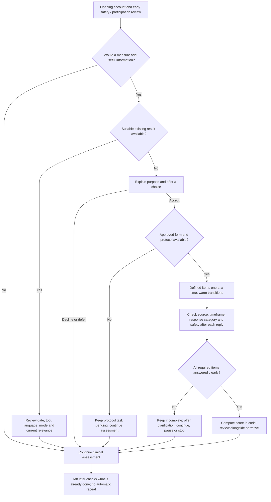

# 14 - Screening tools, optional measurement and scoring

Version 0.1.0 research knowledge | 2 November 2026 | Adults 18+, including older adults

This adds an optional measurement layer to [our interview graph](13_Full_Numbered_Assessment_Graph.md). It covers two separate questions: which tools add value, and which answers can validly receive a numerical score. It does not connect the live agents, bundle questionnaire item banks or establish clinical approval of this platform.

## 1. Our recommendation

Start with **PHQ-9 as an optional general adult baseline and monitoring measure**. Keep **PHQ-2 as an optional brief case-finding route** when the opening has not already established a clear reason for fuller depression assessment. Use other tools selectively for their own construct and population, rather than adding a battery to every conversation.

This is a practical project choice, not a head-to-head finding that PHQ-9 is best for everyone. NICE recommends considering validated measures alongside assessment; it also requires history, course, functioning and other relevant clinical information. No questionnaire is mandatory for every encounter in our design. [NICE_222]

| Tool | What it adds | Proposed use and current status |
|---|---|---|
| **PHQ-9** | Nine symptom-frequency items over two weeks; a standard symptom baseline. | Optional default for suspected depression and later monitoring. Arithmetic reference implemented; form/language/mode and clinical workflow still need review. |
| **PHQ-2** | Two-item brief case finding. | Useful if a brief initial screen would change what happens next. Skip the extra screening step when a fuller assessment is already warranted. Arithmetic reference implemented. |
| **WHO-5** | Five items about positive well-being over two weeks. | Optional alternative outcome construct if well-being is what we want to track. It is not a depression subtype test. Arithmetic reference implemented. |
| **EPDS** | Perinatal screening developed for postnatal depression; also used in perinatal pathways. | Candidate alternative to PHQ-9 in a reviewed pregnancy/postpartum pathway. Not automatically required in addition. Item-level protocol/scorer not implemented. |
| **GDS-15** | An older-adult depression screening option. | Consider individual suitability rather than switching solely because of age. Exact form, language, applicability and scoring key remain to be reviewed. Not implemented. |
| **MADRS / structured interview guide** | Clinician-rated depressive symptom severity. | A possible future professional-rating route with defined probes/anchors and rater competence. It is not unrestricted LLM scoring and is not implemented. |
| **DRSP / prospective daily records** | Day-by-day symptom and menstrual-pattern information. | Relevant to the PMDD branch; cannot be replaced by one PHQ total. Our existing PMDD diary contract remains separate. New DRSP administration/scorer not implemented. |
| **ASQ** | A separate suicide-screening protocol in an appropriate reviewed setting. | Candidate connected safety pathway, not a depression severity score. Needs a response plan and trained follow-up; not implemented by this module. |

Sources for the tool properties and limits are in section 9 and [the registry](Measurement/instrument_profiles.json). We have not shown that any of these choices makes this platform clinically effective.

## 2. When to offer a measure

The proposed default timing is **after the person's opening account and early safety/participation review, before a long symptom inventory**, if a baseline would be useful. Offering a measure at this point can provide explicit item responses that help identify remaining clinical gaps. If there is no useful reason or the person declines, continue the natural assessment.

M8 becomes a **checkpoint**, not a requirement to repeat a questionnaire at the end. It checks whether a relevant measure was already completed, deferred, declined or still useful. A suitable pre-visit measure can be reviewed with its date, form and context rather than automatically repeated. A crisis, acute medical concern or important unresolved safety need takes priority over questionnaires.

The exact early placement and deduplication policy are our design. They are not a source-mandated question order.



PHQ-2 is not a compulsory first step. The original study supports a score of 3 or more as a case-finding threshold; a positive screen supports fuller assessment. A negative brief screen does not close persisting clinical concerns or every other depressive presentation. [PHQ2_2003]

## 3. Making it natural without pressure

Suggested project wording:

> You've described some changes in how you've been feeling. I can offer nine short questions to record a consistent baseline. We can do them one at a time, and you can skip or pause. Would that be useful, or would you prefer to keep talking?

If the person accepts, explain that this portion uses a specific two-week window. Present the approved item and response options. Keep acknowledgments brief and neutral; do not praise a particular response or suggest what score they should select.

For someone who has already provided a lot of detail:

> You've already explained several of these experiences. For the questionnaire, I would need you to choose a response for its specific time window. We can leave that for later if it feels repetitive.

If they decline:

> That's fine. We can continue with what you want to discuss.

If they pause partway, retain only actual answers and show the measure as incomplete. Do not turn a missing answer into zero or say the person failed. Avoid rewarding completion, pressuring disclosure or making ordinary support conditional on a score.

NICE shared-decision principles support participation and manageable information. Our exact wording and interaction choices should be tested with users rather than assumed to improve comfort. [NICE_197]

**Naturalness belongs in the invitation, transitions and debrief.** For the initial implementation, preserve the approved item wording, meaning, timeframe and response options. An extensively rewritten conversational scale is a modified administration needing its own validation; do not call it equivalent merely because it sounds similar.

## 4. Do we score every conversational answer?

**No. We keep four layers separate.**

| Layer | What we record | Numerical score? |
|---|---|---|
| Clinical narrative | Concept, subject, period, quote, relevant attributes and reported-present/absent/unclear/conflicting status. | No invented severity points. Preserve numerical reports, such as sleep hours, as reports with units/context. |
| Question coverage | Answered, unclear, declined, deferred and related software states. | No symptom-severity score. A clearly denied symptom can still be an adequately answered question. |
| Standardized measure | Defined item, instrument version, time window, explicit response category and provenance. | Yes, when that instrument's protocol and complete-item rules are satisfied. |
| Diagnostic review | Symptom pattern, timing, burden, alternatives, uncertainty and provisional explanation. | No single total substitutes for clinical review. |

An ordinary statement such as "I sleep badly" does not identify a PHQ sleep-item frequency category. Even "six nights a week for six weeks" should remain a clinical report until the instrument item, its two-week window and the person's response category are explicitly confirmed. Do not secretly assign a category in the background.

Within a structured measure, an answer such as a clearly selected "Nearly every day" can receive its defined category code. The LLM can help clarify which option the person intends, but the application must store that confirmation and compute the arithmetic. Our current design does not enable estimated PHQ scores from unrestricted conversation.

If narrative and questionnaire answers conflict, preserve both. Clarify differences in timeframe or interpretation when useful; do not silently change the selected questionnaire answer to match the model's impression.

**Interview-based scoring does exist.** For example, MADRS is a clinician-rated severity scale, and SIGMA research evaluates a structured interview guide for obtaining the information needed to rate it. That is a defined interview-and-rating procedure, not a rule that any conversational answer can receive a severity number. We have registered it as a future candidate; its rating anchors, rater training, permissions and automated use have not been implemented or validated here. [MADRS_1979; SIGMA_2008]

## 5. Different questions and instruments have different rules

| Answer or tool | Correct treatment |
|---|---|
| Open description, history, goals or preferences | Source-linked text and concept-specific details, without a numerical symptom score. |
| Duration, sleep amount or weight report | Preserve the stated amount, unit, uncertainty and period; do not convert it to points unless an applicable validated tool explicitly requires it. |
| Yes/no clinical question | Record what was affirmed or denied in context; yes is not universally one point. |
| PHQ-2 / PHQ-9 | Defined frequency categories use codes 0-3; sum the required items. |
| WHO-5 | Its own frequency key uses codes 0-5; higher scores mean better well-being, unlike PHQ burden. |
| GDS-15 | Uses an instrument-specific yes/no key; do not assume every yes increases its score. |
| EPDS | Requires its own item-specific response key and seven-day window; do not apply PHQ coding. |
| Prospective menstrual diary | Keep repeated daily observations and cycle timing; an arbitrary single total cannot establish PMDD. |
| Safety questions | Use the dedicated reviewed protocol/clinical assessment; no custom sum of suicidal comments, depression points and supports. |

The canonical PHQ response labels/codes are stored once in [Measurement/knowledge.json](Measurement/knowledge.json). The other instruments keep their own keys. Full item banks are source-linked rather than copied into the agent prompts.

### PHQ-9 arithmetic

Add the nine item codes: the complete total is **0-27**. The separate functional-difficulty response is relevant but is **not added** as a tenth item. [CDC_DPQ; UW_PHQ_FORM]

| PHQ-9 total | Conventional symptom-score band |
|---|---|
| 0-4 | None/minimal |
| 5-9 | Mild |
| 10-14 | Moderate |
| 15-19 | Moderately severe |
| 20-27 | Severe |

These describe this questionnaire's reported symptom burden. They are not confirmed diagnoses or a complete clinical severity formulation. The original validation compared PHQ-9 with an independent professional interview. Its conventional screening threshold of 10 is not an automatic treatment rule. [PHQ9_2001]

Do not confuse this purpose with NICE's less-severe/more-severe treatment-group definitions, which use a different organizing threshold in context. We do not convert a PHQ band into a diagnosis, treatment authorization or safety classification. [NICE_222]

Example fictional item codes: `[2, 2, 2, 1, 1, 1, 1, 0, 0]` give **10**, in the questionnaire's moderate symptom band. They do not establish MDD or its cause. If any required item is missing, our reference returns `total: null` rather than filling it with zero or prorating. Complete-item scoring is supported by CDC documentation; our no-imputation policy is an explicit conservative implementation choice, not a claim that every research protocol uses it.

### PHQ-2 arithmetic

Sum two codes for **0-6**. A score at or above 3 is the original-study screening threshold. No PHQ-9 severity bands are applied to this two-item total. If moving to PHQ-9, retain explicit responses only when the same item wording, timeframe and appropriate administration context are established; obtain the remaining seven items rather than repeating automatically. [PHQ2_2003; project reuse rule]

### WHO-5 arithmetic

Sum five codes for **0-25**, then multiply by four for **0-100**. Higher means better reported well-being. WHO describes a raw score below 13 (percentage below 50) as a suggested indication for further assessment of possible mental-health difficulty. It does not establish depression. [WHO5_2024]

Do not add PHQ-9 and WHO-5 into one platform "mental-health score." Their constructs and score directions differ. EPDS/GDS-15/DRSP/ASQ scoring is not enabled by the arithmetic reference.

## 6. Safety is separate from the total

A nonzero PHQ-9 item-9 answer needs timely appropriate follow-up without waiting for the other eight items. The item combines experiences that require clarification; it does not itself establish active suicidal intent or acuity. A low total cannot cancel that follow-up. An unanswered item 9 remains an information limit needing a review decision, not an automatic positive/negative classification. [NIMH_ASQ; project safety rule]

An adult inpatient study found that depression screening/item 9 could miss people identified through dedicated suicide screening. Its setting-specific result supports keeping safety assessment separate; it does not provide a universal performance estimate for this project. [PHQ9_SAFETY_LIMIT]

ASQ is a free, separate toolkit with adult materials, a planned response workflow and trained follow-up after a positive screen. Adding its name does not implement that pathway. Do not invent low/medium/high predictions or use a score alone for discharge or treatment access. [NIMH_ASQ; NICE_225]

## 7. How instrument replies help the clinical conversation

Use item answers to avoid needless duplication while retaining concept-specific gaps. The mapping in [knowledge.json](Measurement/knowledge.json) is an information bridge, not a diagnostic algorithm.

Examples:

- A positive sleep item can prompt clarification of the actual sleep pattern if it remains unknown.
- An appetite item does not supply a measured weight change.
- A combined interest/pleasure item may require clarification of which aspect changed.
- A motor-change item does not establish direction or professional observation.
- A mood frequency response does not automatically establish daily extent, episode overlap or lifetime course.
- Item 9 requires separate clarification/review; the score does not label the person's intent.

Current scales do not replace the longstanding timeline for PDD, prospective menstrual information for PMDD, attribution review for medical/exposure categories, bipolar history or professional classification of residual presentations.

At follow-up, compare the same appropriate tool/protocol with dates and recall windows. A change in total is a measurement change, not proof of recovery. Review functioning, the person's account and other clinical evidence. NICE describes treatment review after 2-4 weeks and considering outcome monitoring; this is not a requirement to administer a scale every turn or at an identical interval for everyone. [NICE_222]

## 8. What conversational research actually shows

**Chatbot PHQ-9 study, 2021:** 3,895 participants completed the chatbot scale; the authors reported internal consistency and factor analysis. They explicitly noted no paper comparison and no criterion/construct validity assessment. It supports feasibility research, not an assumption that free conversation can be scored as a valid PHQ. [CHAT_PHQ_2021]

**HopeBot, 2026:** 132 adults completed self-administered and chatbot-assisted PHQ-9 versions. The study reported strong score agreement, but lacked clinician-led diagnostic reference and acknowledged fixed-order/recall and sample limitations. It supports studying an engaging structured interface; it does not validate our own wording, language, diagnosis or unrestricted narrative-to-score mapping. [HOPEBOT_2026]

For our evaluation, first check item coding, missingness, source grounding and safety interruptions on fictional fixtures. Then evaluate interface acceptability and item/total agreement under a properly designed study. Counterbalance administration order to reduce recall/order effects where appropriate. Diagnostic validity needs a suitable independent professional reference; score agreement alone does not establish it. This evaluation plan is project design.

## 9. Sources, locations and contributions

Full access limitations and contributions are in [Measurement/sources.json](Measurement/sources.json).

| Source | Location | Used for |
|---|---|---|
| [NICE NG222](https://www.nice.org.uk/guidance/ng222/chapter/Recommendations) | 1.2.4, 1.2.6-1.2.9, 1.4.3; severity definitions. | Assessment plus measures, clinical context and monitoring. |
| [NICE NG197](https://www.nice.org.uk/guidance/ng197/chapter/recommendations) | 1.2.7-1.2.11. | Participation and shared agenda; exact invitation is ours. |
| [PHQ-9 original validation](https://pmc.ncbi.nlm.nih.gov/articles/PMC1495268/) | J Gen Intern Med 16:606-613; Methods and Appendix. | Original validation and conventional score bands. |
| [PHQ-2 original validation](https://pubmed.ncbi.nlm.nih.gov/14583691/) | Abstract Methods/Results. | Brief screening role and threshold. |
| [CDC NHANES depression screener](https://wwwn.cdc.gov/Nchs/Data/Nhanes/Public/2021/DataFiles/DPQ_L.htm) | Component Description, administration, Analytic Notes/codebook. | Recall period, category coding, complete-item total and missingness distinctions. |
| [UW-hosted PHQ form](https://depts.washington.edu/dbpeds/Screening%20Tools/PHQ9.pdf) | PDF pp.1-2; p.3 arithmetic only. | Form/tally structure and separate function response. Older treatment shortcuts are not adopted. |
| [APA assessment-instrument resource](https://www.apa.org/depression-guideline/assessment) | PHQ-9 entry. | Free-use availability; altered administrations still need validation. |
| [WHO-5 official 2024 publication](https://www.who.int/publications/m/item/WHO-UCN-MSD-MHE-2024.01) | Printed pp.1-2 / PDF pp.6-7. | Well-being construct, coding direction, transformation and suggested review threshold. |
| [ACOG patient screening](https://www.acog.org/programs/perinatal-mental-health/patient-screening) | Perinatal recommendations/tool resources. | Context-specific tool choice; indexed page inspected, direct access blocked. |
| [EPDS original study](https://pubmed.ncbi.nlm.nih.gov/3651732/) and [institutional form](https://www.blackdoginstitute.org.au/wp-content/uploads/2020/04/edinburgh-postnatal-depression-scale.pdf) | Original abstract; form instructions. | Candidate perinatal scale with its own key/window. |
| [Stanford GDS author resource](https://www-leland.stanford.edu/~yesavage/GDS.html) | Purpose, short forms, references and translation disclaimer. | Candidate older-adult option and original-scale access. No informal prorating rule adopted. |
| [MADRS development](https://pubmed.ncbi.nlm.nih.gov/444788/) and [SIGMA interview-guide study](https://doi.org/10.1192/bjp.bp.106.032532) | Original abstracts; 1979 and 2008 journal articles. | Interview-based clinician scoring as a distinct future option, not generic LLM interpretation. |
| [ISPMD consensus](https://pmc.ncbi.nlm.nih.gov/articles/PMC4134928/) and [DRSP study](https://pubmed.ncbi.nlm.nih.gov/16172836/) | Measurement sections; existing PMDD source review. | Prospective cycle-pattern assessment. |
| [NIMH ASQ toolkit](https://www.nimh.nih.gov/research/research-conducted-at-nimh/asq-toolkit-materials) | Adult resources and response-plan requirement. | Separate safety workflow and trained follow-up. |
| [Adult inpatient safety-screening study](https://pmc.ncbi.nlm.nih.gov/articles/PMC8258235/) | Results/conclusions. | Limits of depression screening as a safety proxy. |
| [NICE NG225](https://www.nice.org.uk/guidance/ng225/chapter/recommendations) | 1.6.1-1.6.6. | No predictive global risk classification or score-only discharge. |
| [Chatbot PHQ-9 study, 2021](https://www.frontiersin.org/journals/digital-health/articles/10.3389/fdgth.2021.645805/full) | Methods, Results, Limitations. | Preliminary conversational-administration evidence and limits. |
| [HopeBot, 2026](https://journals.plos.org/digitalhealth/article?id=10.1371/journal.pdig.0001446) | Methods, score results and limitations. | Structured conversational feasibility; comparator limitations. |

PHQ-9/PHQ-2 and WHO-5 source forms are linked, not bundled. EPDS/GDS/DRSP language/version/permissions and clinical applicability need checking for the precise form adopted. A translation being downloadable does not prove validity in Egyptian Arabic or for our mode. The WHO publication's stated license is CC-BY-NC-SA 3.0 IGO; original GDS is described as public domain by its author. Do not generalize one tool's conditions to every instrument.

## 10. Files and current readiness

- [Measurement/knowledge.json](Measurement/knowledge.json): role instructions, selection/scoring rules, item-to-concept limits and data-field meanings.
- [instrument_profiles.json](Measurement/instrument_profiles.json): eight tool profiles and implementation status.
- [route_extension.json](Measurement/route_extension.json): proposed optional early offer and later M8 deduplication checkpoint.
- [sources.json](Measurement/sources.json): source provenance.
- [score_answers.py](Measurement/score_answers.py): deterministic PHQ-2/PHQ-9/WHO-5 arithmetic reference for explicitly recorded item categories.
- [score_examples.json](Measurement/score_examples.json): fictional input/output examples, including an incomplete result with item-9 follow-up and rejection of an unstructured estimate.
- [test_measurement.py](Measurement/test_measurement.py): tests of coding, missingness, provenance gates and item-9 review handling.

The scorer requires explicit declared form, language, mode, timeframe, agreement and response provenance. These flags are application declarations; they do not authenticate clinical approval or prove the form was administered correctly. It does not process unrestricted patient text. There is no live questionnaire interface, model-based item extraction, full item bank or operational safety/referral implementation here.

Run the fictional arithmetic demo only if useful:

```powershell
python "C:\Users\DELL\OneDrive\Desktop\Assessment_Diagnosis_Knowledge\Measurement\score_answers.py"
```

Formal instrument answers belong in a separate `standardized_measurements` artifact; they can link to clinical evidence without replacing it. Therapy beliefs, homework and activity scores remain in therapy state rather than being added to a diagnostic total.

Clinical/protocol/language review and connection to the agents remain pending. The existing offline interview preview does not execute this new measurement extension. Arithmetic tests do not establish measurement validity, diagnostic performance or improved patient outcomes.
